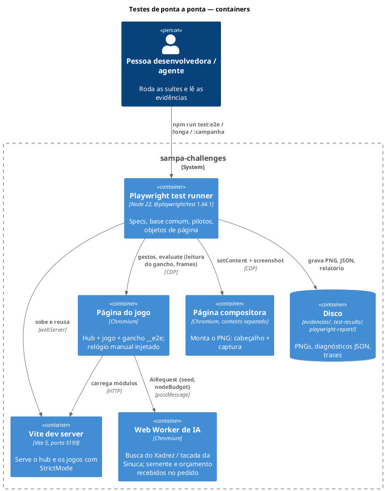
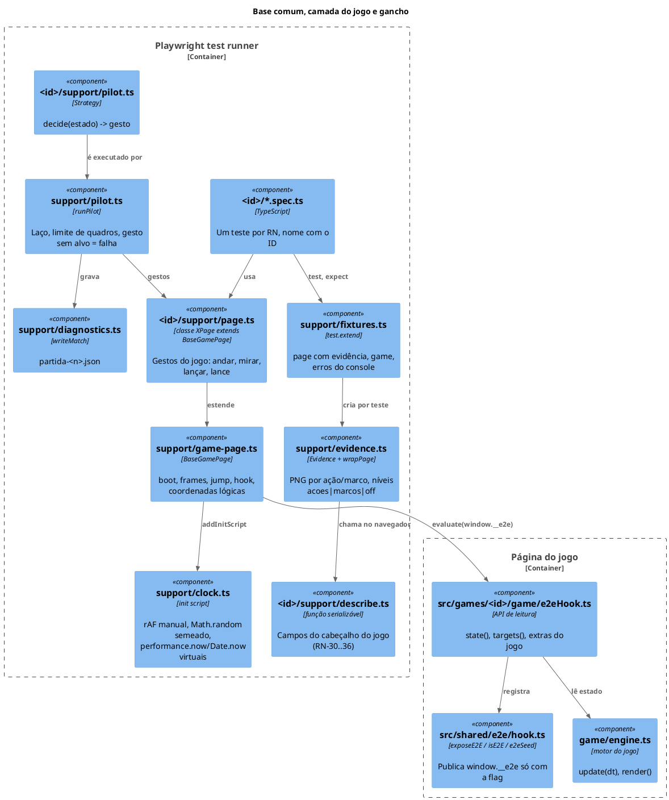
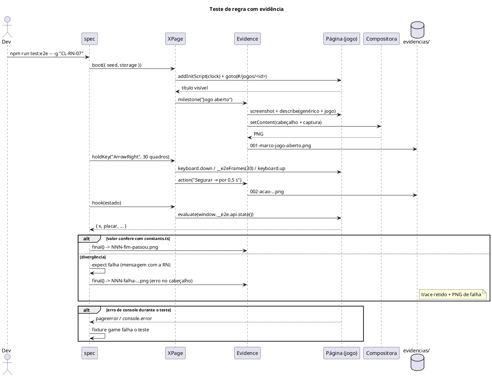
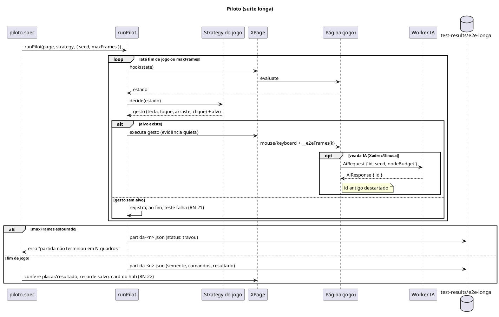

# Planejamento Técnico: Testes de ponta a ponta e manuais completos dos jogos

> Fase 2 do SDD — O Como. Status: **aprovado (revisão 1)**.
> Pré-requisito: `spec.md` (revisão 1) aprovada.

## 1. Visão Geral da Arquitetura

- **Decisão principal:** a infraestrutura de testes do Pastel de Feira (`e2e/pastel-de-feira/support/`)
  é dividida em duas camadas. A **base comum** (`e2e/support/`) fica com o relógio, a semente, as
  evidências, as fixtures, o piloto genérico e o diagnóstico. A **camada do jogo**
  (`e2e/<id>/support/`) fica com o objeto de página do jogo, o descritor do cabeçalho e o piloto. No
  código de produção cada jogo ganha um `game/e2eHook.ts` montado sobre um contrato compartilhado
  (`src/shared/e2e/hook.ts`), ligado só pela flag da página de teste.
- **Abordagem:** testes no navegador (Playwright 1.64.1, já instalado) com o Vite em modo dev
  (StrictMode ligado), relógio manual de `requestAnimationFrame` e tempo virtual nos jogos que
  usam tempo real. Os pilotos rodam do lado do Node: leem o estado pelo gancho e executam gestos reais.
- **Repositório afetado:** `sampa-challenges` (este). Sem serviço novo, sem dependência nova.

### 1.1 Estrutura de pastas

```
e2e/
  playwright.config.ts          # projetos: desktop, celular, longa, campanha
  README.md                     # reescrito para todos os jogos (RN-62)
  support/                      # BASE COMUM (extraída do Pastel)
    clock.ts                    # init script: rAF manual, semente, tempo virtual, storage, som off
    evidence.ts                 # Evidence + wrapPage (genérico; descritor por jogo)
    describe.ts                 # parte genérica do cabeçalho (rota, tela, diálogo, mensagem)
    fixtures.ts                 # test.extend: page com evidência, composer, coleta de erros
    game-page.ts                # BaseGamePage: boot, frames, jump, hook, toClient, tap/hold/drag/key
    pilot.ts                    # laço decide→gesto, limite de quadros, gestos sem alvo
    diagnostics.ts              # grava partida-<n>.json (semente, comandos, resultado)
    storage.ts                  # helpers de recorde/config, storage bloqueado/corrompido
    hub.ts                      # HubPage: home, cards, barra de volta
  _modelo/                      # esqueleto copiado pelo novo-jogo (RN-07)
  hub/                          # RN-50..55
  pastel-de-feira/              # migrado para a base comum (RN-17)
    support/describe.ts         # campos do dia (sai de evidence.ts)
  <id>/                         # um por jogo: cachorro-loko, capacete-voador, corredor-sp,
    support/page.ts             #   fuga-rocam, pinball-paulista, sinuca-de-bar, xadrez-paulistano
    support/describe.ts
    support/pilot.ts
    <tema>.spec.ts              # suíte rápida
    responsivo.spec.ts          # projeto celular
    piloto.spec.ts              # projeto longa
src/shared/e2e/hook.ts          # contrato do gancho (produção, inerte sem a flag)
src/games/<id>/game/e2eHook.ts  # gancho de cada jogo
scripts/e2e-cobertura.mjs       # confere RN do manual × testes (RN-08)
docs/specs/e2e-jogos/bugs.md    # registro dos bugs achados e corrigidos (RN-61)
```

## 2. Diagramas de Solução

### 2.1 C4 Nível 2 — Containers



### 2.2 C4 Nível 3 — Componentes do runner e do gancho



### 2.3 Sequência — um teste de regra (sucesso e falha)



### 2.4 Sequência — partida do piloto



## 3. Modelagem de Dados e Persistência

Sem banco. Os dados são o contrato do gancho, o arquivo de diagnóstico e as chaves de `localStorage`
que os testes preparam.

### 3.1 Contrato do gancho (`src/shared/e2e/hook.ts`)

| Elemento | Tipo | Descrição |
|---|---|---|
| `window.__E2E__` | `boolean` | Flag ligada pelo `clock.ts` antes do carregamento. `window.__PF_E2E__` continua ligada (Pastel) |
| `isE2E()` | `() => boolean` | `true` se alguma das flags existir |
| `exposeE2E(id, api)` | `(id: string, api: T) => () => void` | Publica `window.__e2e = { id, api }` e `window.__e2eLast`; devolve o `dispose` do cleanup do efeito. Sem a flag: não faz nada |
| `e2eSeed()` | `() => number \| undefined` | Semente para o pedido ao worker: `Math.floor(Math.random() * 2**32)` (já semeado) sob a flag; `undefined` fora dela |
| `window.__e2e.api` | objeto do jogo | Só leitura nos testes. Escrita só via `prepare.*` (pré-condição rara, RN-15) |

O Pastel mantém o `window.__pf` atual (sem mudança de código de produção, RN-17); a base comum
recebe o nome do gancho como parâmetro (`hookName: '__pf' | '__e2e'`).

### 3.2 API de cada gancho (`game/e2eHook.ts`)

Lê campos do motor por métodos `e2eState()`/`e2eTargets()` acrescentados ao motor (os campos hoje
são `private`). A Fuga da Rocam reaproveita `snapshot()` e `cheat`.

| Jogo | `state()` (resumo) | `targets()` (coordenadas lógicas) | `prepare` (pré-condições) |
|---|---|---|---|
| Cachorro Loko | placar, vidas, nível, entregas, poderes e tempo, cachorro (x, virado, tonto), pacotes (tipo, x, y, esteira, caindo), desvios (3), pausa, fim | zonas de toque esquerda/direita | `spawn(tipo)`, `lives(n)` |
| Capacete Voador | modo, rodada, placar, vez, vento, hp das motos, capacete (x, y, voando), cidade (prédios), fase | campos/botão do formulário (DOM), motos e cabeças | `wind(v)`, `city(seed)` |
| Corredor SP | pista, pontos, metros, multiplicador, vidas, nível, km/h, x/faixa/corredor, grau, capacetes, caído/invulnerável, trânsito à frente, itens, perigos | botões de toque | `spawn(tipo, faixa, dist)`, `level(n)` |
| Fuga da Rocam | `snapshot()` + mapa, tiles, pedido (tipo, pino, prazo) | direcional e botões de toque, centro de cada tile | `cheat.heat`, `cheat.player` |
| Pinball Paulista | bola(s) (x, y, vx, vy), bola atual, placar, mult., MOTOBOY, semáforos, onda verde, raias, segura-bola, nudge/tilt, Minhocão, fim | metades da mesa, Lançar, Sacudir | `ball(x,y,vx,vy)`, `lights(...)` |
| Sinuca de Bar | modalidade, vez, grupos, bolas (n, x, y, na mesa), branca, mira, força, bola na mão, última tacada (1º toque, encaçapadas, falta), resultado, IA pensando | bolas e caçapas, ◀ ▶ ‹ ›, barra Força, Tacar | `balls([...])`, `turn(p)` |
| Xadrez Paulistano | FEN, lances (SAN pt-BR), vez, xeque, resultado, selecionada, cursor, girado, IA pensando, promoção aberta | centro de cada casa (respeita o giro), botões | `fen(f)` |

### 3.3 Mudanças de produção para determinismo (RN-11)

| Jogo | Fonte não determinística | Mudança |
|---|---|---|
| Todos | `Math.random` | Já semeado pelo `clock.ts` (mulberry32), como no Pastel |
| Fuga da Rocam | `seed = Date.now() ^ Math.random()` | Coberto pelo `Date.now` virtual (abaixo) |
| Xadrez Paulistano | busca com prazo em `performance.now()` (`ai.ts`), `Math.random` no worker, atraso mínimo da IA (`AI_MIN_DELAY_MS`) | `AiRequest` ganha `seed?` e `nodeBudget?` opcionais (preenchidos só sob `isE2E()`); o worker usa `mulberry32(seed)` como `random` e, com `nodeBudget`, para por nós em vez de tempo (`nodeBudget = prof.timeMs × E2E_NODES_PER_MS`, constante calibrada uma vez e registrada no CLAUDE.md do jogo). O atraso mínimo usa `performance.now` virtual |
| Sinuca de Bar | `chooseShot(..., Math.random)` no worker | `AiRequest.seed?`; worker usa `mulberry32(seed)` |
| Capacete, Corredor, Pinball, Cachorro | só `Math.random` na página | nenhuma |
| Telas com `setTimeout` (overlay de fim, confirmação de 3 s) | relógio real | Mantido real; os testes esperam com `expect` (≤ 3 s). Virtualizar `setTimeout` quebraria o cliente do Vite/HMR |

**Tempo virtual (`clock.ts`, opção `virtualTime`, padrão `true` nos 7 jogos, `false` no Pastel):**
`performance.now()` e `Date.now()` passam a devolver `base + tempo do relógio manual`; cada quadro de
`__e2eFrames` avança 1000/60 ms. O laço dos jogos calcula `dt = now − last` com o mesmo relógio, então
o primeiro quadro tem `dt` exato. O Pastel continua com o comportamento atual para não mudar resultado.

### 3.4 Arquivo de diagnóstico da partida (`partida-<n>.json`)

```json
{
  "$schema": "https://json-schema.org/draft/2020-12/schema",
  "type": "object",
  "required": ["jogo", "variante", "semente", "status", "quadros", "comandos", "resultado"],
  "properties": {
    "jogo": { "type": "string", "pattern": "^[a-z0-9-]+$" },
    "variante": { "type": "string", "description": "pista, mapa, modo, nível, modalidade" },
    "semente": { "type": "integer", "minimum": 0 },
    "status": { "enum": ["fim", "travou", "erro"] },
    "quadros": { "type": "integer", "minimum": 0 },
    "comandos": {
      "type": "array",
      "items": {
        "type": "object",
        "required": ["q", "g"],
        "properties": {
          "q": { "type": "integer", "description": "quadro" },
          "g": { "type": "string", "description": "gesto: key:ArrowLeft:down, tap:x,y, drag:x,y>x,y, click:<rótulo>" },
          "alvo": { "type": ["string", "null"], "description": "null = gesto sem alvo (RN-21)" }
        }
      }
    },
    "resultado": { "type": "object", "description": "placar/resultado lido do jogo e o recalculado pelo teste" },
    "erros": { "type": "array", "items": { "type": "string" } }
  }
}
```

### 3.5 Chaves de `localStorage` usadas pelos testes

| Jogo | Chaves | Preparo padrão |
|---|---|---|
| Cachorro Loko | `cachorro-loko:recorde` | limpo |
| Capacete Voador | `capacete-voador:som` (+ config do menu, a confirmar no manual) | som `off` |
| Corredor SP | `corredor-sp:som`, escolha (`CHOICE_KEY`), recorde por pista | som `off` |
| Fuga da Rocam | `fuga-rocam:som`, `fuga-rocam:recorde:<mapa>` | som `off` |
| Pinball Paulista | `pinball-paulista:som`, recorde | som `off` |
| Sinuca de Bar | `sinuca-de-bar:som`, config | som `off` |
| Xadrez Paulistano | `xadrez-paulistano:som`, `xadrez-paulistano:config` | som `off` |

O `clock.ts` recebe a lista de chaves de som por jogo (RN-19) e repete o esquema atual: limpa uma vez
por teste (`sessionStorage` marca o boot), recarga preserva o que o jogo gravou.

### 3.6 Migrações

- **Pastel de Feira:** `support/evidence.ts` e a parte genérica de `support/game.ts` vão para
  `e2e/support/`; `describeScreen` do dia vira `e2e/pastel-de-feira/support/describe.ts`;
  `GamePage` do Pastel passa a estender `BaseGamePage` com `hookName: '__pf'`, `virtualTime: false`,
  logical `640×480`. Os 30 specs mudam só imports. Variável `PF_EVIDENCIAS` continua; nova
  `E2E_EVIDENCIAS` tem prioridade. Aliases `__pfFrames`/`__pfJump` continuam publicados.
- **`e2e/tsconfig.json`:** `include` passa a `["." , "../src/games/*/game", "../src/shared"]`.
- **`scripts/novo-jogo.mjs`:** também copia `e2e/_modelo/` para `e2e/<id>/` com os mesmos
  substitutos (`__ID__`, `__TITULO__`).
- **`package.json`:** scripts novos `test:e2e:longa`, `test:e2e:cobertura`; `test:e2e:tudo` inclui a longa.

## 4. Contratos de Integração (Interfaces)

Não há API REST nem fila. Os contratos são internos ao repositório.

### 4.1 Projetos do Playwright

| Projeto | `testMatch` / `testIgnore` | Viewport | Evidências | Trace | Script |
|---|---|---|---|---|---|
| `desktop` | todos os `*.spec.ts` menos `responsivo`, `piloto`, `campanha-completa` | 1280×1000 | `acoes` | retain-on-failure | `test:e2e` |
| `celular` | `**/responsivo.spec.ts` (8 jogos + hub) | 390×844, touch, mobile | `acoes` | retain-on-failure | `test:e2e` |
| `longa` | `**/piloto.spec.ts` | 1280×1000 | `marcos` | off | `test:e2e:longa` |
| `campanha` | `pastel-de-feira/campanha-completa.spec.ts` | 1280×1000 | `marcos` | off | `test:e2e:campanha` |

`outputDir` próprio por projeto longo (`test-results/e2e-longa`, `e2e-campanha`), como hoje.

### 4.2 `BaseGamePage` (base comum)

| Membro | Contrato |
|---|---|
| `constructor(page, ev, cfg)` | `cfg = { id, route, root: '.<id>', logical: { w, h }, hookName, virtualTime, soundKeys }` |
| `boot(opts)` | `{ seed?, storage?, rawStorage?, blockStorage? }`; injeta o `clock.ts`, abre `#/jogos/<id>`, marco "Jogo aberto" |
| `frames(n)`, `jump(ms)` | Avança `n` quadros de 1/60 s / salta o relógio sem quadros |
| `hook(fn, arg)`, `lastHook(fn, arg)` | `evaluate` com o gancho; erro claro se ausente |
| `advanceUntil(cond, maxSeconds)` | Avança até a condição; erro com a condição se estourar |
| `toClient(x, y)` | Lógico → página (usa `cfg.logical`) |
| `tapAt`, `holdAt`, `dragFromTo`, `holdKey(key, frames)`, `pressKey` | Gestos com evidência única descrita (`ev.quiet` nos internos) |
| `evidence(desc)`, `step(label, fn)` | Iguais aos do Pastel |
| `errors` | Coletados pela fixture; teste falha se houver |

### 4.3 Estratégia de piloto (`support/pilot.ts`)

| Elemento | Contrato |
|---|---|
| `Strategy<S>` | `{ name; read(page): Promise<S>; decide(s: S): Gesture \| null; over(s: S): boolean; result(s: S): object }` |
| `Gesture` | `{ kind: 'key' \| 'tap' \| 'hold' \| 'drag' \| 'click' \| 'wait'; ...; frames: number; target: string \| null }` |
| `runPilot(page, strategy, { seed, maxFrames, variant })` | Executa até `over` ou `maxFrames`; grava diagnóstico; devolve `{ status, frames, result, missed }` |

Estratégia por jogo:

| Jogo | Como decide | Gestos |
|---|---|---|
| Cachorro Loko | pacote não-bomba com menor tempo até o chão (`GRAVITY`, esteiras); evita bomba sob o baú | segurar ←/→ por k quadros |
| Capacete Voador | busca em grade de ângulo/velocidade usando a simulação do jogo exposta pelo gancho (`simulateShot`) | preencher campos, Enter |
| Corredor SP | faixa/corredor com maior distância livre; capacete se o bloqueio é pequeno; grau na faixa azul livre | ↑ segurado, ←/→, X, Espaço |
| Fuga da Rocam | BFS do `nav` até o pino do pedido, penalizando tiles perto de viaturas; garagem com 4+ estrelas | setas na esquina, Espaço, X |
| Pinball Paulista | bola na zona de um flipper descendo → aperta; lançador segurado 0,9 s | Z, /, Espaço segurado |
| Sinuca de Bar | `chooseShot` do jogo em nível Tubarão sobre o estado lido | clique no ponto de mira, barra Força, Tacar, arrastar a branca |
| Xadrez Paulistano | `Searcher` do jogo com semente e orçamento fixo, do lado do Node | clique na peça e na casa; escolha da promoção |

Limites (`maxFrames`) por partida: 60 fps × duração máxima esperada × 3 (ex.: Cachorro 107 s médios
→ 20 min de jogo como teto). Ficam em `e2e/<id>/support/pilot.ts`.

### 4.4 Cobertura RN → teste (`scripts/e2e-cobertura.mjs`)

- Lê `src/games/<id>/README.md`, extrai os IDs `<SIGLA>-RN-\d+`.
- Lê títulos de `test(...)` em `e2e/<id>/**/*.spec.ts` e `e2e/hub/`.
- Falha listando RN sem teste e teste citando RN inexistente. Saída usada para gerar a tabela da seção
  "Testes" de cada manual.

### 4.5 Estrutura do manual (RN-01) e do CLAUDE.md (RN-06)

| README (manual) | CLAUDE.md |
|---|---|
| Sumário · 1. Início rápido · 2. Controles (teclado, mouse, toque) · 3. Telas e fluxo de uma partida · 4..N. Regras e mecânicas por tema, títulos com `<SIGLA>-RN-NN` · Pontuação e recorde · Opções do menu · Parâmetros (todas as constantes e o topo do motor) · Arquitetura · Como contribuir · Testes (como rodar, cobertura por arquivo, RN → teste) | Mapa dos arquivos · Resolução · Sprites · Como o jogo funciona · Receitas · Armadilhas conhecidas · Como verificar · Testes de ponta a ponta (gancho e o que expõe, `prepare`, piloto, determinismo, como rodar só o jogo) |

## 5. Resiliência, Segurança e Tratamento de Erros

### 5.1 Matriz de falhas

| Componente | Falha | Estratégia | Impacto |
|---|---|---|---|
| Worker de IA | não carrega / `onerror` | Caminho de reserva já existente (thread principal); teste `ia-reserva` força a falha trocando `Worker` por um que dispara erro (init script) | Partida continua |
| Worker de IA | resposta atrasada após Desfazer/Nova partida | `id` antigo descartado (existente); teste dispara Desfazer durante "pensando" | Nenhum |
| Busca do Xadrez | duração varia com a máquina | `nodeBudget` sob a flag | Determinismo |
| Relógio | 1º quadro com `dt` negativo/gigante | `jump(ms)` e teste dedicado por jogo (RN-47) | Nenhum esperado |
| Chrome ocioso (macOS) | aba suspensa, partida lenta | `caffeinate -dimsu` documentado; tempo do jogo em quadros | Só tempo de parede |
| Evidência | screenshot/composição falha | `try/catch` com aviso (existente, RN-14) | Nenhum |
| Piloto | partida não termina | `maxFrames` → status `travou`, diagnóstico e falha | Teste falha com dados |
| Piloto | gesto sem alvo | registrado em `missed`; falha ao fim | Teste falha |
| Vite | porta 5199 ocupada | `reuseExistingServer` fora de CI (existente) | Nenhum |
| Página | `pageerror` / `console.error` | Fixture falha o teste | Teste falha |
| Storage | bloqueado / corrompido | `blockStorage` e `rawStorage` no `boot` | Testes de borda |

### 5.2 Segurança

- O gancho é inerte sem a flag: `exposeE2E` retorna cedo; nenhuma leitura de URL ou de parâmetro do
  usuário liga a flag (só o init script do teste).
- `prepare.*` só é chamado pelo teste; o jogador não tem como alcançá-lo sem console.
- Nenhum dado pessoal; as evidências ficam fora do git (`evidencias/` já está no `.gitignore`).

### 5.3 Observabilidade (do próprio processo de teste)

| Tipo | Nome/Pattern | Quando | Finalidade |
|---|---|---|---|
| Evidência | `evidencias/<projeto>/<id>/<arquivo>/<teste>/NNN-<tipo>-<desc>.png` | cada ação/marco/fim | Prova visual |
| Diagnóstico | `test-results/e2e-longa/**/partida-<n>.json` | fim de cada partida do piloto | Reproduzir partida |
| Trace | `test-results/e2e/**/trace.zip` | teste que falhou (suíte rápida) | Depurar |
| Relatório | `playwright-report/` | toda execução | Visão geral |
| Log | `[evidência N] …` (console.warn) | evidência falhou | Aviso |
| Log | `[piloto] …` com `E2E_PILOT_DEBUG=1` | ritmo de gestos e gestos lentos | Depurar piloto |
| Cobertura | saída de `test:e2e:cobertura` | sob demanda | RN-08 |

## 6. Justificativa e Trade-offs

| Decisão | Alternativa descartada | Justificativa |
|---|---|---|
| Extrair base comum e migrar o Pastel | Base nova com Pastel intacto | Decisão do utilizador; evita duas versões de evidência divergindo. Custo: risco na suíte do Pastel, mitigado por RN-17 (mesmo número de testes + campanha completa verde) |
| Gancho no código de produção atrás de flag | Caixa-preta (só pixels/DOM) | Decisão do utilizador; os jogos são canvas puro e as regras dependem de estado interno |
| Métodos `e2eState()` no motor | Tornar campos públicos | Mantém o encapsulamento; o gancho lê um retrato, não o objeto vivo |
| Descritor do cabeçalho do lado do teste (função serializada) | Formatar no gancho | Texto de teste fora do bundle de produção |
| Tempo virtual (`performance.now`/`Date.now`) só nos 7 jogos | Ligar também no Pastel | Não mudar resultado do Pastel (RN-17) |
| `setTimeout` real | Virtualizar timers | Vite/HMR e React usam timers; os atrasos dos jogos são de UI (≤ 3 s) |
| `nodeBudget` na busca do Xadrez sob a flag | Rodar busca com prazo nos testes | Prazo depende da máquina e da carga; testes paralelos dariam lances diferentes |
| Piloto do lado do Node | Piloto no navegador (como `pilot.browser.ts`) | Arcade decide a cada poucos quadros com pouco estado; um `evaluate` por decisão cabe no orçamento de 30 min. Se um jogo estourar, a estratégia dele migra para o navegador |
| Script de cobertura RN × teste | Tabela manual | Torna RN-08 verificável e mantém o manual em dia |
| Um PR | 1 PR por jogo | Decisão do utilizador. Custo: revisão grande; mitigado pela ordem de commits (base → Pastel → hub → um jogo por vez) |

### 6.1 Ordem de implementação (insumo do `tasks.md`)

1. Base comum + migração do Pastel (suíte do Pastel verde, campanha verde, mesma contagem).
2. Contrato do gancho, `_modelo`, `novo-jogo`, script de cobertura.
3. Hub.
4. Por jogo, na ordem de complexidade crescente: Cachorro Loko → Pinball Paulista → Capacete Voador →
   Corredor SP → Fuga da Rocam → Sinuca de Bar → Xadrez Paulistano. Para cada um: manual + CLAUDE.md →
   gancho → page/describe → specs das RN → responsivo → piloto → bugs.
5. `e2e/README.md`, medição de tempo (≤ 10 / ≤ 30 min), 3 execuções verdes, bugs.md → descrição do PR.
