# Backlog de Execução: Testes de ponta a ponta e manuais completos dos jogos

> Fase 3 do SDD. Status: **aprovado (revisão 1)**.
> Pré-requisitos: `spec.md` (revisão 1) e `plan.md` (revisão 1) aprovados.
> Entrega única: um PR (spec RN-60). A ordem das US é a ordem dos commits.

## Épico de Referência

**Épico:** `[INSERIR_EPICO]` — sem épico de PM cadastrado (repositório pessoal). Preencher se o backlog for
sincronizado com o ClickUp.

---

## 0. Convenções comuns a todas as TF

Valem para todas as Tarefas; cada TF lista só o que é dela.

| Item | Regra |
|---|---|
| **Sistema** | `sampa-challenges` |
| **Validação mínima** | `npm run typecheck && npm run typecheck:e2e` + o comando da seção 4.3 da TF |
| **Comandos só pela tela** | Specs agem por toque, clique, arraste e teclado; o gancho só lê estado e alvos. Escrita direta só via `prepare.*`, comentada no teste (spec RN-15) |
| **Nome de teste** | Começa pelo ID da regra: `test('CL-RN-07 desvio troca a cada pacote', …)` (spec RN-18) |
| **Números esperados** | Importados de `src/games/<id>/game/constants.ts` / dados do jogo, nunca copiados à mão (spec RN-18) |
| **Bug encontrado** | Seguir `systematic-debugging`; registrar em `docs/specs/e2e-jogos/bugs.md` (jogo, sintoma, causa, RN, arquivo da correção); corrigir no jogo; se a regra mudar, atualizar o README na mesma TF (spec RN-61) |
| **Divergência manual × código** | Bug → corrige o código; manual desatualizado → corrige o manual; caso não óbvio → perguntar ao utilizador (spec RN-04) |
| **Código de produção** | TS strict, sem `any`; CSS só com prefixo `.<id>`; listeners removidos no cleanup; gancho inerte sem a flag |
| **Git** | `git add` só dos arquivos tocados pela TF, listados explicitamente; commits sem trailer de coautoria do agente |
| **Skills** | `test-driven-agentic-development` (toda TF que toca código), `verification-before-completion` (antes de fechar a TF), `systematic-debugging` (falha ou bug), `regra-plantuml-diagrams` (diagramas) |
| **Escalar** | 3 tentativas seguidas falhando no mesmo critério → parar e reportar ao utilizador |

Tamanho lógico por jogo (usado por `BaseGamePage.toClient`):

| Jogo | Sigla | Lógico | Canvas | Telas (componentes) |
|---|---|---|---|---|
| Cachorro Loko | CL | 320×200 | 640×400 | `TitleScreen`, `GameScreen` |
| Capacete Voador | CV | 640×400 | 1280×800 | `Menu`, `GameScreen`, `AimForm` |
| Corredor SP | CS | 640×400 | 640×400 (HUD 320×200 ×2) | `SetupScreen`, `RaceScreen` |
| Fuga da Rocam | FR | 640×400 | 1280×800 | `TitleScreen`, `GameScreen` |
| Pinball Paulista | PP | 240×400 | 480×800 | `TitleScreen`, `GameScreen` |
| Sinuca de Bar | SB | 320×200 | 640×400 | `Menu`, `GameScreen` |
| Xadrez Paulistano | XP | 320×200 | 640×400 | `Menu`, `GameScreen` |

---

## Rastreabilidade

| Regra (spec.md) | Decisão (plan.md) | User Story | Tarefas |
|---|---|---|---|
| RN-10, RN-11 (página), RN-19 | `clock.ts` com tempo virtual opcional (3.3) | US-124 | TF-124-01 |
| RN-12, RN-13, RN-14 | `evidence.ts` + descritor por jogo (2.2) | US-124 | TF-124-02 |
| RN-15, RN-18 | `BaseGamePage` (4.2) | US-124 | TF-124-03 |
| RN-20, RN-21, RN-23 | `runPilot` + `partida-<n>.json` (3.4, 4.3) | US-124 | TF-124-04 |
| — (projetos, scripts) | Projetos `desktop`/`celular`/`longa`/`campanha` (4.1) | US-124 | TF-124-05 |
| RN-17 | Migração do Pastel (3.6) | US-124 | TF-124-06 |
| RN-16 | `src/shared/e2e/hook.ts` (3.1) | US-125 | TF-125-01 |
| RN-07 | `_modelo` + `novo-jogo` (3.6) | US-125 | TF-125-02 |
| RN-08 | `scripts/e2e-cobertura.mjs` (4.4) | US-125 | TF-125-03 |
| RN-50..55 | `HubPage` + `e2e/hub/` | US-126 | TF-126-01..03 |
| RN-01..03, RN-30, RN-40, RN-47, RN-24 (CL) | Gancho, page, piloto do Cachorro Loko | US-127 | TF-127-01..07 |
| RN-01..03, RN-34, RN-44, RN-47, RN-24 (PP) | idem Pinball Paulista | US-128 | TF-128-01..07 |
| RN-01..03, RN-31, RN-41, RN-47, RN-24 (CV) | idem Capacete Voador | US-129 | TF-129-01..07 |
| RN-01..03, RN-32, RN-42, RN-47, RN-24 (CS) | idem Corredor SP | US-130 | TF-130-01..07 |
| RN-01..03, RN-05, RN-33, RN-43, RN-47, RN-24 (FR) | idem Fuga da Rocam | US-131 | TF-131-01..07 |
| RN-01..03, RN-11 (worker), RN-35, RN-45, RN-47, RN-24 (SB) | idem Sinuca + semente no worker (3.3) | US-132 | TF-132-01..08 |
| RN-01..03, RN-11 (worker), RN-36, RN-46, RN-47, RN-24 (XP) | idem Xadrez + semente e `nodeBudget` (3.3) | US-133 | TF-133-01..08 |
| RN-06, RN-08 | CLAUDE.md + seção Testes de cada manual | US-127..133 | TF-1xx-07/08 |
| RN-62, critérios da seção 5, RN-61 | README do e2e, medição, estabilidade, bugs.md | US-134 | TF-134-01..03 |

---

## Visão Geral das User Stories

| # | User Story | Entrega de Valor | SP |
|---|---|---|---|
| US-124 | Base comum de testes e Pastel migrado | Qualquer jogo pode ter testes com relógio, semente e evidências iguais aos do Pastel | 8 |
| US-125 | Contrato do gancho, modelo de jogo e cobertura RN × teste | Jogos novos nascem testáveis; regra sem teste fica visível | 3 |
| US-126 | Testes do hub | Navegação, isolamento e troca de jogo protegidos | 3 |
| US-127 | Cachorro Loko: manual e e2e | Manual completo, todas as regras testadas, piloto | 5 |
| US-128 | Pinball Paulista: manual e e2e | idem | 8 |
| US-129 | Capacete Voador: manual e e2e | idem | 5 |
| US-130 | Corredor SP: manual e e2e | idem | 8 |
| US-131 | Fuga da Rocam: manual reescrito e e2e | idem, com README reescrito do zero | 8 |
| US-132 | Sinuca de Bar: manual e e2e | idem, com IA determinística nos testes | 8 |
| US-133 | Xadrez Paulistano: manual e e2e | idem, com busca por nós nos testes | 8 |
| US-134 | Fechamento: documentação, tempo e estabilidade | Suítes dentro do orçamento, estáveis e documentadas; PR pronto | 3 |

---

## US-124: Base comum de testes e Pastel migrado

**Épico:** `[INSERIR_EPICO]`
**Sistema:** sampa-challenges
**Estimativa:** 8 Story Points
**Prioridade:** P0

### Narrativa de Valor

> **Eu como** pessoa desenvolvedora do hub,
> **Eu quero** relógio controlado, sorteio previsível, evidências e piloto genéricos,
> **Para que** os 7 jogos ganhem testes no mesmo padrão do Pastel sem copiar código.

### Contexto de Negócio

A infraestrutura atual vive em `e2e/pastel-de-feira/support/` e é acoplada ao Pastel (seletor
`.pastel-de-feira`, `window.__pf`, campos do dia no cabeçalho). Ela é dividida em base comum e camada
do jogo; o Pastel passa a usar a base sem perder nada.

### Critérios de Aceitação (Nível de Negócio)

- [ ] `e2e/support/` contém relógio, evidências, fixtures, `BaseGamePage`, piloto e diagnóstico genéricos.
- [ ] Teste de autoverificação da base (`e2e/support/base.spec.ts`) passa sem depender de nenhum jogo.
- [ ] Suíte rápida do Pastel passa com o mesmo número de testes de antes; a campanha completa passa.
- [ ] Evidências do Pastel têm o mesmo cabeçalho (campos do dia inclusos).
- [ ] `PF_EVIDENCIAS` e `E2E_EVIDENCIAS` funcionam.

### Regras de Negócio Aplicáveis

| # | Regra | Tipo |
|---|---|---|
| RN-10 | Relógio controlado em quadros | Obrigatória |
| RN-11 | Sorteio previsível (página) | Obrigatória |
| RN-12..14 | Evidências, níveis, falha não derruba | Obrigatória |
| RN-15, RN-18 | Comandos pela tela; números das constantes | Restritiva |
| RN-17 | Pastel sem regressão | Obrigatória |
| RN-19 | Som off e storage limpo | Obrigatória |
| RN-20, RN-21, RN-23 | Piloto genérico e diagnóstico | Obrigatória |

### Diagramas

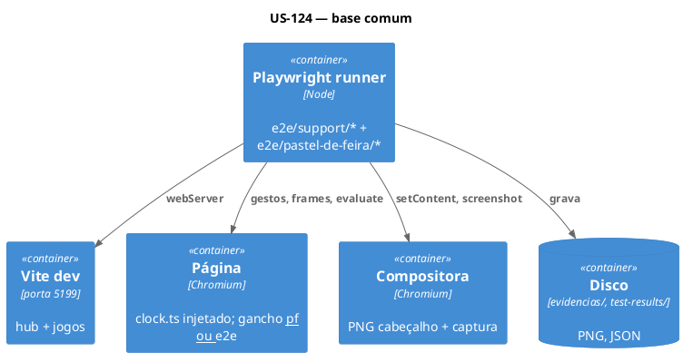

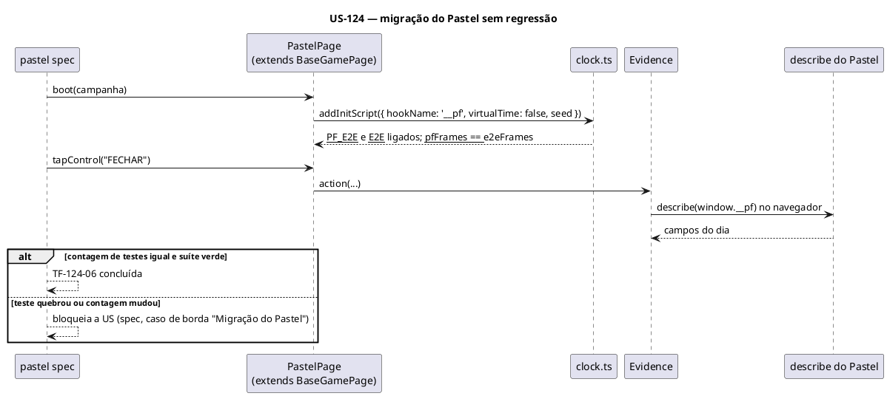

### Sequenciamento de Tarefas

| # | Tarefa | Escopo | Depende de |
|---|---|---|---|
| TF-124-01 | Relógio, semente e storage genéricos (`clock.ts`) | Infra de teste — tempo | — |
| TF-124-02 | Evidências genéricas com descritor por jogo | Infra de teste — evidência | TF-124-01 |
| TF-124-03 | `BaseGamePage`, fixtures e helpers de storage | Infra de teste — página | TF-124-01, TF-124-02 |
| TF-124-04 | Piloto genérico e diagnóstico da partida | Infra de teste — piloto | TF-124-03 |
| TF-124-05 | Projetos do Playwright, scripts npm e tsconfig | Configuração | — |
| TF-124-06 | Migrar o Pastel de Feira para a base comum | Migração | TF-124-01..05 |

### Tarefas

#### TF-124-01: [sampa-challenges] Relógio, semente e storage genéricos

**User Story:** US-124 · **Prioridade:** P0

##### 1. Descrição e Objetivo

> **Eu como** suíte de testes, **Eu quero** um init script único que controla quadros, tempo, sorteio
> e storage, **Para que** qualquer jogo rode determinístico (spec RN-10, RN-11, RN-19).

*Contexto:* hoje esse código está embutido em `GamePage.boot` (`e2e/pastel-de-feira/support/game.ts`, linhas 70–135).

##### 2. Especificação Técnica

**2.1 Pontos de interceptação**
- `e2e/support/clock.ts` (novo) — função `installClock(opts)` serializável para `addInitScript`.
- Opções: `{ seed: number; virtualTime: boolean; storageKey: string; storage: Record<string,string>; rawStorage?: Record<string,string>; blockStorage: boolean; soundOff: Record<string,string> }`.
- Publica `__E2E__ = true`, `__PF_E2E__ = true`, `__e2eFrames(n)`, `__e2eJump(ms)` e aliases `__pfFrames`/`__pfJump`.
- `virtualTime: true` → `performance.now()` e `Date.now()` devolvem `base + t`, `t` avança 1000/60 por quadro e com `jump`.
- Mantém a regra do relógio do Pastel: pedido de quadro fora de um quadro reinicia `ts` em `agora + meio quadro`.

**2.2 Dados:** `sessionStorage['__e2e_booted']` marca o preparo único por teste (substitui `__pf_booted`, que continua sendo lido).

**2.3 Contrato:** tabela 4.2 do `plan.md` (`boot`).

**2.4 Resiliência**

| Cenário | Estratégia | Impacto |
|---|---|---|
| `blockStorage` | getter de `localStorage` lança `Error('bloqueado')` | Testes de modo privado |
| `rawStorage` com texto inválido | gravado como está | Testes de recorde/config corrompido |
| Primeiro `__e2eFrames` antes de qualquer pedido | `ts = performance.now()` (real ou virtual) | Sem `dt` negativo inesperado |

##### 3. Modelagem Visual
Coberta pelo diagrama de sequência da US.

##### 4. Orientação de Execução

**4.1 Contexto de entrada:** `e2e/pastel-de-feira/support/game.ts` (boot), `plan.md` 3.3.

**4.2 Passos**
1. Extrair o corpo do init script de `boot` para `installClock`, sem mudar a lógica do rAF.
2. Acrescentar `virtualTime` (desligado por padrão).
3. Acrescentar `soundOff` genérico (pares chave/valor) e `rawStorage`.
4. Cobrir em `e2e/support/base.spec.ts` (harness com `page.setContent`: canvas + laço rAF que conta `dt`):
   quadros só andam com `__e2eFrames`; `dt` = 1000/60 com `virtualTime`; `Math.random` igual entre duas cargas com a mesma semente; `jump` gera `dt` grande; storage bloqueado lança.

**4.3 Validação**
```bash
npx playwright test -c e2e/playwright.config.ts --project=desktop support/base
```

**4.4 Restrições negativas**
- NÃO virtualizar `setTimeout`/`setInterval` (plan.md 6).
- NÃO ligar `virtualTime` por padrão.

**4.6 Critérios de saída**
- [ ] `base.spec.ts` (bloco relógio) verde 3 vezes seguidas.
- [ ] Pastel ainda não usa o arquivo (feito na TF-124-06).

##### 5. Definition of Done
- [ ] Caminho feliz: quadros e `dt` exatos, semente reproduzível.
- [ ] Resiliência: storage bloqueado e corrompido.
- [ ] Sem `any`; typecheck:e2e verde.

---

#### TF-124-02: [sampa-challenges] Evidências genéricas com descritor por jogo

**User Story:** US-124 · **Prioridade:** P0

##### 1. Descrição e Objetivo

> **Eu como** pessoa que lê o resultado, **Eu quero** o PNG com cabeçalho para qualquer jogo,
> **Para que** cada ação tenha prova visual com o estado do jogo (spec RN-12..14).

##### 2. Especificação Técnica

**2.1 Pontos de interceptação**
- `e2e/support/evidence.ts` (novo, vindo de `e2e/pastel-de-feira/support/evidence.ts`) — `Evidence`, `wrapPage`, `evidenceLevel`.
- `e2e/support/describe.ts` (novo) — parte genérica: rota, tela (por `root` do jogo: `h1/h2` visível ou "Hub"), diálogos, `[role=status|alert]`.
- `Evidence` recebe `describers: Describer[]`; `Describer = { src: string }` (função serializada que recebe `window` e devolve `[string, string][]`).
- Pasta: `evidencias/<projeto>/<arquivo relativo a e2e/>/<teste>/` (inclui o id do jogo pelo caminho do arquivo).
- `evidenceLevel`: `E2E_EVIDENCIAS` > `PF_EVIDENCIAS` > opção do projeto.

**2.4 Resiliência:** captura, descritor ou compositora falhando → `console.warn` e segue (já existe; manter). Descritor que lança → linha `Tela: (não foi possível ler: …)`.

##### 4. Orientação de Execução

**4.1 Contexto:** `e2e/pastel-de-feira/support/evidence.ts` inteiro.

**4.2 Passos**
1. Mover o arquivo e trocar `describeScreen` por genérico + `describers`.
2. Mover os campos do dia do Pastel para `e2e/pastel-de-feira/support/describe.ts` (consumido na TF-124-06).
3. Em `base.spec.ts`: ação gera PNG numerado; nível `marcos` não grava ações; `off` não cria pasta; descritor que lança não derruba o teste.

**4.3 Validação**
```bash
npx playwright test -c e2e/playwright.config.ts --project=desktop support/base
```

**4.4 Restrições negativas**
- NÃO mudar o layout do cabeçalho nem o padrão de nome dos arquivos.

**4.6 Critérios de saída**
- [ ] Bloco evidências de `base.spec.ts` verde; PNGs conferidos à mão uma vez.

##### 5. Definition of Done
- [ ] Os 3 níveis funcionam; as duas variáveis funcionam.
- [ ] Falha de evidência só avisa.

---

#### TF-124-03: [sampa-challenges] `BaseGamePage`, fixtures e helpers de storage

**User Story:** US-124 · **Prioridade:** P0

##### 1. Descrição e Objetivo

> **Eu como** autor de testes de um jogo, **Eu quero** uma página base com boot, quadros, gancho e gestos,
> **Para que** cada jogo só escreva os gestos próprios (plan.md 4.2).

##### 2. Especificação Técnica

**2.1 Pontos de interceptação**
- `e2e/support/game-page.ts` (novo) — `BaseGamePage` com `cfg = { id, route, root, logical, hookName, virtualTime, soundOff }`; membros da tabela 4.2 do plan; `holdKey(key, frames)`, `pressKey(key)`, `dragFromTo(a, b, frames)` novos (o Pastel não tinha).
- `e2e/support/fixtures.ts` (novo) — `makeTest<T extends BaseGamePage>(factory, describers)`: devolve `test` com `page` (evidência), `composer` (worker scope), `game` (coleta `pageerror`/`console.error` e falha ao fim).
- `e2e/support/storage.ts` (novo) — `readStorage(page, key)`, `expectStored(page, key, valor)`.

**2.4 Resiliência:** `hook()` sem gancho → erro `gancho <nome> ausente (<id>)`; `advanceUntil` estourado → erro com a condição e o tempo.

##### 4. Orientação de Execução

**4.1 Contexto:** `e2e/pastel-de-feira/support/game.ts` (classe e fixtures).

**4.2 Passos**
1. Extrair o genérico de `GamePage` (boot, frames, jump, hook, lastHook, advanceUntil, toClient, tapAt, holdAt).
2. Generalizar `toClient` por `cfg.logical` e o seletor do canvas por `cfg.root`.
3. Extrair fixtures; `expectSteps` vai para a base.
4. Em `base.spec.ts`: `toClient` mapeia cantos do canvas do harness; `holdKey` segura por N quadros exatos; erro de console falha o teste (usar `test.fail`).

**4.3 Validação**
```bash
npx playwright test -c e2e/playwright.config.ts --project=desktop support/base
```

**4.6 Critérios de saída**
- [ ] `base.spec.ts` inteiro verde; nenhuma referência a `pastel-de-feira` em `e2e/support/`.

##### 5. Definition of Done
- [ ] Gestos geram uma evidência cada (internos em `quiet`).
- [ ] Erros do console falham o teste.

---

#### TF-124-04: [sampa-challenges] Piloto genérico e diagnóstico da partida

**User Story:** US-124 · **Prioridade:** P0

##### 1. Descrição e Objetivo

> **Eu como** suíte longa, **Eu quero** um executor de piloto com limite de quadros e diagnóstico,
> **Para que** cada jogo só escreva a estratégia (spec RN-20, RN-21, RN-23; plan.md 3.4 e 4.3).

##### 2. Especificação Técnica

**2.1 Pontos de interceptação**
- `e2e/support/pilot.ts` (novo) — `Strategy<S>`, `Gesture`, `runPilot(page, strategy, { seed, variant, maxFrames, decideEvery })`.
- `e2e/support/diagnostics.ts` (novo) — `writeMatch(testInfo, n, data)` → `testInfo.outputPath('partida-<n>.json')`, no esquema do plan.md 3.4.
- `E2E_PILOT_DEBUG=1` imprime ritmo de gestos (como `PF_PILOT_DEBUG`).

**2.3 Contrato:** JSON Schema do plan.md 3.4.

**2.4 Resiliência**

| Cenário | Estratégia | Impacto |
|---|---|---|
| `maxFrames` estourado | `status: travou`, grava JSON, lança erro | Teste falha com dados |
| Gesto sem alvo | `missed++`, comando com `alvo: null` | Teste falha ao fim |
| Exceção na estratégia | `status: erro`, grava JSON, relança | Teste falha |

##### 4. Orientação de Execução

**4.1 Contexto:** `e2e/pastel-de-feira/support/pilot.ts`, `pilot.browser.ts` (só referência; o Pastel mantém o dele).

**4.2 Passos**
1. Implementar `runPilot` e `writeMatch`.
2. Em `base.spec.ts`: estratégia de brinquedo no harness (clica num quadrado que muda de lugar) termina, grava JSON válido; versão que nunca termina estoura `maxFrames`; gesto fora do alvo conta `missed`.

**4.3 Validação**
```bash
npx playwright test -c e2e/playwright.config.ts --project=desktop support/base
```

**4.6 Critérios de saída**
- [ ] 3 cenários do piloto verdes; JSON confere com o esquema.

##### 5. Definition of Done
- [ ] Diagnóstico gravado nos 3 status.

---

#### TF-124-05: [sampa-challenges] Projetos do Playwright, scripts e tsconfig

**User Story:** US-124 · **Prioridade:** P0

##### 1. Descrição e Objetivo

> **Eu como** pessoa desenvolvedora, **Eu quero** os projetos `desktop`, `celular`, `longa`, `campanha`,
> **Para que** suíte rápida e longa rodem separadas (plan.md 4.1).

##### 2. Especificação Técnica

**2.1 Pontos de interceptação**
- `e2e/playwright.config.ts` — `desktop` ignora `responsivo`, `piloto`, `campanha-completa`; `celular` casa `**/responsivo.spec.ts`; `longa` casa `**/piloto.spec.ts` (`outputDir: ../test-results/e2e-longa`, `evidencias: 'marcos'`, `trace: 'off'`); `campanha` inalterado. Tipo da opção vem de `e2e/support/fixtures.ts`.
- `package.json` — `test:e2e:longa`, `test:e2e:cobertura` (stub até TF-125-03), `test:e2e:tudo` com todos.
- `e2e/tsconfig.json` — `include: [".", "../src/games/*/game", "../src/shared"]`.

##### 4. Orientação de Execução

**4.2 Passos:** editar os 3 arquivos; conferir com `--list` que nenhum teste do Pastel mudou de projeto.

**4.3 Validação**
```bash
npx playwright test -c e2e/playwright.config.ts --list --project=desktop --project=celular | tail -1
npm run typecheck:e2e
```

**4.6 Critérios de saída**
- [ ] Contagem do `--list` do Pastel igual à anterior (anotar antes de mudar).

##### 5. Definition of Done
- [ ] 4 projetos listados; scripts executam.

---

#### TF-124-06: [sampa-challenges] Migrar o Pastel de Feira para a base comum

**User Story:** US-124 · **Prioridade:** P0

##### 1. Descrição e Objetivo

> **Eu como** mantenedor, **Eu quero** o Pastel usando a base comum,
> **Para que** haja uma só implementação de relógio e evidências (spec RN-17).

##### 2. Especificação Técnica

**2.1 Pontos de interceptação**
- `e2e/pastel-de-feira/support/game.ts` — `GamePage extends BaseGamePage` (`hookName: '__pf'`, `virtualTime: false`, `logical: 640×480`); ficam só os gestos do Pastel.
- `e2e/pastel-de-feira/support/evidence.ts` — removido (vira `support/describe.ts` do Pastel).
- `e2e/pastel-de-feira/*.spec.ts` — só imports, se necessário.
- `src/games/pastel-de-feira/game/e2eHook.ts` — inalterado.

**2.4 Resiliência:** qualquer diferença de resultado bloqueia a TF (caso de borda da spec).

##### 4. Orientação de Execução

**4.1 Contexto:** todos os arquivos de `e2e/pastel-de-feira/support/`.

**4.2 Passos**
1. Antes de tudo: `--list` da suíte rápida e da campanha → anotar as contagens.
2. Trocar a herança e as fixtures; remover o código duplicado.
3. Rodar a suíte rápida e a campanha; comparar contagens e 3 PNGs de referência (abertura, ação no painel, fechamento).

**4.3 Validação**
```bash
npm run test:e2e -- pastel-de-feira/
caffeinate -dimsu npm run test:e2e:campanha
```

**4.4 Restrições negativas**
- NÃO mudar código de produção do Pastel.
- NÃO alterar asserts dos specs.

**4.6 Critérios de saída**
- [ ] Mesmas contagens; suíte rápida e campanha verdes; cabeçalho com campos do dia.

**4.7 Decomposição iterativa (mimic-loop)**

**Modo:** `mimic-loop` · **Máx. iterações:** 20 · **Projeto saga:** `exec:sampa-challenges:TF-124-06`

| # | RT | Critério | Depende de |
|---|---|---|---|
| RT-01 | Anotar contagens de testes | números no saga | — |
| RT-02 | `GamePage` herdando a base | `typecheck:e2e` verde | RT-01 |
| RT-03 | Descritor do dia do Pastel | PNG com campos do dia | RT-02 |
| RT-04 | Suíte rápida do Pastel | verde, contagem igual | RT-03 |
| RT-05 | Campanha completa | verde | RT-04 |

##### 5. Definition of Done
- [ ] Suíte do Pastel verde com a mesma contagem; campanha verde.
- [ ] `PF_EVIDENCIAS=marcos` continua reduzindo as evidências.

---

## US-125: Contrato do gancho, modelo de jogo e cobertura RN × teste

**Épico:** `[INSERIR_EPICO]` · **Sistema:** sampa-challenges · **Estimativa:** 3 SP · **Prioridade:** P0

### Narrativa de Valor

> **Eu como** pessoa desenvolvedora, **Eu quero** um contrato único de gancho, o modelo de jogo já
> testável e uma checagem automática RN × teste, **Para que** cada jogo exponha estado do mesmo jeito,
> jogos novos nasçam no padrão e nenhuma regra fique sem teste.

### Critérios de Aceitação

- [ ] `src/shared/e2e/hook.ts` publicado e inerte sem a flag (build de produção sem `window.__e2e`).
- [ ] `npm run novo-jogo -- teste-x "Teste X"` cria `src/games/teste-x/` e `e2e/teste-x/` que passam typecheck e a suíte mínima (pasta apagada depois).
- [ ] `npm run test:e2e:cobertura` lista RN sem teste e teste com RN inexistente, por jogo.

### Regras de Negócio Aplicáveis

| # | Regra | Tipo |
|---|---|---|
| RN-07 | `_modelo` no padrão do manual com testes | Obrigatória |
| RN-08 | Nenhuma RN sem teste | Obrigatória |
| RN-16 | Gancho só com a flag | Restritiva |

### Diagramas

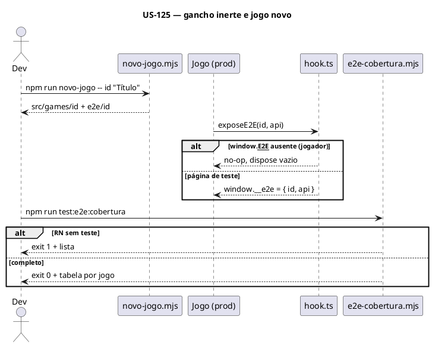

### Sequenciamento de Tarefas

| # | Tarefa | Escopo | Depende de |
|---|---|---|---|
| TF-125-01 | Contrato do gancho em `src/shared/e2e/hook.ts` | Código de produção compartilhado | US-124 |
| TF-125-02 | `_modelo` no padrão e `novo-jogo` copiando o e2e | Modelo de jogo | TF-125-01 |
| TF-125-03 | Script de cobertura RN × teste | Ferramenta | — |

### Tarefas

#### TF-125-01: [sampa-challenges] Contrato do gancho

**User Story:** US-125 · **Prioridade:** P0

##### 1. Descrição e Objetivo

> **Eu como** jogo, **Eu quero** `isE2E`, `exposeE2E` e `e2eSeed`, **Para que** todos os ganchos sigam o plan.md 3.1.

##### 2. Especificação Técnica

**2.1** `src/shared/e2e/hook.ts` (novo): `isE2E()`, `exposeE2E<T>(id, api): () => void` (publica `__e2e` e `__e2eLast`; `dispose` só limpa `__e2e` se ainda for o mesmo), `e2eSeed()`; tipo `E2EWindow`.

**2.4 Resiliência:** montagem dupla do StrictMode → o segundo `exposeE2E` substitui o primeiro; o `dispose` do primeiro não apaga o segundo.

##### 4. Orientação de Execução

**4.2 Passos**
1. Implementar.
2. Teste em `e2e/support/base.spec.ts` (harness importando o módulo via Vite `/src/shared/e2e/hook.ts`): sem flag não publica; com flag publica; dispose cruzado.
3. `npm run build` e `grep -c "__e2e" dist/assets/*.js` só no próprio módulo (sem chamada ativa sem flag).

**4.3 Validação**
```bash
npm run typecheck && npx playwright test -c e2e/playwright.config.ts --project=desktop support/base
```

**4.6 Critérios de saída**
- [ ] 3 cenários verdes; build ok.

##### 5. Definition of Done
- [ ] Inerte para o jogador; dispose seguro no StrictMode.

---

#### TF-125-02: [sampa-challenges] `_modelo` no padrão do manual e `novo-jogo` copiando o e2e

**User Story:** US-125 · **Prioridade:** P1

##### 1. Descrição e Objetivo

> **Eu como** quem cria um jogo, **Eu quero** o modelo com manual, CLAUDE.md, gancho e suíte mínima,
> **Para que** o jogo nasça testável (spec RN-07).

##### 2. Especificação Técnica

**2.1**
- `src/games/_modelo/README.md` — seções do manual (plan.md 4.5) com marcadores `__SIGLA__-RN-01`.
- `src/games/_modelo/CLAUDE.md` — seções + "Testes de ponta a ponta".
- `src/games/_modelo/game/e2eHook.ts` (novo) e chamada no `Game.tsx` do modelo.
- `e2e/_modelo/support/page.ts`, `support/describe.ts`, `navegacao.spec.ts` (abre, joga 60 quadros, volta ao hub), `responsivo.spec.ts`.
- `scripts/novo-jogo.mjs` — copia `e2e/_modelo` → `e2e/<id>` com os mesmos substitutos; `__SIGLA__` = iniciais do título em maiúsculas.
- `e2e/playwright.config.ts` — ignorar `_modelo/` em todos os projetos.

##### 4. Orientação de Execução

**4.2 Passos:** editar; criar `teste-x` com o script; rodar typecheck e `test:e2e -- teste-x/`; apagar `src/games/teste-x` e `e2e/teste-x`.

**4.3 Validação**
```bash
npm run novo-jogo -- teste-x "Teste X" && npm run typecheck && npm run test:e2e -- teste-x/
```

**4.4 Restrições negativas:** NÃO deixar a pasta `teste-x` no commit.

**4.6 Critérios de saída**
- [ ] Jogo criado passa typecheck e a suíte mínima; pastas removidas.

##### 5. Definition of Done
- [ ] Modelo com manual, CLAUDE.md, gancho e suíte.

---

#### TF-125-03: [sampa-challenges] Script de cobertura RN × teste

**User Story:** US-125 · **Prioridade:** P1

##### 1. Descrição e Objetivo

> **Eu como** revisor, **Eu quero** a checagem automática, **Para que** RN-08 seja verificável (plan.md 4.4).

##### 2. Especificação Técnica

**2.1** `scripts/e2e-cobertura.mjs` (novo): para cada `src/games/<id>/README.md` (exceto `_modelo` e `pastel-de-feira`, cujos IDs `RN-NN` têm cobertura própria) e para o hub (IDs `HUB-RN-NN` listados em `e2e/README.md`), compara IDs do manual com IDs citados em `test(`/`test.describe(` de `e2e/<id>/` e `e2e/hub/`. Saída: tabela por jogo; `--md <id>` imprime a tabela RN → arquivo de teste em Markdown para colar no manual. `package.json`: `test:e2e:cobertura`.

**2.4** README sem nenhum ID → aviso "manual sem RN" e exit 1.

##### 4. Orientação de Execução

**4.2 Passos:** implementar; testar contra um README temporário com 2 RN e 1 spec citando uma.

**4.3 Validação**
```bash
npm run test:e2e:cobertura; echo "exit=$?"
```

**4.6 Critérios de saída**
- [ ] Detecta RN sem teste, teste com RN inexistente e manual sem RN.

##### 5. Definition of Done
- [ ] Saída legível e `--md` funcionando.

---

## US-126: Testes do hub

**Épico:** `[INSERIR_EPICO]` · **Sistema:** sampa-challenges · **Estimativa:** 3 SP · **Prioridade:** P1

### Narrativa de Valor

> **Eu como** jogador, **Eu quero** que a home, as rotas e a troca de jogos sempre funcionem,
> **Para que** nenhum jogo quebre o hub ou os outros jogos.

### Critérios de Aceitação

- [ ] RN-50..55 com teste (`HUB-RN-50`..`HUB-RN-55`).
- [ ] Evidências com o cabeçalho do hub (rota, cards, jogo montado).

### Regras de Negócio Aplicáveis

| # | Regra | Tipo |
|---|---|---|
| RN-50..55 | Home, rotas, troca, isolamento, erro, 390 px | Obrigatória |

### Diagramas

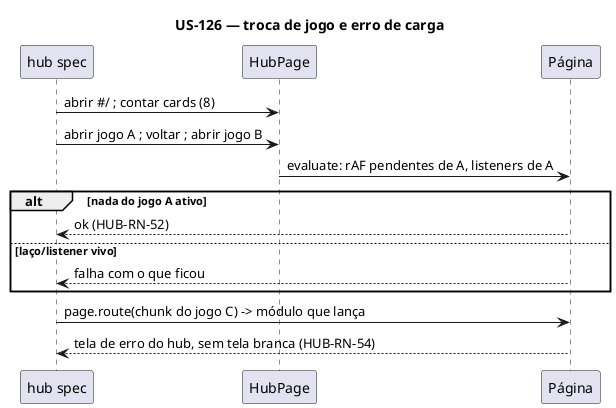

### Sequenciamento de Tarefas

| # | Tarefa | Escopo | Depende de |
|---|---|---|---|
| TF-126-01 | `HubPage` e descritor do hub | Infra de teste | US-124 |
| TF-126-02 | Specs do hub (desktop) | Testes | TF-126-01 |
| TF-126-03 | Responsivo do hub (celular) | Testes | TF-126-01 |

### Tarefas

#### TF-126-01: [sampa-challenges] `HubPage` e descritor do hub

**User Story:** US-126 · **Prioridade:** P1

##### 1. Descrição e Objetivo
> **Eu como** autor de testes, **Eu quero** a página do hub, **Para que** specs do hub e dos jogos naveguem do mesmo jeito.

##### 2. Especificação Técnica
**2.1** `e2e/support/hub.ts` (novo): `HubPage` com `open()`, `cards()` (título, recorde exibido), `openGame(id)` (clique no card), `back()` (barra "← Sampa Challenges"); descritor: rota, número de cards, jogo montado (`.<id>` presente), contagem de pedidos de rAF ativos (lida do relógio).
**2.2** O relógio (`clock.ts`) passa a expor `__e2eRafPending()` (tamanho da fila) — só leitura.

##### 4. Orientação de Execução
**4.1 Contexto:** `src/hub/HubHome.tsx`, `GameHost.tsx`, `useHashRoute.ts`, `registry.ts`.
**4.3 Validação:** `npm run typecheck:e2e`.
**4.6 Critérios de saída:** [ ] `HubPage` usada por TF-126-02 sem duplicar seletores.

##### 5. Definition of Done
- [ ] Descritor aparece nos PNGs do hub.

---

#### TF-126-02: [sampa-challenges] Specs do hub

**User Story:** US-126 · **Prioridade:** P1

##### 1. Descrição e Objetivo
> **Eu como** jogador, **Eu quero** home, rotas, troca e isolamento testados (spec RN-50..54).

##### 2. Especificação Técnica
**2.1** `e2e/hub/home.spec.ts` (HUB-RN-50: 8 cards na ordem de `registry.ts`, recorde no card a partir de storage preparado), `rotas.spec.ts` (HUB-RN-51: cada `#/jogos/<id>`, id inexistente, id inválido, voltar do navegador e pela barra), `troca.spec.ts` (HUB-RN-52: abrir/voltar/abrir outro; fila de rAF volta ao tamanho de um jogo; `keydown` não chega ao jogo anterior), `isolamento.spec.ts` (HUB-RN-53: estilos computados de `body`, `.hub` e de um card iguais antes/depois de abrir cada jogo), `erro.spec.ts` (HUB-RN-54: `page.route` do chunk de um jogo devolvendo módulo que lança; error boundary visível).
**2.4** Comportamento de id inexistente/ inválido: o que o hub faz hoje é escrito em `e2e/README.md` (seção Hub) antes do teste (spec RN-03).

##### 4. Orientação de Execução
**4.3 Validação**
```bash
npm run test:e2e -- hub/
```
**4.6 Critérios de saída:** [ ] 5 arquivos verdes; HUB-RN-50..54 citados.

##### 5. Definition of Done
- [ ] Erro de carga e troca de jogo cobertos; bugs (se houver) em `bugs.md`.

---

#### TF-126-03: [sampa-challenges] Responsivo do hub

**User Story:** US-126 · **Prioridade:** P2

##### 1. Descrição e Objetivo
> **Eu como** jogador no celular, **Eu quero** home e barra de volta sem rolagem lateral (spec RN-55).

##### 2. Especificação Técnica
**2.1** `e2e/hub/responsivo.spec.ts`: `scrollWidth <= innerWidth` na home e com cada jogo aberto (só a barra); toque no card abre o jogo.

##### 4. Orientação de Execução
**4.3 Validação:** `npm run test:e2e -- --project=celular hub/`
**4.6 Critérios de saída:** [ ] Verde nos 8 jogos.

##### 5. Definition of Done
- [ ] HUB-RN-55 coberta.

---

## Padrão das US por jogo (US-127 a US-133)

Cada US de jogo tem as mesmas Tarefas na mesma ordem. As TF abaixo de cada jogo trazem só o que é
específico; os passos comuns estão aqui.

| TF | Escopo | Passos comuns | Validação |
|---|---|---|---|
| **-01 Manual** | Documentação para jogador | Ler o código inteiro do jogo (`game/*`, `components/*`); reescrever o README na estrutura do plan.md 4.5; numerar cada regra/mecânica `<SIGLA>-RN-NN` (spec RN-02); toda constante de `constants.ts` e do topo do motor na tabela de parâmetros; comportamentos sem documentação (entradas inválidas, foco, empates) escritos (RN-03); seção "Testes" com placeholder preenchido na TF -07 | Revisão: cada `export const` de `constants.ts` aparece no README (`grep`) |
| **-02 Gancho** | Código de produção | `game/e2eHook.ts` com `state()`, `targets()`, `prepare` (plan.md 3.2); métodos `e2eState()`/`e2eTargets()` no motor (sem tornar campos públicos); chamada a `exposeE2E` no `useEffect` do motor e `dispose` no cleanup | `npm run typecheck && npm run build`; teste mínimo: gancho presente com flag, ausente sem |
| **-03 Página e descritor** | Infra de teste do jogo | `e2e/<id>/support/page.ts` (`XPage extends BaseGamePage`, gestos do jogo); `support/describe.ts` (campos da spec 3.4); `support/test.ts` exporta `test`/`expect` via `makeTest` | `npm run typecheck:e2e`; `navegacao.spec.ts` abre e fecha com PNG mostrando os campos |
| **-04 Specs das regras** | Testes | Um ou mais `test` por RN do manual, agrupados por tema (arquivos listados na TF); números das constantes; evidência a cada ação | `npm run test:e2e -- <id>/` |
| **-05 Bordas e responsivo** | Testes | `bordas.spec.ts` (spec RN-47: foco, `jump` com quadro gigante, storage bloqueado, recorde/config corrompido, StrictMode sem laço duplicado (fila de rAF), sair e voltar no meio da partida); `responsivo.spec.ts` (390 px, toque mapeado, HUD visível) | `npm run test:e2e -- <id>/bordas` e `--project=celular <id>/` |
| **-06 Piloto** | Teste longo | `support/pilot.ts` (`Strategy` da tabela 4.3 do plan) e `piloto.spec.ts` com as partidas mínimas da spec RN-24; confere RN-22 (resultado recalculado, recorde, card do hub, console limpo); mesma semente 2 vezes → mesmo `partida-<n>.json` (sem os campos de data) | `caffeinate -dimsu npm run test:e2e:longa -- <id>/` |
| **-07 CLAUDE.md e cobertura** | Documentação para quem mexe | CLAUDE.md completo (spec RN-06) com "Testes de ponta a ponta"; seção "Testes" do README com a tabela de `npm run test:e2e:cobertura -- --md <id>`; cobertura sem pendência | `npm run test:e2e:cobertura` sem pendência do jogo |

Diagrama comum de containers das US de jogo (Xadrez e Sinuca acrescentam o worker, ver US-132/133):

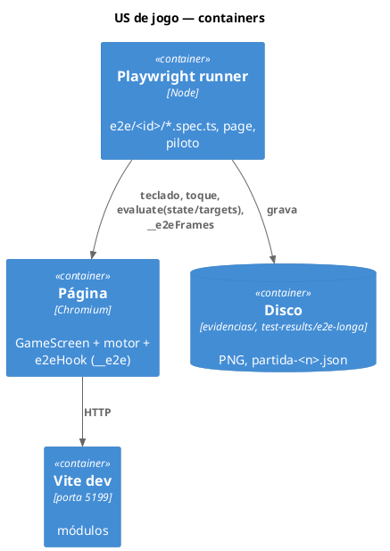

Orientação de execução comum às TF -04 e -06: **4.7 mimic-loop** recomendado (muitos arquivos de teste,
DoD longo). Projeto saga `exec:sampa-challenges:TF-<us>-<yy>`; uma RT por arquivo de spec (-04) ou por
variante de partida (-06); critério de cada RT: arquivo/variante verde 2 vezes seguidas.

---

## US-127: Cachorro Loko — manual e e2e

**Épico:** `[INSERIR_EPICO]` · **Sistema:** sampa-challenges · **Estimativa:** 5 SP · **Prioridade:** P1

### Narrativa de Valor

> **Eu como** jogador e mantenedor, **Eu quero** o manual completo e todas as regras do Cachorro Loko
> testadas pela tela, **Para que** esteiras, desvios, poderes e recorde não regridam.

### Critérios de Aceitação

- [ ] README com todas as regras numeradas `CL-RN-NN`; CLAUDE.md completo.
- [ ] Toda `CL-RN` com teste; bordas e responsivo verdes.
- [ ] Piloto joga até perder as 3 vidas passando do nível 3; placar e recorde conferem.

### Regras de Negócio Aplicáveis

| # | Regra | Tipo |
|---|---|---|
| RN-01..03, RN-06 | Manual e CLAUDE.md | Obrigatória |
| RN-30 | Cabeçalho do Cachorro Loko | Obrigatória |
| RN-40 | Cobertura de regras | Obrigatória |
| RN-47 | Bordas comuns | Obrigatória |
| RN-24 | Piloto: 3 vidas, nível ≥ 3 | Obrigatória |

### Diagramas

C4 N2: diagrama comum das US de jogo.

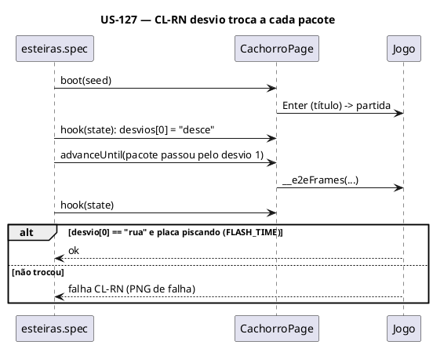

### Sequenciamento de Tarefas

| # | Tarefa | Escopo | Depende de |
|---|---|---|---|
| TF-127-01 | Manual do Cachorro Loko | Documentação | — |
| TF-127-02 | Gancho do Cachorro Loko | Produção | US-125 |
| TF-127-03 | Página e descritor | Infra de teste | TF-127-02, US-124 |
| TF-127-04 | Specs das regras | Testes | TF-127-01, TF-127-03 |
| TF-127-05 | Bordas e responsivo | Testes | TF-127-03 |
| TF-127-06 | Piloto | Teste longo | TF-127-03 |
| TF-127-07 | CLAUDE.md e cobertura | Documentação | TF-127-04..06 |

### Tarefas

#### TF-127-01: [sampa-challenges] Manual do Cachorro Loko
**User Story:** US-127 · **Prioridade:** P1
> **Eu como** jogador, **Eu quero** o manual completo, **Para que** toda regra tenha número e descrição exata.

**Especificação:** `src/games/cachorro-loko/README.md`. Temas a numerar (spec RN-40): controles (teclado, toque); esteiras e sentido; desvio por pacote e aviso; pega (baú/corpo, `CATCH_RECT`); ponto; vidas (`START_LIVES`/`MAX_LIVES`); bomba (`BOMBS_FROM_SCORE`, `DIZZY_TIME`, explosão na rua); cada poder e `POWER_DURATION`; repegar reinicia; nível e curva (`engine.ts`); especial (5 comuns, 22%, 11º garantido, vida peso 0,7); pausa (P, Esc, foco); fim e recorde (`cachorro-loko:recorde`).
**Contexto de entrada:** `game/constants.ts`, `game/engine.ts`, `game/input.ts`, `components/*`.
**Validação / DoD:** padrão -01; cada tema com ID; parâmetros completos.

---

#### TF-127-02: [sampa-challenges] Gancho do Cachorro Loko
**User Story:** US-127 · **Prioridade:** P0
> **Eu como** suíte, **Eu quero** ler o estado do motor, **Para que** as regras sejam verificáveis.

**Pontos de interceptação:** `game/engine.ts` (`e2eState()`: placar, vidas, nível, entregas, poderes com tempo restante, cachorro x/virado/tonto, pacotes com tipo/x/y/esteira/caindo, 3 desvios com destino e flash, pausa, fim; `prepare.spawn(tipo)`, `prepare.lives(n)`), `game/e2eHook.ts` (novo), `components/GameScreen.tsx` (`exposeE2E('cachorro-loko', …)` no efeito do motor; `targets()` = retângulos das `.touch.left/.right` em coordenadas de página).
**Validação / DoD:** padrão -02.

---

#### TF-127-03: [sampa-challenges] Página e descritor do Cachorro Loko
**User Story:** US-127 · **Prioridade:** P1
**Pontos:** `e2e/cachorro-loko/support/{page.ts,describe.ts,test.ts}`. Gestos: `start()` (título → partida), `walk(dir, frames)` (segurar ←/→ ou A/D), `touch(side, frames)`, `pause(tecla)`. Descritor: spec RN-30. `cfg.logical` 320×200.
**Validação / DoD:** padrão -03.

---

#### TF-127-04: [sampa-challenges] Specs das regras do Cachorro Loko
**User Story:** US-127 · **Prioridade:** P1
**Arquivos:** `e2e/cachorro-loko/navegacao.spec.ts` (título, início, fim de jogo, recorde salvo e exibido), `movimento.spec.ts` (velocidade `DOG_SPEED` em px/quadro, limites `DOG_MIN_X/MAX_X`, toque), `esteiras-desvios.spec.ts`, `pega-vidas.spec.ts` (pega, ponto, pacote na rua, bomba: vida, tontura, explosão sem dano, só após 15), `poderes.spec.ts` (turbo `DOG_TURBO_SPEED`, grau `GRAU_LIFT`, ímã `IMA_RANGE`, vida até 5, dobro, repegar reinicia), `nivel.spec.ts` (nível a cada 10, velocidade/intervalo da curva), `pausa.spec.ts` (P, Esc, `blur`).
**Pré-condições:** `prepare.spawn` para colocar o pacote desejado (comentado).
**Validação / DoD:** padrão -04; 100% das `CL-RN` da TF-127-01.

---

#### TF-127-05: [sampa-challenges] Bordas e responsivo do Cachorro Loko
**User Story:** US-127 · **Prioridade:** P1
**Específico:** recorde corrompido (`cachorro-loko:recorde` = `"abc"`) → 0; toque segurando as zonas em 390 px.
**Validação / DoD:** padrão -05.

---

#### TF-127-06: [sampa-challenges] Piloto do Cachorro Loko
**User Story:** US-127 · **Prioridade:** P1
**Estratégia:** plan.md 4.3. Partidas: 3 sementes; cada uma até 0 vidas e nível ≥ 3. Resultado recalculado: soma dos pontos dos pacotes pegos (×2 no dobro) = placar. `maxFrames` = 20 min de jogo.
**Validação / DoD:** padrão -06.

---

#### TF-127-07: [sampa-challenges] CLAUDE.md e cobertura do Cachorro Loko
**User Story:** US-127 · **Prioridade:** P2
**Específico:** `src/games/cachorro-loko/CLAUDE.md` + seção "Testes" do README.
**Validação / DoD:** padrão -07.

---

## US-128: Pinball Paulista — manual e e2e

**Épico:** `[INSERIR_EPICO]` · **Sistema:** sampa-challenges · **Estimativa:** 8 SP · **Prioridade:** P1

### Narrativa de Valor

> **Eu como** jogador e mantenedor, **Eu quero** o manual completo e a mesa testada pela tela,
> **Para que** flippers, prêmios, multiball e tilt não regridam.

### Critérios de Aceitação

- [ ] README `PP-RN-NN` e CLAUDE.md completos.
- [ ] Toda `PP-RN` com teste; física idêntica entre 3 execuções na mesma semente.
- [ ] Piloto joga as 3 bolas até o fim; bônus e placar conferem.

### Regras de Negócio Aplicáveis

RN-01..03, RN-06, RN-34, RN-44, RN-47, RN-24 (3 bolas até o fim).

### Diagramas

C4 N2: diagrama comum.

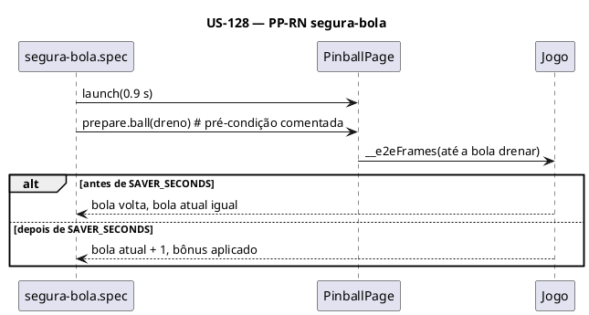

### Sequenciamento de Tarefas

| # | Tarefa | Escopo | Depende de |
|---|---|---|---|
| TF-128-01 | Manual do Pinball | Documentação | — |
| TF-128-02 | Gancho do Pinball | Produção | US-125 |
| TF-128-03 | Página e descritor | Infra de teste | TF-128-02 |
| TF-128-04 | Specs das regras | Testes | TF-128-01, TF-128-03 |
| TF-128-05 | Bordas e responsivo | Testes | TF-128-03 |
| TF-128-06 | Piloto | Teste longo | TF-128-03 |
| TF-128-07 | CLAUDE.md e cobertura | Documentação | TF-128-04..06 |

### Tarefas

#### TF-128-01: [sampa-challenges] Manual do Pinball Paulista
**Temas:** controles (Z, /, ←, →, Espaço, ↓, N, P/Esc, toque e botões); semáforos e Onda Verde; raias e multiplicador (`MAX_MULT`); MOTOBOY (500/50, 2000, Multiball); Minhocão (`KICKOUT_HOLD`, 250, ciclo de prêmios, bola extra única, entupido 4 s); spinner (10 por meia volta); estilingues (`SLING_KICK`); segura-bola (`SAVER_SECONDS`); bônus de fim de bola (tabela de pontos acumulados × mult.); tilt (`NUDGE_LIMIT`, decaimento 1/4 s); lançador (`PLUNGER_*`); 3 bolas; recorde.
**Validação / DoD:** padrão -01.

#### TF-128-02: [sampa-challenges] Gancho do Pinball Paulista
**Pontos:** `game/engine.ts` (`e2eState()` da plan.md 3.2; `prepare.ball`, `prepare.lights`), `game/e2eHook.ts`, `components/GameScreen.tsx`; `targets()`: metades `.touch.left/.right`, botões Lançar e Sacudir.
**Validação / DoD:** padrão -02.

#### TF-128-03: [sampa-challenges] Página e descritor do Pinball
**Gestos:** `flipper(lado, frames)`, `launch(segundos)`, `nudge()`, `touchFlipper`, `touchLaunch`. `cfg.logical` 240×400. Descritor: spec RN-34.
**Validação / DoD:** padrão -03.

#### TF-128-04: [sampa-challenges] Specs das regras do Pinball
**Arquivos:** `navegacao`, `flippers`, `lancador` (fraco não sobe a rampa, forte ≈ `PLUNGER_MIN + PLUNGER_RANGE`), `nudge-tilt`, `semaforos`, `raias`, `motoboy-multiball`, `minhocao`, `spinner-estilingue`, `segura-bola`, `bonus-fim-bola`, `pausa`.
**Pré-condições:** `prepare.ball` para levar a bola ao alvo (comentado); o caminho natural fica coberto pelo piloto.
**Validação / DoD:** padrão -04; cada teste de física repetido com `--repeat-each=3` uma vez na TF.

#### TF-128-05: [sampa-challenges] Bordas e responsivo do Pinball
**Específico:** `jump(5000)` no meio do voo da bola não atravessa parede (subpassos `STEP`); 390 px com mesa vertical.
**Validação / DoD:** padrão -05.

#### TF-128-06: [sampa-challenges] Piloto do Pinball
**Estratégia:** plan.md 4.3; 3 sementes; resultado recalculado: soma dos eventos de pontuação lidos do gancho = placar. `maxFrames` = 30 min de jogo.
**Validação / DoD:** padrão -06.

#### TF-128-07: [sampa-challenges] CLAUDE.md e cobertura do Pinball
**Validação / DoD:** padrão -07.

---

## US-129: Capacete Voador — manual e e2e

**Épico:** `[INSERIR_EPICO]` · **Sistema:** sampa-challenges · **Estimativa:** 5 SP · **Prioridade:** P1

### Narrativa de Valor

> **Eu como** jogador e mantenedor, **Eu quero** o manual e os modos testados pela tela,
> **Para que** mira, acertos, computador e placar não regridam.

### Critérios de Aceitação

- [ ] README `CV-RN-NN` e CLAUDE.md completos (inclui comportamento de entradas inválidas).
- [ ] Toda `CV-RN` com teste.
- [ ] Piloto termina uma partida em cada modo e cada nível do computador; placar confere.

### Regras de Negócio Aplicáveis

RN-01..03, RN-06, RN-31, RN-41, RN-47, RN-24 (todos os modos).

### Diagramas

C4 N2: diagrama comum.

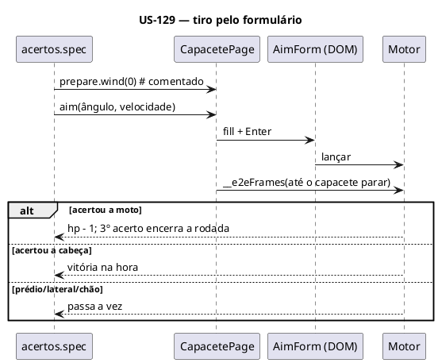

### Sequenciamento de Tarefas

| # | Tarefa | Escopo | Depende de |
|---|---|---|---|
| TF-129-01 | Manual do Capacete | Documentação | — |
| TF-129-02 | Gancho do Capacete | Produção | US-125 |
| TF-129-03 | Página e descritor | Infra de teste | TF-129-02 |
| TF-129-04 | Specs das regras | Testes | TF-129-01, TF-129-03 |
| TF-129-05 | Bordas e responsivo | Testes | TF-129-03 |
| TF-129-06 | Piloto | Teste longo | TF-129-03 |
| TF-129-07 | CLAUDE.md e cobertura | Documentação | TF-129-04..06 |

### Tarefas

#### TF-129-01: [sampa-challenges] Manual do Capacete Voador
**Temas:** menu (cada opção e padrão); campos (`ANGLE_*`, `VELOCITY_*`) e entradas inválidas (vazio, texto, fora do limite — comportamento atual); Enter/botão; física (fórmula, `DT`, `MAX_FLIGHT_T`); vento; acertos (tabela atual); rodada (moto inteira, cidade/vento novos, alternância, comemoração `ROUND_OVER_MS`); modos; computador por nível; cidade (regras de posição); som e `capacete-voador:som`; fim de partida.
**Validação / DoD:** padrão -01.

#### TF-129-02: [sampa-challenges] Gancho do Capacete Voador
**Pontos:** `game/engine.ts` (`e2eState()` da plan.md 3.2; `simulateShot(ângulo, velocidade)` só leitura, usando a mesma simulação do jogo, para o piloto; `prepare.wind`, `prepare.city(seed)`), `game/e2eHook.ts`, `components/GameScreen.tsx`. `targets()`: motos e cabeças (`MOTO_BOX`, `PILOT_BOX`) em coordenadas lógicas.
**Validação / DoD:** padrão -02.

#### TF-129-03: [sampa-challenges] Página e descritor do Capacete
**Gestos:** `menu(opções)`, `aim(a, v)` (preenche `AimForm`), `fire()` (Enter ou botão), `waitShot()`. `cfg.logical` 640×400. Descritor: spec RN-31.
**Validação / DoD:** padrão -03.

#### TF-129-04: [sampa-challenges] Specs das regras do Capacete
**Arquivos:** `menu`, `mira` (limites, inválidos, Enter, botão), `voo` (vento, tiro para trás, gravidade e atalhos), `acertos` (3 estágios, destruição, cabeça, própria moto/cabeça, prédio/cratera, lateral, chão, sol), `rodadas` (alternância, cidade nova, pontos para vencer, fim), `computador` (fácil nunca acerta em N cidades sorteadas; médio acerta até o 5º; difícil até o 3º), `treino`, `som`.
**Pré-condições:** `prepare.wind`/`prepare.city` para tiros de acerto conhecidos (ângulo/velocidade achados por `simulateShot`).
**Validação / DoD:** padrão -04.

#### TF-129-05: [sampa-challenges] Bordas e responsivo do Capacete
**Específico:** formulário utilizável em 390 px; teclado virtual não tapa o botão.
**Validação / DoD:** padrão -05.

#### TF-129-06: [sampa-challenges] Piloto do Capacete
**Partidas:** 2 jogadores (piloto nos dois lados), contra o computador fácil/médio/difícil, treino; resultado recalculado = rodadas vencidas por lado. `maxFrames` = 15 min por partida.
**Validação / DoD:** padrão -06.

#### TF-129-07: [sampa-challenges] CLAUDE.md e cobertura do Capacete
**Validação / DoD:** padrão -07.

---

## US-130: Corredor SP — manual e e2e

**Épico:** `[INSERIR_EPICO]` · **Sistema:** sampa-challenges · **Estimativa:** 8 SP · **Prioridade:** P1

### Narrativa de Valor

> **Eu como** jogador e mantenedor, **Eu quero** o manual e a corrida testados pela tela,
> **Para que** escolhas, pontuação, grau, capacete, itens e perigos não regridam.

### Critérios de Aceitação

- [ ] README `CS-RN-NN` e CLAUDE.md completos.
- [ ] Toda `CS-RN` com teste (inclusive controles de toque com aceleração automática em celular).
- [ ] Piloto termina um turno em cada pista passando do nível 2; pontos conferem com a fórmula.

### Regras de Negócio Aplicáveis

RN-01..03, RN-06, RN-32, RN-42, RN-47, RN-24 (3 pistas, nível ≥ 2).

### Diagramas

C4 N2: diagrama comum.

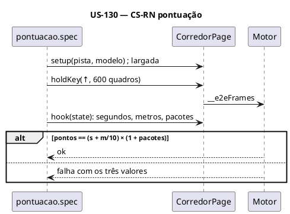

### Sequenciamento de Tarefas

| # | Tarefa | Escopo | Depende de |
|---|---|---|---|
| TF-130-01 | Manual do Corredor | Documentação | — |
| TF-130-02 | Gancho do Corredor | Produção | US-125 |
| TF-130-03 | Página e descritor | Infra de teste | TF-130-02 |
| TF-130-04 | Specs das regras | Testes | TF-130-01, TF-130-03 |
| TF-130-05 | Bordas e responsivo | Testes | TF-130-03 |
| TF-130-06 | Piloto | Teste longo | TF-130-03 |
| TF-130-07 | CLAUDE.md e cobertura | Documentação | TF-130-04..06 |

### Tarefas

#### TF-130-01: [sampa-challenges] Manual do Corredor SP
**Temas:** escolhas e persistência (`CHOICE_KEY`); modelos (`data.ts`); controles (teclado e toque, `autoAccel` em ponteiro grosso); contagem/largada; pontuação; vidas, queda, proteção; faixas, corredores e faixa azul; grau; capacete; itens e sorteio; nível; densidade; dia/noite; garoa; trânsito e perigos (tabela); pesos por pista; som; pausa; fim e recorde por pista.
**Validação / DoD:** padrão -01.

#### TF-130-02: [sampa-challenges] Gancho do Corredor SP
**Pontos:** `game/engine.ts` (`e2eState()` da plan.md 3.2; `prepare.spawn(tipo, faixa, distância)`, `prepare.level(n)`), `game/e2eHook.ts`, `components/RaceScreen.tsx`. `targets()`: botões `◀ ▶ FREIO GRAU` e capacete.
**Validação / DoD:** padrão -02.

#### TF-130-03: [sampa-challenges] Página e descritor do Corredor
**Gestos:** `setup(escolhas)`, `accelerate(frames)`, `brake`, `steer(dir, frames)`, `grau(frames)`, `helmet()`, `touchBtn(nome, frames)`. `cfg.logical` 640×400. Descritor: spec RN-32.
**Validação / DoD:** padrão -03.

#### TF-130-04: [sampa-challenges] Specs das regras do Corredor
**Arquivos:** `escolha`, `largada-controles`, `pontuacao`, `vidas-queda`, `corredor-grau`, `capacete`, `itens`, `nivel-densidade`, `perigos` (buraco acima/abaixo de 55%, cones −30%, contramão e ambulância no nível 2+), `garoa-dia-noite`, `pausa-som`, `recorde`.
**Validação / DoD:** padrão -04.

#### TF-130-05: [sampa-challenges] Bordas e responsivo do Corredor
**Específico:** `isMobile` liga a aceleração automática; botões de toque em 390 px.
**Validação / DoD:** padrão -05.

#### TF-130-06: [sampa-challenges] Piloto do Corredor
**Partidas:** uma por pista; resultado recalculado pela fórmula. `maxFrames` = 15 min de jogo.
**Validação / DoD:** padrão -06.

#### TF-130-07: [sampa-challenges] CLAUDE.md e cobertura do Corredor
**Validação / DoD:** padrão -07.

---

## US-131: Fuga da Rocam — manual reescrito e e2e

**Épico:** `[INSERIR_EPICO]` · **Sistema:** sampa-challenges · **Estimativa:** 8 SP · **Prioridade:** P1

### Narrativa de Valor

> **Eu como** jogador e mantenedor, **Eu quero** o manual da Fuga da Rocam escrito do zero e as regras
> testadas, **Para que** o jogo deixe de depender só do código para ser entendido.

### Critérios de Aceitação

- [ ] README reescrito a partir do código (spec RN-05) com `FR-RN-NN`; CLAUDE.md de 16 linhas vira completo.
- [ ] Toda `FR-RN` com teste; partida reproduzível com a semente (tempo virtual cobre o `Date.now`).
- [ ] Piloto joga até ser pego 3 vezes em cada mapa chegando a 3 estrelas.

### Regras de Negócio Aplicáveis

RN-01..03, RN-05, RN-06, RN-33, RN-43, RN-47, RN-24 (3 mapas, ≥ 3 estrelas).

### Diagramas

C4 N2: diagrama comum.

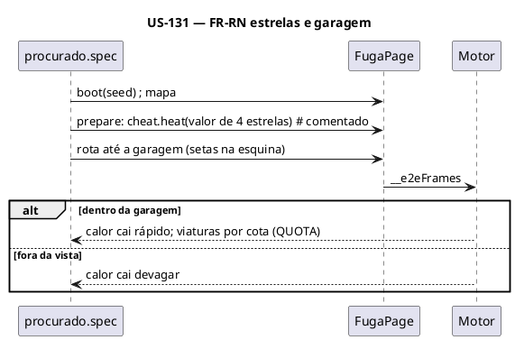

### Sequenciamento de Tarefas

| # | Tarefa | Escopo | Depende de |
|---|---|---|---|
| TF-131-01 | Manual da Fuga da Rocam (reescrito) | Documentação | — |
| TF-131-02 | Gancho da Fuga | Produção | US-125 |
| TF-131-03 | Página e descritor | Infra de teste | TF-131-02 |
| TF-131-04 | Specs das regras | Testes | TF-131-01, TF-131-03 |
| TF-131-05 | Bordas e responsivo | Testes | TF-131-03 |
| TF-131-06 | Piloto | Teste longo | TF-131-03 |
| TF-131-07 | CLAUDE.md e cobertura | Documentação | TF-131-04..06 |

### Tarefas

#### TF-131-01: [sampa-challenges] Manual da Fuga da Rocam
**Contexto de entrada:** `game/constants.ts`, `game/engine.ts` (`QUOTA`, `PERSONAS`, visão `SIGHT_TILES`, `RADIO_MEMORY`, garagem `HIDE_MAX`/`GARAGE_COOLDOWN`), `game/maps.ts` (tiles e classes), `game/nav.ts`, `components/*`.
**Temas:** mapas e tiles; controles (teclado, deslizar, direcional e botões); movimento por grade e curva antecipada (`TURN_TOLERANCE`); turbo; óleo; pedidos e multiplicadores; prazo do urgente; calor e estrelas; viaturas, personas e cotas; helicóptero (5 estrelas); garagem; capacete; itens; vidas; pontuação; pausa; recorde por mapa (`fuga-rocam:recorde:<mapa>`); som.
**Validação / DoD:** padrão -01; nenhum número do equilíbrio fora da tabela de parâmetros.

#### TF-131-02: [sampa-challenges] Gancho da Fuga da Rocam
**Pontos:** `game/e2eHook.ts` reaproveita `snapshot()` e `cheat` (plan.md 3.2) e acrescenta mapa, pedido (tipo, pino, prazo) e `targets()` (centro de tile em coordenadas lógicas, direcional e botões de toque); `components/GameScreen.tsx`.
**Validação / DoD:** padrão -02; duas cargas com a mesma semente → mesmo `snapshot()` após 600 quadros.

#### TF-131-03: [sampa-challenges] Página e descritor da Fuga
**Gestos:** `chooseMap`, `turn(dir)`, `goToTile(tx, ty)` (sequência de curvas pelo `nav`), `turbo`, `oil`, `swipe(dir)`, `dpad(dir)`. `cfg.logical` 640×400. Descritor: spec RN-33.
**Validação / DoD:** padrão -03.

#### TF-131-04: [sampa-challenges] Specs das regras da Fuga
**Arquivos:** `navegacao`, `movimento`, `turbo-oleo`, `pedidos` (cada tipo), `procurado` (subida à vista e por entrega, descida longe, garagem, viaturas por estrela, helicóptero), `captura-escudo`, `itens`, `pausa`, `recorde`.
**Validação / DoD:** padrão -04.

#### TF-131-05: [sampa-challenges] Bordas e responsivo da Fuga
**Específico:** deslizar no mapa em 390 px; direcional e TURBO/ÓLEO.
**Validação / DoD:** padrão -05.

#### TF-131-06: [sampa-challenges] Piloto da Fuga
**Partidas:** uma por mapa; até 3 capturas e ≥ 3 estrelas; resultado recalculado pelas entregas e multiplicadores. `maxFrames` = 20 min por mapa.
**Validação / DoD:** padrão -06.

#### TF-131-07: [sampa-challenges] CLAUDE.md e cobertura da Fuga
**Validação / DoD:** padrão -07.

---

## US-132: Sinuca de Bar — manual e e2e

**Épico:** `[INSERIR_EPICO]` · **Sistema:** sampa-challenges · **Estimativa:** 8 SP · **Prioridade:** P1

### Narrativa de Valor

> **Eu como** jogador e mantenedor, **Eu quero** a regra da casa toda testada e o computador
> determinístico nos testes, **Para que** faltas, grupos e bola castigo não regridam.

### Critérios de Aceitação

- [ ] README `SB-RN-NN` e CLAUDE.md completos.
- [ ] A tacada do computador é a mesma em duas execuções com a mesma semente.
- [ ] Reserva sem worker e descarte de resposta antiga testados.
- [ ] Piloto termina uma partida em cada modalidade contra o computador e uma de 2 jogadores.

### Regras de Negócio Aplicáveis

RN-01..03, RN-06, RN-11 (worker), RN-35, RN-45, RN-47, RN-24.

### Diagramas

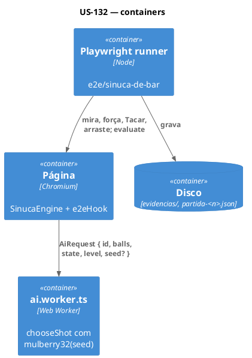

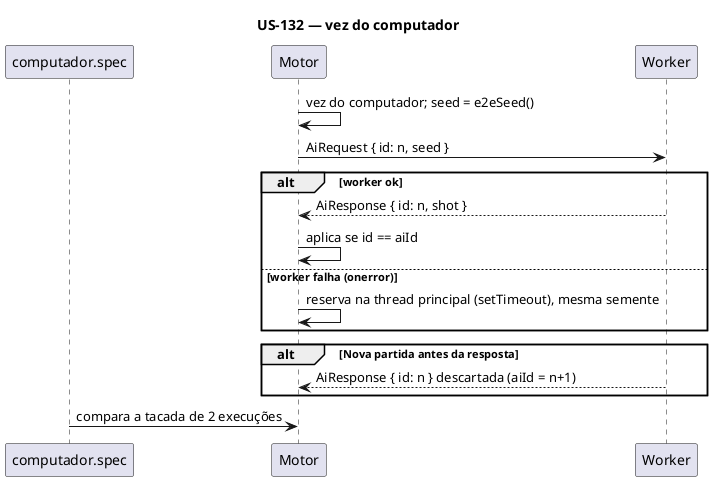

### Sequenciamento de Tarefas

| # | Tarefa | Escopo | Depende de |
|---|---|---|---|
| TF-132-01 | Manual da Sinuca | Documentação | — |
| TF-132-02 | Gancho da Sinuca | Produção — leitura | US-125 |
| TF-132-03 | Semente no pedido ao worker | Produção — IA | TF-125-01 |
| TF-132-04 | Página e descritor | Infra de teste | TF-132-02 |
| TF-132-05 | Specs das regras | Testes | TF-132-01, TF-132-03, TF-132-04 |
| TF-132-06 | Bordas e responsivo | Testes | TF-132-04 |
| TF-132-07 | Piloto | Teste longo | TF-132-03, TF-132-04 |
| TF-132-08 | CLAUDE.md e cobertura | Documentação | TF-132-05..07 |

### Tarefas

#### TF-132-01: [sampa-challenges] Manual da Sinuca de Bar
**Temas:** menu (modalidade, adversário, nível, quem sai, som); controles (mira por toque/arraste, ◀ ▶ ‹ ›, barra Força 5–100%, Tacar, teclado com Shift fino, WASD); linhas de mira; grupos por modalidade; saída e linha de cabeceira; mesa aberta; vez; faltas e bola na mão; bola castigo (vitória e cada derrota na hora); castigo na saída; alternância da saída; computador por nível; parâmetros da mesa; fim de partida e confirmação de nova partida (3 s).
**Validação / DoD:** padrão -01.

#### TF-132-02: [sampa-challenges] Gancho da Sinuca
**Pontos:** `game/engine.ts` (`e2eState()` da plan.md 3.2; `prepare.balls`, `prepare.turn`), `game/e2eHook.ts`, `components/GameScreen.tsx`. `targets()`: bolas e caçapas em coordenadas lógicas; botões e barra Força em coordenadas de página.
**Validação / DoD:** padrão -02.

#### TF-132-03: [sampa-challenges] Semente no pedido ao worker da Sinuca
> **Eu como** suíte, **Eu quero** a tacada do computador reproduzível, **Para que** RN-11 valha fora da página principal.

**Pontos:** `game/ai.worker.ts` (`AiRequest.seed?`; com seed usa `mulberry32(seed)` como `rnd` de `chooseShot`), `game/engine.ts` (`requestAi` preenche `seed: e2eSeed()`; reserva na thread principal usa a mesma semente), função `mulberry32` local do jogo (ou compartilhada em `src/shared/e2e/` se a da Fuga for movida — decidir na TF sem mudar a Fuga).
**Resiliência:** sem flag, `seed` é `undefined` e o comportamento é o atual.
**Validação:** spec `ia-worker.spec.ts`: mesma semente → mesma tacada (2 cargas); `Worker` trocado por um que dispara `onerror` (init script) → partida continua; Nova partida durante "pensando" → resposta descartada.
**DoD:** 3 cenários verdes; `npm run build` ok.

#### TF-132-04: [sampa-challenges] Página e descritor da Sinuca
**Gestos:** `menu(opções)`, `aimAt(x, y)`, `nudgeAim(botão, n)`, `power(pct)`, `shoot()`, `placeCue(x, y)` (arraste), `placeCueKeys`. `cfg.logical` 320×200. Descritor: spec RN-35.
**Validação / DoD:** padrão -03.

#### TF-132-05: [sampa-challenges] Specs das regras da Sinuca
**Arquivos:** `menu`, `mira-forca`, `saida`, `grupos-vez`, `faltas-bola-na-mao`, `castigo`, `computador` (diferença de erro por nível medida em N tacadas com semente fixa), `ia-worker` (da TF-132-03).
**Pré-condições:** `prepare.balls` para montar a mesa de cada falta (comentado).
**Validação / DoD:** padrão -04.

#### TF-132-06: [sampa-challenges] Bordas e responsivo da Sinuca
**Específico:** config corrompida (`sinuca-de-bar:config`) → padrões; arraste da branca por toque em 390 px.
**Validação / DoD:** padrão -05.

#### TF-132-07: [sampa-challenges] Piloto da Sinuca
**Partidas:** lisas × listradas e ímpares × pares contra o computador (Pato, para terminar em tempo), uma de 2 jogadores (piloto nos dois lados); resultado recalculado pelas regras (`rules.ts`) sobre os eventos de cada tacada. `maxFrames` = 20 min por partida.
**Validação / DoD:** padrão -06.

#### TF-132-08: [sampa-challenges] CLAUDE.md e cobertura da Sinuca
**Validação / DoD:** padrão -07; CLAUDE.md documenta o `seed` no `AiRequest`.

---

## US-133: Xadrez Paulistano — manual e e2e

**Épico:** `[INSERIR_EPICO]` · **Sistema:** sampa-challenges · **Estimativa:** 8 SP · **Prioridade:** P1

### Narrativa de Valor

> **Eu como** jogador e mantenedor, **Eu quero** todas as regras oficiais testadas e o computador
> reproduzível nos testes, **Para que** roque, en passant, empates e a IA não regridam.

### Critérios de Aceitação

- [ ] README `XP-RN-NN` e CLAUDE.md completos.
- [ ] Mesma semente → mesmos lances do computador em qualquer máquina (busca por nós nos testes).
- [ ] Reserva sem worker e descarte de resposta antiga (Desfazer/Nova partida) testados.
- [ ] Piloto termina partidas contra os níveis baixo, médio e alto e uma de 2 jogadores.

### Regras de Negócio Aplicáveis

RN-01..03, RN-06, RN-11 (worker), RN-36, RN-46, RN-47, RN-24.

### Diagramas

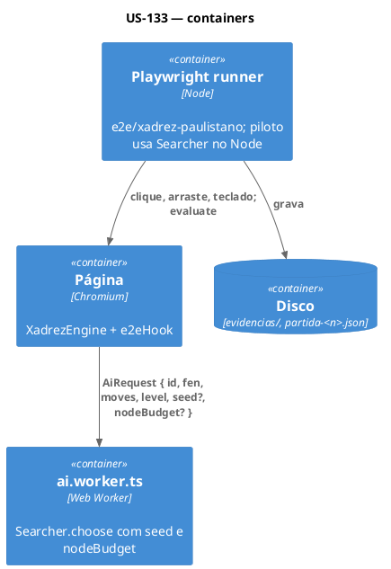

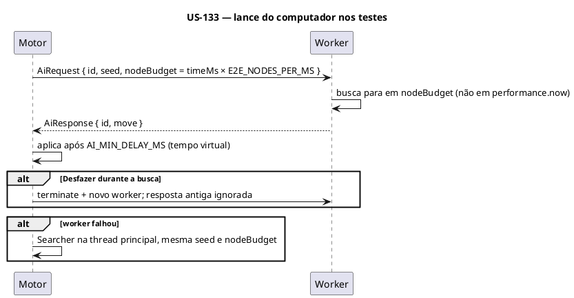

### Sequenciamento de Tarefas

| # | Tarefa | Escopo | Depende de |
|---|---|---|---|
| TF-133-01 | Manual do Xadrez | Documentação | — |
| TF-133-02 | Gancho do Xadrez | Produção — leitura | US-125 |
| TF-133-03 | Semente e orçamento de nós na busca | Produção — IA | TF-125-01 |
| TF-133-04 | Página e descritor | Infra de teste | TF-133-02 |
| TF-133-05 | Specs das regras | Testes | TF-133-01, TF-133-03, TF-133-04 |
| TF-133-06 | Bordas e responsivo | Testes | TF-133-04 |
| TF-133-07 | Piloto | Teste longo | TF-133-03, TF-133-04 |
| TF-133-08 | CLAUDE.md e cobertura | Documentação | TF-133-05..07 |

### Tarefas

#### TF-133-01: [sampa-challenges] Manual do Xadrez Paulistano
**Temas:** menu e persistência (`xadrez-paulistano:config`); controles (clique, arraste, teclado); botões e confirmação (3 s); regras oficiais (cada uma com ID: roque, en passant, promoção, xeque, mate, afogamento, 50 lances, repetição tripla, material insuficiente com os casos listados); notação em português; modos; níveis (`levels.ts`: profundidade, ruído, erro, tempo); girar automático; som; parâmetros.
**Validação / DoD:** padrão -01.

#### TF-133-02: [sampa-challenges] Gancho do Xadrez
**Pontos:** `game/engine.ts` (`e2eState()` da plan.md 3.2; `prepare.fen`), `game/e2eHook.ts`, `components/GameScreen.tsx`. `targets()`: centro de cada casa (`a1`..`h8`) respeitando o giro; botões em coordenadas de página.
**Validação / DoD:** padrão -02.

#### TF-133-03: [sampa-challenges] Semente e orçamento de nós na busca
> **Eu como** suíte, **Eu quero** a busca parando por nós e sorteando com semente, **Para que** os lances não dependam da máquina.

**Pontos:** `game/ai.ts` (`choose(pos, level, random, nodeBudget?)`: com orçamento, o corte por `deadline` e o corte de 55% do tempo usam `nodes` em vez de `performance.now()`), `game/ai.worker.ts` (`AiRequest.seed?`, `nodeBudget?`), `game/engine.ts` (`requestAi` preenche os dois sob `isE2E()`; reserva usa os mesmos), `game/constants.ts` (`E2E_NODES_PER_MS`, calibrado: medir nós/ms em 20 posições no nível 60 e registrar o valor e a medição no CLAUDE.md).
**Resiliência:** sem flag, campos ausentes e comportamento atual intacto (conferir com uma partida manual no navegador).
**Validação:** `ia-worker.spec.ts`: mesma semente → mesma sequência de 10 lances do computador (2 cargas, com outra suíte rodando em paralelo); reserva com `Worker` quebrado; Desfazer e Nova partida durante a busca.
**DoD:** 3 cenários verdes; nível 100 nos testes termina em ≤ 5 s de parede por lance.

#### TF-133-04: [sampa-challenges] Página e descritor do Xadrez
**Gestos:** `menu(opções)`, `move('e2', 'e4')` (clique-clique), `drag('e2', 'e4')`, `keyMove(...)`, `promote(peça)`, `button(nome)` (com segundo clique de confirmação). `cfg.logical` 320×200. Descritor: spec RN-36.
**Validação / DoD:** padrão -03.

#### TF-133-05: [sampa-challenges] Specs das regras do Xadrez
**Arquivos:** `menu`, `lances` (clique, arraste, soltar fora volta, teclado), `regras-especiais` (roque curto/longo, roque proibido por casa atacada, en passant, promoção nas 4 peças), `fim-de-partida` (mate, afogamento, 50 lances, repetição tripla, material insuficiente), `notacao`, `botoes` (Desfazer, Desistir, Nova partida, Girar, Som), `computador` (nível alto vence o baixo em partida com semente fixa), `ia-worker` (TF-133-03).
**Pré-condições:** `prepare.fen` para posições de regra especial (comentado); um caso de cada regra também jogado a partir da posição inicial.
**Validação / DoD:** padrão -04.

#### TF-133-06: [sampa-challenges] Bordas e responsivo do Xadrez
**Específico:** config corrompida → padrões; toque em casas em 390 px; arraste por toque.
**Validação / DoD:** padrão -05.

#### TF-133-07: [sampa-challenges] Piloto do Xadrez
**Partidas:** piloto (Searcher no Node, nível 85, semente fixa) contra os níveis 10, 50 e 90; uma de 2 jogadores; resultado recalculado aplicando os lances num `Position` no Node e comparando o resultado e a lista de lances exibida. `maxFrames` = 30 min por partida; limite de 200 lances com empate forçado registrado como `travou`.
**Validação / DoD:** padrão -06.

#### TF-133-08: [sampa-challenges] CLAUDE.md e cobertura do Xadrez
**Validação / DoD:** padrão -07; CLAUDE.md documenta `seed`, `nodeBudget` e `E2E_NODES_PER_MS`.

---

## US-134: Fechamento — documentação, tempo e estabilidade

**Épico:** `[INSERIR_EPICO]` · **Sistema:** sampa-challenges · **Estimativa:** 3 SP · **Prioridade:** P1

### Narrativa de Valor

> **Eu como** pessoa desenvolvedora, **Eu quero** as suítes documentadas, dentro do orçamento e estáveis,
> **Para que** o PR único possa ser revisado e mesclado com confiança.

### Critérios de Aceitação

- [ ] `e2e/README.md` e `CLAUDE.md` da raiz descrevem todos os jogos, o hub, a base comum e as suítes.
- [ ] Suíte rápida ≤ 10 min; suíte longa ≤ 30 min (tempos medidos e registrados).
- [ ] Suíte rápida verde 3 vezes seguidas; pilotos reproduzíveis.
- [ ] `bugs.md` completo e descrição do PR pronta.

### Regras de Negócio Aplicáveis

RN-61, RN-62; critérios da seção 5 da spec.

### Diagramas

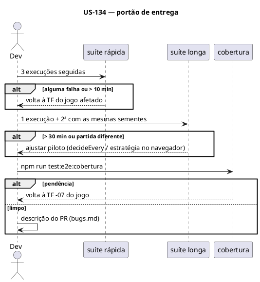

### Sequenciamento de Tarefas

| # | Tarefa | Escopo | Depende de |
|---|---|---|---|
| TF-134-01 | `e2e/README.md` e `CLAUDE.md` da raiz | Documentação | US-124..133 |
| TF-134-02 | Medição de tempo e estabilidade | Verificação | US-124..133 |
| TF-134-03 | `bugs.md` e descrição do PR | Entrega | TF-134-01, TF-134-02 |

### Tarefas

#### TF-134-01: [sampa-challenges] README do e2e e CLAUDE.md da raiz
**Pontos:** `e2e/README.md` (base comum, como rodar cada suíte e cada jogo, evidências, níveis e variáveis, piloto e diagnóstico, cobertura por jogo com link para a seção "Testes" de cada manual, seção Hub com HUB-RN), `CLAUDE.md` da raiz (comandos `test:e2e:longa` e `test:e2e:cobertura`; trocar "hoje só o Pastel de Feira"; checklist inclui cobertura sem pendência), `src/games/pastel-de-feira/README.md` seção 15.2 (base comum).
**Validação:** leitura cruzada dos comandos (cada comando citado executa).
**DoD:** nenhum comando documentado quebrado.

#### TF-134-02: [sampa-challenges] Medição de tempo e estabilidade
**Passos:** medir `time npm run test:e2e` 3 vezes seguidas e `time caffeinate -dimsu npm run test:e2e:longa` 2 vezes (mesmas sementes); comparar `partida-*.json` (sem data); se estourar orçamento, aplicar na ordem: `decideEvery` maior → estratégia do piloto no navegador → reduzir variantes repetidas da suíte rápida (sem tirar RN). Registrar os tempos em `e2e/README.md`.
**Validação:** os comandos acima.
**DoD:** ≤ 10 min e ≤ 30 min; 3/3 verdes; diagnósticos idênticos.

#### TF-134-03: [sampa-challenges] `bugs.md` e descrição do PR
**Pontos:** `docs/specs/e2e-jogos/bugs.md` consolidado (jogo, sintoma, causa, RN, arquivo); descrição do PR (resumo por US, tempos, tabela de bugs, como rodar). Commit e PR só com confirmação do utilizador (skills `commit-message`, `expert-pull-request`).
**DoD:** descrição revisada pelo utilizador; `npm run build` verde.
