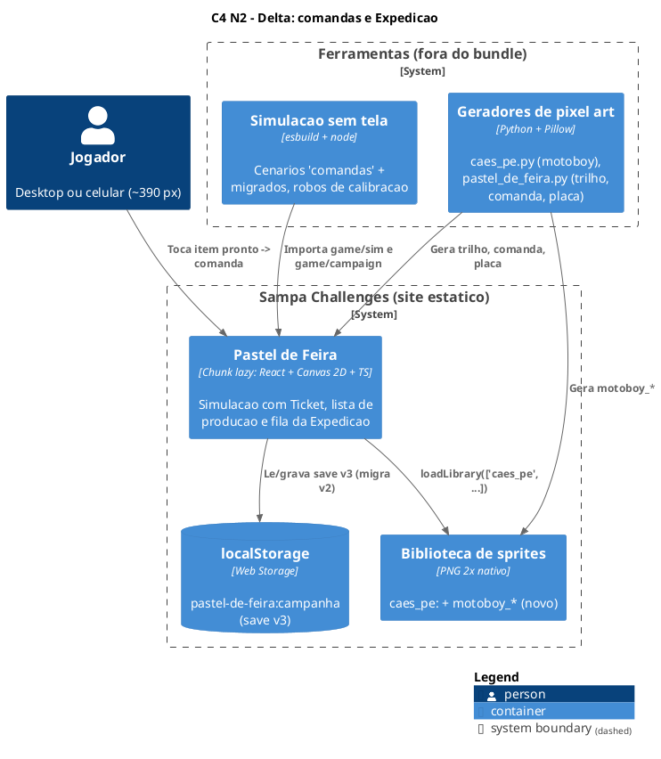
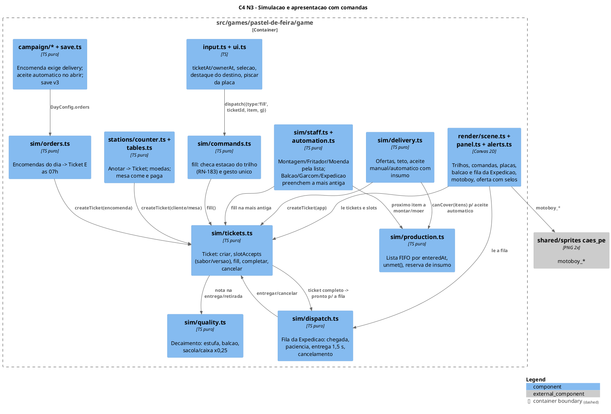
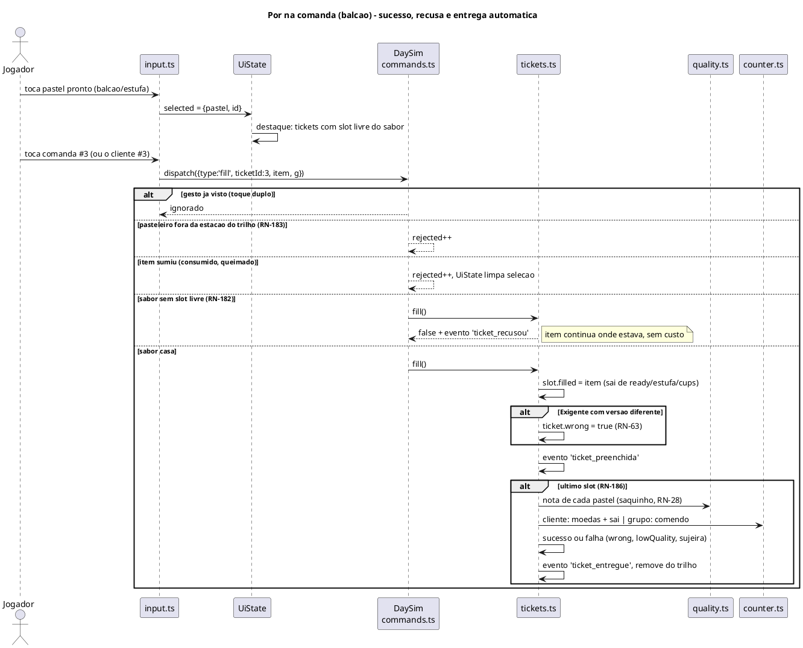
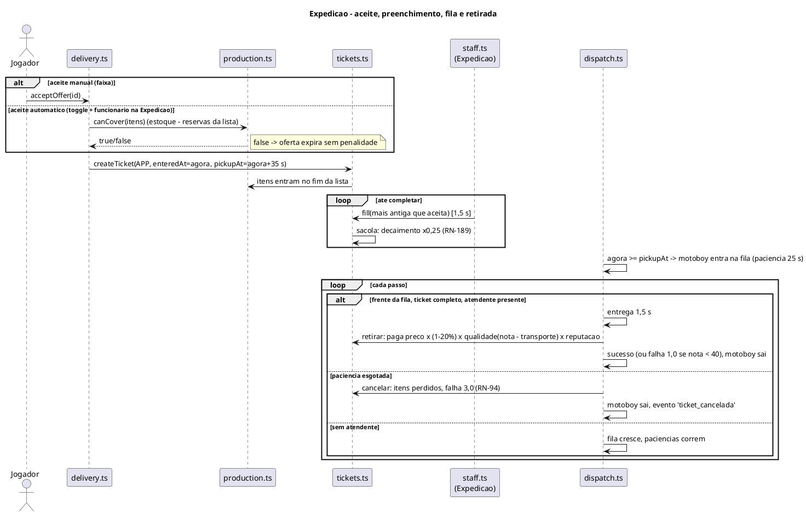
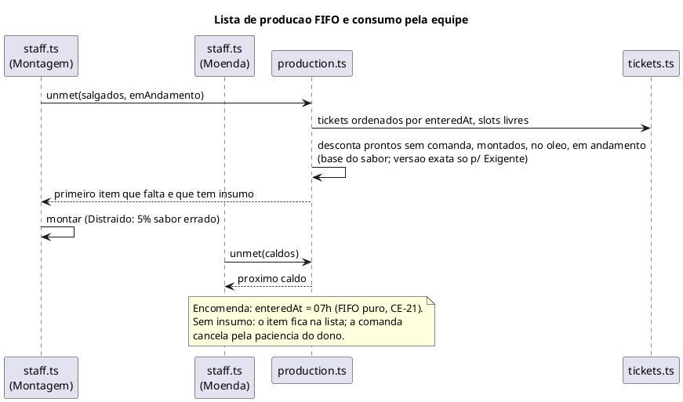

# Planejamento Técnico: Comandas e Expedição com balcão próprio (Pastel de Feira)

> Fase 2 do SDD — O Como. Status: **aprovado (revisão 1)**.
> Pré-requisito: [`spec.md`](spec.md) deste delta, aprovada (revisão 1). Arquitetura base: o
> [`plan.md` principal](../plan.md). Aqui só entra o que muda.

## 1. Visão Geral da Arquitetura

- **Decisão principal:** a simulação ganha uma entidade única, **`Ticket`** (a comanda), em
  `game/sim/tickets.ts`. Ela substitui três estruturas:
  - o estado de entrega de `Customer.lines` (`OrderLine.delivered`);
  - `Comanda` e `Motoboy` (`sim/delivery.ts`);
  - `BigOrder` (`sim/orders.ts`).

  Junto vêm dois módulos:
  - `game/sim/production.ts`: a **lista de produção** FIFO, que substitui a prioridade fixa de
    `unmetItems`;
  - `game/sim/dispatch.ts`: a **fila da Expedição**, que substitui o laço de motoboys e o
    `updateOrders`.
- **Abordagem:** a mesma do jogo, com simulação pura determinística, passo fixo de 1/60 s e entrada
  só por `Command`.
  - Um comando novo, `fill`, passa a ser o **único** caminho de um item pronto até um pedido.
  - A entrega é consequência do estado (comanda completa) e não um comando.
  - A apresentação só lê `DayState`; o destaque e a seleção ficam em `UiState`.
- **Sem dependências novas, sem novo container.** A biblioteca de sprites ganha o motoboy, e o
  gerador do jogo ganha as peças do trilho, da comanda e da placa de número.
- **Save:** `CURRENT_VERSION` 2 → **3**. A migração descarta encomendas aceitas sem área de
  delivery (RN-102 alterada, caso de borda da spec).
- **Repositório afetado:** `sampa-challenges`.

| Caminho | Mudança |
|---|---|
| `src/games/pastel-de-feira/game/sim/tickets.ts` | **Novo.** `Ticket`, criação (anotar, aceite, 07h), `fill`, casamento por sabor/versão (RN-182), entrega automática (RN-186), cancelamento |
| `src/games/pastel-de-feira/game/sim/production.ts` | **Novo.** Lista de produção FIFO (RN-187), `unmet(s, drinks, inProgress)`, reserva de insumo para o aceite automático (RN-95) |
| `src/games/pastel-de-feira/game/sim/dispatch.ts` | **Novo.** Fila da Expedição: chegada de motoboy e de cliente de encomenda, paciência, entrega de 1,5 s e cancelamento (RN-191–193) |
| `game/sim/state.ts` | `DayState.tickets`, `nextTicketNum`, `dispatchQueue`. Saem `comandas`, `motoboys`, `bigOrders`, `Ready.reservedFor` e `Ready.boxed`. `Customer.ticketId`. `OrderLine` perde `delivered` |
| `game/types.ts` | `Command` ganha `fill`. Saem `deliver` e os `Slot` `pronto` e `encomenda` |
| `game/sim/commands.ts` | Despacho de `fill` com a checagem de estação por trilho (RN-183) |
| `game/sim/stations/counter.ts` | `noteOrder` cria o ticket. Sai a lógica de entrega de `deliverItem`/`deliver`, que vai para `tickets.ts`. `lineMatches` vira `slotAccepts` |
| `game/sim/stations/tables.ts` | Comanda M (RN-83). Grupo completo → comendo |
| `game/sim/delivery.ts` | Fica com ofertas, teto e aceite (manual e automático com insumo). Sai o laço de motoboys (vai para `dispatch.ts`) e saem `packPastry`, `shelve` e `pickup` |
| `game/sim/orders.ts` | Encomenda vira ticket às 07h. `boxPastry` e `updateOrders` saem (vão para `tickets.ts`/`dispatch.ts`) |
| `game/sim/demand.ts` | Removido (substituído por `production.ts`) |
| `game/sim/staff.ts` | `pickBalcao`, `pickWaiter` e `pickDispatch` usam `fill` na comanda mais antiga (RN-188) e a tarefa nova `entregar_exp`. `pickAssemble` e `pickCaldo` leem `production.ts` |
| `game/sim/automation.ts` | Moenda automática segue a lista de produção (RN-160) |
| `game/sim/quality.ts` | `currentQuality` com fator de decaimento na sacola/caixa (RN-189) |
| `game/sim/customers.ts` | A troca automática por esgotamento (RN-35) atualiza o item livre do ticket |
| `game/campaign/actions/orders.ts`, `campaign.ts`, `shop.ts` | Encomenda exige escritório **e** delivery. Aceite automático de encomenda ao abrir a feira (RN-102) |
| `game/campaign/save.ts` | Versão 3, `isOrder` exige `owned.delivery`, migração 2→3 |
| `game/constants.ts` | Novos (P): `BAG_DECAY_FACTOR` 0,25; `DISPATCH_HANDOFF` 1,5; `RAIL_VISIBLE` 6 / `RAIL_VISIBLE_NARROW` 4; `TICKET_MIN_TARGET` 28×24. Sai `APP_MOTO_MAX_ORDERS` |
| `game/layout.ts` | Faixa inferior: Mesas 200, Expedição 200, Escritório 100, Descanso 100 (RN-196). Zonas de toque dos trilhos |
| `game/render/scene.ts` | Trilho do balcão e da Expedição, comanda, placa de número, balcão da Expedição, fila de motoboys, mesas 2×2 compactas, balão com placa |
| `game/render/panel.ts` | Balcão sem `CAIXA`. Expedição: comandas + prontos do balcão. Mesas: prontos → comandas M |
| `game/render/alerts.ts` | Faixa de oferta com selos (RN-195) |
| `game/input.ts`, `game/ui.ts` | Toque em comanda (`ticketAt`), atalho no dono, destaque do destino, piscar da placa |
| `game/assets.ts` | `motoboy(cor, pose)` recolorido da biblioteca |
| `game/tutorial.ts` | Passo "pôr na comanda #N" (RN-170) |
| `game/sound.ts` | Som de recusa (`ticket_recusou`) |
| `game/e2eHook.ts` | Expõe `tickets` e `dispatchQueue` |
| `src/shared/sprites/assets/caes_pe/motoboy_*.png` + `README.md` | Sprite do motoboy (parado, andando 0/1, bravo) |
| `tools/pixelart/biblioteca/caes_pe.py` (+ `fonte16`) | Desenho do motoboy (capacete, jaqueta, baú) |
| `tools/pixelart/pastel_de_feira.py` | `equip/trilho_*` (3-slice), `ui/comanda` (9-slice), `ui/placa_num` (9-slice), `equip/sacola_app*` com espaço para a placa |
| `sim/scenarios/comandas.ts` (novo) + grupos migrados | Ver seção 8 |
| `e2e/pastel-de-feira/**` | Gestos novos, migração dos specs e do piloto (seção 8) |
| `docs/specs/pastel-de-feira/spec.md`, `plan.md`, `calibracao.md`, `README.md` e `CLAUDE.md` do jogo | Incorporação do delta (revisão 5) |

## 2. Diagramas de Solução

### 2.1 C4 Nível 2 — Containers (delta)

Os containers são os mesmos do plano principal. Mudam só a biblioteca de sprites (motoboy) e o gerador.



### 2.2 C4 Nível 3 — Componentes afetados



### 2.3 Sequência — Pôr na comanda e entrega automática (sucesso e falha)



### 2.4 Sequência — Expedição: aceite, sacola, motoboy (sucesso e cancelamento)



### 2.5 Sequência — Lista de produção e equipe



## 3. Modelagem de Dados e Persistência

### 3.1 Modelos da simulação (`game/sim/state.ts`)

**`Ticket`** (novo):

| Campo | Tipo | Descrição |
|---|---|---|
| `id` | number | Id interno (`newId`) |
| `num` | number | Número visível, sequencial no dia (RN-180) |
| `kind` | `'balcao' \| 'mesa' \| 'app' \| 'encomenda'` | Prefixo e regras de saída |
| `track` | `'balcao' \| 'expedicao'` | Trilho (RN-181) |
| `owner` | number \| null | `Customer.id` (balcão/mesa), id do motoboy ou do cliente da encomenda na fila (null antes de chegar) |
| `enteredAt` | number | Instante de entrada (RN-180, RN-187) |
| `slots` | `TicketSlot[]` | Um por unidade |
| `pickupAt` | number? | App: aceite + 35 s. Encomenda: horário |
| `pay`, `fine` | number? | Encomenda (RN-102, RN-104) |
| `bagSince` | number? | Instante do 1º pastel na sacola/caixa (RN-189) |
| `wrong` | boolean | Versão errada para o Exigente (RN-63) |

**`TicketSlot`**: `{ item: ItemId; profile?: Profile; gift?: boolean; filled: Ready | Cup | null }`. O
objeto pronto **sai** de `s.ready`/`s.cups` e fica no slot, mantendo `quality` e `readyAt`.

**`DispatchEntry`** (novo, fila da Expedição): `{ id; ticketId; who: 'motoboy' | 'encomenda'; patience; patienceMax; arrivedAt; handoffLeft: number | null }`.

**Alterações:**
- `DayState`: + `tickets: Ticket[]`, `nextTicketNum: number` e `dispatchQueue: DispatchEntry[]`.
  Saem `comandas`, `motoboys` e `bigOrders`, porque os dados da encomenda vão para o `Ticket` e
  `DayConfig.orders` continua a origem.
- `Customer`: + `ticketId: number | null`. `OrderLine` perde `delivered`, pois o estado preenchido
  fica no slot. `wrong` e `lowQuality` passam para o ticket.
- `Ready`: saem `reservedFor` e `boxed`. Continuam `warmed`, `quality` e `readyAt`.
- `WorkerTask.kind`: + `'preencher'` (com `ticketId` e `ref`) e `'entregar_exp'` (com o id da
  `DispatchEntry`). Saem `'entregar'` e `'embalar'`.
- `SimEvent`: + `ticket_criada`, `ticket_preenchida`, `ticket_recusou`, `ticket_entregue`,
  `ticket_cancelada`, `fila_exp_chegou` e `fila_exp_saiu`. Os eventos `comanda_*`, `moto_chegou` e
  `encomenda_*` passam a ser emitidos a partir dos novos, mantendo os nomes que o som e os testes
  usam até a migração terminar. Depois saem.

**Decaimento (RN-189).** `currentQuality(r, t)` recebe o contexto:

| Onde está | Decaimento |
|---|---|
| Na estufa | regra atual |
| No slot de comanda do balcão | 1 ponto/s depois de 20 s de espera |
| No slot de sacola ou caixa | o decaimento corre com `BAG_DECAY_FACTOR` a partir de `bagSince` |

A nota de pagamento do app é a da retirada menos o transporte (RN-25).

### 3.2 Contrato do comando (`game/types.ts`)

```json
{
  "type": "fill",
  "ticketId": "number — Ticket.id existente e aberto",
  "item": { "kind": "'pastel' | 'copo'", "id": "number — em s.ready (sem comanda) ou s.cups" },
  "g": "number — id do gesto; repetido = ignorado"
}
```

Validação em `commands.ts` (zero trust; o comando vem da UI ou do replay):

1. ticket existe e está aberto;
2. o ator está na estação do trilho: `balcao` (ou `mesas` para `kind = 'mesa'`), ou `expedicao`;
3. o item existe e não está em outra comanda;
4. `slotAccepts`.

Qualquer falha incrementa `rejected` e não muda o estado. Só a recusa por sabor (item 4) emite
`ticket_recusou`.

### 3.3 Persistência (`localStorage`, save v3)

| Mudança | Detalhe |
|---|---|
| `CURRENT_VERSION` | 2 → 3 |
| `isOrder` | exige `owned.office && owned.delivery` |
| Migração 2→3 | se `!owned.delivery`, `orders = []` e uma flag `avisos.encomendaDescartada = true` para o aviso único no Preparo. O resto é copiado |
| `autoAccept` | Sem mudança de formato. A UI só permite ligar com funcionário fixo na Expedição |

O estado do dia não é salvo (checkpoint do início do dia, JA-06), então `Ticket` não entra no save.
Os replays gravados antes da mudança ficam inválidos: os comandos mudam e o hash muda.

### 3.4 Layout (`game/layout.ts`)

`LOW` com larguras por zona: `mesas` 200, `expedicao` 200, `escritorio` 100, `descanso` 100, com o
mesmo `GAP` 6 (8 + 200 + 6 + 200 + 6 + 100 + 6 + 100 = 626).

| Zona | Posição |
|---|---|
| Mesas (`seatSpot`) | colunas a `z.x + 6 + (t % 2) × 96`; lugares a +12 e +76 da mesa |
| Trilho do balcão | faixa de 14 de altura no topo da zona `balcao`, abaixo da placa |
| Trilho da Expedição | topo da zona `expedicao` |

## 4. Contratos de Integração

### 4.1 Simulação ↔ apresentação

`render/*` lê `DayState.tickets`, `dispatchQueue`, `ready` e `cups`, e não altera nada. `UiState`
ganha:
- `highlightOwner: { ticketId; left: number } | null`: a placa pisca por 1 s;
- `destinations(selected) → Set<ticketId>`: a lista é derivada a cada quadro, sem guardar estado.

### 4.2 Biblioteca de sprites (`src/shared/sprites/assets/caes_pe/`)

| Item | Valor |
|---|---|
| Arquivos | `motoboy_{parado,andando_0,andando_1,bravo}.png` |
| Formato | 2× nativo, com as mesmas chaves de cor (magenta base, sombra e luz) dos outros `caes_pe` |
| Partes fixas | capacete, jaqueta e baú com as cores do app |
| Uso | `Assets.motoboy(cor, pose)` |

O README da biblioteca lista o sprite novo.

### 4.3 Gancho E2E (`window.__pf`)

O gancho passa a expor, só para leitura:
- `tickets`: `num`, `kind`, `track`, `owner` e os slots com `item` e `filled` (sabor);
- `dispatchQueue`: quem, `ticketId`, paciência e `handoffLeft`;
- `selected` e `destinations`, vindos de `UiState`.

Os campos `comandas`, `motoboys` e `bigOrders` saem, e os testes migram para os novos.

### 4.4 Campanha ↔ Preparo

| Ponto | Mudança |
|---|---|
| `rollOrders` e `acceptOrder` | exigem `owned.office && owned.delivery` |
| `autoAcceptOrders(c)` (novo) | roda ao abrir a feira, antes de `toDayConfig`: aceita as ofertas cobertas pelo estoque (somando as já aceitas), com `autoAccept` ligado e funcionário fixo na Expedição |
| Aba Cardápio | o toggle de aceite automático fica desabilitado sem esse funcionário, com o texto "precisa de alguém fixo na Expedição" |

## 5. Resiliência, Segurança e Tratamento de Erros

### 5.1 Matriz de falhas

| Componente | Falha | Estratégia | Impacto no jogador |
|---|---|---|---|
| `fill` | Ticket fechado ou item inexistente (corrida com a equipe) | Rejeita, `rejected++`, a UI limpa a seleção | Nada acontece; o destaque some |
| `fill` | Toque duplo | Gesto `g` processado uma vez | O item entra uma vez só |
| `fill` | Sabor sem slot | Recusa sem custo + `ticket_recusou` | A comanda treme e toca o som curto |
| Equipe | Dois funcionários preenchem a mesma comanda com o último slot | `claimed()` por `ticketId` + slot, como hoje com `entregar` | Sem item duplicado |
| `dispatch.ts` | Ticket cancelado com itens | Itens viram desperdício, falha pelo peso (RN-94/104) | Dono sai irritado |
| `production.ts` | Sem insumo para um item | O item fica na lista; a equipe pula para o próximo que tem insumo | O ticket cancela pela paciência |
| `quality.ts` | `bagSince` ausente com slot preenchido | Usa `readyAt` do pastel (fallback conservador) | Nenhum |
| Save | v2 com encomenda sem delivery | Migração descarta e avisa | Aviso único no Preparo |
| Save | v3 inválido | Regra atual: descarta e começa nova campanha | Aviso atual |
| Render | Mais comandas que o trilho mostra | "+N"; atalho no dono | Nenhum bloqueio |

### 5.2 Segurança

Sem entrada externa nova. O `fill` valida ids contra o estado (passo 3.2). `localStorage` em
`try/catch` (regra 10 da raiz).

### 5.3 Observabilidade (adaptada a jogo estático)

- Os eventos `ticket_*` e `fila_exp_*` entram no log do replay (`startLog`).
- O `DayResult` ganha `tickets: { criadas, entregues, canceladas, recusas, versaoErrada }`, usado
  pelo relatório dos robôs e pelo fechamento (a linha "app: N cancelados" continua).
- O cabeçalho das evidências E2E (`describe.ts`) passa a mostrar "Comandas: balcão N · Expedição N ·
  fila Exp N".

### 5.4 Calibração dos valores (P)

`--bots all --seeds 50` antes e depois. Valores a calibrar:
- novos: `BAG_DECAY_FACTOR`, `DISPATCH_HANDOFF`, `RAIL_VISIBLE`;
- afetados: a paciência (RN-06), o intervalo de chegada (RN-02) e a espera do motoboy (RN-92), por
  dois motivos: o sabor errado agora é bloqueado e a lista FIFO tira a prioridade do app e da
  encomenda.

Critério: os 4 robôs passam em pelo menos 80% das sementes, e os critérios da seção 5 da spec
principal continuam válidos (piso dos dias 1 a 3, armadilha do delivery, trade-off do brinde). O
resultado vai para o `calibracao.md`.

## 6. Justificativa e Trade-offs

| Decisão | Alternativa descartada | Motivo |
|---|---|---|
| Entidade única `Ticket` | Adaptador sobre `Customer.lines`, `Comanda` e `BigOrder` | Um só caminho de preenchimento, entrega, casamento e cancelamento. O adaptador manteria três implementações do RN-182 |
| Pronto **dentro** do slot (sai de `ready`) | Manter em `ready` com `reservedFor` | Elimina a classe de bug "reservado mas visível no balcão"; a estufa guarda só pronto sem comanda (RN-27) |
| Entrega derivada do estado | Comando `deliver` | Entrega automática (RN-186) sem ação nova e sem estado intermediário |
| `dispatch.ts` separado | Manter o motoboy em `delivery.ts` | A fila trata motoboy e encomenda iguais (RN-191); `delivery.ts` fica só com as ofertas |
| Uma entrega (sim + tela) | Duas PRs | Decisão do utilizador. O risco é o diff grande; a mitigação é sequenciar as US com os cenários verdes a cada TF |

## 7. Volumetria e Orçamento

| Item | Pior caso |
|---|---|
| Comandas simultâneas | 6 (fila do balcão) + 4 grupos de mesa + 10 do app (teto com Conta Parceira) + 3 encomendas ≈ 23 |
| Lista de produção | ≤ 23 comandas × 4 itens + 40 de encomenda ≈ 130 itens; recalculada por consulta da equipe (≤ 14 funcionários por passo), O(n) |
| Desenho | 6 + 4 comandas visíveis com ≤ 5 selos cada, 4 motoboys, placas; dentro do orçamento de 60 quadros/s da spec |

## 8. Plano de testes

| Camada | O que muda |
|---|---|
| Cenários sem tela | **Novo grupo `comandas`**: RN-180 a RN-196 e as regras alteradas (63, 83, 95, 102, 104, 189). **Migração** de `deliverItem`, `boxPastry` e `packPastry` para `fill` em `balcao`, `combinacoes`, `delivery`, `desafios`, `encomendas`, `eventos-previstos`, `fechamento`, `mesas`, `moenda`, `pagamento`, `perfis`, `promocoes`, `reputacao`, `sujeira`, `tutorial` e `xepa-tema`; `layout` com as larguras novas; `testConfig.ts` |
| Jogador automático e robôs | `sim/player.ts` decide `fill` (comanda mais antiga compatível) e o deslocamento à Expedição; `bots.ts` sem `deliver` |
| E2E | `GamePage`: `porNaComanda(num)`, `tocarDono(num)`, `atenderExpedicao()`. Cada RN nova ou alterada com um teste que cita o número; os specs `pedido`, `mesas-delivery`, `escritorio`, `promocoes`, `clientes`, `dia-completo`, `tutorial`, `receitas-selos`, `bancada`, `eventos`, `fechamento`, `navegacao`, `opcoes-save` e `progressao` migram; o piloto (`pilot.browser.ts`, `flow.ts`, `strategy.ts`) traduz `fill` em toques |
| Cobertura | `npm run test:e2e:cobertura` sem pendência |
| Campanha | `npm run test:e2e:campanha` (a economia muda) |
| Visual | Captura da Expedição e da faixa inferior comparada com os mockups (revisão humana) |

## 9. Riscos Técnicos

| Risco | Mitigação |
|---|---|
| Diff grande numa entrega única (decisão do utilizador) | US sequenciadas topologicamente; cada TF fecha com `--scenario all` verde |
| A lista FIFO com encomenda às 07h trava o balcão de manhã | Calibrar pelos robôs; registrar o efeito no `calibracao.md`. A regra (CE-21) não muda sem decisão do utilizador |
| O piloto da campanha E2E depende do jogador automático | Migrar `player.ts` antes do piloto; rodar a campanha só no fim |
| Mesas com 200 de largura deixam a placa sobre o 1º cliente sentado (visto no mockup) | Ajuste fino do `seatSpot` na TF de layout, com captura de evidência |
| Replays antigos inválidos | Documentar no README (seção 16) e regravar os replays de referência |
