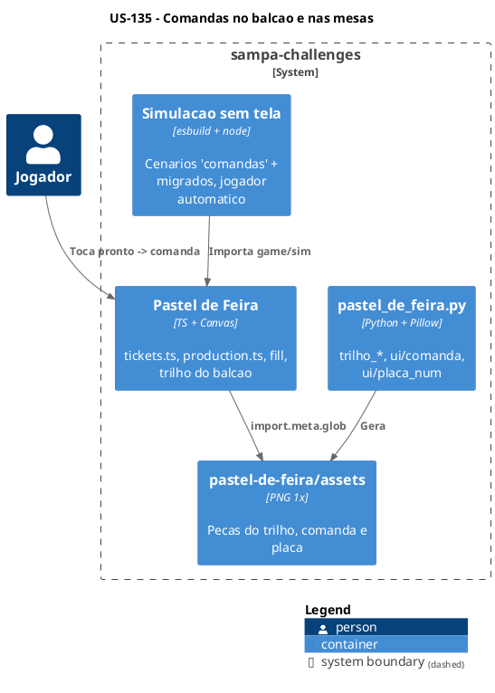
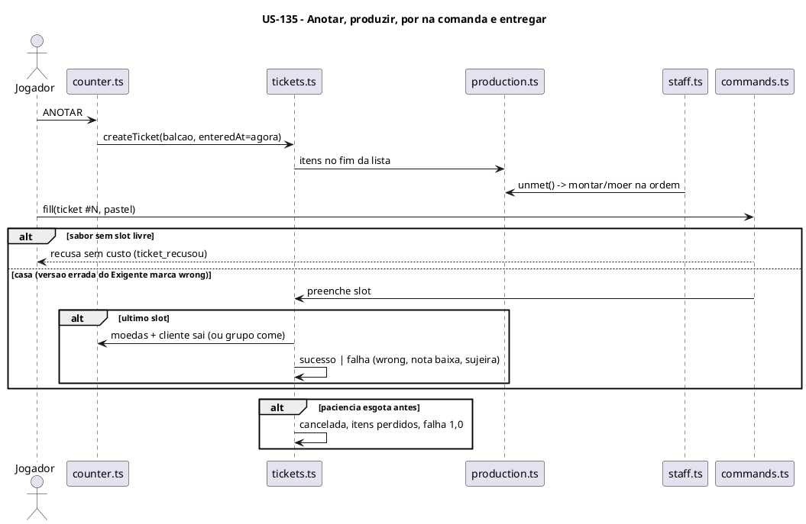
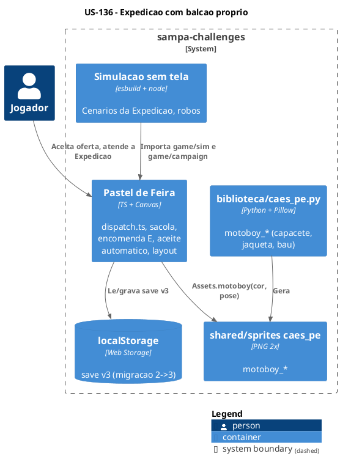
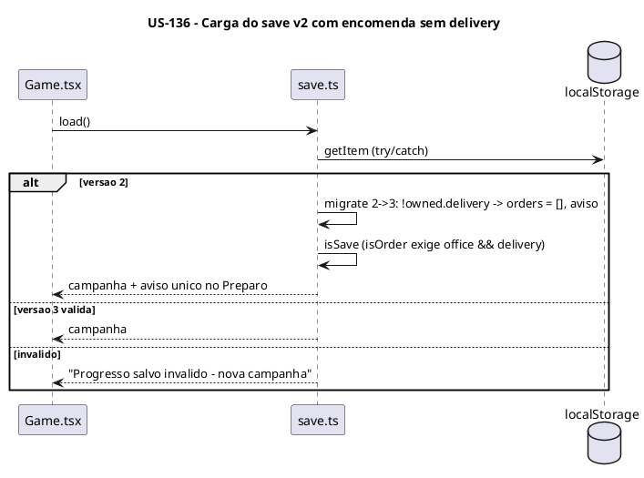
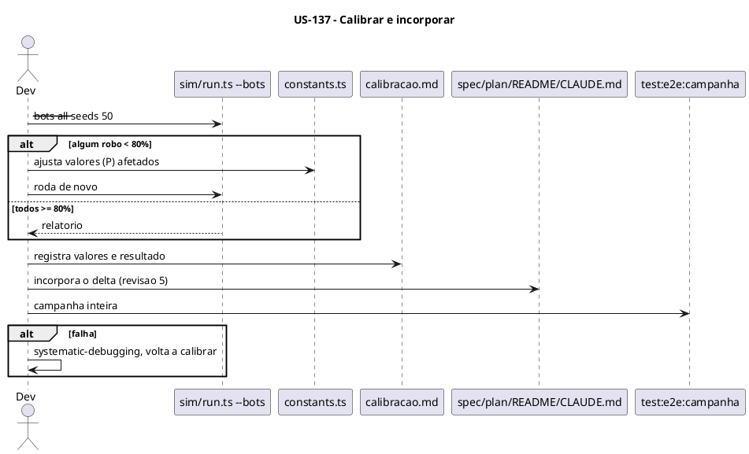

# Backlog de Execução: Comandas e Expedição com balcão próprio (Pastel de Feira)

> Fase 3 do SDD. Status: **aprovado (revisão 1)**.
> Pré-requisitos: [`spec.md`](spec.md) e [`plan.md`](plan.md) deste delta, aprovados (revisão 1).
> Entrega única (um PR), sequenciada pelas TF abaixo. Toda TF de simulação fecha com
> `node /tmp/pf-sim.mjs --scenario all` verde e `npm run typecheck` sem erros.

## Épico de Referência

**Épico:** [INSERIR_ID_EPICO] Pastel de Feira

---

## Rastreabilidade

| Regra (spec.md) | Decisão (plan.md) | User Story | Tarefas |
|---|---|---|---|
| RN-180, RN-07 | `Ticket` em `sim/tickets.ts`; criação ao anotar | US-135 | TF-135-01 |
| RN-182, RN-186, RN-63, RN-83, RN-42, RN-43 | Comando `fill`, `slotAccepts`, entrega derivada do estado | US-135 | TF-135-02 |
| RN-187, RN-160, RN-35 | `sim/production.ts` substitui `demand.ts` | US-135 | TF-135-03 |
| RN-188, RN-40 | Tarefa `preencher` na comanda mais antiga | US-135 | TF-135-04 |
| RN-181, RN-185, RN-74, RN-75 | Peças de arte do trilho, da comanda e da placa | US-135 | TF-135-05 |
| RN-181, RN-184, RN-185, RN-170 | Render do trilho do balcão, balão com placa, gestos e destaque | US-135 | TF-135-06, TF-135-07 |
| Todas da US-135 | Jogador automático e gancho; suporte E2E e piloto; migração dos specs; testes E2E novos (`comandas.spec.ts`) | US-135 | TF-135-08, TF-135-09, TF-135-10, TF-135-11 |
| RN-189, RN-25, RN-27, RN-91, RN-96 (removida) | Sacola/caixa no `Ticket`, decaimento com contexto | US-136 | TF-136-01 |
| RN-191, RN-192, RN-193, RN-92, RN-94 | `sim/dispatch.ts` | US-136 | TF-136-02 |
| RN-104 | Encomenda como `Ticket` E às 07h | US-136 | TF-136-03 |
| RN-183, RN-188 (Expedição) | `pickDispatch` com `fill` + `entregar_exp` | US-136 | TF-136-04 |
| RN-95 | Aceite automático com reserva de insumo | US-136 | TF-136-05 |
| RN-102, CE-22 | Encomenda exige delivery; aceite automático no abrir; save v3 | US-136 | TF-136-06 |
| RN-196 | Larguras da faixa inferior e mesas 2×2 compactas | US-136 | TF-136-07 |
| RN-194, RN-165 | Sprite `motoboy_*` na biblioteca | US-136 | TF-136-08 |
| RN-190, RN-195, RN-75 | Render do balcão e da fila da Expedição, painel, oferta com selos | US-136 | TF-136-09 |
| Todas da US-136 | Jogador automático e piloto; migração dos specs; testes E2E novos (`expedicao.spec.ts`) | US-136 | TF-136-10, TF-136-11, TF-136-12 |
| Valores (P) novos e afetados | Calibração pelos robôs | US-137 | TF-137-01 |
| Delta inteiro | Incorporação na spec principal (revisão 5), no plan principal, no README e no `CLAUDE.md` | US-137 | TF-137-02 |
| Critérios de sucesso (spec seção 5) | Campanha completa, suíte inteira e cobertura | US-137 | TF-137-03 |

---

## Visão Geral das User Stories

| # | User Story | Entrega de Valor |
|---|---|---|
| US-135 | Comandas no balcão e nas mesas | O jogador vê cada pedido com sabores, dono e o que falta, põe o pastel na comanda e a entrega acontece sozinha |
| US-136 | Expedição com balcão próprio e fila de motoboys | App e encomenda seguem o mesmo fluxo, com motoboy distinguível, sacola visível e fila com paciência |
| US-137 | Equilíbrio recalibrado e manual atualizado | O jogo continua vencível nos mesmos critérios, e o manual e a spec descrevem o comportamento novo |

---

## US-135: Comandas no balcão e nas mesas

**Épico:** [INSERIR_ID_EPICO] Pastel de Feira
**Sistema:** sampa-challenges
**Estimativa:** 13 Story Points
**Prioridade:** P0

### Narrativa de Valor

> **Eu como** jogador,
> **Eu quero** ver cada pedido como uma comanda numerada com os sabores e pôr o pastel pronto nela,
> **Para que** eu saiba para quem é cada item, o que falta e quem já recebeu.

### Contexto de Negócio

Hoje a entrega é tocar no pastel e depois no cliente, sem nenhuma ligação visível. A US introduz o
modelo de comanda (`Ticket`) em toda a simulação, a lista de produção única que a equipe segue e a
apresentação do trilho do balcão. A Expedição (US-136) reaproveita o mesmo modelo. A US envolve dois
containers: o gerador de arte e o jogo.

### Critérios de Aceitação (Nível de Negócio)

- [ ] Anotar cria a comanda #N no trilho do balcão, com os selos de sabor, e o cliente ganha a placa #N.
- [ ] Pastel ou caldo tocado e depois a comanda (ou o cliente) entra na comanda. Sabor errado é recusado sem custo; versão errada para o Exigente entra e conta falha na entrega.
- [ ] Comanda completa é entregue sozinha: o cliente paga e sai; o grupo de mesa come e depois paga.
- [ ] Com um item selecionado, as comandas compatíveis ficam destacadas e as demais esmaecidas.
- [ ] Montagem, Fritador e Moenda produzem na ordem de entrada dos pedidos.
- [ ] O tutorial do dia 1 guia "pôr na comanda #N".

### Regras de Negócio Aplicáveis

| # | Regra | Tipo |
|---|---|---|
| RN-180 a RN-188 | Comandas, trilhos, pôr na comanda, destaque, placa, entrega automática, lista de produção, equipe | Obrigatória |
| RN-63, RN-83, RN-42, RN-43, RN-07, RN-35, RN-160, RN-170 | Alteradas pelo delta | Obrigatória / Condicional |

### Diagrama — C4 N2 da US

### Diagrama — Sequência da US

### Sequenciamento de Tarefas

| # | Tarefa | Escopo | Depende de |
|---|---|---|---|
| TF-135-01 | Modelo `Ticket` e criação ao anotar | Simulação (modelo) | — |
| TF-135-02 | Comando `fill`, casamento e entrega automática | Simulação (regras) | TF-135-01 |
| TF-135-03 | Lista de produção FIFO | Simulação (produção) | TF-135-01 |
| TF-135-04 | Equipe do Balcão e Garçom preenche a mais antiga | Simulação (equipe) | TF-135-02, TF-135-03 |
| TF-135-05 | Arte: trilho, comanda e placa de número | Pixel art do jogo | — |
| TF-135-06 | Render do trilho do balcão, comanda, placa e balão | Apresentação (render) | TF-135-02, TF-135-05 |
| TF-135-07 | Gestos, destaque do destino, painel e tutorial | Apresentação (entrada/UI) | TF-135-06 |
| TF-135-08 | Jogador automático, robôs e gancho E2E com comandas | Testes (sim) | TF-135-04 |
| TF-135-09 | E2E: suporte da `GamePage` e piloto com comandas | Testes E2E (suporte) | TF-135-07, TF-135-08 |
| TF-135-10 | E2E: migração dos specs existentes do balcão e das mesas | Testes E2E (migração) | TF-135-09 |
| TF-135-11 | E2E: testes novos das regras de comandas no balcão | Testes E2E (novos) | TF-135-09 |

### Tarefas

#### TF-135-01: Modelo `Ticket` e criação ao anotar

**User Story:** US-135 Comandas no balcão e nas mesas
**Épico:** [INSERIR_ID_EPICO] Pastel de Feira
**Sistema:** sampa-challenges
**Prioridade:** P0

##### 1. Descrição e Objetivo

> **Eu como** simulação do dia,
> **Eu quero** uma entidade `Ticket` criada quando o pedido entra,
> **Para que** todo pedido tenha número, dono, itens e trilho (RN-180, `plan.md` 3.1).

##### 2. Especificação Técnica

**2.1 Pontos de interceptação**
- `game/sim/state.ts`:
  - `Ticket`, `TicketSlot` e `DayState.tickets` / `nextTicketNum`;
  - `Customer.ticketId`;
  - `OrderLine` sem `delivered`; `wrong` e `lowQuality` passam para o `Ticket`.
- `game/sim/tickets.ts` (novo): `createTicket(s, kind, owner, lines, enteredAt)`, `ticketOf(s, customerId)`, `openTickets(s, track)`, `cancelTicket(s, t, weight)`, eventos `ticket_criada` e `ticket_cancelada`.
- `game/sim/stations/counter.ts`: `noteOrder` cria o ticket `balcao` ou `mesa` (garçom ou cliente de mesa na fila, RN-83).
- `game/sim/customers.ts`: paciência esgotada cancela o ticket (itens viram desperdício, RN-06); a troca por esgotamento (RN-35) muda o `item` do slot livre.
- RN-07 (corte das 14h): tickets abertos são perdidos sem falha, e os itens dentro deles contam como desperdício.

**2.2 Dados:**
- `num` sequencial no dia, a partir de 1;
- `track`: `balcao` para `kind` balcão e mesa;
- `enteredAt` = `now(s)`.

**2.3 Contrato:** `plan.md` 3.1. Nenhum comando novo nesta TF.

**2.4 Resiliência e Zero Trust**

| Cenário | Estratégia | Impacto |
|---|---|---|
| Cliente sai com ticket aberto | `cancelTicket` remove do trilho e devolve os itens como desperdício | Sem ticket órfão |
| Anotar duas vezes o mesmo cliente | `noteOrder` só age em `aguardando` (regra atual) | Um ticket por cliente |

##### 3. Modelagem Visual

Sequência da US-135 (trecho "ANOTAR").

##### 4. Orientação de Execução

**4.1 Contexto de entrada:** `plan.md` 3.1; `game/sim/state.ts`; `game/sim/stations/counter.ts`; `game/sim/customers.ts`; `sim/harness.ts`.

**4.2 Passos**
1. Tipos em `state.ts` e `createState`.
2. `tickets.ts` com criação e cancelamento.
3. `noteOrder` e cancelamento por paciência.
4. Troca automática atualiza o slot.
5. Corte das 14h.
6. Cenários novos em `sim/scenarios/comandas.ts` (registrar em `index.ts`): RN-180 (número, prefixo, dono, itens com brinde), cancelamento por paciência e RN-07.

**4.3 Validação:** `npm run typecheck`; `npx esbuild src/games/pastel-de-feira/sim/run.ts --bundle --platform=node --format=esm --outfile=/tmp/pf-sim.mjs && node /tmp/pf-sim.mjs --scenario all`.

**4.4 Restrições negativas**
- NÃO usar `Math.random` nem `Date` na simulação.
- NÃO apagar `OrderLine` ainda usado pela apresentação sem ajustar a leitura (o balão lê do ticket a partir da TF-135-06; até lá, mantenha a compilação).

**4.5 Skills:** `test-driven-agentic-development`, `verification-before-completion`.

**4.6 Critérios de saída**
- [ ] Cenários RN-180 e de cancelamento verdes.
- [ ] `--scenario all` verde.

---

#### TF-135-02: Comando `fill`, casamento e entrega automática

**User Story:** US-135 Comandas no balcão e nas mesas
**Épico:** [INSERIR_ID_EPICO] Pastel de Feira
**Sistema:** sampa-challenges
**Prioridade:** P0

##### 1. Descrição e Objetivo

> **Eu como** jogador,
> **Eu quero** pôr um pronto numa comanda escolhida e ver a comanda completa ser entregue sozinha,
> **Para que** a entrega seja explícita e sem erro de sabor (RN-182, RN-186, RN-63).

##### 2. Especificação Técnica

**2.1 Pontos de interceptação**
- `game/types.ts`: `Command` ganha `{ type: 'fill'; ticketId; item: ItemRef; g }` e perde `deliver`.
- `game/sim/commands.ts`: valida o `fill` na ordem do `plan.md` 3.2:
  - ticket aberto;
  - ator na estação do trilho (`balcao`, ou `mesas` para `kind = 'mesa'`);
  - item existente e sem comanda;
  - `slotAccepts`.
- `game/sim/tickets.ts`:
  - `slotAccepts(t, slot, item)`: mesmo sabor (`ITEMS[].base`); a versão só importa para o Exigente, e com versão errada o item entra e marca `t.wrong`;
  - `fill(s, t, ref)`: tira o pronto de `s.ready`/`s.cups` (e da estufa) e põe no slot;
  - `completeTicket(s, t)`: balcão → nota com saquinho (RN-28), valor (RN-20), moedas e o cliente sai; mesa → `eating` (RN-82).

  Na conclusão vale sucesso ou falha, por `wrong` (1,0), nota abaixo do mínimo (RN-15) e sujeira ≥ 80 (RN-133). Também conta o brinde (RN-122) e soma a sujeira por pedido (RN-131).
- `game/sim/stations/counter.ts`: removem-se `deliverItem`, `deliver` e `lineMatches`; a lógica vai para `tickets.ts`.
- `game/sim/stations/tables.ts`: o grupo da comanda M completa passa a comer.

**2.2 Dados:** sem novos campos além do `plan.md` 3.1.

**2.3 Contrato:** `plan.md` 3.2. Eventos `ticket_preenchida`, `ticket_recusou` e `ticket_entregue`. Os eventos antigos usados pelo som (`entregou`, `item_errado`) continuam sendo emitidos.

**2.4 Resiliência e Zero Trust**

| Cenário | Estratégia | Impacto |
|---|---|---|
| Gesto repetido | `seenGestures` (regra atual) | O item entra uma vez |
| Item já em outra comanda ou consumido | Rejeita, `rejected++` | Sem duplicação |
| Ator fora da estação | Rejeita, `rejected++` | Sem efeito |

##### 3. Modelagem Visual

`plan.md` 2.3.

##### 4. Orientação de Execução

**4.1 Contexto de entrada:** `plan.md` 2.3 e 3.2; `game/sim/stations/counter.ts` (lógica atual de `deliverItem`); `game/sim/stations/tables.ts`; `sim/scenarios/{balcao,mesas,promocoes,xepa-tema,sujeira,perfis,reputacao,pagamento}.ts`.

**4.2 Passos**
1. Contrato do comando.
2. `slotAccepts`, `fill` e `completeTicket`.
3. Despacho em `commands.ts`.
4. Remover a entrega antiga.
5. Migrar os cenários que chamam `deliverItem` para `fill`.
6. Cenários novos: RN-182 (recusa sem custo, versão errada), RN-186 (balcão e mesa), RN-63, RN-83 e o gesto duplo.

**4.3 Validação:** `npm run typecheck`; `--scenario all`.

**4.4 Restrições negativas**
- NÃO manter um segundo caminho de entrega: `fill` é o único.
- NÃO cobrar o saquinho antes da conclusão (a regra atual consome o saquinho na entrega do pastel; manter por pastel, na conclusão).

**4.5 Skills:** `test-driven-agentic-development`, `systematic-debugging` (se algum cenário migrado divergir).

**4.6 Critérios de saída**
- [ ] Nenhuma referência a `deliverItem`, `deliver` ou `lineMatches` em `game/` e `sim/`.
- [ ] Cenários migrados e novos verdes.

---

#### TF-135-03: Lista de produção FIFO

**User Story:** US-135 Comandas no balcão e nas mesas
**Épico:** [INSERIR_ID_EPICO] Pastel de Feira
**Sistema:** sampa-challenges
**Prioridade:** P0

##### 1. Descrição e Objetivo

> **Eu como** equipe da produção,
> **Eu quero** uma lista única de itens a produzir, na ordem de entrada dos pedidos,
> **Para que** balcão, mesa, app e encomenda sigam o mesmo mecanismo (RN-187).

##### 2. Especificação Técnica

**2.1 Pontos de interceptação**
- `game/sim/production.ts` (novo):
  - `productionList(s)`: slots livres dos tickets por `enteredAt`, depois pelo índice do slot;
  - `unmet(s, drinks, inProgress)`: desconta prontos sem comanda, montados, no óleo, copos e itens em andamento, por base (versão exata só para o Exigente).
- `game/sim/demand.ts`: removido.
- `game/sim/staff.ts`: `pickAssemble` e `pickCaldo` usam `unmet`.
- `game/sim/automation.ts`: a moenda automática extrai os caldos de `unmet(s, true)` (RN-160).
- `sim/player.ts`: troca `unmetItems` por `unmet`.

**2.2 Dados:** nenhum campo novo; a lista é derivada a cada consulta (`plan.md` 7, O(n)).

**2.3 Contrato:** `unmet(s, drinks, inProgress?: ItemId[]) → ItemId[]`.

**2.4 Resiliência e Zero Trust**

| Cenário | Estratégia | Impacto |
|---|---|---|
| Item sem insumo no topo da lista | A equipe pula para o próximo com `canMake` | Sem travar a produção |
| Distraído monta o sabor errado | O pronto errado entra no `supply` só para o sabor dele; a lista volta a pedir o certo | Comportamento da spec, seção 4 |

##### 3. Modelagem Visual

`plan.md` 2.5.

##### 4. Orientação de Execução

**4.1 Contexto de entrada:** `game/sim/demand.ts` (algoritmo atual de `supplyMap`); `game/sim/staff.ts` (`pickAssemble`, `pickCaldo`); `game/sim/automation.ts`; `sim/scenarios/{moenda,combinacoes,desafios}.ts`.

**4.2 Passos**
1. `production.ts` portando `supplyMap`.
2. Ordenar por `enteredAt`.
3. Trocar os consumidores.
4. Apagar `demand.ts`.
5. Cenários RN-187: dois pedidos com entrada diferente, a Montagem segue a ordem; encomenda às 07h fica antes dos clientes; RN-160 da moenda automática na ordem.

**4.3 Validação:** `npm run typecheck`; `--scenario all`.

**4.4 Restrições negativas**
- NÃO dar prioridade fixa a app ou encomenda (CE-21).

**4.5 Skills:** `test-driven-agentic-development`.

**4.6 Critérios de saída**
- [ ] Nenhuma importação de `demand.ts`.
- [ ] Cenários RN-187 e RN-160 verdes.

---

#### TF-135-04: Equipe do Balcão e Garçom preenche a mais antiga

**User Story:** US-135 Comandas no balcão e nas mesas
**Épico:** [INSERIR_ID_EPICO] Pastel de Feira
**Sistema:** sampa-challenges
**Prioridade:** P0

##### 1. Descrição e Objetivo

> **Eu como** funcionário do Balcão ou Garçom,
> **Eu quero** pôr cada pronto na comanda mais antiga do meu trilho que aceita o sabor,
> **Para que** a equipe siga a mesma regra do jogador (RN-188, RN-40).

##### 2. Especificação Técnica

**2.1 Pontos de interceptação**
- `game/sim/state.ts`: `TaskKind` ganha `preencher` (com `ticketId` e `ref`) e perde `entregar`.
- `game/sim/staff.ts`:
  - `pickBalcao` escolhe, entre os tickets abertos `balcao` (por `enteredAt`), o primeiro com slot compatível com um pronto sem comanda, preferindo o pastel de maior nota (regra atual de `bestFor`). Em seguida vêm pagar, anotar e cobrar (ordem atual).
  - `pickWaiter` faz o mesmo nos tickets `mesa`.
  - `claimed()` passa a reservar por `ticketId` + ref.
  - `complete('preencher')` chama `fill`.
- Tempos: 1,5 s (`WORK.deliver`), −20% com o curso de Atendimento (RN-118).

**2.2 Dados:** `WorkerTask.ticketId`.

**2.3 Contrato:** a equipe usa a mesma função `fill` do comando (sem o `g` do gesto).

**2.4 Resiliência e Zero Trust**

| Cenário | Estratégia | Impacto |
|---|---|---|
| Dois funcionários disputam o último slot | `claimed` por ticket e ref; `fill` revalida na conclusão | Sem item duplicado |
| O pronto some durante a tarefa | `fill` falha em silêncio e a tarefa termina | O funcionário busca outra |

##### 3. Modelagem Visual

Sequência da US-135 (trecho da equipe).

##### 4. Orientação de Execução

**4.1 Contexto de entrada:** `game/sim/staff.ts` (`pickBalcao`, `pickWaiter`, `bestFor`, `claimed`, `complete`); `sim/scenarios/{posicoes,mesas,combinacoes}.ts`.

**4.2 Passos**
1. `TaskKind`.
2. Seleção da mais antiga.
3. `complete`.
4. Migrar os cenários de posição e de garçom.
5. Cenários RN-188: ordem de preenchimento, curso de Atendimento e disputa do último slot.

**4.3 Validação:** `npm run typecheck`; `--scenario all`; `node /tmp/pf-sim.mjs --bots all --seeds 10` (só fumaça: ninguém trava).

**4.4 Restrições negativas**
- NÃO deixar o funcionário do Balcão preencher o trilho da Expedição (isso é da US-136).

**4.5 Skills:** `test-driven-agentic-development`.

**4.6 Critérios de saída**
- [ ] Cenários RN-188 verdes.
- [ ] Robôs rodam sem erro (calibração fica na US-137).

---

#### TF-135-05: Arte: trilho, comanda e placa de número

**User Story:** US-135 Comandas no balcão e nas mesas
**Épico:** [INSERIR_ID_EPICO] Pastel de Feira
**Sistema:** sampa-challenges
**Prioridade:** P1

##### 1. Descrição e Objetivo

> **Eu como** apresentação do jogo,
> **Eu quero** as peças do trilho, da comanda e da placa de número,
> **Para que** o trilho e as placas sigam a arte do jogo (RN-181, RN-185).

##### 2. Especificação Técnica

**2.1 Pontos de interceptação**
- `tools/pixelart/pastel_de_feira.py`, com as peças:
  - `equip/trilho_{esq,meio,dir}` (3-slice de madeira com pregadores);
  - `ui/comanda` (9-slice de papel, cantos de 3);
  - `ui/placa_num` (9-slice dourado, cantos de 2);
  - ajuste de `equip/sacola_app*` com espaço para a placa.
- `src/games/pastel-de-feira/assets/{equip,ui}/`: os PNGs gerados.
- `game/render/draw.ts`: as novas peças entram na tabela de cantos do `drawNine` (`CLAUDE.md` do jogo, "Ajudantes de desenho").

**2.2 Dados:** PNGs 1×, Scale2x no carregamento (regra do jogo).

**2.3 Contrato:** os nomes acima, lidos por `drawThree`/`drawNine`.

**2.4 Resiliência:** sem arte, `drawNine` cai no `box` (regra atual dos ajudantes).

##### 3. Modelagem Visual

C4 N2 da US-135; mockup `mockups/expedicao.png`.

##### 4. Orientação de Execução

**4.1 Contexto de entrada:** `tools/pixelart/pastel_de_feira.py` (funções de `ui/balao`, `ui/moldura` e `moveis/balcao_*`); `game/render/draw.ts`.

**4.2 Passos**
1. Desenhar as peças.
2. Gerar.
3. Copiar só os arquivos usados.
4. Prévia com `--previa`.

**4.3 Validação:** `python3 tools/pixelart/pastel_de_feira.py`, depois `git diff --stat src/games/pastel-de-feira/assets` (só os arquivos novos e as sacolas), depois inspeção visual.

**4.4 Restrições negativas**
- NÃO editar PNG à mão.
- NÃO criar ícone novo de sabor (CE-17: os selos atuais).

**4.5 Skills:** `verification-before-completion`.

**4.6 Critérios de saída**
- [ ] Peças geradas e carregadas sem placeholder.

---

#### TF-135-06: Render do trilho do balcão, comanda, placa e balão

**User Story:** US-135 Comandas no balcão e nas mesas
**Épico:** [INSERIR_ID_EPICO] Pastel de Feira
**Sistema:** sampa-challenges
**Prioridade:** P0

##### 1. Descrição e Objetivo

> **Eu como** jogador,
> **Eu quero** ver o trilho com as comandas, os selos, os vistos e a placa de número sobre o dono,
> **Para que** eu saiba o que falta e para quem é (RN-181, RN-185, RN-75).

##### 2. Especificação Técnica

**2.1 Pontos de interceptação**
- `game/render/scene.ts`:
  - `drawRail(ctx, st, zone, track, ui)`: até `RAIL_VISIBLE` comandas mais antigas e o "+N";
  - `drawTicket`: número, selos via `drawFlavor`, visto, estrela de brinde, véu quando esmaecida, contorno dourado quando destacada;
  - `drawBalloon`: lê os slots do ticket do cliente e acrescenta a placa `#N`/`M N`;
  - placa no grupo da mesa.
- `game/constants.ts`: `RAIL_VISIBLE` 6 e `RAIL_VISIBLE_NARROW` 4 **(P)**.
- `game/layout.ts`: retângulo do trilho do balcão (topo da zona `balcao`, acima do painel, RN-75).

**2.2 Dados:** leitura de `DayState.tickets` e `UiState` (destaque, piscar).

**2.3 Contrato:** `render/*` não altera o estado (`plan.md` 4.1).

**2.4 Resiliência:** sem arte, as caixas de fallback (regra atual dos ajudantes).

##### 3. Modelagem Visual

`mockups/expedicao.png` (comanda e placa); RN-181.

##### 4. Orientação de Execução

**4.1 Contexto de entrada:** `game/render/scene.ts` (`drawBalloon`, `CHECK`, `drawFlavor`); `game/render/draw.ts`; `game/layout.ts`; `CLAUDE.md` do jogo, "Visual em alta e resolução".

**4.2 Passos**
1. Retângulo do trilho.
2. `drawTicket`.
3. `drawRail`.
4. Balão e placa.
5. Captura de evidência a 1280×960 e a 390 px.

**4.3 Validação:** `npm run typecheck`; `npm run dev` em `#/jogos/pastel-de-feira` (desktop e ≈ 390 px); `npm run test:e2e -- pastel-de-feira/pedido` (fumaça visual).

**4.4 Restrições negativas**
- NÃO usar `ctx.drawImage(spriteEmAlta, x, y)` sem tamanho.
- NÃO desenhar em coordenada fracionária (`Math.round`).

**4.5 Skills:** `verification-before-completion`.

**4.6 Critérios de saída**
- [ ] Trilho, comandas, placas e balão conforme o mockup.
- [ ] Sem sobreposição com a estufa e a placa BALCÃO.

---

#### TF-135-07: Gestos, destaque do destino, painel e tutorial

**User Story:** US-135 Comandas no balcão e nas mesas
**Épico:** [INSERIR_ID_EPICO] Pastel de Feira
**Sistema:** sampa-challenges
**Prioridade:** P0

##### 1. Descrição e Objetivo

> **Eu como** jogador,
> **Eu quero** tocar no pronto e depois na comanda (ou no dono), ver os destinos possíveis e ser guiado no dia 1,
> **Para que** a ação "pôr na comanda" seja óbvia (RN-184, RN-185, RN-42, RN-170).

##### 2. Especificação Técnica

**2.1 Pontos de interceptação**
- `game/input.ts`: `ticketAt(layout, st, x, y)` e o atalho no dono (`customerAt` e grupo da mesa) geram `fill`; tocar na comanda sem seleção liga `ui.highlightOwner`.
- `game/ui.ts`: `highlightOwner` e `destinations(selected)`.
- `game/render/panel.ts`:
  - balcão sem `CAIXA` (o slot `encomenda` sai de `types.ts`);
  - os prontos do painel selecionam o item;
  - o painel das Mesas lista os prontos e preenche as comandas M.
- `game/sound.ts`: som curto em `ticket_recusou`.
- `game/tutorial.ts`: o passo de entregar vira "toque no pastel e depois na comanda #N", com a seta apontando a comanda.
- `game/constants.ts`: `TICKET_MIN_TARGET` 28×24 **(P)**.

**2.2 Dados:** `UiState`.

**2.3 Contrato:** só `Command` (`fill`); o destaque é só apresentação.

**2.4 Resiliência e Zero Trust**

| Cenário | Estratégia | Impacto |
|---|---|---|
| Seleção some (item consumido) | `input.ts` limpa a seleção (regra atual de `alive`) | Sem toque inválido |
| Toque na comanda escondida pelo "+N" | Atalho no dono | Nada fica inalcançável |

##### 3. Modelagem Visual

`plan.md` 2.3.

##### 4. Orientação de Execução

**4.1 Contexto de entrada:** `game/input.ts`; `game/ui.ts`; `game/render/panel.ts`; `game/tutorial.ts`; `sim/scenarios/tutorial.ts`.

**4.2 Passos**
1. Hit test das comandas.
2. Atalho no dono.
3. Destaque.
4. Painel.
5. Som.
6. Tutorial e cenário do tutorial.

**4.3 Validação:** `npm run typecheck`; `--scenario all`; teste manual no navegador (desktop e ≈ 390 px).

**4.4 Restrições negativas**
- NÃO guardar o destaque no `DayState`.

**4.5 Skills:** `verification-before-completion`.

**4.6 Critérios de saída**
- [ ] O jogo é jogável de ponta a ponta pelo toque no dia 1, com tutorial.

---

#### TF-135-08: Jogador automático, robôs e gancho E2E com comandas

**User Story:** US-135 Comandas no balcão e nas mesas
**Épico:** [INSERIR_ID_EPICO] Pastel de Feira
**Sistema:** sampa-challenges
**Prioridade:** P0

##### 1. Descrição e Objetivo

> **Eu como** suíte de testes,
> **Eu quero** que o jogador automático, os robôs e o gancho `window.__pf` conheçam as comandas,
> **Para que** os testes de tela e a calibração possam jogar e ler o novo fluxo.

##### 2. Especificação Técnica

**2.1 Pontos de interceptação**
- `sim/player.ts` e `sim/bots.ts`: a decisão de entrega vira `fill` na comanda mais antiga compatível.
- `game/e2eHook.ts`: expõe `tickets` (número, tipo, trilho, dono, slots com sabor e preenchido), `selected` e `destinations` (`plan.md` 4.3).
- `src/shared/e2e/hook.ts`: só se o contrato comum precisar de campo novo.

**2.2 Dados:** nenhum.

**2.3 Contrato:** leitura só para testes; o gancho existe só com `window.__PF_E2E__`.

**2.4 Resiliência:** o gancho não altera estado (regra atual).

##### 3. Modelagem Visual

Não se aplica.

##### 4. Orientação de Execução

**4.1 Contexto de entrada:** `sim/player.ts`; `sim/bots.ts`; `game/e2eHook.ts`; `e2e/README.md`.

**4.2 Passos**
1. Jogador automático.
2. Robôs.
3. Gancho.

**4.3 Validação:** `npm run typecheck`; `--bots all --seeds 10` (fumaça); `npm run typecheck:e2e`.

**4.4 Restrições negativas**
- NÃO calibrar valores aqui (US-137).

**4.5 Skills:** `test-driven-agentic-development`.

**4.6 Critérios de saída**
- [ ] Robôs jogam dias completos sem erro.
- [ ] Gancho expõe as comandas.

---

#### TF-135-09: E2E: suporte da `GamePage` e piloto com comandas

**User Story:** US-135 Comandas no balcão e nas mesas
**Épico:** [INSERIR_ID_EPICO] Pastel de Feira
**Sistema:** sampa-challenges
**Prioridade:** P0

##### 1. Descrição e Objetivo

> **Eu como** suíte de ponta a ponta,
> **Eu quero** gestos de alto nível para pôr na comanda e um piloto que traduza `fill` em toques,
> **Para que** os specs e a campanha pela tela usem o fluxo novo.

##### 2. Especificação Técnica

**2.1 Pontos de interceptação**
- `e2e/pastel-de-feira/support/game.ts`:
  - `porNaComanda(num)` toca na comanda pelo trilho ou pelo painel e espera o `fill` no gancho;
  - `tocarDono(num)` toca no cliente ou no grupo;
  - `comanda(num)` lê o ticket pelo gancho;
  - `destaques()`.
- `e2e/pastel-de-feira/support/flow.ts`: `deliver`/`serveFront` passam a usar `porNaComanda`; o nome antigo sai.
- `e2e/pastel-de-feira/support/pilot.browser.ts` e `pilot.ts`: a decisão `fill` do jogador automático vira toque na comanda.
- `e2e/pastel-de-feira/support/describe.ts`: cabeçalho das evidências com "Comandas: balcão N · Expedição N · fila Exp N".

**2.2 Dados:** nenhum.

**2.3 Contrato:** gestos com relógio controlado; nada de `waitForTimeout` (base comum `e2e/support/`).

**2.4 Resiliência:** o toque na comanda escondida pelo "+N" cai no atalho do dono.

##### 3. Modelagem Visual

Não se aplica.

##### 4. Orientação de Execução

**4.1 Contexto de entrada:** `e2e/README.md`; `e2e/pastel-de-feira/support/*`; `e2e/support/*`.

**4.2 Passos**
1. Gestos.
2. `flow.ts`.
3. Piloto.
4. Cabeçalho.

**4.3 Validação:** `npm run typecheck:e2e`; `npm run test:e2e:longa -- pastel-de-feira` (piloto de um dia).

**4.4 Restrições negativas**
- NÃO ler coordenadas de tela fixas: usar o layout exposto pelo gancho.

**4.5 Skills:** `verification-before-completion`.

**4.6 Critérios de saída**
- [ ] O piloto joga um dia inteiro pela tela com comandas.

---

#### TF-135-10: E2E: migração dos specs existentes do balcão e das mesas

**User Story:** US-135 Comandas no balcão e nas mesas
**Épico:** [INSERIR_ID_EPICO] Pastel de Feira
**Sistema:** sampa-challenges
**Prioridade:** P0

##### 1. Descrição e Objetivo

> **Eu como** suíte de ponta a ponta,
> **Eu quero** que os specs atuais que entregam pastel passem pelo fluxo de comandas,
> **Para que** as regras antigas continuem cobertas depois da mudança.

##### 2. Especificação Técnica

**2.1 Pontos de interceptação** (`e2e/pastel-de-feira/`)
- `pedido.spec.ts`: o teste de entregar vira "RN-42: pôr na comanda"; o RN-63 vira "sabor errado recusado / versão errada falha".
- `clientes.spec.ts`: paciência, troca por esgotamento (RN-35) refletida no slot.
- `promocoes.spec.ts`: o brinde como slot com estrela (RN-120 a RN-122).
- `receitas-selos.spec.ts`: o selo na comanda além do balão.
- `bancada.spec.ts`, `dia-completo.spec.ts`, `fechamento.spec.ts`, `navegacao.spec.ts` e `eventos.spec.ts`: só a troca de `deliver` por `porNaComanda`.
- `tutorial.spec.ts`: RN-170 com o passo "pôr na comanda #N".
- `mesas-delivery.spec.ts` (parte das mesas): RN-81/RN-83/RN-87 com a comanda M.

**2.2 Dados:** nenhum.

**2.3 Contrato:** cada teste continua citando a sua RN no nome.

**2.4 Resiliência:** relógio controlado e semente fixa.

##### 3. Modelagem Visual

Não se aplica.

##### 4. Orientação de Execução

**4.1 Contexto de entrada:** os specs listados; `support/flow.ts` (TF-135-09).

**4.2 Passos**
1. Migrar spec por spec.
2. Rodar cada arquivo isolado.
3. Rodar a suíte do jogo.

**4.3 Validação:** `npm run test:e2e -- pastel-de-feira/<arquivo>` por arquivo; `npm run test:e2e -- pastel-de-feira/` no fim.

**4.4 Restrições negativas**
- NÃO apagar teste de regra antiga sem a regra ter sido removida no delta.

**4.5 Skills:** `verification-before-completion`, `systematic-debugging`.

**4.6 Critérios de saída**
- [ ] Specs migrados verdes em desktop e a 390 px.

---

#### TF-135-11: E2E: testes novos das regras de comandas no balcão (`comandas.spec.ts`)

**User Story:** US-135 Comandas no balcão e nas mesas
**Épico:** [INSERIR_ID_EPICO] Pastel de Feira
**Sistema:** sampa-challenges
**Prioridade:** P0

##### 1. Descrição e Objetivo

> **Eu como** suíte de ponta a ponta,
> **Eu quero** um teste por regra nova ou alterada da US-135, jogado pela tela,
> **Para que** `test:e2e:cobertura` encontre cada RN e o comportamento seja verificado no navegador.

##### 2. Especificação Técnica

**2.1 Pontos de interceptação:** `e2e/pastel-de-feira/comandas.spec.ts` (novo). Testes (nome = RN + comportamento):

| Teste | Verifica |
|---|---|
| `RN-180: anotar cria a comanda #N com um selo por item e o brinde` | ticket no gancho e a captura do trilho |
| `RN-180: comandas de mesa recebem o prefixo M e o número da mesa` | `kind`/prefixo |
| `RN-181: o trilho do balcão mostra as 6 mais antigas e "+N"` (e 4 a 390 px) | contagem visível |
| `RN-182: pastel de outro sabor é recusado sem custo e continua selecionado` | estado inalterado, `ticket_recusou` |
| `RN-182/RN-63: versão errada para o Exigente entra e o pedido conta falha 1,0` | falha na reputação |
| `RN-183: o pasteleiro fora do balcão não preenche o trilho do balcão` | `rejected` |
| `RN-184: com um pastel selecionado, só as comandas compatíveis ficam destacadas` | `destinations` |
| `RN-185: tocar na comanda sem seleção faz a placa do dono piscar` | `highlightOwner` |
| `RN-185: tocar no cliente com item selecionado põe na comanda dele` | atalho |
| `RN-186: comanda completa entrega sozinha, deixa moedas e o cliente sai` | moedas, trilho vazio |
| `RN-186/RN-83: comanda M completa leva o grupo a comer` | `eating` |
| `RN-187: a Montagem produz na ordem de entrada dos pedidos` | ordem dos montados |
| `RN-188: o funcionário do Balcão preenche a comanda mais antiga` | ordem de preenchimento |
| `RN-07: às 14h as comandas abertas somem sem falha` | reputação inalterada |
| Toque duplo no mesmo gesto põe o item uma vez | idempotência |

**2.2 Dados:** campanhas de teste em `support/campaign.ts` (perfil Exigente forçado por semente, equipe no Balcão).

**2.3 Contrato:** um `test.describe('Comandas no balcão')` com `game.startDay()` no `beforeEach`.

**2.4 Resiliência:** espera por estado no gancho (`waitHook`), nunca por tempo real.

##### 3. Modelagem Visual

Sequência da US-135.

##### 4. Orientação de Execução

**4.1 Contexto de entrada:** `pedido.spec.ts` (estilo); `support/game.ts`; `support/campaign.ts`.

**4.2 Passos**
1. Campanhas de teste.
2. Um teste por linha da tabela.
3. Captura das evidências.

**4.3 Validação:** `npm run test:e2e -- pastel-de-feira/comandas`; `npm run test:e2e:cobertura` (as RN da US-135 sem pendência).

**4.4 Restrições negativas**
- NÃO usar `waitForTimeout`.
- NÃO depender de sorteio sem semente fixa.

**4.5 Skills:** `test-driven-agentic-development`, `verification-before-completion`.

**4.6 Critérios de saída**
- [ ] Todos os testes verdes em desktop e a 390 px.
- [ ] Cobertura das RN da US-135.

---

## US-136: Expedição com balcão próprio e fila de motoboys

**Épico:** [INSERIR_ID_EPICO] Pastel de Feira
**Sistema:** sampa-challenges
**Estimativa:** 13 Story Points
**Prioridade:** P0

### Narrativa de Valor

> **Eu como** jogador com delivery,
> **Eu quero** uma Expedição com balcão próprio, sacolas visíveis, motoboys distinguíveis numa fila com paciência e encomendas no mesmo fluxo,
> **Para que** o gargalo do app e das encomendas fique visível e controlável.

### Contexto de Negócio

O motoboy hoje parece um cliente, a comanda do app não mostra os sabores e o pastel vai sozinho para
a primeira comanda. A US leva o modelo da US-135 para o trilho da Expedição e acrescenta:
- a fila com paciência;
- a sacola com decaimento reduzido;
- o aceite automático com insumo;
- a regra nova da encomenda (exige delivery) com o save v3;
- o layout da faixa inferior e o sprite do motoboy.

A US envolve quatro containers: biblioteca de sprites, gerador, jogo e `localStorage`.

### Critérios de Aceitação (Nível de Negócio)

- [ ] A oferta mostra os sabores. O aceite cria a comanda APP N e a sacola no balcão da Expedição.
- [ ] O atendente da Expedição (funcionário ou pasteleiro) põe os prontos do balcão e da estufa na sacola.
- [ ] O motoboy tem sprite próprio, entra na fila, sai com a sacola completa quando há atendente e cancela quando a paciência acaba.
- [ ] A encomenda vira a comanda E às 07h, com a caixa no balcão da Expedição e o cliente na fila no horário.
- [ ] O aceite automático exige insumo (app) e estoque (encomenda), com funcionário fixo na Expedição.
- [ ] A faixa inferior segue a RN-196, e a barraca cheia cabe sem sobreposição.
- [ ] Um save v2 com encomenda sem delivery carrega, descarta a encomenda e avisa uma vez.

### Regras de Negócio Aplicáveis

| # | Regra | Tipo |
|---|---|---|
| RN-189 a RN-196 | Decaimento da sacola, balcão e fila da Expedição, paciência, motoboy, oferta e layout | Obrigatória |
| RN-25, RN-27, RN-40, RN-75, RN-91, RN-92, RN-95, RN-102, RN-104, RN-165 | Alteradas pelo delta | Obrigatória / Condicional |
| RN-96 | Removida | — |

### Diagrama — C4 N2 da US

### Diagrama — Sequência da US

`plan.md` 2.4 (aceite, preenchimento, fila e retirada, com cancelamento) e o trecho de save abaixo.

### Sequenciamento de Tarefas

| # | Tarefa | Escopo | Depende de |
|---|---|---|---|
| TF-136-01 | Comanda APP com sacola e decaimento reduzido | Simulação (app) | TF-135-02 |
| TF-136-02 | Fila da Expedição: chegada, paciência, entrega e cancelamento | Simulação (fila) | TF-136-01 |
| TF-136-03 | Encomenda como comanda E | Simulação (encomenda) | TF-136-02, TF-135-03 |
| TF-136-04 | Equipe da Expedição preenche e entrega | Simulação (equipe) | TF-136-02, TF-135-04 |
| TF-136-05 | Aceite automático do app com insumo | Simulação (ofertas) | TF-135-03 |
| TF-136-06 | Campanha: encomenda exige delivery, aceite automático no abrir e save v3 | Campanha e persistência | TF-136-03 |
| TF-136-07 | Layout da faixa inferior e mesas compactas | Layout e render das mesas | — |
| TF-136-08 | Sprite do motoboy na biblioteca | Pixel art compartilhada | — |
| TF-136-09 | Render e entrada da Expedição, oferta com selos | Apresentação | TF-136-02, TF-136-07, TF-136-08, TF-135-07 |
| TF-136-10 | Jogador automático, robôs e piloto na Expedição | Testes (sim + suporte E2E) | TF-136-04 a TF-136-09, TF-135-09 |
| TF-136-11 | E2E: migração dos specs de delivery, encomenda e save | Testes E2E (migração) | TF-136-10 |
| TF-136-12 | E2E: testes novos da Expedição | Testes E2E (novos) | TF-136-10 |

### Tarefas

#### TF-136-01: Comanda APP com sacola e decaimento reduzido

**User Story:** US-136 Expedição com balcão próprio e fila de motoboys
**Épico:** [INSERIR_ID_EPICO] Pastel de Feira
**Sistema:** sampa-challenges
**Prioridade:** P0

##### 1. Descrição e Objetivo

> **Eu como** simulação do dia,
> **Eu quero** que o aceite crie a comanda APP com a sacola e que a sacola reduza o decaimento,
> **Para que** o app use o modelo de comanda (RN-91, RN-189, RN-25, RN-27; RN-96 removida).

##### 2. Especificação Técnica

**2.1 Pontos de interceptação**
- `game/sim/delivery.ts`:
  - `acceptOffer` cria `Ticket` `app` (`track` `expedicao`, `pickupAt` = agora + `APP_PICKUP_DELAY`, brinde como hoje);
  - removem-se `Comanda`, `packPastry`, `shelve`, `pickup`, `cancel`, `finish` e o laço de motoboys, que vai para a TF-136-02.
- `game/sim/tickets.ts`: no `fill` de ticket `app`/`encomenda`, `bagSince` recebe o instante do 1º pastel.
- `game/sim/quality.ts`: `currentQuality(r, t, ctx)` com o contexto `estufa`, `balcao` ou `sacola`. Na sacola, `BAG_DECAY_FACTOR` (0,25, **P**) vale desde `bagSince` (`plan.md` 3.1).
- `game/sim/stations/warmer.ts`: a estufa só guarda pronto sem comanda (RN-27); ao entrar numa comanda, o pastel sai da estufa.
- `game/sim/state.ts`: saem `comandas`, `motoboys`, `Ready.reservedFor` e `Ready.boxed`.
- `game/constants.ts`: `BAG_DECAY_FACTOR`.

**2.2 Dados:** `Ticket.pickupAt` e `bagSince`.

**2.3 Contrato:** `acceptOffer(s, offerId)` mantém a assinatura.

**2.4 Resiliência e Zero Trust**

| Cenário | Estratégia | Impacto |
|---|---|---|
| `bagSince` ausente com slot preenchido | Usa o `readyAt` do pastel (`plan.md` 5.1) | Nota conservadora |
| Sem embalagem ou no teto | Aceite recusado (regra atual) | Oferta continua até expirar |

##### 3. Modelagem Visual

`plan.md` 2.4.

##### 4. Orientação de Execução

**4.1 Contexto de entrada:** `game/sim/delivery.ts`; `game/sim/quality.ts`; `game/sim/stations/warmer.ts`; `sim/scenarios/delivery.ts`.

**4.2 Passos**
1. Criação do ticket no aceite.
2. Decaimento com contexto.
3. Estufa só sem comanda.
4. Limpar o modelo antigo.
5. Migrar `sim/scenarios/delivery.ts`.
6. Cenários RN-189 e RN-27.

**4.3 Validação:** `npm run typecheck`; `--scenario all`.

**4.4 Restrições negativas**
- NÃO mudar o pagamento do app além do uso da nota da retirada (RN-93).

**4.5 Skills:** `test-driven-agentic-development`.

**4.6 Critérios de saída**
- [ ] Nenhuma referência a `Comanda`, `packPastry` ou `reservedFor`.
- [ ] Cenários RN-189 e RN-27 verdes.

---

#### TF-136-02: Fila da Expedição: chegada, paciência, entrega e cancelamento

**User Story:** US-136 Expedição com balcão próprio e fila de motoboys
**Épico:** [INSERIR_ID_EPICO] Pastel de Feira
**Sistema:** sampa-challenges
**Prioridade:** P0

##### 1. Descrição e Objetivo

> **Eu como** simulação do dia,
> **Eu quero** uma fila na Expedição em que o dono da frente recebe a comanda completa quando há atendente,
> **Para que** o motoboy espere com paciência e cancele se ela acabar (RN-191, RN-192, RN-193, RN-92, RN-94).

##### 2. Especificação Técnica

**2.1 Pontos de interceptação**
- `game/sim/dispatch.ts` (novo): `updateDispatch(s, dt)`.
  - Na chegada (`pickupAt` vencido), um `DispatchEntry` entra na fila com paciência de 25 s **(P)** (×0,6 com reputação abaixo de 2).
  - A paciência de cada um corre em ritmo normal (DCE-03).
  - Quando o dono da frente tem o ticket completo e há atendente (pasteleiro em `expedicao` ou funcionário na posição), começa `handoffLeft` = `DISPATCH_HANDOFF` 1,5 s **(P)**.
  - Ao fim da entrega, a retirada paga preço × (1 − 20%) × qualidade(nota − transporte) × reputação (RN-93, RN-25) e conta sucesso, ou falha 1,0 com nota abaixo de 40.
  - Com a paciência zerada, o ticket é cancelado (falha 3,0, RN-94).
  - Eventos `fila_exp_chegou` e `fila_exp_saiu`, mais os antigos `moto_chegou`, `comanda_entregue` e `comanda_cancelada` enquanto houver consumidor.
- `game/sim/day.ts`: `step` chama `updateDispatch` no lugar do laço de motoboys.
- `game/sim/state.ts`: `DispatchEntry` e `dispatchQueue`.
- `game/constants.ts`: `DISPATCH_HANDOFF`; sai `APP_MOTO_MAX_ORDERS`.
- `game/sim/result.ts`: `DayResult.tickets` (`plan.md` 5.3).

**2.2 Dados:** `plan.md` 3.1 (`DispatchEntry`).

**2.3 Contrato:** a ordem no `step` é a atual, com `updateDispatch` na posição do antigo delivery.

**2.4 Resiliência e Zero Trust**

| Cenário | Estratégia | Impacto |
|---|---|---|
| Atendente sai no meio da entrega | `handoffLeft` pausa até voltar alguém | Sem entrega fantasma |
| Ticket cancelado por outro caminho (14h) | A entrada sai da fila sem falha (RN-07) | Corte seco correto |

##### 3. Modelagem Visual

`plan.md` 2.4.

##### 4. Orientação de Execução

**4.1 Contexto de entrada:** laço atual em `game/sim/delivery.ts` (`updateDelivery`); `game/sim/day.ts`; `game/sim/result.ts`; `sim/scenarios/delivery.ts`.

**4.2 Passos**
1. Tipos.
2. `dispatch.ts`.
3. Ligação no `step`.
4. `DayResult`.
5. Cenários RN-191 a RN-193, RN-92 e RN-94 (fila cresce sem atendente; paciência; entrega de 1,5 s; cancelamento; corte das 14h).

**4.3 Validação:** `npm run typecheck`; `--scenario all`; replay gravado duas vezes com o mesmo hash.

**4.4 Restrições negativas**
- NÃO aplicar a calma por posição (RN-06b) na fila da Expedição.

**4.5 Skills:** `test-driven-agentic-development`.

**4.6 Critérios de saída**
- [ ] Cenários da fila verdes.
- [ ] Replay determinístico.

---

#### TF-136-03: Encomenda como comanda E

**User Story:** US-136 Expedição com balcão próprio e fila de motoboys
**Épico:** [INSERIR_ID_EPICO] Pastel de Feira
**Sistema:** sampa-challenges
**Prioridade:** P0

##### 1. Descrição e Objetivo

> **Eu como** simulação do dia,
> **Eu quero** que cada encomenda aceita vire a comanda E às 07h, com o cliente na fila da Expedição no horário,
> **Para que** a encomenda siga o fluxo da sacola (RN-104, RN-187, CE-15, CE-21).

##### 2. Especificação Técnica

**2.1 Pontos de interceptação**
- `game/sim/orders.ts`:
  - no início do dia, cada `DayConfig.orders` vira `Ticket` `encomenda` (`enteredAt` 0, `pickupAt` no horário, `pay`, `fine`, `qty` slots do item);
  - removem-se `BigOrder`, `boxPastry`, `dropBox` e `updateOrders`.
- `game/sim/dispatch.ts`:
  - o cliente da encomenda entra na fila no `pickupAt`, com 30 s **(P)**;
  - a retirada paga `pay` (RN-102) e conta sucesso;
  - cancelado, aplica a multa `fine` e falha 3,0.
- `game/sim/state.ts`: sai `bigOrders`.
- `game/sim/commands.ts`: sai o slot `encomenda`.

**2.2 Dados:** `Ticket.pay`, `fine` e `pickupAt`.

**2.3 Contrato:** `DayConfig.orders` sem mudança.

**2.4 Resiliência:** se a encomenda tem item sem insumo, a lista não o produz e a encomenda cancela pela paciência (spec, seção 4).

##### 3. Modelagem Visual

`plan.md` 2.4 e 2.5.

##### 4. Orientação de Execução

**4.1 Contexto de entrada:** `game/sim/orders.ts`; `sim/scenarios/encomendas.ts`; `sim/scenarios/escritorio*`, se houver.

**4.2 Passos**
1. Ticket no início do dia.
2. Cliente na fila.
3. Pagamento e multa.
4. Remover o modelo antigo.
5. Migrar `encomendas.ts`.
6. Cenários RN-104 e RN-187 (encomenda às 07h).

**4.3 Validação:** `npm run typecheck`; `--scenario all`.

**4.4 Restrições negativas**
- NÃO dar brinde nem xepa à encomenda (RN-102).

**4.5 Skills:** `test-driven-agentic-development`.

**4.6 Critérios de saída**
- [ ] Nenhuma referência a `BigOrder` nem a `boxPastry`.
- [ ] Cenários verdes.

---

#### TF-136-04: Equipe da Expedição preenche e entrega

**User Story:** US-136 Expedição com balcão próprio e fila de motoboys
**Épico:** [INSERIR_ID_EPICO] Pastel de Feira
**Sistema:** sampa-challenges
**Prioridade:** P0

##### 1. Descrição e Objetivo

> **Eu como** funcionário da Expedição,
> **Eu quero** pôr os prontos do balcão e da estufa na sacola ou caixa mais antiga e entregar ao dono da frente da fila,
> **Para que** a Expedição funcione sem o pasteleiro (RN-183, RN-188, RN-40).

##### 2. Especificação Técnica

**2.1 Pontos de interceptação**
- `game/sim/staff.ts`:
  - `pickDispatch` faz `preencher` no ticket `expedicao` mais antigo compatível e, com o dono da frente pronto, `entregar_exp` (1,5 s, curso de Atendimento −20%);
  - `pickBalcao` deixa de chamar `pickDispatch` (RN-183: o Balcão não preenche a Expedição);
  - `complete` trata `entregar_exp` delegando ao `dispatch.ts`.
- `game/sim/commands.ts`: `fill` em ticket `expedicao` exige o pasteleiro em `expedicao`.
- `game/sim/state.ts`: `TaskKind` ganha `entregar_exp` e perde `embalar`.

**2.2 Dados:** `WorkerTask.ticketId` e o id da entrada da fila.

**2.3 Contrato:** a mesma função `fill` da TF-135-02.

**2.4 Resiliência:** `claimed` por ticket e ref; a entrega revalida o dono da frente.

##### 3. Modelagem Visual

`plan.md` 2.4.

##### 4. Orientação de Execução

**4.1 Contexto de entrada:** `game/sim/staff.ts` (`pickDispatch`, `pickBalcao`); `sim/scenarios/{posicoes,combinacoes}.ts`.

**4.2 Passos**
1. `pickDispatch`.
2. `entregar_exp`.
3. Remover `embalar`.
4. Cenários RN-183 e RN-188 na Expedição.

**4.3 Validação:** `npm run typecheck`; `--scenario all`; `--bots all --seeds 10` (fumaça).

**4.4 Restrições negativas**
- NÃO deixar o pasteleiro no balcão preencher a Expedição (CE-20, RN-183).

**4.5 Skills:** `test-driven-agentic-development`.

**4.6 Critérios de saída**
- [ ] Cenários verdes; robôs sem erro.

---

#### TF-136-05: Aceite automático do app com insumo

**User Story:** US-136 Expedição com balcão próprio e fila de motoboys
**Épico:** [INSERIR_ID_EPICO] Pastel de Feira
**Sistema:** sampa-challenges
**Prioridade:** P1

##### 1. Descrição e Objetivo

> **Eu como** simulação do dia,
> **Eu quero** que o aceite automático só aceite a oferta quando há insumo para todos os itens,
> **Para que** a automação não gere comanda impossível (RN-95, DCE-07).

##### 2. Especificação Técnica

**2.1 Pontos de interceptação**
- `game/sim/production.ts`: `canCover(s, items)`, que compara o estoque com a soma dos insumos dos itens ainda não produzidos da lista mais os da oferta (`itemIngredients`).
- `game/sim/delivery.ts`: o aceite automático (com funcionário na posição `expedicao`) exige `canCover`. Sem cobertura, a oferta segue até expirar.

**2.2 Dados:** nenhum.

**2.3 Contrato:** `canCover(s, items: ItemId[]) → boolean`.

**2.4 Resiliência:** o aceite manual continua permitido sem insumo (spec, seção 4).

##### 3. Modelagem Visual

`plan.md` 2.4 (bloco do aceite).

##### 4. Orientação de Execução

**4.1 Contexto de entrada:** `game/sim/delivery.ts`; `game/sim/stock.ts`; `game/data/recipes.ts` (`itemIngredients`).

**4.2 Passos**
1. `canCover`.
2. Ligação no aceite.
3. Cenários: cobertura total, parcial e manual sem insumo.

**4.3 Validação:** `npm run typecheck`; `--scenario all`.

**4.4 Restrições negativas**
- NÃO consumir insumo no aceite: a reserva é só de cálculo.

**4.5 Skills:** `test-driven-agentic-development`.

**4.6 Critérios de saída**
- [ ] Cenários RN-95 verdes.

---

#### TF-136-06: Campanha: encomenda exige delivery, aceite automático no abrir e save v3

**User Story:** US-136 Expedição com balcão próprio e fila de motoboys
**Épico:** [INSERIR_ID_EPICO] Pastel de Feira
**Sistema:** sampa-challenges
**Prioridade:** P0

##### 1. Descrição e Objetivo

> **Eu como** campanha,
> **Eu quero** exigir escritório e delivery para as encomendas, aceitar sozinho as cobertas pelo estoque e migrar o save,
> **Para que** toda encomenda tenha Expedição e saves antigos continuem válidos (RN-102, CE-22, spec seção 4).

##### 2. Especificação Técnica

**2.1 Pontos de interceptação**
- `game/campaign/actions/orders.ts`:
  - `rollOrders` e `acceptOrder` exigem `owned.office && owned.delivery`;
  - `autoAcceptOrders(c)` (novo) aceita as ofertas cobertas pelo estoque, somadas às já aceitas, quando `autoAccept` está ligado e há funcionário fixo na Expedição.
- `game/campaign/campaign.ts`: ao abrir a feira, `autoAcceptOrders` roda antes de `toDayConfig`. O `DayConfig.delivery.on` continua só para as ofertas: com `deliveryOn` desligado, a Expedição existe para as encomendas.
- `components/prep/MenuTab.tsx`: o toggle de aceite automático fica desabilitado sem funcionário fixo na Expedição, com o texto "precisa de alguém fixo na Expedição".
- `game/campaign/save.ts`: `CURRENT_VERSION` 3; `isOrder` exige `owned.delivery`; migração 2→3 que limpa `orders` sem delivery e marca o aviso único.
- `components/prep/PrepScreen.tsx`: aviso único "Encomenda descartada: agora exige a área de delivery".
- `game/unlocks.ts` (RN-171): o balão de novidade das encomendas aparece só quando escritório e delivery existem.

**2.2 Dados:** save v3 (`plan.md` 3.3).

**2.3 Contrato:** `ActionResult` (regra atual).

**2.4 Resiliência e Zero Trust**

| Cenário | Estratégia | Impacto |
|---|---|---|
| Save v2 com encomenda sem delivery | Migração descarta e avisa | Campanha continua |
| Save v3 adulterado com encomenda sem delivery | `isOrder` falha, então o save é inválido (regra atual de descarte) | Aviso atual |

##### 3. Modelagem Visual

Sequência de save da US-136.

##### 4. Orientação de Execução

**4.1 Contexto de entrada:** `game/campaign/actions/orders.ts`; `game/campaign/campaign.ts`; `game/campaign/save.ts` (`migrate`, `isOrder`); `components/prep/MenuTab.tsx`; `e2e/pastel-de-feira/opcoes-save.spec.ts`.

**4.2 Passos**
1. Gate de delivery.
2. `autoAcceptOrders`.
3. Toggle.
4. Save v3 e migração.
5. Aviso.
6. Cenários de campanha.

**4.3 Validação:** `npm run typecheck`; `--scenario all`; `npm run test:e2e -- pastel-de-feira/opcoes-save pastel-de-feira/escritorio`.

**4.4 Restrições negativas**
- NÃO acessar `localStorage` fora de `try/catch`.
- NÃO mudar o formato do save sem a migração.

**4.5 Skills:** `test-driven-agentic-development`, `verification-before-completion`.

**4.6 Critérios de saída**
- [ ] Migração 2→3 com teste.
- [ ] Encomenda exige delivery.
- [ ] Aceite automático no abrir.

---

#### TF-136-07: Layout da faixa inferior e mesas compactas

**User Story:** US-136 Expedição com balcão próprio e fila de motoboys
**Épico:** [INSERIR_ID_EPICO] Pastel de Feira
**Sistema:** sampa-challenges
**Prioridade:** P1

##### 1. Descrição e Objetivo

> **Eu como** jogador com a barraca cheia,
> **Eu quero** Mesas e Expedição com 200 de largura e Escritório e Descanso com 100,
> **Para que** a Expedição tenha espaço para o balcão próprio e a fila (RN-196, RN-74).

##### 2. Especificação Técnica

**2.1 Pontos de interceptação**
- `game/layout.ts`: largura por zona em `LOW` (`mesas` 200, `expedicao` 200, `escritorio` 100, `descanso` 100).
- `game/render/scene.ts`:
  - `seatSpot` e `drawTables` com as mesas 2×2 compactas (colunas a `z.x + 6 + (t % 2) × 96`, lugares a +12 e +76);
  - a fileira de cima não pode sobrepor a placa MESAS (risco do `plan.md` 9).
- `game/render/scene.ts` (escritório): as caixas de encomenda saem do escritório.

**2.2 Dados:** nenhum.

**2.3 Contrato:** `buildLayout` mantém a assinatura.

**2.4 Resiliência:** o cenário `layout` cobre a barraca cheia sem sobreposição (critério da seção 5 da spec principal).

##### 3. Modelagem Visual

`mockups/layout-faixa-inferior.png`.

##### 4. Orientação de Execução

**4.1 Contexto de entrada:** `game/layout.ts`; `game/render/scene.ts` (`seatSpot`, `drawTables`, escritório); `sim/scenarios/layout.ts`.

**4.2 Passos**
1. Larguras.
2. Mesas.
3. Placa sem sobreposição.
4. Cenário `layout`.
5. Captura.

**4.3 Validação:** `npm run typecheck`; `--scenario layout`; navegador em desktop e ≈ 390 px.

**4.4 Restrições negativas**
- NÃO mover zonas de uso frequente para a faixa do painel (RN-75).

**4.5 Skills:** `verification-before-completion`.

**4.6 Critérios de saída**
- [ ] Barraca cheia cabe, conforme o mockup.

---

#### TF-136-08: Sprite do motoboy na biblioteca

**User Story:** US-136 Expedição com balcão próprio e fila de motoboys
**Épico:** [INSERIR_ID_EPICO] Pastel de Feira
**Sistema:** sampa-challenges
**Prioridade:** P1

##### 1. Descrição e Objetivo

> **Eu como** biblioteca de sprites,
> **Eu quero** um motoboy de pé com capacete, jaqueta e baú do app,
> **Para que** o motoboy se distinga do cliente e do funcionário (RN-194, RN-165).

##### 2. Especificação Técnica

**2.1 Pontos de interceptação**
- `tools/pixelart/biblioteca/fonte16/cpe16.py`: desenho 1× do motoboy com as cores-chave do pelo e com capacete, viseira, jaqueta e baú fixos.
- `tools/pixelart/biblioteca/caes_pe.py`: poses `parado`, `andando_0`, `andando_1` e `bravo`.
- `src/shared/sprites/assets/caes_pe/motoboy_*.png` e o `README.md` da biblioteca.
- `game/assets.ts`: `motoboy(cor, pose)` com `recolored`.

**2.2 Dados:** PNG 56×72 (porte m), 2× nativo.

**2.3 Contrato:** `lib/caes_pe/motoboy_<pose>` (`plan.md` 4.2).

**2.4 Resiliência:** sem o sprite, o fallback `dog()` com chapéu vermelho distinto (`draw.ts`).

##### 3. Modelagem Visual

C4 N2 da US-136; `mockups/expedicao.png` (rascunho do motoboy).

##### 4. Orientação de Execução

**4.1 Contexto de entrada:** `tools/pixelart/biblioteca/caes_pe.py`; `fonte16/cpe16.py` (pasteleiro e funcionários como referência de roupa fixa); `src/shared/sprites/README.md`.

**4.2 Passos**
1. Desenho.
2. Poses.
3. Gerar.
4. README.
5. `assets.ts`.

**4.3 Validação:** `cd tools/pixelart && python3 -m biblioteca.gerar ../../src/shared/sprites/assets`, depois `git diff --stat src/shared/sprites/assets` (só `motoboy_*`), depois inspeção visual.

**4.4 Restrições negativas**
- NÃO editar PNG à mão.
- NÃO alterar sprites existentes da biblioteca.

**4.5 Skills:** `verification-before-completion`.

**4.6 Critérios de saída**
- [ ] 4 poses geradas, recoloríveis e distintas do cliente e do funcionário.

---

#### TF-136-09: Render e entrada da Expedição, oferta com selos

**User Story:** US-136 Expedição com balcão próprio e fila de motoboys
**Épico:** [INSERIR_ID_EPICO] Pastel de Feira
**Sistema:** sampa-challenges
**Prioridade:** P0

##### 1. Descrição e Objetivo

> **Eu como** jogador,
> **Eu quero** ver o balcão da Expedição com o trilho, as sacolas, a caixa da encomenda, o atendente e a fila de motoboys, e uma oferta que mostra os sabores,
> **Para que** eu acompanhe e opere a Expedição (RN-190, RN-195, RN-75, RN-185).

##### 2. Especificação Técnica

**2.1 Pontos de interceptação**
- `game/render/scene.ts`:
  - `drawDispatch` reescrito: trilho da Expedição (`drawRail` da TF-135-06), balcão próprio (`moveis/balcao` 3-slice), sacolas e caixa com placa e barra, atendente, fila com `Assets.motoboy`, placa, balão com os selos e barra de paciência;
  - o cliente da encomenda usa o sprite de cliente com a placa `E N`.
- `game/render/panel.ts`: o painel da Expedição lista as comandas da Expedição e os prontos do balcão e da estufa (CE-20).
- `game/input.ts`: `ticketAt` na Expedição e o atalho no motoboy ou cliente da encomenda.
- `game/render/alerts.ts`: a faixa da oferta mostra os selos (`drawFlavor`) e o tempo (RN-195).
- `game/e2eHook.ts`: `dispatchQueue`.

**2.2 Dados:** leitura de `tickets` e `dispatchQueue`.

**2.3 Contrato:** `plan.md` 4.1.

**2.4 Resiliência:** com mais de 2 motoboys, a fila sai pela borda e mostra "+N".

##### 3. Modelagem Visual

`mockups/expedicao.png` e `mockups/layout-faixa-inferior.png`.

##### 4. Orientação de Execução

**4.1 Contexto de entrada:** `game/render/scene.ts` (`drawDispatch` atual); `game/render/panel.ts` (`expedicao`); `game/render/alerts.ts`; `game/input.ts`.

**4.2 Passos**
1. Balcão e trilho.
2. Fila e motoboy.
3. Painel.
4. Oferta.
5. Entrada.
6. Capturas.

**4.3 Validação:** `npm run typecheck`; navegador em desktop e ≈ 390 px; comparação visual com os mockups.

**4.4 Restrições negativas**
- NÃO mostrar prontos guardados na Expedição (CE-20).
- NÃO usar fita de perfil no motoboy.

**4.5 Skills:** `verification-before-completion`.

**4.6 Critérios de saída**
- [ ] Expedição conforme o mockup.
- [ ] Oferta com selos.
- [ ] Pasteleiro opera a Expedição pelo toque.

---

#### TF-136-10: Jogador automático, robôs e piloto na Expedição

**User Story:** US-136 Expedição com balcão próprio e fila de motoboys
**Épico:** [INSERIR_ID_EPICO] Pastel de Feira
**Sistema:** sampa-challenges
**Prioridade:** P0

##### 1. Descrição e Objetivo

> **Eu como** suíte de testes,
> **Eu quero** que o jogador automático, os robôs e o piloto operem a Expedição,
> **Para que** a calibração e a campanha pela tela usem o fluxo novo.

##### 2. Especificação Técnica

**2.1 Pontos de interceptação**
- `sim/player.ts` e `sim/bots.ts`: sem funcionário, o pasteleiro vai à Expedição para preencher e entregar. O robô "armadilha" continua ligando o delivery sem estrutura.
- `game/e2eHook.ts`: `dispatchQueue`.
- `e2e/pastel-de-feira/support/game.ts`: `atenderExpedicao()`, `porNaComanda('APP 7')`, `filaExpedicao()`.
- `e2e/pastel-de-feira/support/pilot*.ts` e `strategy.ts`: deslocamento à Expedição e aceite automático com funcionário fixo.

**2.2 Dados:** nenhum.

**2.3 Contrato:** os mesmos gestos da TF-135-09.

**2.4 Resiliência:** relógio controlado.

##### 3. Modelagem Visual

Não se aplica.

##### 4. Orientação de Execução

**4.1 Contexto de entrada:** `sim/player.ts`; `support/*`.

**4.2 Passos**
1. Jogador automático.
2. Gancho.
3. Gestos.
4. Piloto e estratégia.

**4.3 Validação:** `--bots all --seeds 10` (fumaça); `npm run typecheck:e2e`; `npm run test:e2e:longa -- pastel-de-feira`.

**4.4 Restrições negativas**
- NÃO calibrar aqui (US-137).

**4.5 Skills:** `test-driven-agentic-development`.

**4.6 Critérios de saída**
- [ ] O piloto joga um dia com delivery e encomenda pela tela.

---

#### TF-136-11: E2E: migração dos specs existentes de delivery, encomenda e save

**User Story:** US-136 Expedição com balcão próprio e fila de motoboys
**Épico:** [INSERIR_ID_EPICO] Pastel de Feira
**Sistema:** sampa-challenges
**Prioridade:** P0

##### 1. Descrição e Objetivo

> **Eu como** suíte de ponta a ponta,
> **Eu quero** os specs atuais de delivery, escritório, save e progressão no fluxo novo,
> **Para que** as regras mantidas continuem cobertas.

##### 2. Especificação Técnica

**2.1 Pontos de interceptação** (`e2e/pastel-de-feira/`)
- `mesas-delivery.spec.ts` (parte do delivery):
  - RN-91 (oferta e aceite) segue;
  - RN-92/RN-94 passa a usar a fila e a paciência;
  - RN-93 é a retirada com a nota da sacola;
  - o teste `RN-93/RN-96` perde o RN-96 (removida).
- `escritorio.spec.ts`: a encomenda exige delivery (RN-102); as caixas saem do escritório.
- `opcoes-save.spec.ts`: o save v3; RN-55a com delivery no dia 1.
- `progressao.spec.ts`: o balão de novidade das encomendas só com escritório e delivery.
- `promocoes.spec.ts`: o brinde no app como slot da sacola.
- `eventos.spec.ts`: a queda de energia não afeta a sacola.

**2.2 Dados:** campanhas com escritório e delivery em `support/campaign.ts`.

**2.3 Contrato:** os nomes citam as RN.

**2.4 Resiliência:** semente fixa.

##### 3. Modelagem Visual

Não se aplica.

##### 4. Orientação de Execução

**4.1 Contexto de entrada:** os specs listados; `support/campaign.ts`.

**4.2 Passos**
1. Migrar arquivo por arquivo.
2. Rodar cada um isolado.
3. Suíte do jogo.

**4.3 Validação:** `npm run test:e2e -- pastel-de-feira/<arquivo>`; `npm run test:e2e -- pastel-de-feira/`.

**4.4 Restrições negativas**
- NÃO manter teste de RN-96 (removida); o nome do teste muda junto.

**4.5 Skills:** `verification-before-completion`, `systematic-debugging`.

**4.6 Critérios de saída**
- [ ] Specs migrados verdes em desktop e a 390 px.

---

#### TF-136-12: E2E: testes novos da Expedição (`expedicao.spec.ts`)

**User Story:** US-136 Expedição com balcão próprio e fila de motoboys
**Épico:** [INSERIR_ID_EPICO] Pastel de Feira
**Sistema:** sampa-challenges
**Prioridade:** P0

##### 1. Descrição e Objetivo

> **Eu como** suíte de ponta a ponta,
> **Eu quero** um teste por regra nova ou alterada da US-136, jogado pela tela,
> **Para que** a Expedição nova fique coberta e a cobertura não tenha pendência.

##### 2. Especificação Técnica

**2.1 Pontos de interceptação:** `e2e/pastel-de-feira/expedicao.spec.ts` (novo). Testes:

| Teste | Verifica |
|---|---|
| `RN-195: a faixa da oferta mostra os selos dos sabores e o tempo` | captura e o gancho da oferta |
| `RN-91/RN-180: aceitar cria a comanda APP N e a sacola no balcão da Expedição` | ticket `app`, `pickupAt` |
| `RN-183: o pasteleiro no balcão não preenche a sacola; na Expedição, sim` | `rejected` × `fill` |
| `RN-189: na sacola a nota cai a 1/4 do ritmo normal até a retirada` | nota no gancho em dois instantes |
| `RN-27: pastel posto na sacola sai da estufa` | vagas da estufa |
| `RN-193/RN-191: o motoboy chega 35 s após o aceite e entra na fila` | `dispatchQueue` |
| `RN-194: o motoboy usa o sprite próprio, sem fita de perfil` | captura comparada ao mockup (revisão humana) |
| `RN-191: sacola completa + atendente = entrega em 1,5 s e o motoboy sai` | `handoffLeft`, receita do app |
| `RN-191: sem atendente a fila cresce e ninguém é atendido` | fila ≥ 2 |
| `RN-192/RN-94: paciência esgotada cancela a sacola (falha 3,0)` | reputação, desperdício |
| `RN-104: a encomenda vira a comanda E às 07h com a caixa no balcão da Expedição` | ticket `encomenda` |
| `RN-104/RN-192: cliente da encomenda chega no horário, espera 30 s; incompleta = multa` | multa, falha |
| `RN-95: aceite automático só aceita a oferta com insumo para todos os itens` | oferta expira sem insumo |
| `RN-95: o toggle de aceite automático exige funcionário fixo na Expedição` | Preparo, controle desabilitado |
| `RN-102: encomenda exige escritório e área de delivery` | ofertas no Preparo |
| `RN-102: com aceite automático, a encomenda coberta pelo estoque é aceita ao abrir a feira` | `orders` no dia |
| `RN-102: delivery desligado no dia mantém a Expedição para a encomenda` | sem ofertas do app, fila ativa |
| `RN-196: barraca cheia cabe com Mesas 200, Expedição 200, Escritório 100, Descanso 100` | zonas do layout sem sobreposição |
| Save v2 com encomenda sem delivery carrega, descarta e avisa uma vez | migração 2→3 |

**2.2 Dados:** campanhas de teste com delivery, escritório, estufa e funcionário fixo na Expedição.

**2.3 Contrato:** um `test.describe('Expedição')` por grupo (app, encomenda, aceite, layout, save).

**2.4 Resiliência:** espera por estado no gancho; semente fixa.

##### 3. Modelagem Visual

`plan.md` 2.4; `mockups/expedicao.png`; `mockups/layout-faixa-inferior.png`.

##### 4. Orientação de Execução

**4.1 Contexto de entrada:** `mesas-delivery.spec.ts` (estilo); `opcoes-save.spec.ts` (save); `support/*`.

**4.2 Passos**
1. Campanhas.
2. Um teste por linha.
3. Evidências.

**4.3 Validação:** `npm run test:e2e -- pastel-de-feira/expedicao`; `npm run test:e2e:cobertura` sem pendência.

**4.4 Restrições negativas**
- NÃO usar `waitForTimeout`.

**4.5 Skills:** `test-driven-agentic-development`, `verification-before-completion`.

**4.6 Critérios de saída**
- [ ] Todos verdes em desktop e a 390 px.
- [ ] Cobertura sem pendência.

---

## US-137: Equilíbrio recalibrado e manual atualizado

**Épico:** [INSERIR_ID_EPICO] Pastel de Feira
**Sistema:** sampa-challenges
**Estimativa:** 5 Story Points
**Prioridade:** P0

### Narrativa de Valor

> **Eu como** jogador e mantenedor,
> **Eu quero** que o jogo continue vencível nos mesmos critérios e que o manual e a spec descrevam o comportamento novo,
> **Para que** a mudança chegue ao jogador sem quebrar a progressão e sem dívida de documentação.

### Contexto de Negócio

As regras novas mexem no equilíbrio por três caminhos: o fim do item errado de sabor, a lista FIFO e
a sacola com decaimento reduzido. O delta também precisa entrar na spec principal (revisão 5), no
`README.md` do jogo (manual) e no `CLAUDE.md` do jogo, como exige o `CLAUDE.md` raiz. É um fluxo único
dentro do repositório, então basta o diagrama de sequência.

### Critérios de Aceitação (Nível de Negócio)

- [ ] Os 4 robôs passam em pelo menos 80% das 50 sementes; os critérios da seção 5 da spec principal continuam válidos.
- [ ] `calibracao.md` e a tabela de parâmetros do README têm os valores finais.
- [ ] A `spec.md` principal está na revisão 5, com o delta incorporado e PA-12 substituída por CE-22. O `plan.md` principal referencia este plano.
- [ ] README do jogo (seções 2, 4.4, 7.1, 8, 12 e 16) e `CLAUDE.md` do jogo atualizados.
- [ ] A campanha inteira pela tela passa.

### Regras de Negócio Aplicáveis

| # | Regra | Tipo |
|---|---|---|
| Todas do delta | Incorporação e calibração | — |

### Diagrama — Sequência da US

### Sequenciamento de Tarefas

| # | Tarefa | Escopo | Depende de |
|---|---|---|---|
| TF-137-01 | Calibração dos valores (P) | Equilíbrio | US-135, US-136 |
| TF-137-02 | Incorporação do delta na spec, no plan, no README e no `CLAUDE.md` | Documentação | TF-137-01 |
| TF-137-03 | E2E: campanha completa, suíte inteira e cobertura final | Testes E2E (regressão) | TF-137-01, TF-137-02 |

### Tarefas

#### TF-137-01: Calibração dos valores (P)

**User Story:** US-137 Equilíbrio recalibrado e manual atualizado
**Épico:** [INSERIR_ID_EPICO] Pastel de Feira
**Sistema:** sampa-challenges
**Prioridade:** P0

##### 1. Descrição e Objetivo

> **Eu como** mantenedor,
> **Eu quero** recalibrar os valores (P) novos e os afetados,
> **Para que** os critérios de equilíbrio continuem passando (`plan.md` 5.4).

##### 2. Especificação Técnica

**2.1 Pontos de interceptação**
- `game/constants.ts`: `BAG_DECAY_FACTOR`, `DISPATCH_HANDOFF`, `RAIL_VISIBLE`, paciências (RN-06), intervalo de chegada (RN-02), espera do motoboy (RN-92) e espera da encomenda (RN-104), só se os robôs exigirem.
- `docs/specs/pastel-de-feira/calibracao.md`: valores, resultado por robô e o efeito da encomenda às 07h (risco do `plan.md` 9).

**2.2 Dados:** nenhum.

**2.3 Contrato:** critério do robô (≥ 80% das sementes).

**2.4 Resiliência:** a mudança de regra não entra nesta TF; se a calibração não fechar, o assunto volta ao utilizador.

##### 3. Modelagem Visual

Sequência da US-137.

##### 4. Orientação de Execução

**4.1 Contexto de entrada:** `calibracao.md`; `sim/bots.ts`; `sim/report.ts`.

**4.2 Passos**
1. Linha de base.
2. Ajustes.
3. Registro.

**4.3 Validação:** `node /tmp/pf-sim.mjs --bots all --seeds 50`; `--scenario all`.

**4.4 Restrições negativas**
- NÃO mudar regra (CE-21, CE-08) para fechar a calibração sem decisão do utilizador.

**4.5 Skills:** `systematic-debugging`, `verification-before-completion`.

**4.6 Critérios de saída**
- [ ] Robôs ≥ 80%.
- [ ] `calibracao.md` atualizado.

---

#### TF-137-02: Incorporação do delta na spec, no plan, no README e no `CLAUDE.md`

**User Story:** US-137 Equilíbrio recalibrado e manual atualizado
**Épico:** [INSERIR_ID_EPICO] Pastel de Feira
**Sistema:** sampa-challenges
**Prioridade:** P0

##### 1. Descrição e Objetivo

> **Eu como** mantenedor,
> **Eu quero** que a spec principal, o plan principal, o README (manual) e o `CLAUDE.md` do jogo reflitam o delta,
> **Para que** não haja dívida de documentação (regra do `CLAUDE.md` raiz e CE-18).

##### 2. Especificação Técnica

**2.1 Pontos de interceptação**
- `docs/specs/pastel-de-feira/spec.md` (revisão 5):
  - RN-180 a RN-196 na seção 3.21/3.22;
  - textos alterados no lugar e a RN-96 marcada como removida;
  - jornadas, atores, casos de borda e glossário;
  - critério "RN-01 a RN-196";
  - PA-12 → CE-22 e as decisões CE e DCE.
- `docs/specs/pastel-de-feira/plan.md`: seção nova que referencia `comandas-expedicao/plan.md` e atualiza os diagramas C4 N3.
- `src/games/pastel-de-feira/README.md`:
  - 2 (como jogar);
  - 4.4 (fluxo e ações);
  - 4.7 (RN-63);
  - 7.1 (posições);
  - 8 (delivery e encomendas);
  - 12 (parâmetros);
  - 16 (replays antigos inválidos).
- `src/games/pastel-de-feira/CLAUDE.md`: mapa dos arquivos (`tickets.ts`, `production.ts`, `dispatch.ts`) e armadilhas (o `fill` é o único caminho; save v3).
- `docs/specs/pastel-de-feira/comandas-expedicao/*`: status "incorporado na revisão 5".

**2.2 Dados:** nenhum.

**2.3 Contrato:** a numeração RN não muda (o delta já usa números definitivos).

**2.4 Resiliência:** `npm run test:e2e:cobertura` confere que toda RN do manual tem teste.

##### 3. Modelagem Visual

Sequência da US-137.

##### 4. Orientação de Execução

**4.1 Contexto de entrada:** este delta; `spec.md`, `plan.md` e `README.md` principais; `CLAUDE.md` do jogo.

**4.2 Passos**
1. Spec.
2. Plan.
3. README.
4. `CLAUDE.md`.
5. Status do delta.

**4.3 Validação:**
- `npm run typecheck`, `npm run typecheck:e2e` e `npm run build`;
- `npm run test:e2e:cobertura`;
- checklist do `CLAUDE.md` raiz (hub abre, voltar ao hub, ≈ 390 px). A campanha completa fica na TF-137-03.

**4.4 Restrições negativas**
- NÃO deixar regra no README sem teste.
- NÃO usar Mermaid (diagramas em PlantUML).

**4.5 Skills:** `verification-before-completion`, `commit-message`.

**4.6 Critérios de saída**
- [ ] Documentação coerente com o código.
- [ ] Cobertura verde.

---

#### TF-137-03: E2E: campanha completa, suíte inteira e cobertura final

**User Story:** US-137 Equilíbrio recalibrado e manual atualizado
**Épico:** [INSERIR_ID_EPICO] Pastel de Feira
**Sistema:** sampa-challenges
**Prioridade:** P0

##### 1. Descrição e Objetivo

> **Eu como** mantenedor,
> **Eu quero** a campanha inteira pela tela, a suíte de todos os jogos e a cobertura verdes com os valores calibrados,
> **Para que** a entrega não regrida o jogo nem o hub.

##### 2. Especificação Técnica

**2.1 Pontos de interceptação**
- `e2e/pastel-de-feira/campanha-completa.spec.ts` e `support/strategy.ts`: estratégia do Preparo com Expedição (funcionário fixo, aceite automático) e comparação do fechamento exibido com o `closeDay`.
- `e2e/pastel-de-feira/campanha.spec.ts`: dias com delivery e encomenda.
- Regravar `test-results/e2e-campanha/dia-cal<N>.json`: os replays antigos são inválidos.

**2.2 Dados:** nenhum.

**2.3 Contrato:** critérios do `e2e/README.md`.

**2.4 Resiliência:** no macOS, `caffeinate -dimsu`.

##### 3. Modelagem Visual

Sequência da US-137.

##### 4. Orientação de Execução

**4.1 Contexto de entrada:** `e2e/README.md`; `campanha-completa.spec.ts`; `support/strategy.ts`.

**4.2 Passos**
1. Estratégia.
2. Campanha.
3. Suíte inteira.
4. Cobertura.

**4.3 Validação:**
- `caffeinate -dimsu npm run test:e2e:campanha`;
- `npm run test:e2e` (todos os jogos e o hub);
- `npm run test:e2e:cobertura`;
- `npm run test:e2e:longa -- pastel-de-feira`.

**4.4 Restrições negativas**
- NÃO afrouxar asserção da campanha para passar.

**4.5 Skills:** `verification-before-completion`, `systematic-debugging`.

**4.6 Critérios de saída**
- [ ] Campanha, suíte inteira, pilotos e cobertura verdes.
