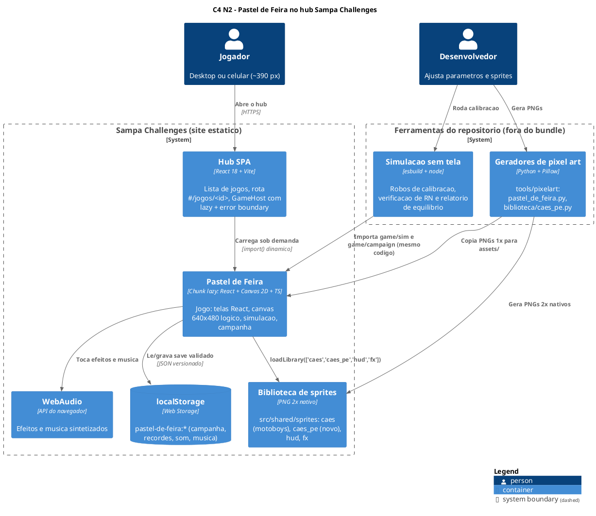
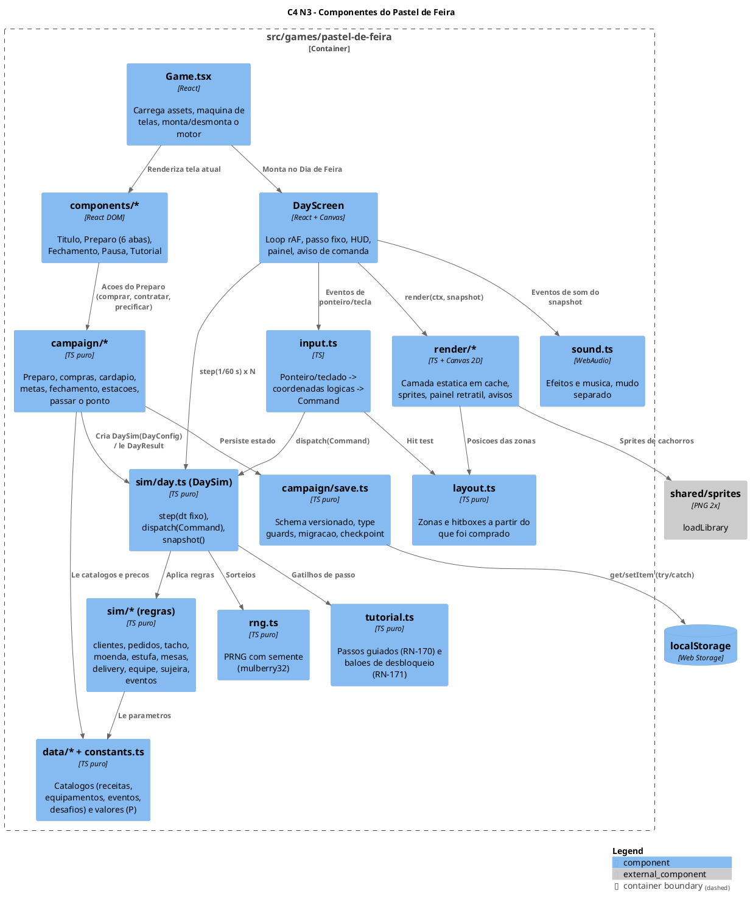
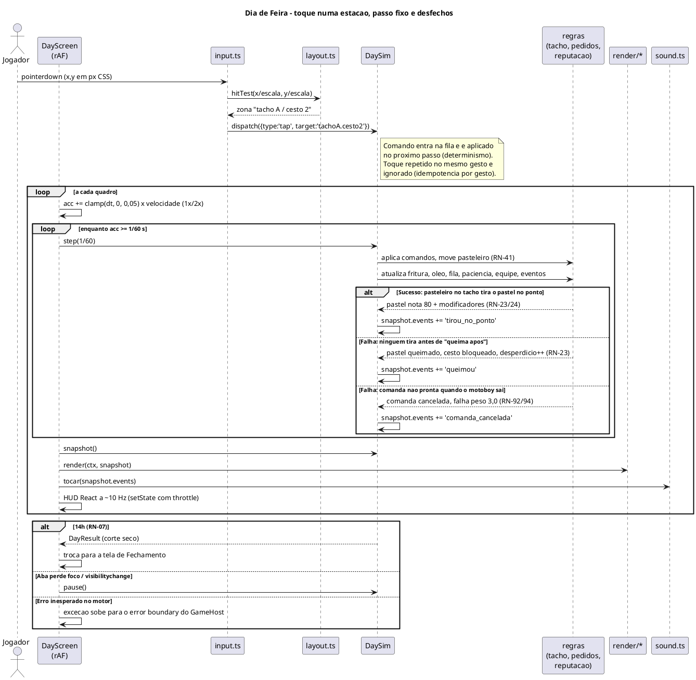
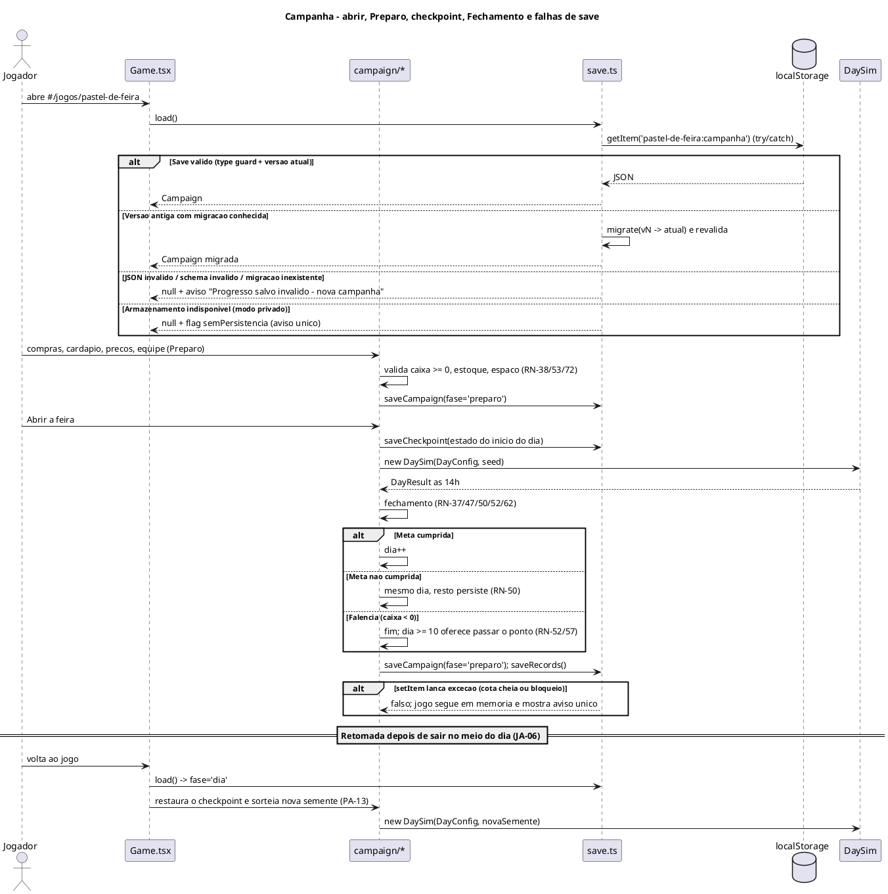
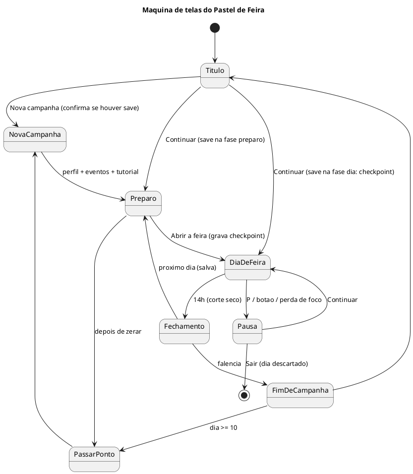

# Planejamento Técnico: Pastel de Feira

> Fase 2 do SDD — O Como. Status: **rascunho para aprovação**.
> Pré-requisito: `spec.md` revisão 4, aprovada. As referências `RN-xx` apontam para ela.

## 1. Visão Geral da Arquitetura

- **Decisão principal:** novo jogo do hub em `src/games/pastel-de-feira/`, descoberto pelo
  `import.meta.glob` do `registry.ts`. O contrato do hub (`GameManifest`, `GameProps`) **não muda**.
- **Abordagem:** motor de **simulação pura em TypeScript**, determinística, com **passo fixo** e
  **semente**. O jogador só altera o mundo por **comandos**. Camadas separadas:
  - **Simulação** (`game/sim/`): regras do Dia de Feira, sem DOM;
  - **Campanha** (`game/campaign/`): Preparo, fechamento, metas, save;
  - **Apresentação**: canvas para o Dia de Feira e React DOM para Preparo, Fechamento e menus;
  - **Calibração**: a mesma simulação rodando em node, com jogadores-robô, para ajustar os
    valores (P) (spec, seção 5).
- **Resolução:** lógica em 640×480 (4:3). Canvas de 1280×960 (`SCALE` 2), com Scale2x para os PNGs
  1× do jogo e cópia direta para os sprites 2× nativos da biblioteca. É exceção à regra 7 do
  `CLAUDE.md` raiz (PA-15).
- **Sem dependências novas.** Validação, PRNG, áudio e testes com o que o repo já tem: TypeScript,
  WebAudio, o `esbuild` que vem com o Vite e o node.
- **Repositório afetado:** `sampa-challenges`. Ver a tabela de arquivos.

| Caminho | Mudança |
|---|---|
| `src/games/pastel-de-feira/**` | Novo jogo (manifest, Game, components, game/, assets, styles, README, CLAUDE.md) |
| `src/shared/sprites/assets/caes_pe/**` + `README.md` | Nova pasta da biblioteca: cachorros de pé (clientes, pasteleiro, funcionários) |
| `tools/pixelart/biblioteca/caes_pe.py` + `fonte16/cpe16.py` | Gerador dos cachorros de pé (desenho 1× + Scale2x) |
| `tools/pixelart/pastel_de_feira.py` | Gerador do cenário, equipamentos, itens e capa do jogo |
| `src/games/pastel-de-feira/sim/` | Executor da simulação sem tela e dos robôs de calibração (fora do bundle) |
| `CLAUDE.md` (raiz) | Regra 7: registrar o Pastel de Feira como exceção de resolução (640×480) |

## 2. Diagramas de Solução

### 2.1 C4 Nível 2 — Containers



### 2.2 C4 Nível 3 — Componentes do container "Pastel de Feira"



### 2.3 Sequência — Dia de Feira: comando do jogador e passo da simulação (sucesso e falha)



### 2.4 Sequência — Campanha e persistência (sucesso e falha)



### 2.5 Estados das telas



## 3. Modelagem de Dados e Persistência

### 3.1 Estrutura do código

| Pasta / arquivo | Responsabilidade | Depende de |
|---|---|---|
| `manifest.ts` | Card do hub. `getRecord` lê só `pastel-de-feira:recorde` (função leve) | `game/record.ts` |
| `Game.tsx` | Carrega assets e biblioteca, faz `upscaleAll` e controla a máquina de telas (2.5) | components, campaign |
| `components/TitleScreen.tsx`, `NewCampaign.tsx` | Título, nova campanha (perfil, eventos, tutorial) | campaign |
| `components/prep/*` | Preparo em 6 abas: Insumos, Cardápio, Melhorias, Equipe, Escritório, Associação | campaign (só leitura + ações) |
| `components/DayScreen.tsx` | Canvas, loop rAF, acumulador de passo fixo, HUD, menu de pausa | sim, render, input, sound |
| `components/ClosingScreen.tsx` | Balanço do dia, meta, reputação, desperdício | campaign |
| `game/constants.ts` | `W` 640, `H` 480, `STEP` 1/60, valores (P) de tempo, filas, pesos, paciência, energia | — |
| `game/data/recipes.ts` | Catálogo das 17 receitas, versões (RN-30, RN-30a) e bebidas (RN-31) | constants |
| `game/data/catalog.ts` | Insumos, consumíveis, equipamentos, automação, espaço, mesas, cursos, cargos, perfis, temas | constants |
| `game/data/events.ts`, `challenges.ts` | Eventos previstos/surpresa (RN-151/152) e desafios (RN-136) | constants |
| `game/types.ts` | Tipos compartilhados (`Command`, `DayConfig`, `DaySnapshot`, `DayResult`, `Campaign`) | — |
| `game/rng.ts` | PRNG com semente: `next()`, `int()`, `pick()`, `weighted()` | — |
| `game/sim/day.ts` | `DaySim`: relógio, fila de comandos, `step`, `snapshot`, `result` | sim/* |
| `game/sim/customers.ts` | Chegada, perfis, mistura por hora (RN-02/12/17/19), grupos, pedido, troca (RN-18/35), calma por posição na fila (`queueCalm`, RN-06b) | rng, data |
| `game/sim/stations/*.ts` | Balcão, bancada, tacho (cestos, ponto, queima, óleo), estufa, moenda, mesas, expedição, escritório | data |
| `game/sim/staff.ts` | Posições, fixo/automático (RN-45), tipos (RN-49), energia e descanso, traços, cursos | data |
| `game/sim/quality.ts`, `reputation.ts`, `result.ts` | Nota e decaimento (RN-20–28), sucesso/falha/encanto (RN-61/62); variação de reputação com ganho ×4 acima da taxa-alvo e ×2 abaixo (`REPUTATION_RATE_GAIN_UP`) | — |
| `game/sim/delivery.ts` | Ofertas, teto, aceite, motoboys, cancelamento (RN-90–96) | rng |
| `game/sim/world.ts` | Sujeira, eventos do dia, estações do ano, corte seco | rng, data |
| `game/campaign/campaign.ts` | Estado da campanha, ações do Preparo com validação, montagem do `DayConfig` | data, save |
| `game/campaign/closing.ts` | Fechamento: dinheiro, estoque que sobra, meta, reputação, falência, recordes | data |
| `game/campaign/save.ts` | Serialização, type guards, migrações, checkpoint. Quantidade de lote e `wasteUnits` aceitam fração (cana com chorinho) | types |
| `game/campaign/warnings.ts` | `openWarning(c)`: aviso antes de abrir a feira com falta de insumo, saquinho ou copo (RN-36a); exibido pelo `PrepScreen` | campaign |
| `game/record.ts` | Recordes (maior dia, maior caixa, maior ponto) | — |
| `game/layout.ts` | Zonas fixas do layout 640×480 por compra e hitboxes (RN-74/75) | data |
| `game/render/*.ts` | Camada estática em canvas fora da tela, sprites, painel, avisos, fonte de pixels | hires, layout |
| `game/hires.ts`, `pixelFont.ts`, `assets.ts` | Padrão do hub (`SCALE` 2, `blit`, `isNativeHd`) | shared/sprites |
| `game/input.ts` | Ponteiro e teclado (RN-174) → `Command`. Escala CSS → lógica | layout |
| `game/sound.ts` | WebAudio, chaves `pastel-de-feira:som` e `pastel-de-feira:musica` | — |
| `game/tutorial.ts` | Roteiro do dia 1 e balões (RN-170/171) | types |
| `sim/run.ts`, `sim/bots.ts`, `sim/scenarios.ts` | Executor node, robôs, cenários de RN, relatório | game/sim, game/campaign |

Regra de dependência: `game/sim` e `game/campaign` não importam React, DOM, canvas nem `localStorage`
(o `save.ts` recebe um `Storage` injetado). É isso que permite rodar tudo em node.

### 3.2 Modelos principais

**`Command`** (a única entrada do jogador na simulação):

| `type` | Campos | Origem |
|---|---|---|
| `tapStation` | `station: StationId` | Toque na visão geral (desloca o pasteleiro) |
| `tapSlot` | `station`, `slot: number` | Toque no painel (cesto, ingrediente, item pronto) |
| `holdStart` / `holdEnd` | `station`, `action: 'moenda'\|'oleo'\|'limpar'` | Segurar (RN-42) |
| `deliver` | `itemRef`, `customerId` | Item pronto → cliente |
| `acceptOffer` | `offerId` | Oferta do app (RN-91) |
| `sendRest` | `staffId` | Mandar um fixo descansar (RN-116) |
| `respondEvent` | `eventId`, `choice` | Reivindicação etc. |
| `pause` / `resume` / `setSpeed` | `speed: 1\|2` | Controles de sessão |

**`DayConfig`** (campanha → simulação, imutável durante o dia): dia, estação, tema, perfil,
reputação inicial, cardápio do dia com preços, chorinho, brinde, xepa, estoque inicial por lote
(com validade), equipamentos e quantidades, layout comprado, equipe (tipo, traços, cursos, energia,
modo), cargos, encomendas e desafios aceitos, eventos previstos, flags (eventos ligados, tutorial),
semente.

**`DayResult`** (simulação → campanha): receita por canal, custos variáveis do dia (óleo, reparos,
multas), brindes, pedidos por desfecho e canal, falhas ponderadas, encanto, estoque restante por
lote, desperdício por motivo, flag "cliente perdido por falta" (RN-37), energia final da equipe
(para a reivindicação), eventos ocorridos, progresso dos desafios.

**`DaySnapshot`** (simulação → render/HUD, a cada quadro): relógio, posições do pasteleiro e da
equipe, estado de cada estação (cestos com tempo/ponto, óleo, estufa, moenda), fila, filas de
pagamento, mesas, motoboys, ofertas, caixa do dia, avisos e `events[]` (para som e partículas).

### 3.3 Persistência (`localStorage`)

| Chave | Conteúdo | Escrita |
|---|---|---|
| `pastel-de-feira:campanha` | `SaveV1` (JSON) | Preparo, checkpoint de início do dia, fechamento (RN-55) |
| `pastel-de-feira:recorde` | maior dia concluído (inteiro) | Fechamento. Lido pelo `manifest.getRecord` |
| `pastel-de-feira:recorde-caixa` | maior caixa em modo livre | Fechamento |
| `pastel-de-feira:recorde-ponto` | maior valor de ponto (RN-57) | Passar o ponto |
| `pastel-de-feira:som` / `pastel-de-feira:musica` | `on`/`off` | Botões de mudo (RN-172) |
| `pastel-de-feira:visto` | lista de balões já mostrados (RN-171) | Primeira exibição de cada sistema |

Todas as leituras e escritas ficam em `try/catch` (regra 10 do hub).

**Schema do save (JSON Schema resumido):**

```json
{
  "$schema": "https://json-schema.org/draft/2020-12/schema",
  "title": "SaveV1",
  "type": "object",
  "required": ["version", "phase", "campaign"],
  "properties": {
    "version": { "const": 1 },
    "phase": { "enum": ["preparo", "dia", "fim"] },
    "campaign": {
      "type": "object",
      "required": ["day", "freeMode", "cash", "reputation", "profile", "eventsOn", "inventory", "owned", "menu", "prices", "staff", "seasonDay"],
      "properties": {
        "day": { "type": "integer", "minimum": 1 },
        "freeMode": { "type": "boolean" },
        "cash": { "type": "number" },
        "reputation": { "type": "number", "minimum": 1, "maximum": 5 },
        "profile": { "enum": ["tradicional", "negociante", "chapeiro", "boa-praca", "gestor"] },
        "theme": { "enum": ["popular", "tradicional", "gourmet", null] },
        "eventsOn": { "type": "boolean" },
        "inventory": { "type": "array", "items": { "type": "object", "required": ["item", "qty", "expiresDay", "inCooler"] } },
        "owned": { "type": "object", "description": "receitas, versoes, equipamentos, m2, mesas, estruturas, placas de cardapio" },
        "menu": { "type": "object", "description": "vagas de salgado e doce do dia, bebidas" },
        "prices": { "type": "object", "additionalProperties": { "type": "number", "minimum": 0 } },
        "staff": { "type": "array", "items": { "type": "object", "required": ["id", "kind", "traits", "courses", "mode"] } },
        "offices": { "type": "array" },
        "fatigue": { "type": "object", "additionalProperties": { "type": "integer", "minimum": 0 } },
        "challenges": { "type": "array" },
        "orders": { "type": "array" },
        "history": { "type": "array", "maxItems": 60 },
        "seasonDay": { "type": "integer", "minimum": 1 }
      }
    },
    "checkpoint": { "description": "copia de campaign no inicio do Dia de Feira, quando phase = dia" }
  }
}
```

- **Validação (Zero Trust):** os type guards em `save.ts` validam tipos, faixas, enums e referências
  ao catálogo (receita ou equipamento inexistente invalida o save). Não existe "conserto parcial":
  ou o save é válido, ou o jogo inicia campanha nova com aviso (spec, seção 4).
- **Migração:** `migrations: Record<number, (s: unknown) => unknown>`. Cada versão nova do schema
  acrescenta uma função. O save é migrado em sequência e validado no fim.
- **Tamanho:** o histórico (relatórios do Contador) fica limitado aos últimos 60 dias. O save
  estimado fica abaixo de 30 KB.

### 3.4 Índices e migrações

Não se aplicam índices (não há banco). Também não há migração inicial: o `SaveV1` nasce com o jogo.

## 4. Contratos de Integração

### 4.1 Contrato com o hub (sem mudança)

| Contrato | Uso |
|---|---|
| `GameManifest` | `id: 'pastel-de-feira'`, `title: 'Pastel de Feira'`, descrição curta, `cover` (320×200), `tags: ['1 jogador', 'Gestão']`, `accent`, `getRecord` (maior dia), `load: () => import('./Game')` |
| `GameProps.onExit` | Botão "Sair" do título e do menu de pausa |

### 4.2 Contrato interno simulação ↔ apresentação

| Interface | Garantias |
|---|---|
| `new DaySim(config: DayConfig, seed: number)` | Mesma `config` + mesma `seed` + mesma sequência de comandos por passo = mesmo `DayResult` |
| `step(dt)` | `dt` é sempre `STEP` (1/60 s). Chamadores com `dt` diferente geram erro em desenvolvimento |
| `dispatch(cmd)` | Comando inválido para o estado atual é **descartado** (sem exceção) e conta em `snapshot.rejected` (depuração) |
| `snapshot()` | Objeto só de leitura, reaproveitado entre quadros (sem alocação por quadro) |
| `result()` | Disponível depois do corte seco (RN-07) |

### 4.3 Contrato campanha ↔ telas do Preparo

Cada ação do Preparo é uma função pura `(campaign, payload) → { ok: true, campaign } | { ok: false, motivo }`,
com motivos fixos para a UI: `semCaixa`, `semEspaco`, `semCapacidade`, `bloqueadoAteDia`,
`requer` (equipamento ou escritório), `limite`. As telas nunca alteram o estado da campanha diretamente.

### 4.4 Biblioteca de sprites (contrato novo)

| Pasta | Chaves | Tamanho PNG | Observação |
|---|---|---|---|
| `caes_pe` | `<raça>_<porte>_<pose>`. Raças: caramelo, pitbull, pincher, collie, salsicha, poodle, vira-lata. Portes: p/m/g. Poses: `parado`, `andando_0/1`, `sentado`, `comendo_0/1`, `bravo`, `feliz` | 48×64 (p), 56×72 (m), 64×80 (g) **(P)** | Cores-chave magenta trocadas em tempo de execução, como em `caes_costas` (cores variadas, RN-165) |
| `caes_pe` | `pasteleiro_<pose>`, `func_<fritador\|geral>_<pose>` | 56×72 | Avental e chapéu com cor fixa por tipo (indicador visual) |
| `caes` (existente) | `p1_*`, `p2_*` | 80×80 | Motoboys do app (sem mudança) |

## 5. Resiliência, Segurança e Tratamento de Erros

### 5.1 Matriz de falhas

| Componente | Falha | Estratégia | Impacto no utilizador |
|---|---|---|---|
| `localStorage` | Indisponível (modo privado) | `try/catch`. Flag `semPersistencia`, jogo em memória | Aviso discreto uma vez. O progresso se perde ao sair |
| `localStorage` | Cota cheia no `setItem` | `try/catch`. Histórico reduzido pela metade e uma nova tentativa. Se falhar, aviso | O último ponto salvo continua valendo |
| Save | JSON inválido, schema inválido ou referência inexistente | Type guards. Descarte e campanha nova | Aviso "Progresso salvo inválido — nova campanha" |
| Save | Versão antiga | Migração em sequência + validação | Transparente |
| rAF | Primeiro `dt` negativo ou `dt` enorme (aba em segundo plano) | `Math.max(0, Math.min(dt, 0.05))` + acumulador com teto de 5 passos por quadro | Sem saltos. Em queda de FPS o jogo fica mais lento, sem pular regras |
| Foco | `blur` / `visibilitychange` | Pausa automática (RN-150, spec seção 4) | Volta pausado |
| StrictMode | Efeito montado duas vezes | `DaySim`, listeners e rAF criados no `useEffect` e descartados no cleanup | Nenhum |
| WebAudio | `AudioContext` ausente ou suspenso | Criado só no primeiro gesto (`unlock()`). Sem contexto, tudo vira no-op | Jogo sem som |
| Assets | PNG falha ao carregar | `Promise.all` rejeita. Tela "Não foi possível carregar o jogo" com Tentar de novo | Não entra no jogo quebrado |
| Motor | Exceção não prevista | Sobe para o error boundary do `GameHost` | Mensagem do hub + voltar |
| Comando inválido | Toque fora de contexto, gesto repetido | `dispatch` descarta. Idempotência por id de gesto | Nada acontece |
| Desempenho | Celular lento | Camada estática em cache (só redesenha ao mudar o layout). HUD React limitado a ~10 Hz. Sem alocação por quadro na simulação | ≥ 30 quadros/s (spec, seção 5) |

### 5.2 Segurança

- Não há autenticação, rede nem segredos. O jogo é 100% cliente.
- O conteúdo do `localStorage` é tratado como **não confiável**: validado antes do uso e nunca
  interpretado como código (nada de `eval` ou `innerHTML`). Textos do save que vão para a tela passam
  pelo React (escape automático) ou pela fonte de pixels.
- CSS escopado em `.pastel-de-feira` (regra 1 do hub). Nenhum listener global sobra depois do cleanup.

### 5.3 Observabilidade (adaptada a um jogo estático)

Não há backend nem telemetria remota (fora de escopo na spec). A observabilidade é local e voltada
a desenvolvimento e calibração:

| Tipo | Nome | Quando | Finalidade |
|---|---|---|---|
| Overlay de depuração | `pastel-de-feira:debug` = `on` | Desenvolvimento | FPS, passos por quadro, comandos rejeitados, semente, hitboxes |
| `console.warn` | `[pastel-de-feira] save inválido: <motivo>` | Save descartado ou migração falha | Diagnóstico de bug de schema |
| `console.warn` | `[pastel-de-feira] sem persistência` | `localStorage` indisponível | Diagnóstico |
| Relatório da simulação | `sim/run.ts` → tabela por dia + JSON | Calibração | Lucro, meta, reputação, falhas por tipo, desperdício, ocupação de cada posição |
| Verificação de RN | `sim/scenarios.ts` | Antes de entregar | Um cenário por grupo de RN, com resultado esperado (pass/fail) |
| Determinismo | `sim/run.ts --replay` | Antes de entregar | Mesma semente e mesmos comandos devem dar `DayResult` idêntico (hash) |

### 5.4 Calibração dos valores (P)

Os robôs (`sim/bots.ts`) usam a mesma API de `Command` que o jogador:

| Robô | Estratégia | Critério da spec que verifica |
|---|---|---|
| `solo` | Só o pasteleiro, sem melhorias, eventos desligados, prioriza tirar no ponto | Metas dos dias 1–3 cumpridas (piso) |
| `armadilha` | Liga o delivery no dia 5 sem equipe e aceita todas as ofertas | A reputação cai no mesmo dia |
| `brinde-max` | Brinde N = 2 e chorinho 3 todos os dias | Reputação sobe, lucro fica abaixo da meta |
| `equilibrado` | Compra seguindo uma heurística (tacho → funcionário → estufa → mesas) | A campanha de 20 dias é vencível, e a meta do dia 20 não é trivial |

Fluxo: `node` roda N sementes por robô e gera o relatório. Os valores de `constants.ts` e `data/*`
são ajustados até todos os critérios passarem, com margem em pelo menos 80% das sementes **(P)**. Os
valores finais vão para a tabela de parâmetros do `README.md` e do `CLAUDE.md` do jogo e para `calibracao.md` (valores (P) alterados e tabelas por dia). Na calibração entraram `PATIENCE`, `QUEUE_CALM_*`, `DECAY_*`, `GOAL_BASE`/`GOAL_GROWTH`, `CHARM_GIFT` e `REPUTATION_RATE_GAIN_UP`; nenhum número aleatório (RN) mudou.

Comando previsto (sem script novo no `package.json`, como nos outros jogos):
`npx esbuild src/games/pastel-de-feira/sim/run.ts --bundle --platform=node --format=esm --outfile=<scratch>/sim.mjs && node <scratch>/sim.mjs --bots all --seeds 50`.

## 6. Justificativa e Trade-offs

| Decisão | Alternativa descartada | Justificativa |
|---|---|---|
| Simulação pura com passo fixo (1/60 s) e semente | `dt` variável direto no `update` | Exigência de determinismo da spec (seção 5). O acelerar 2× vira "2 passos por quadro" sem mudar regras. A calibração em node é a mesma do navegador |
| Jogador age só por `Command` | Telas mexendo no estado do motor | Replays e robôs usam a mesma entrada. Idempotência e validação ficam num ponto só |
| Preparo, Fechamento e menus em React DOM | Tudo no canvas | Formulários densos (6 abas, ≈ 30 insumos) a 390 px ficam legíveis e acessíveis com rolagem nativa. O canvas fica só para o Dia de Feira |
| Catálogos em `data/*.ts` + valores em `constants.ts` | Tudo no `constants.ts` | São ≈ 120 regras e 17 receitas: um arquivo só ficaria ilegível. A regra do hub ("números de equilíbrio em `constants.ts`") vale para os valores, e os catálogos ficam separados, documentados no `CLAUDE.md` |
| Type guards à mão para o save | Zod / JSON Schema em execução | Evita dependência nova no bundle de um jogo estático. O schema da seção 3.3 é a documentação |
| Cachorros de pé na biblioteca (`caes_pe`) | Sprites só no jogo | Regra do hub: personagem que pode servir a mais de um jogo vai para a biblioteca. Troca de cor em tempo de execução dá variedade sem multiplicar PNGs |
| 640×480 com `SCALE` 2 (canvas 1280×960) | 320×200 (padrão) | Decisão da spec (PA-15). A barraca cheia + o painel retrátil não cabem em 320×200. Custo: arte maior e exceção registrada no `CLAUDE.md` raiz |
| Sem Web Worker | Simulação num worker | A simulação de um dia é leve (≈ 60 entidades). O worker complicaria o determinismo com o input e não traz ganho. Fica aberto para a calibração, que roda em node |
| Música e efeitos sintetizados (WebAudio) | Arquivos de áudio | Padrão dos outros jogos (`sound.ts`). Não pesa no carregamento (< 2 s) |
| Um save único com checkpoint | Vários slots | Spec: uma campanha só (RN-55) |

## 7. Volumetria e Orçamento

| Item | Pior caso (spec, seção 5) | Orçamento **(P)** |
|---|---|---|
| Entidades vivas | 21 clientes (6 + excursão), 16 em mesa, 4 motoboys, 12 cestos, 14 funcionários | Simulação < 1 ms por passo em desktop. Até 5 passos por quadro |
| Render | Camada estática + ≈ 120 sprites por quadro | < 8 ms por quadro em celular intermediário |
| Bundle do jogo (JS) | Chunk lazy | ≤ 180 KB gzip |
| Assets | Cenário 640×480 1× + equipamentos + `caes_pe` | ≤ 1,2 MB no total, para abrir em < 2 s |
| Save | Campanha + 60 dias de histórico | ≤ 30 KB |

## 8. Riscos Técnicos

| Risco | Probabilidade | Mitigação |
|---|---|---|
| Layout da barraca cheia não caber com o painel aberto | Média | `layout.ts` com teste de sobreposição de zonas na simulação (critério da seção 5 da spec) e protótipo do layout antes da arte final |
| Calibração não convergir para todos os critérios | Média | Robôs + relatório desde as primeiras tarefas. Ajustar primeiro meta e chegada, depois preços |
| Volume de arte (cenário 640×480 + 7 raças × 3 portes) | Alta | Desenho 1× com cores-chave e troca em tempo de execução. Placeholders geométricos até a arte ficar pronta (o jogo nunca bloqueia por falta de sprite) |
| Preparo denso a 390 px | Média | Abas, lista com rolagem, compra sugerida e cartões compactos. Teste a 390 px por aba |
| Escopo grande numa entrega só | Alta | Backlog fatiado em User Stories que se integram por trás de uma flag de desenvolvimento até a US final, mantendo `main` sempre buildável |
