# Backlog de Execução: Pastel de Feira

> Fase 3 do SDD — Execução atômica. Status: **rascunho para aprovação**.
> Pré-requisitos aprovados: `spec.md` (revisão 4) e `plan.md`.

## Épico de Referência

**Épico:** [INSERIR_ID_EPICO] Pastel de Feira — novo jogo de gestão do hub Sampa Challenges.
Não há épico cadastrado pelo PM. O ID fica como placeholder até o cadastro no ClickUp.

---

## Convenções de Execução (valem para todas as Tarefas)

**Sistema:** `sampa-challenges` (repositório único). Raiz do jogo: `src/games/pastel-de-feira/` (abreviada
como `pf/` nas tabelas, mas **sempre** escrita por extenso nos caminhos das Tarefas).

**Comando padrão de validação** (o "4.3" de cada TF acrescenta o cenário específico):

```bash
npm run typecheck
npx esbuild src/games/pastel-de-feira/sim/run.ts --bundle --platform=node --format=esm --outfile="${TMPDIR:-/tmp}/pf-sim.mjs" \
  && node "${TMPDIR:-/tmp}/pf-sim.mjs" --scenario <grupo>
```

O executor `sim/run.ts` nasce na TF-110-03. Cada TF de regra acrescenta seus cenários em
`src/games/pastel-de-feira/sim/scenarios/<grupo>.ts`, com resultado esperado (pass/fail), semente fixa e sequência de
`Command`. Esse é o "teste" do projeto: o repo não tem suíte de testes (`CLAUDE.md` raiz).

**Restrições globais** (além das do `CLAUDE.md` raiz):

- `game/sim/**` e `game/campaign/**` não importam React, DOM, canvas, `window` nem `localStorage`.
- Números de equilíbrio só em `game/constants.ts` e nos catálogos `game/data/*.ts` (nunca soltos no código).
- Sem dependência nova no `package.json`.
- O jogador só altera a simulação via `Command` (`plan.md` 3.2).
- Até a US-123, o card do hub mostra o jogo como **"Em obras"** (tag e descrição) para manter a `main`
  publicável a cada US sem mudar o contrato do hub.

**Skills por tipo de TF:**

| Tipo de TF | Skills |
|---|---|
| Regra de simulação/campanha (TS puro) | `test-driven-agentic-development` (cenários em `sim/scenarios`), `expert-lsp` (impacto via símbolos) |
| Tela React / canvas | `expert-lsp`, `verification-before-completion` (testar no navegador e a 390 px) |
| Pixel art (Python) | `verification-before-completion` (conferir PNG gerado) |
| Documentação | `regra-plantuml-diagrams` (se houver diagrama) |

**Commits:** Conventional Commits em PT-BR (`commit-message`), stage explícito dos arquivos da TF.

---

## Rastreabilidade

| Regras (spec.md) | Decisão (plan.md) | User Story | Tarefas |
|---|---|---|---|
| RN-01, RN-07, JA-06 | `DaySim` com passo fixo e corte seco (2.3, 4.2) | US-110 | TF-110-04 |
| RN-02–06, RN-10–14, RN-18, RN-19, RN-35 | `sim/customers.ts` (3.1) | US-110 | TF-110-05 |
| RN-40 (balcão/bancada), RN-41, RN-42, RN-63 | `sim/stations/*` + `Command` (3.2) | US-110 | TF-110-06 |
| RN-23, RN-46 | `sim/stations/fryer.ts` | US-110 | TF-110-07 |
| RN-26, RN-31 (caldo puro) | `sim/stations/cane.ts` | US-110 | TF-110-08 |
| RN-20–25, RN-60–64 | `sim/quality.ts`, `sim/reputation.ts` | US-110 | TF-110-09 |
| RN-74, RN-75 | `layout.ts`, `render/*`, painel retrátil | US-110 | TF-110-10, TF-110-11 |
| RN-30b, RN-30c, RN-32–39a, RN-10, RN-53 | `campaign/campaign.ts` + ações puras (4.3) | US-111 | TF-111-01 |
| RN-37, RN-50–54, RN-62 | `campaign/closing.ts` | US-111 | TF-111-02 |
| RN-55, RN-56, spec seção 4 (save) | `campaign/save.ts`, `SaveV1` (3.3) | US-111 | TF-111-03 |
| JA principal, RN-110 (seleção) | Telas React + máquina de telas (2.5) | US-111 | TF-111-04, TF-111-05, TF-111-06 |
| RN-30, RN-30a, RN-31, RN-71–73, RN-171 (dados) | `data/*`, ações de compra | US-112 | TF-112-01 |
| RN-24, RN-27, RN-30d, RN-30e, RN-46, RN-73 | Efeitos de equipamento no `DaySim` | US-112 | TF-112-02 |
| RN-72, RN-74 | `layout.ts` dinâmico | US-112 | TF-112-03 |
| Aba Melhorias | `components/prep/*` | US-112 | TF-112-04 |
| RN-47–49, RN-113, RN-114, RN-118 | Equipe na campanha | US-113 | TF-113-01 |
| RN-40, RN-43–45, JA-01 | `sim/staff.ts` | US-113 | TF-113-02 |
| RN-115–117, JA-10 | Energia e descanso | US-113 | TF-113-03 |
| Aba Equipe, render da equipe | `components/prep/*`, `render/*` | US-113 | TF-113-04 |
| RN-80–86, JA-02 | `sim/stations/tables.ts` | US-114 | TF-114-01 |
| RN-83, RN-87 | Fila de pagamento + garçom | US-114 | TF-114-02 |
| RN-16, RN-84, RN-130–133 | Sujeira + Ajudante | US-114 | TF-114-03 |
| Render de mesas/sujeira | `render/*` | US-114 | TF-114-04 |
| RN-90, RN-91, RN-95 | `sim/delivery.ts` (ofertas) | US-115 | TF-115-01 |
| RN-25, RN-92–94, RN-96 | Motoboys + estufa compartilhada | US-115 | TF-115-02 |
| JA-03, UI do app | `render/*`, `components/*` | US-115 | TF-115-03 |
| RN-62, RN-120–123 | Brinde e chorinho | US-116 | TF-116-01 |
| RN-17, RN-124, RN-125 | Xepa e tema | US-116 | TF-116-02 |
| UI de promoções/tema | `components/prep/*` | US-116 | TF-116-03 |
| RN-100, RN-101, RN-103 | Escritório e cargos | US-117 | TF-117-01 |
| RN-102, RN-104, JA-04 | Encomendas | US-117 | TF-117-02 |
| RN-135–137 | `data/challenges.ts` + progresso | US-117 | TF-117-03 |
| Abas Escritório/Associação, relatórios | `components/prep/*` | US-117 | TF-117-04 |
| RN-140, RN-141 | Estações do ano | US-118 | TF-118-01 |
| RN-150, RN-151 | Eventos previstos | US-118 | TF-118-02 |
| RN-152, JA-09 | Eventos surpresa | US-118 | TF-118-03 |
| Previsão e avisos | UI | US-118 | TF-118-04 |
| RN-160–162 | Automação | US-119 | TF-119-01, TF-119-02 |
| RN-110 (efeitos) | Perfil do pasteleiro | US-120 | TF-120-01 |
| RN-52, RN-54, RN-56, RN-57, JA-07, JA-08 | Passar o ponto, modo livre, recordes | US-120 | TF-120-02 |
| RN-165, plan 4.4 | Biblioteca `caes_pe` + recolor | US-121 | TF-121-01, TF-121-02 |
| Cenário 640×480, capa | `tools/pixelart/pastel_de_feira.py` | US-121 | TF-121-03, TF-121-04 |
| RN-170, RN-171, JA-11 | `tutorial.ts` | US-122 | TF-122-01 |
| RN-172 | `sound.ts` | US-122 | TF-122-02 |
| RN-173, RN-174 | Acelerar e atalhos | US-122 | TF-122-03 |
| Spec seção 5 (determinismo, critérios) | `sim/run.ts --replay`, robôs (plan 5.4) | US-123 | TF-123-01, TF-123-02 |
| PA-15, checklist do hub | Documentação e liberação | US-123 | TF-123-03 |

---

## Visão Geral das User Stories

| # | User Story | Entrega de Valor | Pontos | Prioridade |
|---|---|---|---|---|
| US-110 | Dia de feira solo jogável | O jogador abre o jogo no hub e atende clientes sozinho, das 07h às 14h | 8 | P0 |
| US-111 | Campanha com Preparo, Fechamento, metas e save | O jogo vira campanha de 20 dias, com compra de insumos, balanço e progresso salvo | 8 | P0 |
| US-112 | Melhorias: receitas, equipamentos e espaço | O jogador investe o lucro e vê a barraca crescer, com o cardápio completo | 8 | P1 |
| US-113 | Equipe: contratação, posições, cansaço e treinamento | O jogador escala a operação delegando funções | 8 | P1 |
| US-114 | Mesas, grupos, pagamento e limpeza | Comer no local vira uma escolha econômica com gargalos próprios | 5 | P1 |
| US-115 | Delivery do app (motoboys) | Abre a armadilha de progressão do delivery | 5 | P1 |
| US-116 | Promoções, xepa e tema da barraca | Ferramentas de preço e encanto trocam reputação por lucro | 3 | P1 |
| US-117 | Escritório: cargos, encomendas, relatórios e desafios | O pasteleiro passa a administrar | 5 | P1 |
| US-118 | Cidade viva: estações do ano e eventos | Cada dia fica diferente e exige adaptação | 5 | P1 |
| US-119 | Automação por equipamento | Escolha entre capital (equipamento) e folha de pagamento | 3 | P2 |
| US-120 | Perfil do pasteleiro, passar o ponto e modo livre | Rejogabilidade e fim de campanha completo | 3 | P2 |
| US-121 | Arte: cachorros de pé e cenário da feira | Visual final em pixel art no padrão do hub | 8 | P1 |
| US-122 | Experiência: tutorial, som, acelerar e atalhos | Jogo aprendível e confortável no desktop e no celular | 5 | P1 |
| US-123 | Calibração, verificação e liberação no hub | Valores (P) calibrados, critérios da spec comprovados e o card sai de "Em obras" | 5 | P0 |

Ordem de execução: US-110 → US-111 → US-112 → US-113 → US-114 → US-115 → US-116 → US-117 → US-118 →
US-119 → US-120 → US-122 → US-123. A **US-121 (arte)** depende só da US-110 e pode correr em paralelo
desde a US-111, porque o jogo usa placeholders geométricos até a arte chegar (`plan.md` 8).

---
## US-110: Dia de feira solo jogável

**Épico:** [INSERIR_ID_EPICO] Pastel de Feira
**Sistema:** sampa-challenges
**Estimativa:** 8 Story Points
**Prioridade:** P0

### Narrativa de Valor

> **Eu como** jogador do hub Sampa Challenges,
> **Eu quero** abrir o Pastel de Feira e atender clientes sozinho, anotando, fritando, tirando caldo e cobrando, das 07h às 14h,
> **Para que** eu experimente o núcleo do jogo (gestão de gargalos em tempo real) antes de qualquer sistema de progressão.

### Contexto de Negócio

É o alicerce de todas as outras US. Entrega o motor determinístico (`DaySim`), o executor de cenários
que serve de teste para o projeto inteiro e a tela do Dia de Feira com a visão geral e o painel retrátil.
O dia roda com um `DayConfig` fixo de desenvolvimento: Carne, Queijo e Caldo puro, estoque cheio,
1 tacho pequeno e a moenda manual.

### Critérios de Aceitação (Nível de Negócio)

- [ ] O card "Pastel de Feira (Em obras)" aparece no hub e abre o jogo em `#/jogos/pastel-de-feira`.
- [ ] Clientes chegam, fazem fila, pedem sabor específico conforme o perfil e vão embora quando a paciência acaba.
- [ ] O pasteleiro se desloca entre estações, e cada pedido percorre anotar → montar → colocar → tirar → caldo → entregar → cobrar.
- [ ] O pastel pode sair cru, no ponto, passado ou queimado. O óleo suja e pode ser trocado.
- [ ] Às 14h o dia termina em corte seco e mostra receita, pedidos e variação de reputação.
- [ ] Mesma semente + mesmos comandos = mesmo resultado (cenário de determinismo).
- [ ] Jogável por toque a 390 px de largura.

### Regras de Negócio Aplicáveis

| # | Regra | Tipo |
|---|---|---|
| RN-01, RN-07 | Relógio 07h–14h e corte seco sem falha | Obrigatória |
| RN-02–06 | Chegada, pico, fila máxima e paciência | Obrigatória |
| RN-10–14, RN-18, RN-19, RN-35 | Perfis, teto de preço, sabor pedido e troca automática | Obrigatória |
| RN-20–26 | Valor pago, nota, decaimento | Obrigatória |
| RN-41, RN-42, RN-46, RN-63 | Deslocamento, ações manuais, óleo, item errado | Obrigatória |
| RN-60–64 | Reputação do dia | Obrigatória |
| RN-74, RN-75 | Visão geral 640×480 + painel retrátil | Obrigatória |

### Diagrama — Sequência da US (container único)

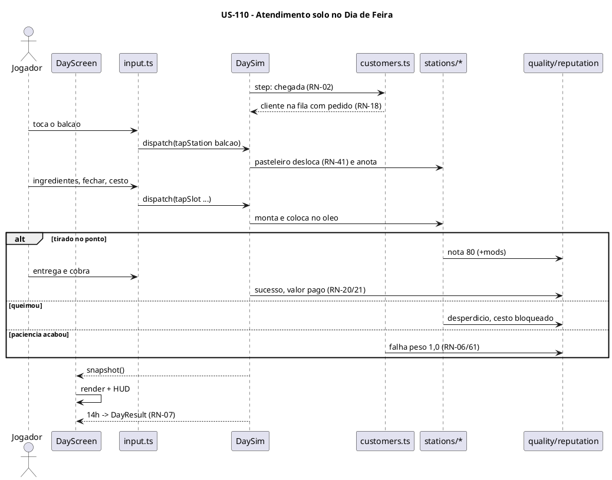

### Sequenciamento de Tarefas

| # | Tarefa | Escopo | Depende de |
|---|---|---|---|
| TF-110-01 | Estrutura do jogo, card "Em obras" e resolução 640×480 | Estrutura | — |
| TF-110-02 | Tipos, PRNG, constantes e catálogos base | Dados | TF-110-01 |
| TF-110-03 | Executor de cenários sem tela | Verificação | TF-110-02 |
| TF-110-04 | Núcleo do `DaySim`: relógio, passo fixo, comandos, snapshot e corte seco | Motor | TF-110-03 |
| TF-110-05 | Clientes de balcão: chegada, perfis, pedido e troca | Clientes | TF-110-04 |
| TF-110-06 | Pasteleiro, balcão e bancada | Estações | TF-110-05 |
| TF-110-07 | Tacho: cestos, ponto, queima e óleo | Estações | TF-110-06 |
| TF-110-08 | Moenda manual e caldo | Estações | TF-110-06 |
| TF-110-09 | Qualidade, valor pago e reputação do dia | Pontuação | TF-110-07, TF-110-08 |
| TF-110-10 | Layout, entrada e render da visão geral com painel retrátil | Apresentação (canvas) | TF-110-04 |
| TF-110-11 | `DayScreen`: loop, HUD, pausa e resumo do dia | Apresentação (React) | TF-110-09, TF-110-10 |

### Tarefas

#### TF-110-01: Estrutura do jogo, card "Em obras" e resolução 640×480

**User Story:** US-110 Dia de feira solo jogável
**Épico:** [INSERIR_ID_EPICO] Pastel de Feira
**Sistema:** sampa-challenges
**Prioridade:** P0

##### 1. Descrição e Objetivo

> **Eu como** desenvolvedor,
> **Eu quero** criar `src/games/pastel-de-feira/` a partir do `_modelo` e ajustá-lo para 640×480 lógicos,
> **Para que** o jogo apareça no hub e todas as TFs seguintes tenham onde morar.

*Contexto arquitetural:* o hub descobre o jogo pelo `import.meta.glob` (`plan.md` 1, 4.1). A resolução é exceção à regra 7 (PA-15). O registro no `CLAUDE.md` raiz fica para a TF-123-03.

##### 2. Especificação Técnica

**2.1 Pontos de interceptação**
- `npm run novo-jogo -- pastel-de-feira "Pastel de Feira"` (gera a pasta a partir do `_modelo`).
- `src/games/pastel-de-feira/manifest.ts` — título "Pastel de Feira", tag "Em obras", descrição provisória, `accent`, `order` alto, `getRecord` lendo `game/record.ts`.
- `src/games/pastel-de-feira/game/constants.ts` — `W = 640`, `H = 480`.
- `src/games/pastel-de-feira/game/hires.ts` — mantém `SCALE = 2` (canvas 1280×960).
- `src/games/pastel-de-feira/styles.css` — `aspect-ratio: 640 / 480`, todos os seletores com `.pastel-de-feira`.
- `src/games/pastel-de-feira/game/record.ts` — `loadRecord()` de `pastel-de-feira:recorde` em `try/catch`.

**2.2 Dados e persistência:** só leitura de `pastel-de-feira:recorde` (inteiro ≥ 0, senão 0).

**2.3 Contrato:** `GameManifest` sem mudança. `getRecord(): number | null`.

**2.4 Resiliência e Zero Trust**

| Cenário | Estratégia | Impacto |
|---|---|---|
| `localStorage` indisponível | `try/catch` → 0 | Card sem recorde |
| Valor de recorde corrompido | `Number.isFinite` e `> 0`, senão 0 | Nenhum |

##### 3. Modelagem Visual

Coberta pelo C4 N2 do `plan.md` 2.1.

##### 4. Orientação de Execução

**4.1 Contexto de entrada:** `CLAUDE.md` raiz; `src/games/_modelo/CLAUDE.md`; `src/games/capacete-voador/CLAUDE.md` (precedente 640×400); `scripts/novo-jogo.mjs`.

**4.2 Passos**
1. Rodar o `novo-jogo`.
2. Ajustar `W`/`H`, o CSS e o manifest ("Em obras").
3. Criar `game/record.ts`.
4. Trocar o `Game.tsx` do modelo por um placeholder que limpa o canvas 640×480 com a cor da feira.

**4.3 Validação:** `npm run typecheck && npm run build`, depois abrir `#/jogos/pastel-de-feira` no `npm run dev`.

**4.4 Restrições negativas**
- NÃO alterar `src/hub/**`.
- NÃO usar `:root`, `body` ou seletores soltos no CSS.

**4.5 Skills:** `verification-before-completion`.

**4.6 Critérios de saída**
- [ ] Build verde.
- [ ] Card visível com "Em obras".
- [ ] O canvas ocupa a largura disponível em 4:3.

##### 5. Testes de Aceitação (DoD)

- [ ] Caminho feliz: hub → card → jogo → barra "← Sampa Challenges" volta.
- [ ] Resiliência: modo privado do navegador não quebra o card.
- [ ] Nenhum estilo vazou para a home e para os outros jogos.

---

#### TF-110-02: Tipos, PRNG, constantes e catálogos base

**User Story:** US-110 Dia de feira solo jogável
**Épico:** [INSERIR_ID_EPICO] Pastel de Feira
**Sistema:** sampa-challenges
**Prioridade:** P0

##### 1. Descrição e Objetivo

> **Eu como** motor de simulação,
> **Eu quero** tipos compartilhados, um PRNG com semente e os catálogos de dados da spec,
> **Para que** todas as regras leiam valores de um lugar só e sejam determinísticas.

*Contexto arquitetural:* `plan.md` 3.1/3.2. Valores (P) da spec viram constantes nomeadas.

##### 2. Especificação Técnica

**2.1 Pontos de interceptação**
- `src/games/pastel-de-feira/game/types.ts` — `Command`, `DayConfig`, `DaySnapshot`, `DayResult`, ids de estação, categorias, perfis.
- `src/games/pastel-de-feira/game/rng.ts` — mulberry32: `next`, `int`, `pick`, `weighted`, `fork(label)` (subfluxos independentes por sistema).
- `src/games/pastel-de-feira/game/constants.ts` — `STEP = 1/60`, duração do dia, intervalos de chegada, fila, paciência, deslocamento, tempos manuais, óleo, decaimento, pesos de reputação.
- `src/games/pastel-de-feira/game/data/recipes.ts` — as 17 receitas (RN-30) com categoria, insumos, etapas, janela, queima, referência e desbloqueio; versões (RN-30a); bebidas (RN-31).
- `src/games/pastel-de-feira/game/data/catalog.ts` — insumos e custos (RN-32), consumíveis (RN-39a), validade da massa (RN-34).

**2.2 Dados:** só constantes imutáveis (objetos congelados). Os ids de receita e insumo são strings estáveis (usadas no save).

**2.3 Contrato (forma do catálogo)**

```json
{ "id": "frango-catupiry", "categoria": "tradicional", "insumos": ["massa", "frango", "catupiry"],
  "etapas": 2, "ponto": [6, 9], "queima": 11, "referencia": 11.0, "desbloqueio": { "preco": 150, "dia": 1 } }
```

**2.4 Resiliência e Zero Trust**

| Cenário | Estratégia | Impacto |
|---|---|---|
| Id de insumo inexistente numa receita | Checagem de integridade do catálogo no cenário `catalogo` | Falha na verificação, não em produção |
| Semente 0 ou negativa | `rng` normaliza para inteiro sem sinal ≠ 0 | Nenhum |

##### 3. Modelagem Visual

Não se aplica (dados).

##### 4. Orientação de Execução

**4.1 Contexto de entrada:** `spec.md` seções 3.1–3.4 e 3.7; `plan.md` 3.2.

**4.2 Passos**
1. Escrever `types.ts`.
2. Escrever `rng.ts`.
3. Transcrever as tabelas da spec para `data/*` e `constants.ts`, com comentário `// RN-xx` em cada bloco.

**4.3 Validação:** comando padrão com `--scenario catalogo` (criado na TF-110-03; até lá, só `npm run typecheck`).

**4.4 Restrições negativas**
- NÃO usar `Math.random` em `game/**`.
- NÃO duplicar números entre `constants.ts` e `data/*`.

**4.5 Skills:** `test-driven-agentic-development`.

**4.6 Critérios de saída**
- [ ] Typecheck verde.
- [ ] As 17 receitas e os 30 insumos estão presentes, com os valores da spec.

##### 5. Testes de Aceitação (DoD)

- [ ] Mesma semente gera a mesma sequência (1.000 valores).
- [ ] `fork` com rótulos diferentes gera sequências independentes.
- [ ] Integridade do catálogo: todo insumo citado existe e toda versão aponta para uma receita base.

---

#### TF-110-03: Executor de cenários sem tela

**User Story:** US-110 Dia de feira solo jogável
**Épico:** [INSERIR_ID_EPICO] Pastel de Feira
**Sistema:** sampa-challenges
**Prioridade:** P0

##### 1. Descrição e Objetivo

> **Eu como** desenvolvedor,
> **Eu quero** um executor node que rode cenários da simulação e reporte pass/fail,
> **Para que** cada regra da spec seja verificável de forma automática (spec, seção 5).

*Contexto arquitetural:* `plan.md` 5.3/5.4. Roda com o `esbuild` do Vite, sem script novo no `package.json`.

##### 2. Especificação Técnica

**2.1 Pontos de interceptação**
- `src/games/pastel-de-feira/sim/run.ts` — CLI: `--scenario <grupo|all>`, `--seed N`, `--list`. Sai com código 1 se algum cenário falhar.
- `src/games/pastel-de-feira/sim/scenarios/index.ts` — registro dos grupos.
- `src/games/pastel-de-feira/sim/scenarios/catalogo.ts` — primeiro grupo (integridade do catálogo e determinismo do `rng`).
- `src/games/pastel-de-feira/sim/harness.ts` — utilitários: montar `DayConfig` de teste, rodar N passos com comandos agendados por passo, assertivas com mensagem.

**2.2 Dados:** nenhum.

**2.3 Contrato (cenário)**

```json
{ "id": "rn07-corte-seco", "grupo": "relogio", "seed": 42, "config": "base",
  "comandos": [{ "passo": 120, "cmd": { "type": "tapStation", "station": "balcao" } }],
  "espera": "descrição verificável do resultado" }
```

**2.4 Resiliência e Zero Trust**

| Cenário | Estratégia | Impacto |
|---|---|---|
| Exceção dentro de um cenário | Captura, marca como falha e segue com os outros | Relatório completo |
| Grupo inexistente | Mensagem com a lista de grupos, código 2 | — |

##### 3. Modelagem Visual

C4 N2 do `plan.md` 2.1 (container "Simulação sem tela").

##### 4. Orientação de Execução

**4.1 Contexto de entrada:** `src/games/sinuca-de-bar/CLAUDE.md` ("Como verificar"); `plan.md` 5.4.

**4.2 Passos**
1. Harness.
2. Registro de grupos.
3. CLI.
4. Grupo `catalogo`.

**4.3 Validação:** comando padrão com `--scenario catalogo` e `--list`.

**4.4 Restrições negativas**
- NÃO importar nada de `components/` ou `render/`.
- NÃO deixar o `sim/` entrar no bundle do jogo (nenhum import a partir de `game/` ou `Game.tsx`).

**4.5 Skills:** `test-driven-agentic-development`.

**4.6 Critérios de saída**
- [ ] `--scenario catalogo` passa.
- [ ] `npm run build` não inclui `sim/` (conferir `dist/`).

##### 5. Testes de Aceitação (DoD)

- [ ] Caminho feliz: grupo passa com código 0.
- [ ] Falha forçada num cenário dá código 1 e mensagem legível.
- [ ] `--list` mostra todos os grupos.

---

#### TF-110-04: Núcleo do `DaySim`: relógio, passo fixo, comandos, snapshot e corte seco

**User Story:** US-110 Dia de feira solo jogável
**Épico:** [INSERIR_ID_EPICO] Pastel de Feira
**Sistema:** sampa-challenges
**Prioridade:** P0

##### 1. Descrição e Objetivo

> **Eu como** motor de simulação,
> **Eu quero** a classe `DaySim` com relógio 07h–14h, passo fixo, fila de comandos, snapshot reutilizável e `result()`,
> **Para que** todas as regras do dia rodem de forma determinística no navegador e no node.

*Contexto arquitetural:* `plan.md` 2.3 e 4.2. O `DaySim` orquestra os subsistemas. Cada subsistema é um módulo com `step(state, dt, rng)`.

##### 2. Especificação Técnica

**2.1 Pontos de interceptação**
- `src/games/pastel-de-feira/game/sim/day.ts` — `constructor(config, seed)`, `dispatch`, `step`, `snapshot`, `result`, `pause`/`resume`, `isOver`.
- `src/games/pastel-de-feira/game/sim/state.ts` — estado mutável do dia e criação a partir do `DayConfig`.
- `src/games/pastel-de-feira/sim/scenarios/relogio.ts` — cenários RN-01, RN-07 e de determinismo.

**2.2 Dados:** estado em memória. O `snapshot` reaproveita objetos (sem alocação por passo).

**2.3 Contrato:** `step(dt)` com `dt !== STEP` lança erro em desenvolvimento. Comandos são aplicados no início do passo seguinte, em ordem de chegada. Comando inválido é descartado e conta em `snapshot.rejected`. Gestos têm id: o mesmo id é processado uma vez só.

**2.4 Resiliência e Zero Trust**

| Cenário | Estratégia | Impacto |
|---|---|---|
| Comando malformado | Type guard no `dispatch` → descarta | Nada acontece |
| `step` depois do corte seco | No-op | Nenhum |
| Corte seco (RN-07) | Encerra fila, mesas, produção e comandas sem falha; prontos/montados viram desperdício | `DayResult` consistente |

##### 3. Modelagem Visual

`plan.md` 2.3.

##### 4. Orientação de Execução

**4.1 Contexto de entrada:** `plan.md` 2.3, 3.2, 4.2; `spec.md` RN-01, RN-07.

**4.2 Passos**
1. Estado e criação.
2. Fila de comandos com idempotência por gesto.
3. Relógio e corte seco.
4. Snapshot.
5. Cenários.

**4.3 Validação:** comando padrão com `--scenario relogio`.

**4.4 Restrições negativas**
- NÃO ler `Date.now` nem `performance.now` dentro de `game/sim`.
- NÃO alocar objetos novos no `snapshot()` a cada chamada.

**4.5 Skills:** `test-driven-agentic-development`, `expert-lsp`.

**4.6 Critérios de saída**
- [ ] Um dia termina em exatamente 240 s de passos.
- [ ] Hashes do `DayResult` idênticos em 2 execuções com a mesma semente.

##### 5. Testes de Aceitação (DoD)

- [ ] Determinismo: mesma semente + comandos = mesmo hash.
- [ ] Idempotência: o mesmo gesto enviado 3 vezes gera 1 ação.
- [ ] Corte seco: cliente na fila às 14h sai sem falha.

---

#### TF-110-05: Clientes de balcão: chegada, perfis, pedido e troca

**User Story:** US-110 Dia de feira solo jogável
**Épico:** [INSERIR_ID_EPICO] Pastel de Feira
**Sistema:** sampa-challenges
**Prioridade:** P0

##### 1. Descrição e Objetivo

> **Eu como** simulação,
> **Eu quero** gerar clientes com perfil, teto de preço, pedido de sabor específico, paciência e troca automática,
> **Para que** a demanda siga a spec e reaja a preço, estoque e hora do dia.

*Contexto arquitetural:* `game/sim/customers.ts` usa um `rng.fork('clientes')`.

##### 2. Especificação Técnica

**2.1 Pontos de interceptação**
- `src/games/pastel-de-feira/game/sim/customers.ts` — chegada por intervalo, pico 10–12h (RN-02), reputação < 2 (RN-03), fila máx. (RN-04), quantidades (RN-05), paciência (RN-06), mistura e deslocamento por preço (RN-11/12), teto (RN-13/14), concentração de Exigentes por dia e hora (RN-19), pedido de sabor e versão (RN-18), troca por esgotamento (RN-35).
- `src/games/pastel-de-feira/sim/scenarios/clientes.ts`.

**2.2 Dados:** cliente = `{ id, perfil, teto, paciencia, pedido[], estado, chegada }`.

**2.3 Contrato:** a troca de RN-35 é feita só pela simulação, quando um sabor zera o estoque. Não existe comando de troca.

**2.4 Resiliência e Zero Trust**

| Cenário | Estratégia | Impacto |
|---|---|---|
| Cardápio sem nenhum item dentro do teto | Cliente vai embora (perdido por preço) | Conta no fechamento, sem falha |
| Esgotou e não há substituto | Sai com falha 0,5 | RN-35 |
| Empate na troca | Desempate (P) da RN-35 | Determinístico |

##### 3. Modelagem Visual

Sequência da US-110.

##### 4. Orientação de Execução

**4.1 Contexto de entrada:** `spec.md` 3.1, 3.2 e RN-35; decisões C-01/C-02 e D-12/D-14.

**4.2 Passos**
1. Chegada.
2. Perfil e teto.
3. Pedido.
4. Paciência.
5. Troca.
6. Cenários (um por RN).

**4.3 Validação:** comando padrão com `--scenario clientes`.

**4.4 Restrições negativas**
- NÃO permitir troca oferecida pelo jogador.
- NÃO usar o `rng` principal (usar `fork`).

**4.5 Skills:** `test-driven-agentic-development`, `expert-lsp`.

**4.6 Critérios de saída**
- [ ] 1 cenário por RN listada passa.
- [ ] A distribuição de perfis em 10.000 clientes fica dentro de ±2 p.p. do esperado.

##### 5. Testes de Aceitação (DoD)

- [ ] Fila cheia → cliente perdido (peso 0,5).
- [ ] Econômico com sabor esgotado leva o de maior estoque na categoria. Padrão leva um de preço ≤. Exigente sai.
- [ ] No dia 20, a fatia de Exigentes às 13h é o dobro da base. No dia 6, igual à base.

---

#### TF-110-06: Pasteleiro, balcão e bancada

**User Story:** US-110 Dia de feira solo jogável
**Épico:** [INSERIR_ID_EPICO] Pastel de Feira
**Sistema:** sampa-challenges
**Prioridade:** P0

##### 1. Descrição e Objetivo

> **Eu como** jogador,
> **Eu quero** deslocar o pasteleiro, anotar, montar, entregar e cobrar,
> **Para que** eu complete pedidos manualmente (RN-41, RN-42).

##### 2. Especificação Técnica

**2.1 Pontos de interceptação**
- `src/games/pastel-de-feira/game/sim/pasteleiro.ts` — posição atual, destino, tempo de deslocamento por grafo de estações vizinhas (RN-41), troca de destino no meio do caminho.
- `src/games/pastel-de-feira/game/sim/stations/counter.ts` — anotar o cliente da frente, entregar item pronto ao cliente, cobrar. Item errado → recusa (RN-63).
- `src/games/pastel-de-feira/game/sim/stations/bench.ts` — montar: ingrediente a ingrediente + "fechar", consumindo estoque. Pastel montado vai para a bancada.
- `src/games/pastel-de-feira/sim/scenarios/balcao.ts`.

**2.2 Dados:** estoque do dia em lotes (massa por validade, RN-34). Pastel montado `{ receita, versao, pedidoRef? }`.

**2.3 Contrato:** comandos `tapStation`, `tapSlot`, `deliver` (`plan.md` 3.2). Ação só vale com o pasteleiro na estação.

**2.4 Resiliência e Zero Trust**

| Cenário | Estratégia | Impacto |
|---|---|---|
| Ação fora da estação | Descartada (`rejected++`) | Nada |
| Montagem com ingrediente sem estoque | Descartada; item marcado esgotado (RN-35) | Troca automática para quem pediu |
| Entrega ao cliente errado | RN-63 (falha uma vez por pedido) | Item volta |

##### 3. Modelagem Visual

Sequência da US-110.

##### 4. Orientação de Execução

**4.1 Contexto de entrada:** `spec.md` RN-41, RN-42, RN-63, RN-34; `plan.md` 3.2.

**4.2 Passos**
1. Grafo de estações.
2. Deslocamento.
3. Balcão.
4. Bancada.
5. Consumo de estoque.
6. Cenários.

**4.3 Validação:** comando padrão com `--scenario balcao`.

**4.4 Restrições negativas**
- NÃO enfileirar ações durante o deslocamento: vale o último destino.
- NÃO cobrar em dobro.

**4.5 Skills:** `test-driven-agentic-development`, `expert-lsp`.

**4.6 Critérios de saída**
- [ ] O cenário "pedido completo de Queijo" fecha com sucesso.
- [ ] O cenário de item errado marca falha uma vez só.

##### 5. Testes de Aceitação (DoD)

- [ ] Deslocamento entre vizinhas: 0,4 s; com 2 estações no caminho: 0,6 s.
- [ ] Massa mais antiga consumida primeiro.
- [ ] Toque duplo na cobrança gera 1 pagamento.

---

#### TF-110-07: Tacho: cestos, ponto, queima e óleo

**User Story:** US-110 Dia de feira solo jogável
**Épico:** [INSERIR_ID_EPICO] Pastel de Feira
**Sistema:** sampa-challenges
**Prioridade:** P0

##### 1. Descrição e Objetivo

> **Eu como** jogador,
> **Eu quero** colocar pastéis nos cestos, tirar no ponto e trocar o óleo quando sujar,
> **Para que** a fritura seja o gargalo de habilidade do jogo (RN-23, RN-46).

##### 2. Especificação Técnica

**2.1 Pontos de interceptação**
- `src/games/pastel-de-feira/game/sim/stations/fryer.ts` — N cestos por tacho (pequeno = 2), tempo de fritura, faixa do ponto e queima por receita, desfecho cru/ponto/passado/queimado, cesto bloqueado com queimado, sujeira +4%, limiares de 70% e 100%, troca de óleo segurando (8 s manual) com tacho parado e custo.
- `src/games/pastel-de-feira/sim/scenarios/tacho.ts`.

**2.2 Dados:** tacho `{ cestos[], oleo%, trocando, tipoOleo }`. Cesto `{ pastel?, t }`.

**2.3 Contrato:** `holdStart`/`holdEnd` com `action: 'oleo'`. Soltar antes do fim cancela sem custo.

**2.4 Resiliência e Zero Trust**

| Cenário | Estratégia | Impacto |
|---|---|---|
| Óleo em 100% | Tacho travado. Cestos em uso seguem fritando | Pode queimar (spec, seção 4) |
| Tentar colocar com tacho travado ou trocando | Descartado | Nada |
| Pastel queimado | Desperdício e cesto bloqueado até tirar | RN-23 |

##### 3. Modelagem Visual

`plan.md` 2.3 (alternativas "no ponto" e "queimou").

##### 4. Orientação de Execução

**4.1 Contexto de entrada:** `spec.md` RN-23, RN-24, RN-42, RN-46; `data/recipes.ts`.

**4.2 Passos**
1. Cestos.
2. Desfechos.
3. Óleo.
4. Troca por segurar.
5. Cenários.

**4.3 Validação:** comando padrão com `--scenario tacho`.

**4.4 Restrições negativas**
- NÃO aplicar ainda os modificadores de equipamento (US-112). Deixar o ponto de extensão.

**4.5 Skills:** `test-driven-agentic-development`.

**4.6 Critérios de saída**
- [ ] Os 4 desfechos verificados por cenário.
- [ ] Óleo em 25 pastéis = 100% e tacho travado.

##### 5. Testes de Aceitação (DoD)

- [ ] Tirado aos 6 s (Carne) = no ponto. Aos 9 s = passado. Aos 10 s = queimado.
- [ ] Troca interrompida não cobra.
- [ ] Troca concluída cobra R$ 25 e zera a sujeira.

---

#### TF-110-08: Moenda manual e caldo

**User Story:** US-110 Dia de feira solo jogável
**Épico:** [INSERIR_ID_EPICO] Pastel de Feira
**Sistema:** sampa-challenges
**Prioridade:** P0

##### 1. Descrição e Objetivo

> **Eu como** jogador,
> **Eu quero** segurar a moenda para extrair o caldo e entregá-lo junto com o pedido,
> **Para que** o caldo de cana seja parte do atendimento (RN-26, RN-31, RN-42).

##### 2. Especificação Técnica

**2.1 Pontos de interceptação**
- `src/games/pastel-de-feira/game/sim/stations/cane.ts` — extração por segurar (6 s manual), consumo de 1 dose de cana + copo, copo pronto disponível para entrega. Ponto de extensão para chorinho (US-116) e moenda motorizada (US-112).
- `src/games/pastel-de-feira/sim/scenarios/moenda.ts`.

**2.2 Dados:** doses de cana em número decimal (prepara a fração do chorinho, PA-10).

**2.3 Contrato:** `holdStart`/`holdEnd` com `action: 'moenda'`. Soltar mantém o progresso parcial.

**2.4 Resiliência e Zero Trust**

| Cenário | Estratégia | Impacto |
|---|---|---|
| Sem cana ou sem copo | Caldo sai do cardápio (RN-35, RN-39a) | Troca automática |
| Soltar no meio | Progresso fica guardado | Nada se perde |

##### 3. Modelagem Visual

Sequência da US-110.

##### 4. Orientação de Execução

**4.1 Contexto de entrada:** `spec.md` RN-26, RN-31, RN-39a, RN-42.

**4.2 Passos**
1. Estado da moenda.
2. Extração.
3. Consumo.
4. Cenários.

**4.3 Validação:** comando padrão com `--scenario moenda`.

**4.4 Restrições negativas**
- NÃO tratar caldo como item com nota de qualidade (RN-26).

**4.5 Skills:** `test-driven-agentic-development`.

**4.6 Critérios de saída**
- [ ] Cenário de extração em 6 s passa.
- [ ] Cenário sem copo passa.

##### 5. Testes de Aceitação (DoD)

- [ ] 6 s segurando = 1 caldo e −1 dose −1 copo.
- [ ] Sem copo: o caldo some do cardápio.

---

#### TF-110-09: Qualidade, valor pago e reputação do dia

**User Story:** US-110 Dia de feira solo jogável
**Épico:** [INSERIR_ID_EPICO] Pastel de Feira
**Sistema:** sampa-challenges
**Prioridade:** P0

##### 1. Descrição e Objetivo

> **Eu como** simulação,
> **Eu quero** calcular nota, decaimento, valor pago, sucesso/falha e a taxa de reputação do dia,
> **Para que** vender com qualidade seja recompensado (RN-20–26, RN-60–64).

##### 2. Especificação Técnica

**2.1 Pontos de interceptação**
- `src/games/pastel-de-feira/game/sim/quality.ts` — nota base por desfecho + modificadores (gancho para US-112/113), decaimento fora da estufa (2/s depois de 10 s), fator de qualidade (0,8–1,2), prêmio de reputação.
- `src/games/pastel-de-feira/game/sim/reputation.ts` — registro de desfechos com peso, encanto (gancho para US-116), taxa e variação (sem aplicar: a campanha aplica na US-111).
- `src/games/pastel-de-feira/sim/scenarios/reputacao.ts`.

**2.2 Dados:** `DayResult.reputacao = { sucessos, encanto, falhasPonderadas, taxa, variacao }`.

**2.3 Contrato:** a variação é calculada no `result()`. Limitada a ±1,0 (RN-62). Dia sem pedidos = 0 (RN-64).

**2.4 Resiliência e Zero Trust**

| Cenário | Estratégia | Impacto |
|---|---|---|
| Divisão por zero (sem pedidos) | RN-64 → 0 | Sem NaN |
| Nota fora de 0–100 | Clamp | — |

##### 3. Modelagem Visual

Sequência da US-110.

##### 4. Orientação de Execução

**4.1 Contexto de entrada:** `spec.md` 3.3 e 3.7.

**4.2 Passos**
1. Nota e decaimento.
2. Valor pago.
3. Desfechos e pesos.
4. Taxa e variação.
5. Cenários.

**4.3 Validação:** comando padrão com `--scenario reputacao`.

**4.4 Restrições negativas**
- NÃO arredondar valores no meio do cálculo. Arredondar centavos só no registro do pagamento.

**4.5 Skills:** `test-driven-agentic-development`.

**4.6 Critérios de saída**
- [ ] Os valores pagos batem com a fórmula RN-20/21/22 em 5 casos de tabela.

##### 5. Testes de Aceitação (DoD)

- [ ] Nota 100 → ×1,2. Nota 0 → ×0,8.
- [ ] Taxa 0,75 → variação 0. Taxa 1 → +0,5. Taxa 0 → −1,0 (limitado).
- [ ] Qualidade abaixo da exigência = paga e falha (RN-15).

---

#### TF-110-10: Layout, entrada e render da visão geral com painel retrátil

**User Story:** US-110 Dia de feira solo jogável
**Épico:** [INSERIR_ID_EPICO] Pastel de Feira
**Sistema:** sampa-challenges
**Prioridade:** P0

##### 1. Descrição e Objetivo

> **Eu como** jogador,
> **Eu quero** ver a barraca inteira em 640×480 e um painel que sobe com os controles da estação onde o pasteleiro está,
> **Para que** eu jogue por toque com alvos grandes e sem perder a visão geral (RN-74, RN-75).

##### 2. Especificação Técnica

**2.1 Pontos de interceptação**
- `src/games/pastel-de-feira/game/layout.ts` — zonas fixas da barraca inicial (fila, balcão, bancada, tacho A, moenda), faixa coberta pelo painel, hitboxes e `hitTest(x, y)`.
- `src/games/pastel-de-feira/game/input.ts` — ponteiro → coordenadas lógicas (escala CSS) → `Command`, com id de gesto, segurar (`holdStart`/`holdEnd`) e toque fora do painel.
- `src/games/pastel-de-feira/game/render/scene.ts` — camada estática em canvas fora da tela (redesenha só quando o layout muda), placeholders geométricos, pasteleiro, fila e balões de pedido/paciência.
- `src/games/pastel-de-feira/game/render/panel.ts` — painel ≈ 640×180: subir ao chegar na estação, recolher (toque fora ou 4 s sem interação), controles por estação com alvos ≥ 72×72 unidades.
- `src/games/pastel-de-feira/game/render/alerts.ts` — faixa de avisos sempre acima do painel.

**2.2 Dados:** estado de UI local (painel aberto, timer de inatividade). Não entra na simulação.

**2.3 Contrato:** `render(ctx, snapshot, ui)`. `hitTest` devolve `{ zona, slot? }`.

**2.4 Resiliência e Zero Trust**

| Cenário | Estratégia | Impacto |
|---|---|---|
| Toque fora de qualquer zona | Ignorado | Nada |
| Redimensionamento da janela | Escala recalculada a cada evento a partir do `getBoundingClientRect` | Toque preciso |
| Sprites ainda não existem | Placeholders geométricos | Jogável sem arte |

##### 3. Modelagem Visual

`plan.md` 2.2 (componentes `layout`, `input`, `render`).

##### 4. Orientação de Execução

**4.1 Contexto de entrada:** `src/games/fuga-rocam/components/GameScreen.tsx` (ponteiro/toque); `src/games/_modelo/CLAUDE.md` (resolução); `plan.md` 3.1.

**4.2 Passos**
1. `layout.ts` + hitTest.
2. `input.ts`.
3. Camada estática.
4. Entidades.
5. Painel.
6. Avisos.

**4.3 Validação:** `npm run typecheck`, depois testar no navegador a 1280 px e a 390 px.

**4.4 Restrições negativas**
- NÃO desenhar sprite em alta com `drawImage` sem tamanho (usar `blit`).
- NÃO guardar estado de jogo na UI.

**4.5 Skills:** `verification-before-completion`, `expert-lsp`.

**4.6 Critérios de saída**
- [ ] Todos os controles do painel funcionam por toque a 390 px.
- [ ] O painel nunca cobre fila, balcão, tacho nem avisos.

**4.7 Decomposição Iterativa (mimic-loop)**

**Modo de execução:** `mimic-loop` · **Máx. iterações:** 20 · **Projeto saga:** `exec:sampa-challenges:TF-110-10`

| # | RT | Critério de conclusão | Depende de |
|---|---|---|---|
| RT-01 | `layout.ts` + `hitTest` | Cenário `layout` (zonas sem sobreposição) passa | — |
| RT-02 | `input.ts` | Toque gera `Command` correto no console de depuração | RT-01 |
| RT-03 | Render da visão geral | Barraca, fila e pasteleiro visíveis | RT-01 |
| RT-04 | Painel retrátil + avisos | Sobe, recolhe e não cobre zonas frequentes | RT-02, RT-03 |

##### 5. Testes de Aceitação (DoD)

- [ ] Toque no tacho desloca o pasteleiro e abre o painel do tacho.
- [ ] 4 s sem interação recolhem o painel.
- [ ] Alvos ≥ 72×72 unidades lógicas.

---

#### TF-110-11: `DayScreen`: loop, HUD, pausa e resumo do dia

**User Story:** US-110 Dia de feira solo jogável
**Épico:** [INSERIR_ID_EPICO] Pastel de Feira
**Sistema:** sampa-challenges
**Prioridade:** P0

##### 1. Descrição e Objetivo

> **Eu como** jogador,
> **Eu quero** jogar um dia completo com relógio, caixa e reputação na tela, pausar e ver um resumo às 14h,
> **Para que** o núcleo do jogo seja demonstrável de ponta a ponta.

##### 2. Especificação Técnica

**2.1 Pontos de interceptação**
- `src/games/pastel-de-feira/components/DayScreen.tsx` — cria o `DaySim` no `useEffect` e descarta no cleanup (StrictMode). Loop rAF com acumulador: `clamp(dt, 0, 0,05)`, teto de 5 passos por quadro. HUD a ~10 Hz. Pausa por botão, `P`, `blur` e `visibilitychange`. Menu de pausa (Continuar, Sair).
- `src/games/pastel-de-feira/components/DaySummary.tsx` — resumo provisório do `DayResult` (vira o Fechamento na US-111).
- `src/games/pastel-de-feira/Game.tsx` — carrega assets e monta o `DayScreen` com o `DayConfig` de desenvolvimento.
- `src/games/pastel-de-feira/game/devConfig.ts` — `DayConfig` fixo de desenvolvimento (removido na US-111).

**2.2 Dados:** nenhum persistido.

**2.3 Contrato:** `onExit` do hub no "Sair".

**2.4 Resiliência e Zero Trust**

| Cenário | Estratégia | Impacto |
|---|---|---|
| Primeiro `dt` negativo / aba em segundo plano | Clamp + pausa automática | Sem saltos |
| Montagem dupla (StrictMode) | Motor e listeners criados e removidos no efeito | Sem listeners órfãos |
| Exceção no motor | Sobe para o error boundary do `GameHost` | Mensagem do hub |

##### 3. Modelagem Visual

`plan.md` 2.3 e 2.5 (estados Dia/Pausa).

##### 4. Orientação de Execução

**4.1 Contexto de entrada:** `src/games/fuga-rocam/components/GameScreen.tsx`; `CLAUDE.md` raiz regras 4–6.

**4.2 Passos**
1. DayScreen.
2. HUD.
3. Pausa.
4. Resumo.
5. `Game.tsx`.

**4.3 Validação:** `npm run typecheck && npm run build`, depois jogar um dia inteiro no navegador (desktop e 390 px).

**4.4 Restrições negativas**
- NÃO chamar `setState` a cada quadro.
- NÃO deixar listener global sem remoção.

**4.5 Skills:** `verification-before-completion`.

**4.6 Critérios de saída**
- [ ] Um dia completo jogável.
- [ ] Trocar de aba pausa.
- [ ] Voltar ao hub e reabrir não duplica o loop (conferir no profiler).

##### 5. Testes de Aceitação (DoD)

- [ ] Dia de 240 s com relógio de 07h a 14h no HUD.
- [ ] Resumo às 14h com receita, pedidos e variação de reputação.
- [ ] Sem vazamento: 5 entradas e saídas seguidas sem aumento de listeners.

---
## US-111: Campanha com Preparo, Fechamento, metas e save

**Épico:** [INSERIR_ID_EPICO] Pastel de Feira
**Sistema:** sampa-challenges
**Estimativa:** 8 Story Points
**Prioridade:** P0

### Narrativa de Valor

> **Eu como** jogador,
> **Eu quero** comprar insumos, montar o cardápio e os preços antes de abrir, ver o balanço e a meta no fim do dia e continuar depois de onde parei,
> **Para que** o jogo vire uma campanha de 20 dias com decisões econômicas de verdade.

### Contexto de Negócio

Transforma o dia isolado da US-110 no ciclo Preparo → Dia → Fechamento (jornada principal da spec).
Entrega a persistência validada e a retomada pelo checkpoint. As abas de Melhorias, Equipe, Escritório e
Associação ficam ocultas até as US delas (desbloqueio progressivo, RN-171).

### Critérios de Aceitação (Nível de Negócio)

- [ ] Nova campanha começa no dia 1 com R$ 200 e reputação 3,0.
- [ ] O Preparo permite comprar insumos e consumíveis dentro do caixa e da capacidade, definir cardápio (vagas) e preços. Nos dias 1–3 mostra a compra sugerida.
- [ ] O Fechamento mostra o balanço completo, o desperdício, o bônus de aproveitamento e se a meta foi cumprida (avança) ou não (repete o dia).
- [ ] Caixa negativo depois do fechamento encerra a campanha (falência).
- [ ] Sair no meio do dia e voltar recomeça o dia do checkpoint com novo sorteio.
- [ ] Save corrompido gera campanha nova com aviso, sem travar.

### Regras de Negócio Aplicáveis

| # | Regra | Tipo |
|---|---|---|
| RN-10, RN-30b, RN-30c | Preços, vagas, fadiga | Obrigatória |
| RN-32–39a | Insumos, validade, estoque, capacidade, consumíveis, compra sugerida | Obrigatória |
| RN-37, RN-47 (débito), RN-50–54 | Bônus, metas, caixa, falência, modo livre | Obrigatória |
| RN-55, RN-56 | Save e recorde | Obrigatória |
| RN-62 | Aplicação da variação de reputação | Obrigatória |

### Diagrama — Sequência da US (container único)

`plan.md` 2.4 (campanha e persistência, com sucesso e falhas) e 2.5 (máquina de telas) cobrem esta US.
Recorte da US:

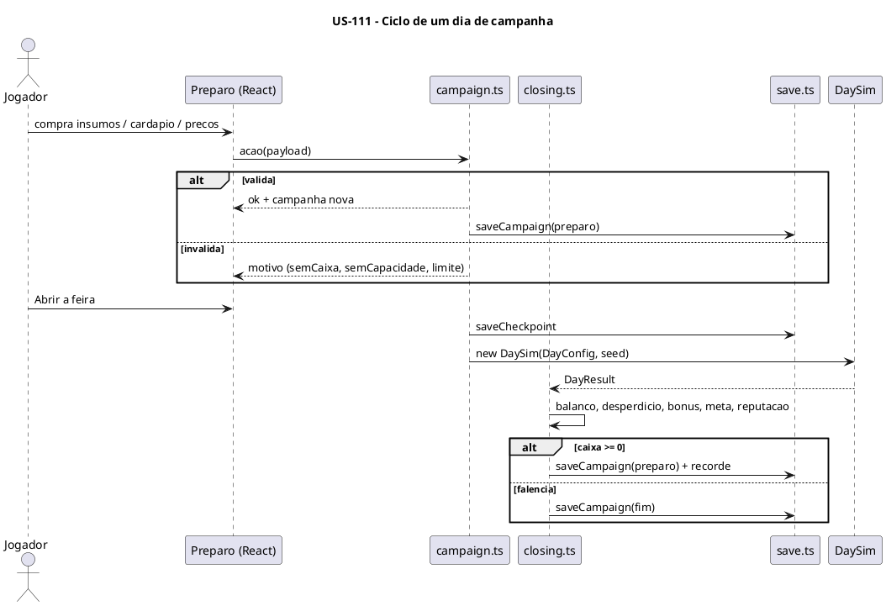

### Sequenciamento de Tarefas

| # | Tarefa | Escopo | Depende de |
|---|---|---|---|
| TF-111-01 | Modelo da campanha e ações do Preparo (insumos, estoque, cardápio, preços) | Campanha | US-110 |
| TF-111-02 | Fechamento do dia, metas e falência | Campanha | TF-111-01 |
| TF-111-03 | Save versionado, checkpoint e recordes | Persistência | TF-111-01 |
| TF-111-04 | Telas de Título e Nova campanha | Apresentação | TF-111-03 |
| TF-111-05 | Preparo: abas Insumos e Cardápio | Apresentação | TF-111-01 |
| TF-111-06 | Fechamento, máquina de telas e retomada | Apresentação | TF-111-02, TF-111-04, TF-111-05 |

### Tarefas

#### TF-111-01: Modelo da campanha e ações do Preparo (insumos, estoque, cardápio, preços)

**User Story:** US-111 Campanha com Preparo, Fechamento, metas e save
**Épico:** [INSERIR_ID_EPICO] Pastel de Feira
**Sistema:** sampa-challenges
**Prioridade:** P0

##### 1. Descrição e Objetivo

> **Eu como** campanha,
> **Eu quero** um estado `Campaign` e ações puras de Preparo com validação,
> **Para que** a UI nunca deixe o jogo num estado inválido (RN-53) e o `DayConfig` saia pronto para o `DaySim`.

*Contexto arquitetural:* `plan.md` 4.3, ações `(campaign, payload) → { ok, campaign } | { ok: false, motivo }`.

##### 2. Especificação Técnica

**2.1 Pontos de interceptação**
- `src/games/pastel-de-feira/game/campaign/campaign.ts` — `newCampaign(opts)`, `toDayConfig(campaign, seed)`.
- `src/games/pastel-de-feira/game/campaign/actions/inventory.ts` — comprar insumo/consumível (caixa, capacidade RN-38, lotes de massa com validade RN-34).
- `src/games/pastel-de-feira/game/campaign/actions/menu.ts` — montar o cardápio por vagas de salgado e doce (RN-30b), preços na faixa e no passo (RN-10).
- `src/games/pastel-de-feira/game/campaign/suggest.ts` — compra sugerida pela demanda esperada (RN-36).
- `src/games/pastel-de-feira/game/campaign/fatigue.ts` — fadiga por receita base, ativa com 4+ receitas (RN-30c).
- `src/games/pastel-de-feira/sim/scenarios/preparo.ts`.

**2.2 Dados:** `Campaign` conforme o `SaveV1.campaign` (`plan.md` 3.3).

**2.3 Contrato:** motivos fixos `semCaixa`, `semCapacidade`, `limite`, `bloqueadoAteDia`, `requer`, `semEspaco`.

**2.4 Resiliência e Zero Trust**

| Cenário | Estratégia | Impacto |
|---|---|---|
| Compra que deixa o caixa negativo | `semCaixa` | Botão desabilitado com motivo |
| Quantidade acima da capacidade livre | Limitada / `semCapacidade` | Spec, seção 4 |
| Preço fora da faixa | Clamp na faixa e no passo | Sem valor inválido |

##### 3. Modelagem Visual

Sequência da US-111.

##### 4. Orientação de Execução

**4.1 Contexto de entrada:** `spec.md` 3.4 e 3.2 (RN-10); `plan.md` 3.2, 3.3, 4.3.

**4.2 Passos**
1. Estado.
2. Ações de estoque.
3. Cardápio e preços.
4. Fadiga.
5. Compra sugerida.
6. `toDayConfig`.
7. Cenários.

**4.3 Validação:** comando padrão com `--scenario preparo`.

**4.4 Restrições negativas**
- NÃO mutar o `Campaign` recebido (retornar cópia).
- NÃO acessar `localStorage` aqui.

**4.5 Skills:** `test-driven-agentic-development`, `expert-lsp`.

**4.6 Critérios de saída**
- [ ] Todas as ações cobertas por cenário de sucesso e de cada motivo de recusa.

##### 5. Testes de Aceitação (DoD)

- [ ] Massa comprada no dia 1 vence no fechamento do dia 3.
- [ ] Fadiga: com 3 receitas compradas, nunca há fadiga. Com 4, a receita há 5 dias seguidos no cardápio tem −20%.
- [ ] A compra sugerida dos dias 1–3 cobre a demanda média sem passar a capacidade.

---

#### TF-111-02: Fechamento do dia, metas e falência

**User Story:** US-111 Campanha com Preparo, Fechamento, metas e save
**Épico:** [INSERIR_ID_EPICO] Pastel de Feira
**Sistema:** sampa-challenges
**Prioridade:** P0

##### 1. Descrição e Objetivo

> **Eu como** campanha,
> **Eu quero** aplicar o `DayResult` ao estado (dinheiro, estoque, desperdício, bônus, reputação, meta, falência),
> **Para que** cada dia tenha consequência econômica (RN-37, RN-47, RN-50–54, RN-62).

##### 2. Especificação Técnica

**2.1 Pontos de interceptação**
- `src/games/pastel-de-feira/game/campaign/closing.ts` — `close(campaign, result) → { campaign, balanco }`: receita, custos variáveis, salários (gancho US-113), taxa de m² (gancho US-112), multas e prêmios (ganchos), recheio estragado e massa vencida, bônus de aproveitamento (condição PA-05), variação de reputação (clamp 1–5), meta RN-50, falência RN-52, entrada no modo livre RN-54, histórico (máx. 60 dias).
- `src/games/pastel-de-feira/sim/scenarios/fechamento.ts`.

**2.2 Dados:** `Balanco` com linhas nomeadas para a tela de Fechamento. `history[]` com resumo diário.

**2.3 Contrato:** `close` é pura e determinística.

**2.4 Resiliência e Zero Trust**

| Cenário | Estratégia | Impacto |
|---|---|---|
| `DayResult` incoerente (valores negativos onde não pode) | Asserção em desenvolvimento; clamp em produção | Sem NaN no caixa |
| Caixa negativo | Falência (fase `fim`) | RN-52 |

##### 3. Modelagem Visual

Sequência da US-111.

##### 4. Orientação de Execução

**4.1 Contexto de entrada:** `spec.md` 3.6, RN-37, RN-62; decisões PA-04/PA-05.

**4.2 Passos**
1. Balanço.
2. Estoque e desperdício.
3. Bônus.
4. Reputação.
5. Meta.
6. Falência.
7. Histórico.
8. Cenários.

**4.3 Validação:** comando padrão com `--scenario fechamento`.

**4.4 Restrições negativas**
- NÃO avançar o dia quando a meta falha. Os demais efeitos persistem (RN-50).

**4.5 Skills:** `test-driven-agentic-development`.

**4.6 Critérios de saída**
- [ ] Meta do dia N bate com R$ 80 × 1,18^(N−1) nos dias 1, 10 e 20.

##### 5. Testes de Aceitação (DoD)

- [ ] Bônus = receita × max(0; 15% − desperdício), só sem cliente perdido por falta.
- [ ] Meta não cumprida: dia igual, caixa e reputação atualizados.
- [ ] Caixa −R$ 1 → fase `fim`.

---

#### TF-111-03: Save versionado, checkpoint e recordes

**User Story:** US-111 Campanha com Preparo, Fechamento, metas e save
**Épico:** [INSERIR_ID_EPICO] Pastel de Feira
**Sistema:** sampa-challenges
**Prioridade:** P0

##### 1. Descrição e Objetivo

> **Eu como** jogador,
> **Eu quero** que o progresso seja salvo e validado,
> **Para que** eu continue depois sem risco de travar com save quebrado (RN-55, RN-56, spec seção 4).

##### 2. Especificação Técnica

**2.1 Pontos de interceptação**
- `src/games/pastel-de-feira/game/campaign/save.ts` — `load(storage)`, `saveCampaign`, `saveCheckpoint`, `clear`, type guards completos do `SaveV1`, tabela `migrations`, validação de referências ao catálogo. O `Storage` é injetado (node usa um fake em memória).
- `src/games/pastel-de-feira/game/record.ts` — `saveRecords` (maior dia, maior caixa).
- `src/games/pastel-de-feira/sim/scenarios/save.ts`.

**2.2 Dados:** chaves da `plan.md` 3.3. Histórico limitado a 60 dias. Cota cheia: reduz o histórico pela metade e tenta de novo uma vez.

**2.3 Contrato:** `load` devolve `{ save: SaveV1 | null, aviso?: 'invalido' | 'semPersistencia' }`.

**2.4 Resiliência e Zero Trust**

| Cenário | Estratégia | Impacto |
|---|---|---|
| JSON inválido / schema inválido / id inexistente | Descartar, `aviso: 'invalido'`, `console.warn` com motivo | Campanha nova |
| `getItem`/`setItem` lança exceção | `semPersistencia` | Jogo em memória |
| Cota cheia | Reduzir histórico e tentar de novo uma vez | Último save válido mantido |

##### 3. Modelagem Visual

`plan.md` 2.4.

##### 4. Orientação de Execução

**4.1 Contexto de entrada:** `plan.md` 3.3, 5.1; `src/games/fuga-rocam/game/record.ts`.

**4.2 Passos**
1. Guards.
2. Load/save.
3. Checkpoint.
4. Migrações (vazia, com o teste do mecanismo).
5. Recordes.
6. Cenários com storage fake (incluindo um que lança exceção).

**4.3 Validação:** comando padrão com `--scenario save`.

**4.4 Restrições negativas**
- NÃO consertar save parcialmente.
- NÃO usar `eval` nem `Function`.

**4.5 Skills:** `test-driven-agentic-development`.

**4.6 Critérios de saída**
- [ ] 10 saves corrompidos diferentes (JSON quebrado, tipos errados, ids inexistentes, reputação 9) são todos rejeitados.
- [ ] Ida e volta (save → load) é idêntica.

##### 5. Testes de Aceitação (DoD)

- [ ] Storage que lança exceção → `semPersistencia`, sem exceção para cima.
- [ ] Migração fictícia v0→v1 aplicada e validada no cenário.
- [ ] Recorde só aumenta.

---

#### TF-111-04: Telas de Título e Nova campanha

**User Story:** US-111 Campanha com Preparo, Fechamento, metas e save
**Épico:** [INSERIR_ID_EPICO] Pastel de Feira
**Sistema:** sampa-challenges
**Prioridade:** P1

##### 1. Descrição e Objetivo

> **Eu como** jogador,
> **Eu quero** continuar a campanha ou começar outra escolhendo perfil, eventos e tutorial,
> **Para que** eu controle o início do jogo (jornada principal, passo 0).

##### 2. Especificação Técnica

**2.1 Pontos de interceptação**
- `src/games/pastel-de-feira/components/TitleScreen.tsx` — Continuar (se houver save), Nova campanha (confirma se houver save, RN-55), Sair (`onExit`), aviso de save inválido ou sem persistência.
- `src/games/pastel-de-feira/components/NewCampaign.tsx` — perfil (5 opções, RN-110; efeitos na US-120), eventos ligados/desligados (RN-150), tutorial sim/não (RN-170).
- `src/games/pastel-de-feira/styles.css` — estilos `.pastel-de-feira .title*`, `.pastel-de-feira .new*`.

**2.2 Dados:** grava `profile`, `eventsOn` e `tutorial` no `Campaign`.

**2.3 Contrato:** callbacks `onContinue`, `onNew(opts)`, `onExit`.

**2.4 Resiliência e Zero Trust**

| Cenário | Estratégia | Impacto |
|---|---|---|
| Aviso de save inválido | Mostrado uma vez | Spec, seção 4 |
| Toque duplo em "Nova campanha" | Botão desabilitado depois do primeiro toque | Sem duas campanhas |

##### 3. Modelagem Visual

`plan.md` 2.5.

##### 4. Orientação de Execução

**4.1 Contexto de entrada:** `src/games/fuga-rocam/components/TitleScreen.tsx`; `CLAUDE.md` raiz regra 9 (texto pt-BR curto).

**4.2 Passos**
1. Título.
2. Nova campanha.
3. Estilos.
4. Testar a 390 px.

**4.3 Validação:** `npm run typecheck`, depois navegador a 390 px e no desktop.

**4.4 Restrições negativas**
- NÃO apagar o save sem confirmação.

**4.5 Skills:** `verification-before-completion`.

**4.6 Critérios de saída**
- [ ] Fluxos Continuar e Nova campanha funcionam. A confirmação aparece quando há save.

##### 5. Testes de Aceitação (DoD)

- [ ] Sem save: só "Nova campanha" e "Sair".
- [ ] Com save inválido: aviso e campanha nova.
- [ ] Layout legível a 390 px.

---

#### TF-111-05: Preparo: abas Insumos e Cardápio

**User Story:** US-111 Campanha com Preparo, Fechamento, metas e save
**Épico:** [INSERIR_ID_EPICO] Pastel de Feira
**Sistema:** sampa-challenges
**Prioridade:** P0

##### 1. Descrição e Objetivo

> **Eu como** jogador,
> **Eu quero** comprar insumos e montar cardápio e preços numa tela clara, inclusive no celular,
> **Para que** eu planeje o dia antes de abrir a feira.

##### 2. Especificação Técnica

**2.1 Pontos de interceptação**
- `src/games/pastel-de-feira/components/prep/PrepScreen.tsx` — cabeçalho (dia, caixa, reputação, meta), barra de abas (só as desbloqueadas, RN-171) e "Abrir a feira".
- `src/games/pastel-de-feira/components/prep/InventoryTab.tsx` — lista por categoria, quantidade (+/−, "sugerida"), estoque atual e validade, capacidade usada/livre, custo total.
- `src/games/pastel-de-feira/components/prep/MenuTab.tsx` — vagas de salgado e doce, receitas compradas, preço por item (faixa e passo), indicador de fadiga.
- `src/games/pastel-de-feira/styles.css` — `.pastel-de-feira .prep*`.

**2.2 Dados:** só leitura do `Campaign`. Escrita via ações da TF-111-01.

**2.3 Contrato:** recusas mostram o texto do motivo (`semCaixa` → "Caixa insuficiente").

**2.4 Resiliência e Zero Trust**

| Cenário | Estratégia | Impacto |
|---|---|---|
| Ação recusada | Mostrar motivo, sem alterar o estado | Spec, seção 4 |
| Lista longa (30 insumos) | Rolagem nativa e agrupamento por categoria | Usável a 390 px |

##### 3. Modelagem Visual

Sequência da US-111.

##### 4. Orientação de Execução

**4.1 Contexto de entrada:** `src/games/sinuca-de-bar/components/Menu.tsx` (padrão de menu React); `plan.md` 6 (Preparo em DOM).

**4.2 Passos**
1. Cabeçalho e abas.
2. Insumos.
3. Cardápio.
4. Testar a 390 px.

**4.3 Validação:** `npm run typecheck`, depois navegador a 390 px.

**4.4 Restrições negativas**
- NÃO calcular regra na UI: tudo vem da campanha.

**4.5 Skills:** `verification-before-completion`, `expert-lsp`.

**4.6 Critérios de saída**
- [ ] Comprar, ajustar preço e montar o cardápio funcionam a 390 px sem rolagem horizontal.

##### 5. Testes de Aceitação (DoD)

- [ ] "Usar sugerida" preenche as quantidades dos dias 1–3.
- [ ] Botão de compra desabilitado com motivo quando falta caixa.
- [ ] Sem rolagem horizontal a 390 px.

---

#### TF-111-06: Fechamento, máquina de telas e retomada

**User Story:** US-111 Campanha com Preparo, Fechamento, metas e save
**Épico:** [INSERIR_ID_EPICO] Pastel de Feira
**Sistema:** sampa-challenges
**Prioridade:** P0

##### 1. Descrição e Objetivo

> **Eu como** jogador,
> **Eu quero** ver o balanço do dia, saber se cumpri a meta e seguir para o próximo Preparo, ou retomar um dia interrompido,
> **Para que** o ciclo da campanha feche de ponta a ponta (JA-06, JA-07).

##### 2. Especificação Técnica

**2.1 Pontos de interceptação**
- `src/games/pastel-de-feira/components/ClosingScreen.tsx` — linhas do `Balanco`, desperdício, reputação (antes/depois), meta cumprida ou não, falência.
- `src/games/pastel-de-feira/Game.tsx` — máquina de telas `plan.md` 2.5: carregar o save, Título, Preparo, Dia (checkpoint), Fechamento, Fim. Retomada com nova semente (PA-13). Remove o `devConfig.ts`.
- `src/games/pastel-de-feira/components/DayScreen.tsx` — recebe o `DayConfig` e devolve o `DayResult` por callback.

**2.2 Dados:** grava nas transições (RN-55).

**2.3 Contrato:** a semente do dia é `hash(diaDaCampanha, contadorDeRetomadas)`. Os eventos previstos ficam no `DayConfig` (não sorteiam de novo).

**2.4 Resiliência e Zero Trust**

| Cenário | Estratégia | Impacto |
|---|---|---|
| Saída no meio do dia | Ao voltar: checkpoint + nova semente | JA-06 |
| Falha ao salvar | Aviso único, segue em memória | `plan.md` 5.1 |

##### 3. Modelagem Visual

`plan.md` 2.4 e 2.5.

##### 4. Orientação de Execução

**4.1 Contexto de entrada:** `plan.md` 2.4, 2.5; `src/hub/GameHost.tsx` (`onExit`).

**4.2 Passos**
1. Tela de Fechamento.
2. Máquina de telas.
3. Retomada.
4. Remover `devConfig`.
5. Teste de 3 dias seguidos no navegador.

**4.3 Validação:** `npm run typecheck && npm run build`, depois jogar 3 dias, sair no meio do 3º e retomar.

**4.4 Restrições negativas**
- NÃO reaproveitar a semente na retomada.

**4.5 Skills:** `verification-before-completion`.

**4.6 Critérios de saída**
- [ ] Ciclo de 3 dias com save entre eles.
- [ ] Retomada funcional.

##### 5. Testes de Aceitação (DoD)

- [ ] Meta não cumprida: o dia repete.
- [ ] Recarregar a página no Preparo volta ao mesmo Preparo.
- [ ] Recarregar no meio do dia volta ao início do dia com o estoque do checkpoint.

---
## US-112: Melhorias: receitas, equipamentos e espaço

**Épico:** [INSERIR_ID_EPICO] Pastel de Feira
**Sistema:** sampa-challenges
**Estimativa:** 8 Story Points
**Prioridade:** P1

### Narrativa de Valor

> **Eu como** jogador,
> **Eu quero** comprar receitas, versões, bebidas, equipamentos e metros quadrados e ver a barraca crescer na tela,
> **Para que** o lucro vire capacidade de produção e qualidade (gargalo × investimento).

### Contexto de Negócio

Libera o catálogo completo (17 receitas, versões, doces como sobremesa, Especial da Casa grande) e
os equipamentos que mudam propriedades mecânicas (tacho grande/extra, termostato, alarme, escorredor,
óleo de algodão, moenda motorizada, estufa). A barraca ganha zonas novas dentro do layout fixo de 640×480.

### Critérios de Aceitação (Nível de Negócio)

- [ ] A aba Melhorias compra receitas, versões, bebidas, equipamentos e m², respeitando caixa, dia mínimo, espaço e pré-requisitos.
- [ ] Cada equipamento muda o comportamento descrito na spec, verificável por cenário.
- [ ] O Especial da Casa ocupa 2 cestos. Os doces são pedidos como sobremesa e têm janela curta.
- [ ] A barraca cheia cabe em 640×480 sem sobreposição, com as zonas frequentes fora da faixa do painel.
- [ ] A taxa diária de m² é debitada no fechamento.

### Regras de Negócio Aplicáveis

| # | Regra | Tipo |
|---|---|---|
| RN-24, RN-27, RN-46 | Modificadores de fritura, estufa, óleo de algodão | Obrigatória |
| RN-30, RN-30a, RN-30d, RN-30e, RN-31 | Catálogo, versões, Especial, doces, bebidas | Obrigatória |
| RN-70–75 | Barraca inicial, m², espaço, equipamentos, layout | Obrigatória |
| RN-171 | Itens e abas aparecem quando desbloqueados | Obrigatória |

### Diagrama — Sequência da US (container único)

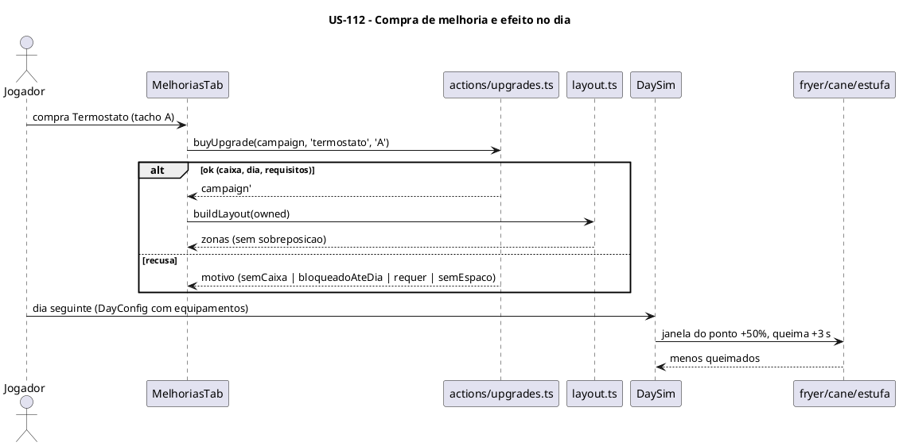

### Sequenciamento de Tarefas

| # | Tarefa | Escopo | Depende de |
|---|---|---|---|
| TF-112-01 | Compras de receitas, versões, bebidas, equipamentos e m² na campanha | Campanha | US-111 |
| TF-112-02 | Efeitos de equipamentos, Especial da Casa e doces no `DaySim` | Simulação | TF-112-01 |
| TF-112-03 | Layout dinâmico da barraca por compras | Apresentação (layout) | TF-112-01 |
| TF-112-04 | Aba Melhorias e render dos equipamentos | Apresentação (UI) | TF-112-02, TF-112-03 |

### Tarefas

#### TF-112-01: Compras de receitas, versões, bebidas, equipamentos e m² na campanha

**User Story:** US-112 Melhorias: receitas, equipamentos e espaço
**Épico:** [INSERIR_ID_EPICO] Pastel de Feira
**Sistema:** sampa-challenges
**Prioridade:** P1

##### 1. Descrição e Objetivo

> **Eu como** campanha,
> **Eu quero** ações de compra para todo o catálogo de melhorias, com pré-requisitos e espaço,
> **Para que** o jogador invista o lucro sem estados inválidos.

##### 2. Especificação Técnica

**2.1 Pontos de interceptação**
- `src/games/pastel-de-feira/game/data/catalog.ts` — equipamentos (RN-73), espaço (RN-71/72), placas de cardápio (RN-30b), dia mínimo e pré-requisitos.
- `src/games/pastel-de-feira/game/campaign/actions/upgrades.ts` — `buyRecipe`, `buyVersion` (em sequência, RN-30a), `buyDrink`, `buyEquipment(id, alvo?)`, `buySpace(m2)`, `buyMenuBoard`.
- `src/games/pastel-de-feira/game/campaign/closing.ts` — débito da taxa diária de m² (RN-71).
- `src/games/pastel-de-feira/sim/scenarios/melhorias.ts`.

**2.2 Dados:** `owned = { receitas, versoes, bebidas, equipamentos{id: alvo[]}, m2, placas }`.

**2.3 Contrato:** recusas `semCaixa`, `bloqueadoAteDia`, `requer` (ex.: Estufa grande sem estufa; versão 2 sem a 1), `semEspaco`, `limite` (3 tachos, 24 m²).

**2.4 Resiliência e Zero Trust**

| Cenário | Estratégia | Impacto |
|---|---|---|
| Compra repetida de item único | `limite` | Sem duplicidade |
| m² acima de 24 | `limite` | RN-71 |

##### 3. Modelagem Visual

Sequência da US-112.

##### 4. Orientação de Execução

**4.1 Contexto de entrada:** `spec.md` RN-30a, RN-30b, RN-31, RN-70–73; `game/data/recipes.ts`.

**4.2 Passos**
1. Catálogo.
2. Ações.
3. Débito da taxa.
4. Cenários de cada recusa.

**4.3 Validação:** comando padrão com `--scenario melhorias`.

**4.4 Restrições negativas**
- NÃO permitir revenda (PA-07).

**4.5 Skills:** `test-driven-agentic-development`.

**4.6 Critérios de saída**
- [ ] Todas as recusas cobertas.
- [ ] O espaço consumido nunca passa do comprado.

##### 5. Testes de Aceitação (DoD)

- [ ] Palmito bloqueado antes do dia 6. Bacalhau antes do dia 14.
- [ ] Tacho extra sem 2 m² livres → `semEspaco`.
- [ ] 10 m² comprados → R$ 80 por dia no fechamento.

---

#### TF-112-02: Efeitos de equipamentos, Especial da Casa e doces no `DaySim`

**User Story:** US-112 Melhorias: receitas, equipamentos e espaço
**Épico:** [INSERIR_ID_EPICO] Pastel de Feira
**Sistema:** sampa-challenges
**Prioridade:** P1

##### 1. Descrição e Objetivo

> **Eu como** simulação,
> **Eu quero** aplicar os efeitos de cada equipamento, o Especial grande e os doces como sobremesa,
> **Para que** as compras mudem o jogo de forma verificável.

##### 2. Especificação Técnica

**2.1 Pontos de interceptação**
- `src/games/pastel-de-feira/game/sim/stations/fryer.ts` — tacho grande (4 cestos), tachos extras, termostato (janela +50%, queima +3 s), alarme (evento `alarme_ponto` e `alarme_queima` 1 s antes), óleo de algodão (+3% de sujeira, custo de troca R$ 45, +10 de nota), Especial ocupando 2 cestos (RN-30d).
- `src/games/pastel-de-feira/game/sim/stations/warmer.ts` — estufa 6/12 vagas, nota congelada 60 s e depois −1/s (RN-27).
- `src/games/pastel-de-feira/game/sim/stations/cane.ts` — moenda motorizada (2,5 s), caldos com limão/abacaxi.
- `src/games/pastel-de-feira/game/sim/quality.ts` — escorredor +10.
- `src/games/pastel-de-feira/game/sim/customers.ts` — doce como sobremesa (RN-30e), versões no pedido do Exigente.
- `src/games/pastel-de-feira/sim/scenarios/equipamentos.ts`.

**2.2 Dados:** `DayConfig.equipamentos`.

**2.3 Contrato:** novos `events` no snapshot: `alarme_ponto`, `alarme_queima`.

**2.4 Resiliência e Zero Trust**

| Cenário | Estratégia | Impacto |
|---|---|---|
| Especial sem 2 cestos livres no tacho | Colocação recusada (`rejected`) | Jogador escolhe outro tacho |
| Estufa cheia | Fica no balcão com decaimento normal | Spec, seção 4 |

##### 3. Modelagem Visual

Sequência da US-112.

##### 4. Orientação de Execução

**4.1 Contexto de entrada:** `spec.md` RN-24, RN-27, RN-30d, RN-30e, RN-46, RN-73.

**4.2 Passos**
1. Fritura.
2. Estufa.
3. Moenda.
4. Qualidade.
5. Doces.
6. Especial.
7. Cenários (1 por equipamento).

**4.3 Validação:** comando padrão com `--scenario equipamentos`.

**4.4 Restrições negativas**
- NÃO acoplar efeito ao id do equipamento espalhado pelo código: centralizar no catálogo como propriedades (`janelaMult`, `queimaExtra`...).

**4.5 Skills:** `test-driven-agentic-development`, `expert-lsp`.

**4.6 Critérios de saída**
- [ ] 1 cenário por equipamento passa.

**4.7 Decomposição Iterativa (mimic-loop)**

**Modo:** `mimic-loop` · **Máx. iterações:** 20 · **Saga:** `exec:sampa-challenges:TF-112-02`

| # | RT | Critério de conclusão | Depende de |
|---|---|---|---|
| RT-01 | Tachos (grande, extra, termostato, alarme, algodão) | Cenários de tacho passam | — |
| RT-02 | Estufa | Cenário da estufa passa | — |
| RT-03 | Moenda motorizada + bebidas | Cenário da moenda passa | — |
| RT-04 | Especial + doces | Cenários RN-30d/30e passam | RT-01 |

##### 5. Testes de Aceitação (DoD)

- [ ] Termostato: Carne no ponto entre 5 s e 9,5 s, queima aos 13 s.
- [ ] Na estufa, a nota fica igual por 60 s.
- [ ] 25% dos clientes pedem doce (±3 p.p. em 5.000 clientes) e 35% depois das 11h.

---

#### TF-112-03: Layout dinâmico da barraca por compras

**User Story:** US-112 Melhorias: receitas, equipamentos e espaço
**Épico:** [INSERIR_ID_EPICO] Pastel de Feira
**Sistema:** sampa-challenges
**Prioridade:** P1

##### 1. Descrição e Objetivo

> **Eu como** jogador,
> **Eu quero** que cada compra apareça como zona nova num layout fixo que sempre cabe na tela,
> **Para que** a barraca cresça visualmente sem sobreposição (RN-74, RN-75, critério da seção 5).

##### 2. Especificação Técnica

**2.1 Pontos de interceptação**
- `src/games/pastel-de-feira/game/layout.ts` — `buildLayout(owned)`: slots fixos por tipo (tachos 1–3, estufa, moenda, bancada, área de mesas 1–4, delivery, escritório, caixas térmicas, área de descanso). Faixa coberta pelo painel. Grafo de vizinhança para o deslocamento (RN-41).
- `src/games/pastel-de-feira/sim/scenarios/layout.ts` — barraca cheia sem sobreposição e zonas frequentes fora da faixa do painel.

**2.2 Dados:** tabela de slots em coordenadas lógicas (640×480).

**2.3 Contrato:** `Layout = { zonas[], vizinhos, faixaPainel }`.

**2.4 Resiliência e Zero Trust**

| Cenário | Estratégia | Impacto |
|---|---|---|
| Combinação de compras não prevista | Slots fixos por tipo cobrem todas as combinações; o cenário testa a combinação máxima | Sem sobreposição |

##### 3. Modelagem Visual

Não se aplica (geometria). Protótipo do layout em PNG de referência no PR.

##### 4. Orientação de Execução

**4.1 Contexto de entrada:** `plan.md` 8 (risco de layout); RN-72/74/75.

**4.2 Passos**
1. Definir slots.
2. `buildLayout`.
3. Vizinhança.
4. Cenário.
5. Protótipo visual com placeholders.

**4.3 Validação:** comando padrão com `--scenario layout`, depois navegador com a barraca cheia via save de teste.

**4.4 Restrições negativas**
- NÃO usar câmera móvel nem rolagem no canvas.

**4.5 Skills:** `test-driven-agentic-development`, `verification-before-completion`.

**4.6 Critérios de saída**
- [ ] A combinação máxima passa no cenário de sobreposição.

##### 5. Testes de Aceitação (DoD)

- [ ] Barraca cheia sem zonas sobrepostas.
- [ ] Fila, balcão, tachos e estufa ficam fora da faixa do painel.
- [ ] O grafo de deslocamento é conexo.

---

#### TF-112-04: Aba Melhorias e render dos equipamentos

**User Story:** US-112 Melhorias: receitas, equipamentos e espaço
**Épico:** [INSERIR_ID_EPICO] Pastel de Feira
**Sistema:** sampa-challenges
**Prioridade:** P1

##### 1. Descrição e Objetivo

> **Eu como** jogador,
> **Eu quero** uma aba de compras organizada e ver na tela do dia os novos tachos, a estufa, a moenda e os alarmes,
> **Para que** o investimento seja visível e compreensível.

##### 2. Especificação Técnica

**2.1 Pontos de interceptação**
- `src/games/pastel-de-feira/components/prep/UpgradesTab.tsx` — seções Receitas (com versões), Bebidas, Equipamentos, Espaço, Cardápio (placas). Preço, requisito e motivo de bloqueio.
- `src/games/pastel-de-feira/game/render/scene.ts` — zonas dinâmicas pelo `Layout` (placeholders até a US-121).
- `src/games/pastel-de-feira/game/render/panel.ts` — painéis do tacho (4 cestos, Especial em 2), estufa, moenda motorizada. Alarme visual.

**2.2 Dados:** só leitura.

**2.3 Contrato:** a aba usa as ações da TF-112-01.

**2.4 Resiliência e Zero Trust**

| Cenário | Estratégia | Impacto |
|---|---|---|
| Item bloqueado | Visível com "a partir do dia N" ou "requer X" (ou oculto até o desbloqueio, RN-171) | Clareza |

##### 3. Modelagem Visual

Sequência da US-112.

##### 4. Orientação de Execução

**4.1 Contexto de entrada:** TF-111-05 (padrão das abas); `layout.ts`.

**4.2 Passos**
1. Aba.
2. Render das zonas.
3. Painéis novos.
4. Testar a 390 px.

**4.3 Validação:** `npm run typecheck`, depois navegador a 390 px e desktop.

**4.4 Restrições negativas**
- NÃO duplicar regra de bloqueio na UI.

**4.5 Skills:** `verification-before-completion`.

**4.6 Critérios de saída**
- [ ] Comprar um tacho extra mostra a zona nova no dia seguinte.

##### 5. Testes de Aceitação (DoD)

- [ ] A aba é usável a 390 px.
- [ ] O alarme pisca no cesto no ponto.
- [ ] O Especial aparece ocupando 2 cestos.

---

## US-113: Equipe: contratação, posições, cansaço e treinamento

**Épico:** [INSERIR_ID_EPICO] Pastel de Feira
**Sistema:** sampa-challenges
**Estimativa:** 8 Story Points
**Prioridade:** P1

### Narrativa de Valor

> **Eu como** jogador,
> **Eu quero** contratar Fritadores e Gerais entre candidatos com traços, colocá-los em posições fixas ou no automático, treiná-los e administrar o cansaço,
> **Para que** eu escale a barraca delegando funções e assumindo só as posições que quiser.

### Contexto de Negócio

Implementa o sistema de pessoas da spec (3.5 e 3.13): tipos de contratação (PA-03), prioridades do
automático, energia e descanso, traços e cursos. O pasteleiro passa a dividir a barraca com a equipe (JA-01).

### Critérios de Aceitação (Nível de Negócio)

- [ ] O Preparo mostra até 3 candidatos por tipo, com traços e salário. Contratar e dispensar respeitam as posições existentes.
- [ ] Funcionários fixos e automáticos executam suas funções com os tempos da spec. Fritador e Trocador de óleo exigem o tipo Fritador.
- [ ] O cansaço reduz o rendimento. A área de descanso recupera mais rápido.
- [ ] O pasteleiro pode assumir qualquer posição. O funcionário cede o lugar conforme o modo.
- [ ] Salários são debitados no fechamento.

### Regras de Negócio Aplicáveis

| # | Regra | Tipo |
|---|---|---|
| RN-40, RN-43–45 | Posições, tempos, acúmulo, prioridades | Obrigatória |
| RN-47–49 | Salários, contratação, tipos | Obrigatória |
| RN-113–118 | Candidatos, traços, energia, descanso, área, cursos | Obrigatória |
| JA-01, JA-10 | Assumir função, descanso | Obrigatória |

### Diagrama — Sequência da US (container único)

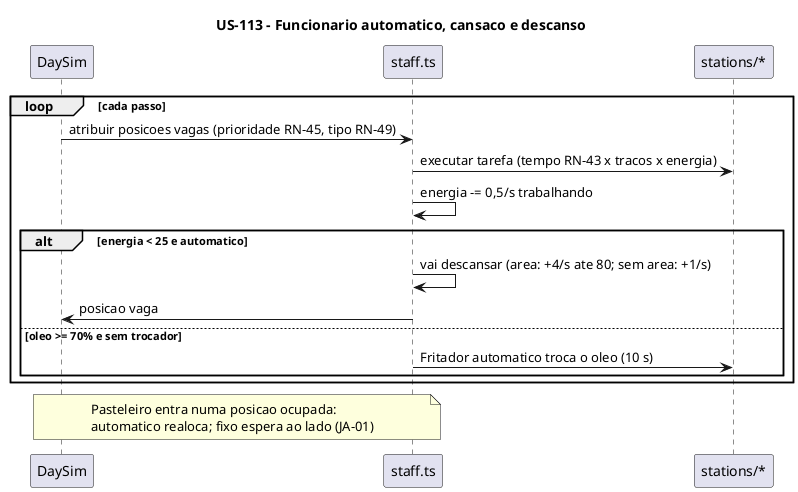

### Sequenciamento de Tarefas

| # | Tarefa | Escopo | Depende de |
|---|---|---|---|
| TF-113-01 | Candidatos, contratação, traços, salários e cursos na campanha | Campanha | US-111 |
| TF-113-02 | Posições, fixo/automático e execução de tarefas pela equipe | Simulação | TF-113-01, US-112 |
| TF-113-03 | Energia, descanso e área de descanso | Simulação | TF-113-02 |
| TF-113-04 | Aba Equipe e render da equipe | Apresentação | TF-113-03 |

### Tarefas

#### TF-113-01: Candidatos, contratação, traços, salários e cursos na campanha

**User Story:** US-113 Equipe: contratação, posições, cansaço e treinamento
**Épico:** [INSERIR_ID_EPICO] Pastel de Feira
**Sistema:** sampa-challenges
**Prioridade:** P1

##### 1. Descrição e Objetivo

> **Eu como** campanha,
> **Eu quero** sortear candidatos por dia, contratar, dispensar, definir modo e posição e pagar cursos,
> **Para que** a equipe seja planejada no Preparo (RN-47–49, RN-113, RN-114, RN-118).

##### 2. Especificação Técnica

**2.1 Pontos de interceptação**
- `src/games/pastel-de-feira/game/data/catalog.ts` — traços, cursos, salários base (Fritador R$ 75, Geral R$ 55).
- `src/games/pastel-de-feira/game/campaign/actions/staff.ts` — `rollCandidates(seed, dia)`, `hire`, `fire`, `setMode(fixo|auto, posicao?)`, `train(curso)` (1 por funcionário por dia).
- `src/games/pastel-de-feira/game/campaign/closing.ts` — débito dos salários (com traços).
- `src/games/pastel-de-feira/sim/scenarios/equipe.ts`.

**2.2 Dados:** `staff[] = { id, kind, traits[], courses[], mode, position? }`. Os candidatos não são salvos (sorteados pelo dia).

**2.3 Contrato:** recusas `limite` (posições), `semCaixa` (curso), `requer` (posição de tacho para Geral).

**2.4 Resiliência e Zero Trust**

| Cenário | Estratégia | Impacto |
|---|---|---|
| Geral fixado como Fritador/Trocador | `requer` | PA-03 |
| Mais funcionários que posições | `limite` | RN-48 |

##### 3. Modelagem Visual

Sequência da US-113.

##### 4. Orientação de Execução

**4.1 Contexto de entrada:** `spec.md` 3.5, 3.13; decisões PA-03, D-01.

**4.2 Passos**
1. Catálogo.
2. Sorteio de candidatos.
3. Ações.
4. Débito.
5. Cenários.

**4.3 Validação:** comando padrão com `--scenario equipe`.

**4.4 Restrições negativas**
- NÃO sortear candidatos com `Math.random`.

**4.5 Skills:** `test-driven-agentic-development`.

**4.6 Critérios de saída**
- [ ] O mesmo dia gera os mesmos candidatos.
- [ ] Todas as recusas cobertas.

##### 5. Testes de Aceitação (DoD)

- [ ] Fritador Rápido custa R$ 86,25 (75 × 1,15).
- [ ] Segundo curso no mesmo dia → recusa.

---

#### TF-113-02: Posições, fixo/automático e execução de tarefas pela equipe

**User Story:** US-113 Equipe: contratação, posições, cansaço e treinamento
**Épico:** [INSERIR_ID_EPICO] Pastel de Feira
**Sistema:** sampa-challenges
**Prioridade:** P1

##### 1. Descrição e Objetivo

> **Eu como** simulação,
> **Eu quero** que funcionários ocupem posições e executem as tarefas sozinhos,
> **Para que** a barraca opere em paralelo (RN-40, RN-43–45, JA-01).

##### 2. Especificação Técnica

**2.1 Pontos de interceptação**
- `src/games/pastel-de-feira/game/sim/staff.ts` — atribuição por prioridade e tipo; executores por função (Balcão, Colocador, Fritador, Trocador volante, Moenda); acúmulo Fritador sem Colocador (RN-44); traços (Rápido, Caprichoso, Distraído) e cursos (Fritura, Atendimento, Higiene) aplicados aos tempos e notas; o pasteleiro entra numa posição ocupada (JA-01).
- `src/games/pastel-de-feira/game/sim/stations/*.ts` — aceitar o executor "funcionário" além do pasteleiro.
- `src/games/pastel-de-feira/sim/scenarios/posicoes.ts`.

**2.2 Dados:** `DayConfig.staff`.

**2.3 Contrato:** os funcionários agem pelas mesmas ações internas que os comandos do pasteleiro (sem atalhos).

**2.4 Resiliência e Zero Trust**

| Cenário | Estratégia | Impacto |
|---|---|---|
| Automático sem posição vaga | Ocioso (spec, seção 4) | Aparece no fechamento |
| Distraído monta sabor errado (5%) | Gera item errado ao entregar (RN-63) | Falha |

##### 3. Modelagem Visual

Sequência da US-113.

##### 4. Orientação de Execução

**4.1 Contexto de entrada:** `spec.md` RN-40, RN-43–45, RN-114, RN-118; TF-110-06/07/08.

**4.2 Passos**
1. Atribuição.
2. Executores por função.
3. Acúmulo.
4. Traços e cursos.
5. JA-01.
6. Cenários.

**4.3 Validação:** comando padrão com `--scenario posicoes`.

**4.4 Restrições negativas**
- NÃO deixar Geral ocupar Fritador/Trocador.

**4.5 Skills:** `test-driven-agentic-development`, `expert-lsp`.

**4.6 Critérios de saída**
- [ ] Cenário "barraca com 4 funcionários sem pasteleiro" atende sem intervenção.

**4.7 Decomposição Iterativa (mimic-loop)**

**Modo:** `mimic-loop` · **Máx. iterações:** 20 · **Saga:** `exec:sampa-challenges:TF-113-02`

| # | RT | Critério de conclusão | Depende de |
|---|---|---|---|
| RT-01 | Atribuição e prioridades | Cenário de prioridades passa | — |
| RT-02 | Executores Balcão/Moenda | Cenário de atendimento passa | RT-01 |
| RT-03 | Executores de tacho + Trocador volante | Cenário de óleo passa | RT-01 |
| RT-04 | Traços, cursos e JA-01 | Cenários de traço e de troca de posição passam | RT-02, RT-03 |

##### 5. Testes de Aceitação (DoD)

- [ ] Fritador tira no meio da janela e nunca queima (RN-43).
- [ ] Fritador automático troca o óleo quando chega a 70%.
- [ ] Pasteleiro entra no balcão: o automático vai para outra posição e o fixo espera.

---

#### TF-113-03: Energia, descanso e área de descanso

**User Story:** US-113 Equipe: contratação, posições, cansaço e treinamento
**Épico:** [INSERIR_ID_EPICO] Pastel de Feira
**Sistema:** sampa-challenges
**Prioridade:** P1

##### 1. Descrição e Objetivo

> **Eu como** simulação,
> **Eu quero** a energia dos funcionários e o descanso,
> **Para que** a equipe tenha custo operacional além do salário (RN-115–117, JA-10).

##### 2. Especificação Técnica

**2.1 Pontos de interceptação**
- `src/games/pastel-de-feira/game/sim/staff.ts` — energia (−0,5/s trabalhando; Resistente −40%), penalidades (<40 → +25%; <15 → +60%), descanso automático (<25), comando `sendRest` para fixos, recuperação 4/s (área) ou 1/s (no lugar), vagas da área.
- `src/games/pastel-de-feira/game/data/catalog.ts` — área de descanso (R$ 120, 1 m², 2 vagas, +1 por R$ 80, máx. 4).
- `src/games/pastel-de-feira/game/campaign/actions/upgrades.ts` — compra da área e das vagas.
- `src/games/pastel-de-feira/sim/scenarios/energia.ts`.

**2.2 Dados:** `DayResult.energiaFinal` (insumo do evento Reivindicação na US-118).

**2.3 Contrato:** `sendRest(staffId)` só vale para fixos.

**2.4 Resiliência e Zero Trust**

| Cenário | Estratégia | Impacto |
|---|---|---|
| Área cheia | Descansa no lugar a 1/s | RN-116 |
| Todos descansando | Permitido; tempo vago contabilizado | Spec, seção 4 |

##### 3. Modelagem Visual

Sequência da US-113.

##### 4. Orientação de Execução

**4.1 Contexto de entrada:** `spec.md` RN-115–117.

**4.2 Passos**
1. Energia.
2. Penalidades.
3. Descanso.
4. Área.
5. `sendRest`.
6. Cenários.

**4.3 Validação:** comando padrão com `--scenario energia`.

**4.4 Restrições negativas**
- NÃO aplicar cansaço ao pasteleiro (PA-08).

**4.5 Skills:** `test-driven-agentic-development`.

**4.6 Critérios de saída**
- [ ] Os tempos de energia batem com a spec em cenário.

##### 5. Testes de Aceitação (DoD)

- [ ] Funcionário sem pausa chega a 25 de energia em 150 s.
- [ ] Na área, vai de 25 a 80 em ~14 s.

---

#### TF-113-04: Aba Equipe e render da equipe

**User Story:** US-113 Equipe: contratação, posições, cansaço e treinamento
**Épico:** [INSERIR_ID_EPICO] Pastel de Feira
**Sistema:** sampa-challenges
**Prioridade:** P1

##### 1. Descrição e Objetivo

> **Eu como** jogador,
> **Eu quero** contratar e treinar numa aba Equipe e ver os funcionários trabalhando e cansando na barraca,
> **Para que** eu gerencie as pessoas com informação visível.

##### 2. Especificação Técnica

**2.1 Pontos de interceptação**
- `src/games/pastel-de-feira/components/prep/StaffTab.tsx` — candidatos (tipo, traços, salário), equipe atual (modo, posição, cursos), área de descanso.
- `src/games/pastel-de-feira/game/render/scene.ts` — funcionários nas posições, barra de energia, indicador de tipo (avental), ícone "zZ" no descanso.
- `src/games/pastel-de-feira/game/input.ts` — toque num funcionário fixo → `sendRest`.

**2.2 Dados:** só leitura.

**2.3 Contrato:** ações da TF-113-01.

**2.4 Resiliência e Zero Trust**

| Cenário | Estratégia | Impacto |
|---|---|---|
| Toque no funcionário em automático | Ignorado (descansa sozinho) | RN-116 |

##### 3. Modelagem Visual

Sequência da US-113.

##### 4. Orientação de Execução

**4.1 Contexto de entrada:** TF-111-05; TF-112-04.

**4.2 Passos**
1. Aba.
2. Render.
3. Input.
4. Testar a 390 px.

**4.3 Validação:** `npm run typecheck`, depois navegador.

**4.4 Restrições negativas**
- NÃO mostrar candidatos de outro dia.

**4.5 Skills:** `verification-before-completion`.

**4.6 Critérios de saída**
- [ ] Contratar, definir modo e posição e treinar funcionam a 390 px.

##### 5. Testes de Aceitação (DoD)

- [ ] O funcionário aparece na posição escolhida.
- [ ] A barra de energia cai durante o dia.
- [ ] Tocar no fixo o manda descansar.

---
## US-114: Mesas, grupos, pagamento e limpeza

**Épico:** [INSERIR_ID_EPICO] Pastel de Feira
**Sistema:** sampa-challenges
**Estimativa:** 5 Story Points
**Prioridade:** P1

### Narrativa de Valor

> **Eu como** jogador,
> **Eu quero** comprar mesas, receber grupos que comem no local, cobrar na fila de pagamento e manter a barraca limpa,
> **Para que** o conforto (mesas) concorra com a produção (tachos) pelo espaço e pelo dinheiro.

### Contexto de Negócio

Implementa a seção 3.9 (mesas, grupos, pagamento no balcão) e a 3.15 (sujeira), com Garçom e Ajudante.
Cria gargalos novos: lugar sujo, fila de pagamento e grupos que exigem a mesa inteira.

### Critérios de Aceitação (Nível de Negócio)

- [ ] Com mesas compradas, parte dos clientes Padrão/Exigentes vem em grupos de 1–4 e senta numa mesa com lugares livres e limpos.
- [ ] Com garçom, o pedido é anotado e entregue na mesa. Sem garçom, o grupo usa a fila do balcão.
- [ ] Ao terminar, o grupo vai para a fila de pagamento. Depois de 20 s sem ser cobrado, vai embora (falha).
- [ ] O lugar fica sujo até alguém limpar. A sujeira da barraca afeta paciência, Exigentes e reputação.

### Regras de Negócio Aplicáveis

| # | Regra | Tipo |
|---|---|---|
| RN-16, RN-130–133 | Sujeira da barraca e efeitos | Obrigatória |
| RN-80–87 | Mesas, escolha, prêmio, garçom, lugar sujo, grupos, pagamento | Obrigatória |

### Diagrama — Sequência da US (container único)

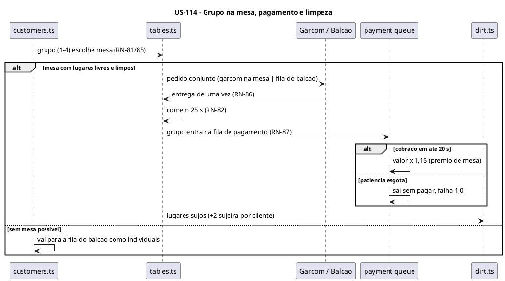

### Sequenciamento de Tarefas

| # | Tarefa | Escopo | Depende de |
|---|---|---|---|
| TF-114-01 | Mesas e grupos na simulação | Simulação (mesas) | US-113 |
| TF-114-02 | Fila de pagamento e fluxo do Garçom | Simulação (atendimento) | TF-114-01 |
| TF-114-03 | Sujeira da barraca, lugares sujos e Ajudante | Simulação (limpeza) | TF-114-01 |
| TF-114-04 | Compra de mesas e render de mesas, fila de pagamento e sujeira | Campanha + apresentação | TF-114-02, TF-114-03 |

### Tarefas

#### TF-114-01: Mesas e grupos na simulação

**User Story:** US-114 Mesas, grupos, pagamento e limpeza
**Épico:** [INSERIR_ID_EPICO] Pastel de Feira
**Sistema:** sampa-challenges
**Prioridade:** P1

##### 1. Descrição e Objetivo

> **Eu como** simulação,
> **Eu quero** mesas com lugares, grupos de clientes e pedido conjunto,
> **Para que** comer no local siga RN-80–82, RN-85 e RN-86.

##### 2. Especificação Técnica

**2.1 Pontos de interceptação**
- `src/games/pastel-de-feira/game/sim/stations/tables.ts` — mesas (4 lugares), ocupação, estados do lugar (livre/ocupado/sujo), tempo comendo.
- `src/games/pastel-de-feira/game/sim/customers.ts` — escolha de mesa (30% dos Padrão/Exigentes), grupos (40/30/20/10), pedido conjunto com perfil por item, paciência do grupo = menor (RN-86), queda para o balcão como individuais.
- `src/games/pastel-de-feira/sim/scenarios/mesas.ts`.

**2.2 Dados:** `Grupo = { id, membros[], mesa?, pedido[], paciencia }`.

**2.3 Contrato:** a entrega de um pedido de grupo só fecha quando todos os itens chegam.

**2.4 Resiliência e Zero Trust**

| Cenário | Estratégia | Impacto |
|---|---|---|
| Grupo de 4 e só mesas parciais livres | Vai para o balcão como individuais | RN-85 |
| Perfis diferentes no grupo | Cada item segue o perfil de quem pediu | Spec, seção 4 |

##### 3. Modelagem Visual

Sequência da US-114.

##### 4. Orientação de Execução

**4.1 Contexto de entrada:** `spec.md` 3.9.

**4.2 Passos**
1. Mesas.
2. Escolha.
3. Grupos.
4. Pedido conjunto.
5. Cenários.

**4.3 Validação:** comando padrão com `--scenario mesas`.

**4.4 Restrições negativas**
- NÃO criar grupos no balcão (PA-18).

**4.5 Skills:** `test-driven-agentic-development`.

**4.6 Critérios de saída**
- [ ] Cenários RN-80–82, RN-85 e RN-86 passam.

##### 5. Testes de Aceitação (DoD)

- [ ] Paciência de mesa ×1,5.
- [ ] O grupo sai junto.
- [ ] Sem mesa livre e limpa, o grupo vai para o balcão.

---

#### TF-114-02: Fila de pagamento e fluxo do Garçom

**User Story:** US-114 Mesas, grupos, pagamento e limpeza
**Épico:** [INSERIR_ID_EPICO] Pastel de Feira
**Sistema:** sampa-challenges
**Prioridade:** P1

##### 1. Descrição e Objetivo

> **Eu como** simulação,
> **Eu quero** a fila de pagamento do balcão e o Garçom anotando/entregando na mesa,
> **Para que** o pagamento de mesa siga RN-83 e RN-87.

##### 2. Especificação Técnica

**2.1 Pontos de interceptação**
- `src/games/pastel-de-feira/game/sim/stations/counter.ts` — fila de pagamento separada (máx. 4 grupos), cobrança por quem está no Balcão, paciência de 20 s, grupo esperando na mesa quando a fila enche, prêmio de mesa +15% na cobrança.
- `src/games/pastel-de-feira/game/sim/staff.ts` — função Garçom (anotar e entregar na mesa).
- `src/games/pastel-de-feira/sim/scenarios/pagamento.ts`.

**2.2 Dados:** `filaPagamento[]`.

**2.3 Contrato:** comando `tapSlot` na fila de pagamento cobra o primeiro grupo (pasteleiro no balcão).

**2.4 Resiliência e Zero Trust**

| Cenário | Estratégia | Impacto |
|---|---|---|
| Fila de pagamento cheia | Grupo espera na mesa ocupada | RN-87 |
| Paciência esgota | Sai sem pagar, falha 1,0 | RN-87 |
| 14h com grupo na fila | Sai sem pagar e sem falha | RN-07 |

##### 3. Modelagem Visual

Sequência da US-114.

##### 4. Orientação de Execução

**4.1 Contexto de entrada:** `spec.md` RN-83, RN-87; decisão D-03.

**4.2 Passos**
1. Fila.
2. Cobrança.
3. Garçom.
4. Cenários.

**4.3 Validação:** comando padrão com `--scenario pagamento`.

**4.4 Restrições negativas**
- NÃO cobrar na mesa (L4: sempre no balcão).

**4.5 Skills:** `test-driven-agentic-development`.

**4.6 Critérios de saída**
- [ ] Os cenários de pagamento, fila cheia e paciência passam.

##### 5. Testes de Aceitação (DoD)

- [ ] Com garçom, o grupo não entra na fila de pedidos.
- [ ] O valor cobrado inclui +15%.

---

#### TF-114-03: Sujeira da barraca, lugares sujos e Ajudante

**User Story:** US-114 Mesas, grupos, pagamento e limpeza
**Épico:** [INSERIR_ID_EPICO] Pastel de Feira
**Sistema:** sampa-challenges
**Prioridade:** P1

##### 1. Descrição e Objetivo

> **Eu como** simulação,
> **Eu quero** o nível de sujeira, os lugares sujos e a limpeza pelo pasteleiro e pelo Ajudante,
> **Para que** a higiene vire gargalo (RN-16, RN-84, RN-130–133).

##### 2. Especificação Técnica

**2.1 Pontos de interceptação**
- `src/games/pastel-de-feira/game/sim/dirt.ts` — sujeira 0–100 com fontes, limiares 60/80 e efeitos (paciência −20%, Exigentes não entram, +0,25 de falha), curso de Higiene −30%.
- `src/games/pastel-de-feira/game/sim/stations/tables.ts` — limpar mesa (3 s), lugares bloqueados.
- `src/games/pastel-de-feira/game/sim/staff.ts` — função Ajudante (mesas e barraca quando ocioso).
- `src/games/pastel-de-feira/sim/scenarios/sujeira.ts`.

**2.2 Dados:** `sujeira` no estado do dia (começa em 0).

**2.3 Contrato:** `holdStart`/`holdEnd` com `action: 'limpar'` (mesa: 3 s; vassoura: 4 s, −25).

**2.4 Resiliência e Zero Trust**

| Cenário | Estratégia | Impacto |
|---|---|---|
| Sujeira acima de 100 | Clamp | — |
| Sem Ajudante | O pasteleiro limpa | Spec, seção 4 |

##### 3. Modelagem Visual

Sequência da US-114.

##### 4. Orientação de Execução

**4.1 Contexto de entrada:** `spec.md` 3.15, RN-84, RN-16.

**4.2 Passos**
1. Sujeira.
2. Efeitos.
3. Limpeza.
4. Ajudante.
5. Cenários.

**4.3 Validação:** comando padrão com `--scenario sujeira`.

**4.4 Restrições negativas**
- NÃO acoplar o limiar do tema Popular aqui (vem na US-116 via `DayConfig`).

**4.5 Skills:** `test-driven-agentic-development`.

**4.6 Critérios de saída**
- [ ] Os efeitos dos limiares 60 e 80 são verificados.

##### 5. Testes de Aceitação (DoD)

- [ ] Sujeira 60 → Exigentes não entram na fila.
- [ ] Ajudante ocioso limpa 10 pontos a cada 3 s.

---

#### TF-114-04: Compra de mesas e render de mesas, fila de pagamento e sujeira

**User Story:** US-114 Mesas, grupos, pagamento e limpeza
**Épico:** [INSERIR_ID_EPICO] Pastel de Feira
**Sistema:** sampa-challenges
**Prioridade:** P1

##### 1. Descrição e Objetivo

> **Eu como** jogador,
> **Eu quero** comprar mesas e ver grupos, lugares sujos, a fila de pagamento e o nível de sujeira na tela,
> **Para que** eu gerencie o salão.

##### 2. Especificação Técnica

**2.1 Pontos de interceptação**
- `src/games/pastel-de-feira/game/campaign/actions/upgrades.ts` — `buyTable` (R$ 150, 2 m², máx. 4).
- `src/games/pastel-de-feira/components/prep/UpgradesTab.tsx` — seção Mesas.
- `src/games/pastel-de-feira/game/render/scene.ts` — mesas, grupos sentados, lugar sujo, fila de pagamento, indicador de sujeira.
- `src/games/pastel-de-feira/game/render/panel.ts` — painel da mesa (limpar) e do balcão (cobrar).

**2.2 Dados:** `owned.mesas`.

**2.3 Contrato:** compra com recusas `semEspaco`, `limite`.

**2.4 Resiliência e Zero Trust**

| Cenário | Estratégia | Impacto |
|---|---|---|
| 4 mesas + barraca cheia | Coberto pelo cenário de layout (TF-112-03) | Sem sobreposição |

##### 3. Modelagem Visual

Sequência da US-114.

##### 4. Orientação de Execução

**4.1 Contexto de entrada:** TF-112-03/04.

**4.2 Passos**
1. Compra.
2. Aba.
3. Render.
4. Painéis.
5. Navegador a 390 px.

**4.3 Validação:** `npm run typecheck`, comando padrão com `--scenario layout`, depois navegador.

**4.4 Restrições negativas**
- NÃO colocar a área de mesas na faixa coberta pelo painel se ela tiver lugares de toque frequente (avaliar no protótipo).

**4.5 Skills:** `verification-before-completion`.

**4.6 Critérios de saída**
- [ ] Ciclo completo de mesa jogável no navegador.

##### 5. Testes de Aceitação (DoD)

- [ ] Grupo senta, come, paga e deixa o lugar sujo, e o lugar é limpo por toque.
- [ ] O indicador de sujeira muda de cor a 60 e a 80.

---

## US-115: Delivery do app (motoboys)

**Épico:** [INSERIR_ID_EPICO] Pastel de Feira
**Sistema:** sampa-challenges
**Estimativa:** 5 Story Points
**Prioridade:** P1

### Narrativa de Valor

> **Eu como** jogador,
> **Eu quero** aceitar comandas do app, prepará-las em paralelo ao balcão, guardá-las na estufa e entregá-las aos motoboys,
> **Para que** eu tenha uma fonte de receita arriscada que testa o planejamento (armadilha de progressão).

### Contexto de Negócio

Implementa a seção 3.10 da spec: ofertas com aceite manual (ou automático com Expedição), teto diário
por reputação, estufa compartilhada, motoboys com espera limitada e cancelamento de peso 3,0.

### Critérios de Aceitação (Nível de Negócio)

- [ ] A área de delivery é comprável a partir do dia 5 e pode ser desligada no Preparo.
- [ ] Ofertas aparecem por 10 s. Aceitar é um toque de qualquer posição. O teto diário segue a reputação.
- [ ] A comanda pronta ocupa vagas da estufa até o motoboy chegar. O motoboy espera 25 s e cancela o que não estiver pronto.
- [ ] O app paga o preço −20%, sem teto de perfil. O brinde vale. A xepa não vale.

### Regras de Negócio Aplicáveis

| # | Regra | Tipo |
|---|---|---|
| RN-25 | Perda no transporte e Embalagem Térmica | Obrigatória |
| RN-90–96 | Área, ofertas, motoboy, pagamento, cancelamento, teto, estufa | Obrigatória |
| RN-39a | Embalagem do app como consumível | Obrigatória |

### Diagrama — Sequência da US (container único)

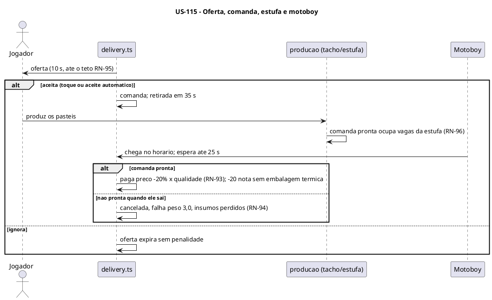

### Sequenciamento de Tarefas

| # | Tarefa | Escopo | Depende de |
|---|---|---|---|
| TF-115-01 | Ofertas do app, teto diário e aceite | Simulação (ofertas) | US-112 |
| TF-115-02 | Motoboys, estufa compartilhada, pagamento e cancelamento | Simulação (retirada) | TF-115-01 |
| TF-115-03 | Compra/desligamento do delivery, Expedição, aviso de oferta e render | Campanha + apresentação | TF-115-02, US-113 |

### Tarefas

#### TF-115-01: Ofertas do app, teto diário e aceite

**User Story:** US-115 Delivery do app (motoboys)
**Épico:** [INSERIR_ID_EPICO] Pastel de Feira
**Sistema:** sampa-challenges
**Prioridade:** P1

##### 1. Descrição e Objetivo

> **Eu como** simulação,
> **Eu quero** gerar ofertas de comanda com validade e teto, e aceitar por comando ou automaticamente,
> **Para que** o jogador controle quanto delivery assume (RN-90, RN-91, RN-95).

##### 2. Especificação Técnica

**2.1 Pontos de interceptação**
- `src/games/pastel-de-feira/game/sim/delivery.ts` — geração (média de 25 s, `rng.fork('app')`), 2–4 pastéis do cardápio, validade 10 s, teto por reputação (+4 com Conta Parceira), aceite automático com Expedição, embalagem do app como pré-requisito.
- `src/games/pastel-de-feira/sim/scenarios/ofertas.ts`.

**2.2 Dados:** `ofertas[]`, `comandas[]`, `aceitasHoje`.

**2.3 Contrato:** comando `acceptOffer(offerId)`, válido de qualquer posição (PA-14). Expirada → descartado.

**2.4 Resiliência e Zero Trust**

| Cenário | Estratégia | Impacto |
|---|---|---|
| Sem embalagem do app | Nenhuma oferta nova é aceita | RN-39a |
| Oferta durante a pausa | O tempo dela também pausa | Spec, seção 4 |
| Aceite sem insumo suficiente | Permitido; cancela na retirada | Spec, seção 4 |

##### 3. Modelagem Visual

Sequência da US-115.

##### 4. Orientação de Execução

**4.1 Contexto de entrada:** `spec.md` RN-90, RN-91, RN-95, RN-39a.

**4.2 Passos**
1. Geração.
2. Validade.
3. Teto.
4. Aceite manual e automático.
5. Cenários.

**4.3 Validação:** comando padrão com `--scenario ofertas`.

**4.4 Restrições negativas**
- NÃO gerar ofertas com o delivery desligado ou não comprado.

**4.5 Skills:** `test-driven-agentic-development`.

**4.6 Critérios de saída**
- [ ] O teto é respeitado nos 3 níveis de reputação.

##### 5. Testes de Aceitação (DoD)

- [ ] Reputação 3,0 → no máximo 3 aceitas.
- [ ] Oferta não aceita some em 10 s.
- [ ] O aceite automático aceita até o teto.

---

#### TF-115-02: Motoboys, estufa compartilhada, pagamento e cancelamento

**User Story:** US-115 Delivery do app (motoboys)
**Épico:** [INSERIR_ID_EPICO] Pastel de Feira
**Sistema:** sampa-challenges
**Prioridade:** P1

##### 1. Descrição e Objetivo

> **Eu como** simulação,
> **Eu quero** motoboys que retiram comandas prontas da estufa no horário e cancelam as atrasadas,
> **Para que** a punição do delivery funcione (RN-25, RN-92–94, RN-96).

##### 2. Especificação Técnica

**2.1 Pontos de interceptação**
- `src/games/pastel-de-feira/game/sim/delivery.ts` — motoboys (até 2 comandas cada), espera de 25 s (×0,6 com reputação < 2), retirada, cancelamento, pagamento −20% com qualidade e reputação, perda de 20 de nota no transporte (anulada pela Embalagem Térmica), falha 1,0 se a nota final < 40.
- `src/games/pastel-de-feira/game/sim/stations/warmer.ts` — vagas compartilhadas e reserva por comanda pronta. Sem vaga: bancada da Expedição com decaimento.
- `src/games/pastel-de-feira/game/sim/staff.ts` — função Expedição (embalar e entregar ao motoboy).
- `src/games/pastel-de-feira/sim/scenarios/motoboy.ts`.

**2.2 Dados:** `motoboys[]`.

**2.3 Contrato:** evento `comanda_cancelada` no snapshot.

**2.4 Resiliência e Zero Trust**

| Cenário | Estratégia | Impacto |
|---|---|---|
| Comanda incompleta na saída | Cancelada, insumos perdidos, falha 3,0 | RN-94 |
| 14h com comanda pendente | Perdida sem falha | RN-07 |

##### 3. Modelagem Visual

Sequência da US-115.

##### 4. Orientação de Execução

**4.1 Contexto de entrada:** `spec.md` RN-25, RN-92–94, RN-96; TF-112-02 (estufa).

**4.2 Passos**
1. Motoboys.
2. Estufa compartilhada.
3. Expedição.
4. Pagamento.
5. Cancelamento.
6. Cenários.

**4.3 Validação:** comando padrão com `--scenario motoboy`.

**4.4 Restrições negativas**
- NÃO aplicar o teto de perfil ao app (RN-93).

**4.5 Skills:** `test-driven-agentic-development`.

**4.6 Critérios de saída**
- [ ] Os cenários de retirada, cancelamento e estufa cheia passam.

##### 5. Testes de Aceitação (DoD)

- [ ] Comanda pronta com Embalagem Térmica chega sem perder nota.
- [ ] Atraso → falha de peso 3,0.

---

#### TF-115-03: Compra/desligamento do delivery, Expedição, aviso de oferta e render

**User Story:** US-115 Delivery do app (motoboys)
**Épico:** [INSERIR_ID_EPICO] Pastel de Feira
**Sistema:** sampa-challenges
**Prioridade:** P1

##### 1. Descrição e Objetivo

> **Eu como** jogador,
> **Eu quero** comprar e ligar/desligar o delivery, ver as ofertas num aviso tocável e os motoboys chegando,
> **Para que** a armadilha do delivery seja jogável e legível (JA-03).

##### 2. Especificação Técnica

**2.1 Pontos de interceptação**
- `src/games/pastel-de-feira/game/campaign/actions/upgrades.ts` — área de delivery (R$ 600, 3 m², dia 5), Conta Parceira (R$ 400), Embalagem Térmica. Opções do dia: delivery ligado/desligado, aceite automático.
- `src/games/pastel-de-feira/components/prep/MenuTab.tsx` — chave de delivery do dia e aceite automático (com Expedição).
- `src/games/pastel-de-feira/game/render/alerts.ts` — cartão de oferta (contagem de 10 s, tocável, sempre acima do painel).
- `src/games/pastel-de-feira/game/render/scene.ts` — área de delivery, motoboys (biblioteca `lib/caes/p1_*`/`p2_*`), comandas na estufa.
- `src/games/pastel-de-feira/components/ClosingScreen.tsx` — alerta "app: N cancelados".

**2.2 Dados:** `owned.delivery`, opções do dia no `Campaign`.

**2.3 Contrato:** toque no cartão → `acceptOffer`.

**2.4 Resiliência e Zero Trust**

| Cenário | Estratégia | Impacto |
|---|---|---|
| Painel aberto com uma oferta | O cartão fica acima do painel (RN-75) | Sempre tocável |
| Delivery ligado sem equipe (armadilha) | Sem bloqueio, só o alerta no fechamento | Spec, seção 4 |

##### 3. Modelagem Visual

Sequência da US-115.

##### 4. Orientação de Execução

**4.1 Contexto de entrada:** `src/shared/sprites/README.md` (chaves `caes`); TF-110-10.

**4.2 Passos**
1. Compras e opções.
2. Aviso.
3. Render.
4. Alerta no fechamento.
5. Navegador.

**4.3 Validação:** `npm run typecheck`, depois navegador com save de teste no dia 5.

**4.4 Restrições negativas**
- NÃO impedir a ativação do delivery por falta de estrutura.

**4.5 Skills:** `verification-before-completion`.

**4.6 Critérios de saída**
- [ ] Fluxo oferta → produção → retirada jogável no navegador.

##### 5. Testes de Aceitação (DoD)

- [ ] O cartão some depois de 10 s.
- [ ] O motoboy aparece no horário.
- [ ] O fechamento mostra os cancelados.

---

## US-116: Promoções, xepa e tema da barraca

**Épico:** [INSERIR_ID_EPICO] Pastel de Feira
**Sistema:** sampa-challenges
**Estimativa:** 3 Story Points
**Prioridade:** P1

### Narrativa de Valor

> **Eu como** jogador,
> **Eu quero** usar brinde, chorinho, xepa e escolher o tema da barraca,
> **Para que** eu troque lucro por reputação (e vice-versa) e defina o público da minha barraca.

### Contexto de Negócio

Implementa a seção 3.14 da spec (brinde, chorinho, xepa) e a RN-17 (tema Popular/Tradicional/Gourmet
no dia 5). Os pontos de encanto entram na taxa de reputação (RN-62).

### Critérios de Aceitação (Nível de Negócio)

- [ ] O brinde "a cada N" vale no balcão, na mesa e no app, aumenta pedidos e dá encanto.
- [ ] O chorinho consome fração de dose e dá encanto por nível.
- [ ] A xepa aplica o desconto das 13h às 14h, atrai Econômicos e vende as sobras no fechamento.
- [ ] O tema é escolhido no dia 5 e muda a mistura de perfis e os efeitos descritos.

### Regras de Negócio Aplicáveis

| # | Regra | Tipo |
|---|---|---|
| RN-17 | Tema da barraca | Obrigatória |
| RN-62 | Encanto | Obrigatória |
| RN-120–125 | Brinde, chorinho, xepa | Obrigatória/Condicional |

### Diagrama — Sequência da US (container único)

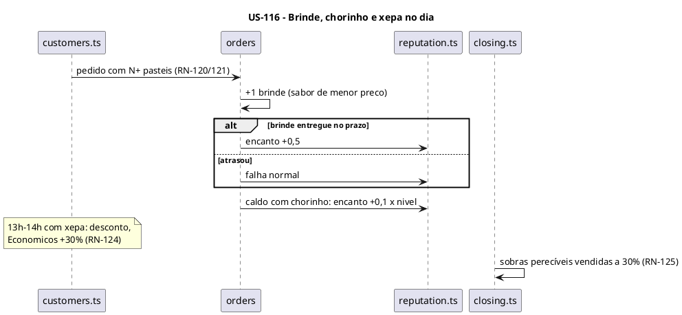

### Sequenciamento de Tarefas

| # | Tarefa | Escopo | Depende de |
|---|---|---|---|
| TF-116-01 | Brinde e chorinho com encanto | Simulação (promoções) | US-115 |
| TF-116-02 | Xepa e tema da barraca | Simulação + campanha | TF-116-01, US-114 |
| TF-116-03 | Controles de promoções e tema no Preparo | Apresentação | TF-116-02 |

### Tarefas

#### TF-116-01: Brinde e chorinho com encanto

**User Story:** US-116 Promoções, xepa e tema da barraca
**Épico:** [INSERIR_ID_EPICO] Pastel de Feira
**Sistema:** sampa-challenges
**Prioridade:** P1

##### 1. Descrição e Objetivo

> **Eu como** simulação,
> **Eu quero** aplicar a promoção do brinde e o chorinho, com pontos de encanto,
> **Para que** o jogador possa comprar reputação com custo (RN-62, RN-120–123).

##### 2. Especificação Técnica

**2.1 Pontos de interceptação**
- `src/games/pastel-de-feira/game/sim/customers.ts` — aumento de pedido até N (40%/20%), brinde no pedido (balcão, mesa, app; nunca encomenda nem doce).
- `src/games/pastel-de-feira/game/sim/delivery.ts` — brinde em comanda com N+ pastéis, sem mudar o tamanho da comanda.
- `src/games/pastel-de-feira/game/sim/stations/cane.ts` — chorinho: +0,1 dose e +0,3 s por nível.
- `src/games/pastel-de-feira/game/sim/reputation.ts` — encanto (+0,5 brinde, +0,1 × nível de chorinho).
- `src/games/pastel-de-feira/sim/scenarios/promocoes.ts`.

**2.2 Dados:** `DayConfig.brindeN`, `DayConfig.chorinho`. `DayResult.custoBrindes`.

**2.3 Contrato:** o pedido só fecha com o brinde entregue (RN-122).

**2.4 Resiliência e Zero Trust**

| Cenário | Estratégia | Impacto |
|---|---|---|
| Sem insumo do sabor do brinde | Usa Tradicional de 1 etapa disponível, ou dispensa sem falha | Spec, seção 4 |

##### 3. Modelagem Visual

Sequência da US-116.

##### 4. Orientação de Execução

**4.1 Contexto de entrada:** `spec.md` 3.14, RN-62; decisões PA-09/PA-10.

**4.2 Passos**
1. Brinde.
2. Comanda.
3. Chorinho.
4. Encanto.
5. Cenários.

**4.3 Validação:** comando padrão com `--scenario promocoes`.

**4.4 Restrições negativas**
- NÃO contar brinde como desperdício (RN-37).

**4.5 Skills:** `test-driven-agentic-development`.

**4.6 Critérios de saída**
- [ ] Os cenários de brinde, chorinho e encanto passam.

##### 5. Testes de Aceitação (DoD)

- [ ] N = 2: pedido de 2 pastéis recebe 3 e o encanto sobe 0,5 na entrega.
- [ ] Chorinho 3: consome 1,3 dose por copo.

---

#### TF-116-02: Xepa e tema da barraca

**User Story:** US-116 Promoções, xepa e tema da barraca
**Épico:** [INSERIR_ID_EPICO] Pastel de Feira
**Sistema:** sampa-challenges
**Prioridade:** P1

##### 1. Descrição e Objetivo

> **Eu como** simulação e campanha,
> **Eu quero** a hora da xepa e o tema da barraca,
> **Para que** o fim do dia e o público reflitam as escolhas do jogador (RN-17, RN-124, RN-125).

##### 2. Especificação Técnica

**2.1 Pontos de interceptação**
- `src/games/pastel-de-feira/game/sim/customers.ts` — xepa: desconto 13–14h, Econômicos +30%, teto sobre o preço de xepa (não vale no app nem em encomenda). Tema: deslocamento da mistura e exigência +10 (Gourmet).
- `src/games/pastel-de-feira/game/sim/dirt.ts` — limiar 75 no tema Popular.
- `src/games/pastel-de-feira/game/sim/stations/tables.ts` — prêmio de mesa +10% no Gourmet.
- `src/games/pastel-de-feira/game/campaign/closing.ts` — venda das sobras a 30% (fora da caixa térmica) sem contar desperdício. Reputação positiva +10% no tema Tradicional.
- `src/games/pastel-de-feira/game/campaign/actions/theme.ts` — escolher no dia 5; trocar depois por R$ 500.
- `src/games/pastel-de-feira/sim/scenarios/xepa-tema.ts`.

**2.2 Dados:** `Campaign.theme`, `DayConfig.xepa`.

**2.3 Contrato:** a escolha do tema antes do dia 5 é recusada com `bloqueadoAteDia`.

**2.4 Resiliência e Zero Trust**

| Cenário | Estratégia | Impacto |
|---|---|---|
| Caixa térmica cheia + xepa | O que não coube vai para a xepa | Spec, seção 4 |

##### 3. Modelagem Visual

Sequência da US-116.

##### 4. Orientação de Execução

**4.1 Contexto de entrada:** `spec.md` RN-17, RN-124, RN-125; decisão PA-19.

**4.2 Passos**
1. Xepa no dia.
2. Venda de sobras.
3. Tema.
4. Cenários.

**4.3 Validação:** comando padrão com `--scenario xepa-tema`.

**4.4 Restrições negativas**
- NÃO aplicar a xepa antes das 13h.

**4.5 Skills:** `test-driven-agentic-development`.

**4.6 Critérios de saída**
- [ ] Os cenários de xepa e dos 3 temas passam.

##### 5. Testes de Aceitação (DoD)

- [ ] Às 13h, os preços caem pelo desconto e os Econômicos aumentam.
- [ ] Gourmet: mais Exigentes e exigência +10.

---

#### TF-116-03: Controles de promoções e tema no Preparo

**User Story:** US-116 Promoções, xepa e tema da barraca
**Épico:** [INSERIR_ID_EPICO] Pastel de Feira
**Sistema:** sampa-challenges
**Prioridade:** P1

##### 1. Descrição e Objetivo

> **Eu como** jogador,
> **Eu quero** configurar o brinde, o chorinho, a xepa e escolher o tema,
> **Para que** as promoções sejam decisões do Preparo.

##### 2. Especificação Técnica

**2.1 Pontos de interceptação**
- `src/games/pastel-de-feira/components/prep/MenuTab.tsx` — seção Promoções: brinde (desligado / N 2–6), chorinho (0–3), xepa (liga/desliga, desconto 10–50%).
- `src/games/pastel-de-feira/components/prep/ThemeDialog.tsx` — escolha do tema no dia 5 e troca (R$ 500).
- `src/games/pastel-de-feira/game/render/scene.ts` — placa "XEPA" às 13h e o brinde no balão do pedido.

**2.2 Dados:** só ações da campanha.

**2.3 Contrato:** faixas da spec (sem valor inválido).

**2.4 Resiliência e Zero Trust**

| Cenário | Estratégia | Impacto |
|---|---|---|
| Valor fora da faixa | O controle limita | Spec, seção 4 |

##### 3. Modelagem Visual

Sequência da US-116.

##### 4. Orientação de Execução

**4.1 Contexto de entrada:** TF-111-05.

**4.2 Passos**
1. Controles.
2. Diálogo de tema.
3. Indicadores no render.
4. Navegador a 390 px.

**4.3 Validação:** `npm run typecheck`, depois navegador.

**4.4 Restrições negativas**
- NÃO mostrar o diálogo de tema antes do dia 5.

**4.5 Skills:** `verification-before-completion`.

**4.6 Critérios de saída**
- [ ] As configurações persistem entre dias e aparecem no jogo.

##### 5. Testes de Aceitação (DoD)

- [ ] O diálogo de tema aparece uma vez no dia 5.
- [ ] A placa "XEPA" aparece às 13h quando ligada.

---
## US-117: Escritório: cargos, encomendas, relatórios e desafios

**Épico:** [INSERIR_ID_EPICO] Pastel de Feira
**Sistema:** sampa-challenges
**Estimativa:** 5 Story Points
**Prioridade:** P1

### Narrativa de Valor

> **Eu como** jogador com a barraca grande,
> **Eu quero** montar o escritório, contratar cargos de gestão, aceitar encomendas e desafios da Associação e consultar relatórios,
> **Para que** o pasteleiro deixe de operar e passe a administrar.

### Contexto de Negócio

Implementa as seções 3.11 (escritório, cargos, encomendas, caixa de encomenda) e 3.16 (desafios da
Associação). O bônus de gestão (RN-101) depende do pasteleiro na posição Escritório.

### Critérios de Aceitação (Nível de Negócio)

- [ ] Escritório comprável a partir do dia 10. Com o pasteleiro lá, a equipe fica 15% mais rápida.
- [ ] Os cargos Contador, Comprador, Gerente e Despachante aplicam seus efeitos.
- [ ] As encomendas aceitas no Preparo são produzidas no dia, guardadas na caixa própria e retiradas no horário (multa no atraso).
- [ ] Os desafios aparecem conforme a barraca, acompanham o progresso e pagam na conclusão.
- [ ] Com Contador, a aba Escritório mostra os relatórios dos últimos 60 dias.

### Regras de Negócio Aplicáveis

| # | Regra | Tipo |
|---|---|---|
| RN-36 (Comprador) | Compra sugerida em qualquer dia | Condicional |
| RN-100–104 | Escritório, bônus, encomendas, cargos, caixa de encomenda | Obrigatória/Condicional |
| RN-135–137 | Desafios | Obrigatória |

### Diagrama — Sequência da US (container único)

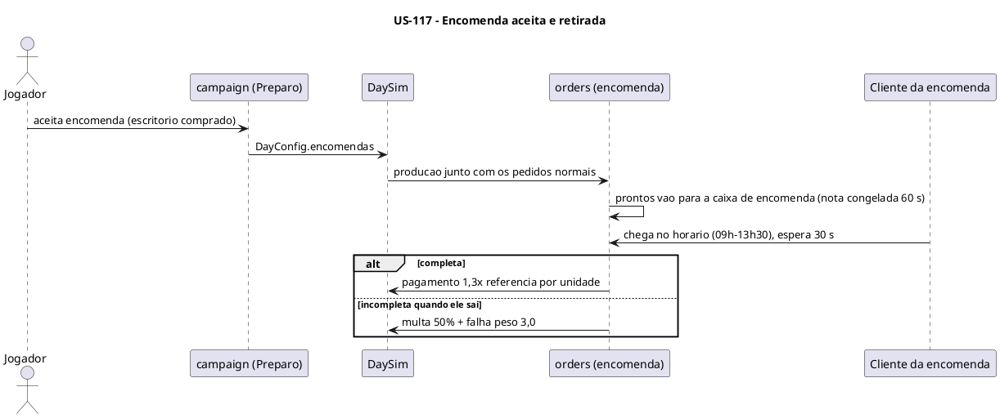

### Sequenciamento de Tarefas

| # | Tarefa | Escopo | Depende de |
|---|---|---|---|
| TF-117-01 | Escritório, posição do pasteleiro e cargos de gestão | Campanha + simulação | US-113 |
| TF-117-02 | Encomendas e caixa de encomenda | Simulação + campanha | TF-117-01 |
| TF-117-03 | Desafios da Associação | Campanha | US-116 |
| TF-117-04 | Abas Escritório e Associação com relatórios | Apresentação | TF-117-02, TF-117-03 |

### Tarefas

#### TF-117-01: Escritório, posição do pasteleiro e cargos de gestão

**User Story:** US-117 Escritório: cargos, encomendas, relatórios e desafios
**Épico:** [INSERIR_ID_EPICO] Pastel de Feira
**Sistema:** sampa-challenges
**Prioridade:** P1

##### 1. Descrição e Objetivo

> **Eu como** campanha e simulação,
> **Eu quero** o escritório comprável, a posição do pasteleiro nele e os 4 cargos,
> **Para que** a gestão tenha efeitos mecânicos (RN-36, RN-100, RN-101, RN-103).

##### 2. Especificação Técnica

**2.1 Pontos de interceptação**
- `src/games/pastel-de-feira/game/data/catalog.ts` — escritório (R$ 1.500, 4 m², dia 10, 3 vagas), cargos e salários.
- `src/games/pastel-de-feira/game/campaign/actions/office.ts` — comprar escritório, contratar e dispensar cargo (3 vagas).
- `src/games/pastel-de-feira/game/sim/staff.ts` — bônus de 15% com o pasteleiro no escritório e de 10% do Gerente (acumulam).
- `src/games/pastel-de-feira/game/campaign/suggest.ts` — Comprador: sugestão em qualquer dia e insumos −8%.
- `src/games/pastel-de-feira/game/campaign/closing.ts` — salários dos cargos.
- `src/games/pastel-de-feira/sim/scenarios/escritorio.ts`.

**2.2 Dados:** `Campaign.offices[]`.

**2.3 Contrato:** o Despachante amplia ofertas de encomenda e desafio para 0–3 e anula 1 multa de fiscalização a cada 5 dias (o gancho da multa é usado na US-118).

**2.4 Resiliência e Zero Trust**

| Cenário | Estratégia | Impacto |
|---|---|---|
| Cargo sem escritório | `requer` | — |
| 4º cargo | `limite` | RN-100 |

##### 3. Modelagem Visual

Sequência da US-117.

##### 4. Orientação de Execução

**4.1 Contexto de entrada:** `spec.md` 3.11; decisão PA-12.

**4.2 Passos**
1. Catálogo.
2. Ações.
3. Bônus.
4. Comprador.
5. Salários.
6. Cenários.

**4.3 Validação:** comando padrão com `--scenario escritorio`.

**4.4 Restrições negativas**
- NÃO deixar cargos operarem estações.

**4.5 Skills:** `test-driven-agentic-development`.

**4.6 Critérios de saída**
- [ ] O cenário de bônus acumulado (pasteleiro + Gerente) passa.

##### 5. Testes de Aceitação (DoD)

- [ ] Equipe 1,15 × 1,10 mais rápida com o pasteleiro no escritório e o Gerente contratado.
- [ ] Comprador reduz o custo dos insumos em 8%.

---

#### TF-117-02: Encomendas e caixa de encomenda

**User Story:** US-117 Escritório: cargos, encomendas, relatórios e desafios
**Épico:** [INSERIR_ID_EPICO] Pastel de Feira
**Sistema:** sampa-challenges
**Prioridade:** P1

##### 1. Descrição e Objetivo

> **Eu como** jogador,
> **Eu quero** aceitar encomendas grandes e entregá-las no horário,
> **Para que** eu tenha uma receita extra com prazo e multa (RN-102, RN-104, JA-04).

##### 2. Especificação Técnica

**2.1 Pontos de interceptação**
- `src/games/pastel-de-feira/game/campaign/actions/orders.ts` — ofertas no Preparo (0–2, ou 0–3 com Despachante), aceitar, aviso de insumo insuficiente.
- `src/games/pastel-de-feira/game/sim/orders.ts` — produção marcada para a encomenda, caixa própria (nota congelada 60 s e depois −1/s), cliente da encomenda no horário, espera de 30 s, entrega por Balcão ou Expedição, pagamento, multa e falha 3,0.
- `src/games/pastel-de-feira/sim/scenarios/encomendas.ts`.

**2.2 Dados:** `Campaign.orders[]`, `DayConfig.encomendas`.

**2.3 Contrato:** horário de retirada entre 09h e 13h30 (D-04). Brinde e xepa não se aplicam.

**2.4 Resiliência e Zero Trust**

| Cenário | Estratégia | Impacto |
|---|---|---|
| Insumo insuficiente ao aceitar | Avisa e permite | Spec, seção 4 |
| Encomenda incompleta | Multa 50% + falha 3,0 | RN-104 |

##### 3. Modelagem Visual

Sequência da US-117.

##### 4. Orientação de Execução

**4.1 Contexto de entrada:** `spec.md` RN-102, RN-104; decisão L2.

**4.2 Passos**
1. Ofertas.
2. Aceite.
3. Produção.
4. Caixa.
5. Retirada.
6. Cenários.

**4.3 Validação:** comando padrão com `--scenario encomendas`.

**4.4 Restrições negativas**
- NÃO usar a estufa para encomenda.

**4.5 Skills:** `test-driven-agentic-development`.

**4.6 Critérios de saída**
- [ ] Os cenários completa, incompleta e com nota decaída passam.

##### 5. Testes de Aceitação (DoD)

- [ ] Uma encomenda de 20 pastéis entregue no horário paga 20 × 1,3 × referência.
- [ ] Atraso → multa e falha.

---

#### TF-117-03: Desafios da Associação

**User Story:** US-117 Escritório: cargos, encomendas, relatórios e desafios
**Épico:** [INSERIR_ID_EPICO] Pastel de Feira
**Sistema:** sampa-challenges
**Prioridade:** P1

##### 1. Descrição e Objetivo

> **Eu como** campanha,
> **Eu quero** oferecer desafios atingíveis, acompanhar o progresso e pagar o prêmio,
> **Para que** existam objetivos opcionais paralelos à meta (RN-135–137).

##### 2. Especificação Técnica

**2.1 Pontos de interceptação**
- `src/games/pastel-de-feira/game/data/challenges.ts` — catálogo (RN-136) com predicado de atingibilidade e de progresso sobre o `DayResult`/`Campaign`.
- `src/games/pastel-de-feira/game/campaign/actions/challenges.ts` — ofertas (até 2, ou 3 com Despachante), aceitar, expirar.
- `src/games/pastel-de-feira/game/campaign/closing.ts` — progresso e prêmio.
- `src/games/pastel-de-feira/sim/scenarios/desafios.ts`.

**2.2 Dados:** `Campaign.challenges[] = { id, aceitoNoDia, prazo, progresso }`.

**2.3 Contrato:** "Passar numa fiscalização" só é oferecido com eventos ligados (atingibilidade).

**2.4 Resiliência e Zero Trust**

| Cenário | Estratégia | Impacto |
|---|---|---|
| Desafio inatingível | Não é oferecido | RN-137 |
| Prazo vence | Expira sem penalidade | RN-135 |

##### 3. Modelagem Visual

Não se aplica (regras sobre o resultado do dia).

##### 4. Orientação de Execução

**4.1 Contexto de entrada:** `spec.md` 3.16; decisão PA-11.

**4.2 Passos**
1. Catálogo.
2. Ofertas.
3. Progresso.
4. Prêmio.
5. Cenários.

**4.3 Validação:** comando padrão com `--scenario desafios`.

**4.4 Restrições negativas**
- NÃO pagar na aceitação.

**4.5 Skills:** `test-driven-agentic-development`.

**4.6 Critérios de saída**
- [ ] 1 cenário por desafio do catálogo.

##### 5. Testes de Aceitação (DoD)

- [ ] "Servir 40 caldos" paga R$ 150 no fechamento do dia em que acontece.
- [ ] O desafio de mesas não aparece sem espaço possível.

---

#### TF-117-04: Abas Escritório e Associação com relatórios

**User Story:** US-117 Escritório: cargos, encomendas, relatórios e desafios
**Épico:** [INSERIR_ID_EPICO] Pastel de Feira
**Sistema:** sampa-challenges
**Prioridade:** P1

##### 1. Descrição e Objetivo

> **Eu como** jogador,
> **Eu quero** abas para cargos, encomendas, relatórios e desafios, e ver o escritório na barraca,
> **Para que** a camada de gestão seja usável.

##### 2. Especificação Técnica

**2.1 Pontos de interceptação**
- `src/games/pastel-de-feira/components/prep/OfficeTab.tsx` — cargos (vagas), encomendas (ofertas e aceite), relatórios (com Contador: tabela por dia de lucro, reputação, vendas por receita, desperdício e falhas por tipo; custo e margem por item).
- `src/games/pastel-de-feira/components/prep/AssociationTab.tsx` — desafios oferecidos, aceitos e progresso.
- `src/games/pastel-de-feira/game/render/scene.ts` — zona do escritório e caixa de encomenda.
- `src/games/pastel-de-feira/game/render/panel.ts` — painel do escritório (bônus ativo).

**2.2 Dados:** `history` (60 dias).

**2.3 Contrato:** ações das TF-117-01/02/03.

**2.4 Resiliência e Zero Trust**

| Cenário | Estratégia | Impacto |
|---|---|---|
| Relatório com 60 dias a 390 px | Tabela com rolagem dentro do card | Sem rolagem horizontal da página |

##### 3. Modelagem Visual

Sequência da US-117.

##### 4. Orientação de Execução

**4.1 Contexto de entrada:** TF-111-05; `dataviz` (se houver mini gráfico).

**4.2 Passos**
1. Abas.
2. Relatórios.
3. Render.
4. Navegador a 390 px.

**4.3 Validação:** `npm run typecheck`, depois navegador.

**4.4 Restrições negativas**
- NÃO mostrar relatórios sem Contador.

**4.5 Skills:** `verification-before-completion`.

**4.6 Critérios de saída**
- [ ] As abas aparecem só quando desbloqueadas (RN-171).

##### 5. Testes de Aceitação (DoD)

- [ ] Aceitar uma encomenda e um desafio pela UI.
- [ ] Relatório legível a 390 px.

---

## US-118: Cidade viva: estações do ano e eventos

**Épico:** [INSERIR_ID_EPICO] Pastel de Feira
**Sistema:** sampa-challenges
**Estimativa:** 5 Story Points
**Prioridade:** P1

### Narrativa de Valor

> **Eu como** jogador,
> **Eu quero** que estações do ano e eventos da cidade mudem cada dia,
> **Para que** eu precise adaptar compras, equipe e operação em vez de repetir uma fórmula.

### Contexto de Negócio

Implementa as seções 3.17 (estações) e 3.18 (eventos previstos e surpresa), desligáveis ao criar a
campanha (RN-150). Os eventos previstos aparecem no Preparo e os surpresa durante o dia (JA-09).

### Critérios de Aceitação (Nível de Negócio)

- [ ] As estações seguem o ciclo de 5 dias e mudam pedidos de caldo, cansaço e chuva.
- [ ] Os eventos só ocorrem a partir do dia 4, no máximo 1 previsto e 1 surpresa por dia, e não ocorrem com eventos desligados.
- [ ] Cada evento aplica o efeito da spec, verificável por cenário.
- [ ] A previsão do Preparo mostra a estação e o evento previsto. Os eventos surpresa aparecem como aviso.

### Regras de Negócio Aplicáveis

| # | Regra | Tipo |
|---|---|---|
| RN-140, RN-141 | Estações | Obrigatória |
| RN-150–152 | Eventos | Obrigatória/Condicional |

### Diagrama — Sequência da US (container único)

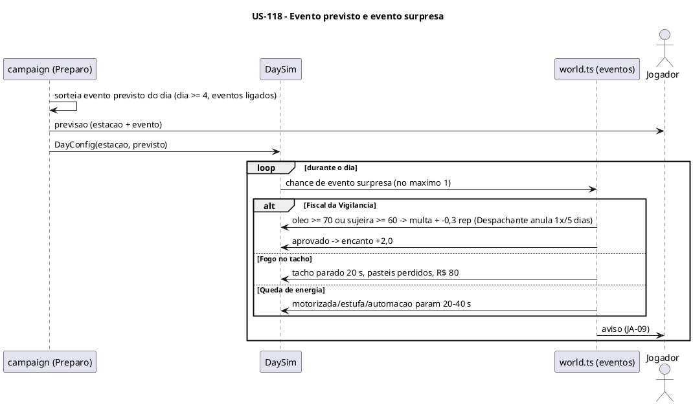

### Sequenciamento de Tarefas

| # | Tarefa | Escopo | Depende de |
|---|---|---|---|
| TF-118-01 | Estações do ano | Simulação + campanha | US-111 |
| TF-118-02 | Eventos previstos (chuva, calor, subprefeitura, reivindicação) | Campanha + simulação | TF-118-01, US-113 |
| TF-118-03 | Eventos surpresa (fiscal, energia, fogo, excursão, funcionário queimado) | Simulação | TF-118-02, US-114 |
| TF-118-04 | Previsão no Preparo e avisos de evento | Apresentação | TF-118-03 |

### Tarefas

#### TF-118-01: Estações do ano

**User Story:** US-118 Cidade viva: estações do ano e eventos
**Épico:** [INSERIR_ID_EPICO] Pastel de Feira
**Sistema:** sampa-challenges
**Prioridade:** P1

##### 1. Descrição e Objetivo

> **Eu como** simulação,
> **Eu quero** aplicar a estação do contador de dias,
> **Para que** a demanda varie ao longo da campanha (RN-140, RN-141).

##### 2. Especificação Técnica

**2.1 Pontos de interceptação**
- `src/games/pastel-de-feira/game/campaign/season.ts` — estação pelo contador (o dia repetido mantém a estação; ciclo no modo livre).
- `src/games/pastel-de-feira/game/sim/customers.ts` — chance de caldo ±40%, 2 pastéis +20% no Inverno.
- `src/games/pastel-de-feira/game/sim/staff.ts` — cansaço +25% no Verão.
- `src/games/pastel-de-feira/sim/scenarios/estacoes.ts`.

**2.2 Dados:** `DayConfig.estacao`.

**2.3 Contrato:** a chance de chuva por estação é usada na TF-118-02.

**2.4 Resiliência e Zero Trust**

| Cenário | Estratégia | Impacto |
|---|---|---|
| Dia repetido por meta | Mantém a estação | RN-140 |

##### 3. Modelagem Visual

Sequência da US-118.

##### 4. Orientação de Execução

**4.1 Contexto de entrada:** `spec.md` 3.17.

**4.2 Passos**
1. Calendário.
2. Efeitos.
3. Cenários.

**4.3 Validação:** comando padrão com `--scenario estacoes`.

**4.4 Restrições negativas**
- NÃO depender da data real.

**4.5 Skills:** `test-driven-agentic-development`.

**4.6 Critérios de saída**
- [ ] Os dias 1, 6, 11, 16 e 21 caem nas estações certas.

##### 5. Testes de Aceitação (DoD)

- [ ] Verão: pedidos de caldo +40% em 5.000 clientes (±3 p.p.).

---

#### TF-118-02: Eventos previstos (chuva, calor, subprefeitura, reivindicação)

**User Story:** US-118 Cidade viva: estações do ano e eventos
**Épico:** [INSERIR_ID_EPICO] Pastel de Feira
**Sistema:** sampa-challenges
**Prioridade:** P1

##### 1. Descrição e Objetivo

> **Eu como** campanha,
> **Eu quero** sortear o evento previsto do dia e aplicá-lo,
> **Para que** o jogador se prepare no Preparo (RN-150, RN-151).

##### 2. Especificação Técnica

**2.1 Pontos de interceptação**
- `src/games/pastel-de-feira/game/data/events.ts` — eventos previstos e chances.
- `src/games/pastel-de-feira/game/campaign/events.ts` — sorteio no Preparo (dia ≥ 4, eventos ligados), Reivindicação (energia 0 no dia anterior, ×2 Pavio curto, ×0,5 Gerente) com escolha: pausa (exige área de descanso), aumento de 10% por 3 dias ou recusa (−15% de velocidade).
- `src/games/pastel-de-feira/game/sim/world.ts` — efeitos da chuva, do calor e da subprefeitura no dia.
- `src/games/pastel-de-feira/sim/scenarios/eventos-previstos.ts`.

**2.2 Dados:** `DayConfig.eventoPrevisto`, `Campaign.aumentoAte`.

**2.3 Contrato:** o previsto é sorteado com a semente da campanha (não muda na retomada, PA-13).

**2.4 Resiliência e Zero Trust**

| Cenário | Estratégia | Impacto |
|---|---|---|
| Eventos desligados | Nenhum sorteio | RN-150 |
| Pausa escolhida sem área de descanso | Opção indisponível | RN-151 |

##### 3. Modelagem Visual

Sequência da US-118.

##### 4. Orientação de Execução

**4.1 Contexto de entrada:** `spec.md` RN-150, RN-151; decisão PA-13.

**4.2 Passos**
1. Catálogo.
2. Sorteio.
3. Reivindicação.
4. Efeitos.
5. Cenários.

**4.3 Validação:** comando padrão com `--scenario eventos-previstos`.

**4.4 Restrições negativas**
- NÃO sortear antes do dia 4.

**4.5 Skills:** `test-driven-agentic-development`.

**4.6 Critérios de saída**
- [ ] 1 cenário por evento previsto.

##### 5. Testes de Aceitação (DoD)

- [ ] Chuva: balcão −40% e app +50%.
- [ ] Subprefeitura: mesas inativas no dia.

---

#### TF-118-03: Eventos surpresa (fiscal, energia, fogo, excursão, funcionário queimado)

**User Story:** US-118 Cidade viva: estações do ano e eventos
**Épico:** [INSERIR_ID_EPICO] Pastel de Feira
**Sistema:** sampa-challenges
**Prioridade:** P1

##### 1. Descrição e Objetivo

> **Eu como** simulação,
> **Eu quero** os eventos surpresa durante o dia,
> **Para que** a operação seja testada por imprevistos (RN-152, JA-09).

##### 2. Especificação Técnica

**2.1 Pontos de interceptação**
- `src/games/pastel-de-feira/game/sim/world.ts` — sorteio (máx. 1 por dia, `rng.fork('eventos')`), Fiscal (09–13h; multa, −0,3, ou +2,0 de encanto; anulação pelo Despachante), queda de energia (20–40 s), excursão (15 clientes em 20 s).
- `src/games/pastel-de-feira/game/sim/stations/fryer.ts` — fogo no tacho (3% por pastel com óleo ≥ 90%, 5% por troca sem curso), bloqueio de 20 s, reparo R$ 80.
- `src/games/pastel-de-feira/game/sim/staff.ts` — funcionário queimado (2% por pastel tirado sem curso), sai por 30 s.
- `src/games/pastel-de-feira/sim/scenarios/eventos-surpresa.ts`.

**2.2 Dados:** `DayResult.eventos[]`, multas e reparos.

**2.3 Contrato:** eventos `evento_inicio`/`evento_fim` no snapshot.

**2.4 Resiliência e Zero Trust**

| Cenário | Estratégia | Impacto |
|---|---|---|
| Fogo com alguém na posição | Sai da posição até o fim do bloqueio | Spec, seção 4 |
| Acelerar 2× durante evento | Segue em 2× | Spec, seção 4 |

##### 3. Modelagem Visual

Sequência da US-118.

##### 4. Orientação de Execução

**4.1 Contexto de entrada:** `spec.md` RN-152; TF-113-02 (cursos).

**4.2 Passos**
1. Sorteio.
2. Fiscal.
3. Energia.
4. Fogo.
5. Excursão.
6. Queimado.
7. Cenários.

**4.3 Validação:** comando padrão com `--scenario eventos-surpresa`.

**4.4 Restrições negativas**
- NÃO causar dano a pessoas no fogo (spec, seção 4).

**4.5 Skills:** `test-driven-agentic-development`.

**4.6 Critérios de saída**
- [ ] 1 cenário por evento surpresa.

##### 5. Testes de Aceitação (DoD)

- [ ] Fiscal com óleo a 75% → multa R$ 150 e −0,3.
- [ ] Com Despachante, a primeira multa em 5 dias é anulada.

---

#### TF-118-04: Previsão no Preparo e avisos de evento

**User Story:** US-118 Cidade viva: estações do ano e eventos
**Épico:** [INSERIR_ID_EPICO] Pastel de Feira
**Sistema:** sampa-challenges
**Prioridade:** P1

##### 1. Descrição e Objetivo

> **Eu como** jogador,
> **Eu quero** ver a previsão no Preparo e avisos claros dos eventos no dia,
> **Para que** eu reaja a tempo (JA-09).

##### 2. Especificação Técnica

**2.1 Pontos de interceptação**
- `src/games/pastel-de-feira/components/prep/PrepScreen.tsx` — card de previsão (estação, evento previsto, diálogo da reivindicação).
- `src/games/pastel-de-feira/game/render/alerts.ts` — avisos de evento acima do painel.
- `src/games/pastel-de-feira/game/render/scene.ts` — chuva, calor, fogo, energia caída e fiscal na barraca.

**2.2 Dados:** só leitura.

**2.3 Contrato:** `respondEvent` para escolhas durante o dia (se houver).

**2.4 Resiliência e Zero Trust**

| Cenário | Estratégia | Impacto |
|---|---|---|
| Vários avisos ao mesmo tempo | Fila de avisos com prioridade (evento > oferta > alarme) | Legível |

##### 3. Modelagem Visual

Sequência da US-118.

##### 4. Orientação de Execução

**4.1 Contexto de entrada:** TF-110-10 (avisos); TF-111-05.

**4.2 Passos**
1. Previsão.
2. Diálogo.
3. Avisos.
4. Efeitos visuais.
5. Navegador.

**4.3 Validação:** `npm run typecheck`, depois navegador com eventos forçados pelo overlay de depuração.

**4.4 Restrições negativas**
- NÃO cobrir as zonas frequentes com efeitos visuais opacos.

**4.5 Skills:** `verification-before-completion`.

**4.6 Critérios de saída**
- [ ] Todos os eventos visíveis e compreensíveis a 390 px.

##### 5. Testes de Aceitação (DoD)

- [ ] A previsão mostra a chuva do dia.
- [ ] O aviso do fiscal aparece com o resultado.

---

## US-119: Automação por equipamento

**Épico:** [INSERIR_ID_EPICO] Pastel de Feira
**Sistema:** sampa-challenges
**Estimativa:** 3 Story Points
**Prioridade:** P2

### Narrativa de Valor

> **Eu como** jogador,
> **Eu quero** comprar cesto com timer, moenda automática e maquininha de cartão,
> **Para que** eu escolha entre investir em capital (sem salário) ou em equipe.

### Contexto de Negócio

Implementa a seção 3.19 da spec. A automação não soma com o funcionário da mesma função (RN-161)
e para na queda de energia.

### Critérios de Aceitação (Nível de Negócio)

- [ ] O cesto com timer tira no meio da janela com nota 80 + equipamento (sem traço nem curso).
- [ ] A moenda automática extrai um caldo por pedido anotado. A maquininha cobra sozinha no balcão.
- [ ] Com a automação ativa, a posição correspondente vira opcional.
- [ ] Na queda de energia, a automação para.

### Regras de Negócio Aplicáveis

| # | Regra | Tipo |
|---|---|---|
| RN-160–162 | Automação | Obrigatória |
| RN-87 | Maquininha na fila de pagamento | Obrigatória |

### Diagrama — Sequência da US (container único)

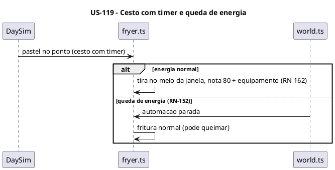

### Sequenciamento de Tarefas

| # | Tarefa | Escopo | Depende de |
|---|---|---|---|
| TF-119-01 | Automação na simulação | Simulação | US-118 |
| TF-119-02 | Compra e render da automação | Campanha + apresentação | TF-119-01 |

### Tarefas

#### TF-119-01: Automação na simulação

**User Story:** US-119 Automação por equipamento
**Épico:** [INSERIR_ID_EPICO] Pastel de Feira
**Sistema:** sampa-challenges
**Prioridade:** P2

##### 1. Descrição e Objetivo

> **Eu como** simulação,
> **Eu quero** executores automáticos para tacho, moenda e cobrança,
> **Para que** a automação substitua parte das funções (RN-160–162).

##### 2. Especificação Técnica

**2.1 Pontos de interceptação**
- `src/games/pastel-de-feira/game/sim/automation.ts` — executores: cesto com timer (tira no ponto; deixa no escorredor, sem pôr na estufa), moenda automática (com chorinho), maquininha (cobra balcão e fila de pagamento).
- `src/games/pastel-de-feira/game/sim/staff.ts` — regra de não somar (RN-161): o funcionário da posição executa só as outras tarefas.
- `src/games/pastel-de-feira/game/sim/world.ts` — queda de energia para a automação.
- `src/games/pastel-de-feira/sim/scenarios/automacao.ts`.

**2.2 Dados:** `DayConfig.equipamentos` (automação).

**2.3 Contrato:** a automação usa as mesmas ações internas das estações.

**2.4 Resiliência e Zero Trust**

| Cenário | Estratégia | Impacto |
|---|---|---|
| Tacho travado em 100% com timer | Timer tira no ponto mesmo assim | Spec, seção 4 |
| Sem energia | Queima normal | Spec, seção 4 |

##### 3. Modelagem Visual

Sequência da US-119.

##### 4. Orientação de Execução

**4.1 Contexto de entrada:** `spec.md` 3.19.

**4.2 Passos**
1. Executores.
2. Não soma.
3. Energia.
4. Cenários.

**4.3 Validação:** comando padrão com `--scenario automacao`.

**4.4 Restrições negativas**
- NÃO aplicar traço ou curso ao pastel do timer (RN-162).

**4.5 Skills:** `test-driven-agentic-development`.

**4.6 Critérios de saída**
- [ ] Os cenários de cada equipamento e da queda de energia passam.

##### 5. Testes de Aceitação (DoD)

- [ ] Timer: nunca queima com energia.
- [ ] Maquininha: grupo da fila de pagamento cobrado sem ninguém no balcão.

---

#### TF-119-02: Compra e render da automação

**User Story:** US-119 Automação por equipamento
**Épico:** [INSERIR_ID_EPICO] Pastel de Feira
**Sistema:** sampa-challenges
**Prioridade:** P2

##### 1. Descrição e Objetivo

> **Eu como** jogador,
> **Eu quero** comprar a automação e vê-la funcionando,
> **Para que** o investimento seja visível.

##### 2. Especificação Técnica

**2.1 Pontos de interceptação**
- `src/games/pastel-de-feira/game/data/catalog.ts` — custos (R$ 600 por tacho, R$ 900 com motorizada como requisito, R$ 300).
- `src/games/pastel-de-feira/game/campaign/actions/upgrades.ts` — compras.
- `src/games/pastel-de-feira/components/prep/UpgradesTab.tsx` — seção Automação (comparativo com salário).
- `src/games/pastel-de-feira/game/render/scene.ts` — timer no cesto, moenda girando, maquininha.

**2.2 Dados:** `owned.equipamentos`.

**2.3 Contrato:** recusa `requer` (moenda automática sem motorizada).

**2.4 Resiliência e Zero Trust**

| Cenário | Estratégia | Impacto |
|---|---|---|
| Compra sem requisito | `requer` | — |

##### 3. Modelagem Visual

Sequência da US-119.

##### 4. Orientação de Execução

**4.1 Contexto de entrada:** TF-112-04.

**4.2 Passos**
1. Catálogo.
2. Ações.
3. Aba.
4. Render.

**4.3 Validação:** `npm run typecheck`, comando padrão com `--scenario melhorias`, depois navegador.

**4.4 Restrições negativas**
- NÃO duplicar regra de requisito na UI.

**4.5 Skills:** `verification-before-completion`.

**4.6 Critérios de saída**
- [ ] Compra e funcionamento visíveis no navegador.

##### 5. Testes de Aceitação (DoD)

- [ ] O comparativo mostra o custo da automação × o salário diário da função substituída.

---

## US-120: Perfil do pasteleiro, passar o ponto e modo livre

**Épico:** [INSERIR_ID_EPICO] Pastel de Feira
**Sistema:** sampa-challenges
**Estimativa:** 3 Story Points
**Prioridade:** P2

### Narrativa de Valor

> **Eu como** jogador,
> **Eu quero** que o perfil escolhido tenha efeito, continuar em modo livre depois de zerar e poder passar o ponto (também ao falir a partir do dia 10),
> **Para que** a campanha tenha fim e motivo para recomeçar.

### Contexto de Negócio

Fecha a jornada de campanha: efeitos do perfil (RN-110), modo livre (RN-54), recordes (RN-56) e
passar o ponto (RN-57) nas duas variantes (zerar e falência ≥ dia 10, RN-52).

### Critérios de Aceitação (Nível de Negócio)

- [ ] Cada perfil aplica o efeito da spec.
- [ ] Zerar o dia 20 leva ao modo livre (sem meta, recorde de caixa).
- [ ] Passar o ponto calcula o valor certo e abre uma campanha nova com o bônus.
- [ ] O card do hub mostra o maior dia (ou o maior caixa no modo livre).

### Regras de Negócio Aplicáveis

| # | Regra | Tipo |
|---|---|---|
| RN-51, RN-110 | Caixa inicial e perfis | Obrigatória |
| RN-52, RN-54, RN-56, RN-57 | Falência com ponto, modo livre, recordes, passar o ponto | Obrigatória/Condicional |

### Diagrama — Sequência da US (container único)

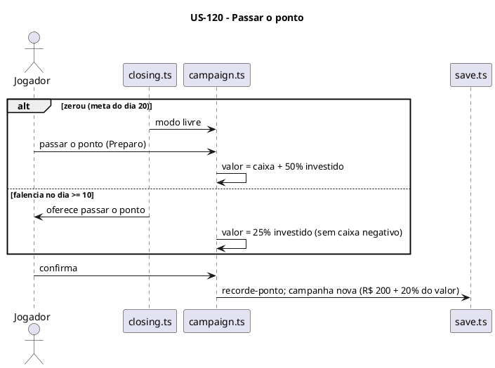

### Sequenciamento de Tarefas

| # | Tarefa | Escopo | Depende de |
|---|---|---|---|
| TF-120-01 | Efeitos dos perfis do pasteleiro | Simulação + campanha | US-113 |
| TF-120-02 | Modo livre, passar o ponto e recordes | Campanha + apresentação | TF-120-01, US-117 |

### Tarefas

#### TF-120-01: Efeitos dos perfis do pasteleiro

**User Story:** US-120 Perfil do pasteleiro, passar o ponto e modo livre
**Épico:** [INSERIR_ID_EPICO] Pastel de Feira
**Sistema:** sampa-challenges
**Prioridade:** P2

##### 1. Descrição e Objetivo

> **Eu como** campanha e simulação,
> **Eu quero** aplicar os bônus dos 5 perfis,
> **Para que** a escolha da nova campanha importe (RN-110).

##### 2. Especificação Técnica

**2.1 Pontos de interceptação**
- `src/games/pastel-de-feira/game/data/catalog.ts` — perfis e efeitos.
- `src/games/pastel-de-feira/game/campaign/campaign.ts` — Tradicional (+R$ 100), Negociante (insumos −10%), Gestor (salários −10%).
- `src/games/pastel-de-feira/game/sim/stations/fryer.ts` — Chapeiro (janela +1 s nas ações do pasteleiro).
- `src/games/pastel-de-feira/game/sim/customers.ts` — Boa-praça (paciência +15%).
- `src/games/pastel-de-feira/sim/scenarios/perfis.ts`.

**2.2 Dados:** `Campaign.profile` (já salvo na US-111).

**2.3 Contrato:** os efeitos acumulam multiplicativamente com o Comprador.

**2.4 Resiliência e Zero Trust**

| Cenário | Estratégia | Impacto |
|---|---|---|
| Perfil desconhecido no save | Save inválido (TF-111-03) | Campanha nova |

##### 3. Modelagem Visual

Não se aplica.

##### 4. Orientação de Execução

**4.1 Contexto de entrada:** `spec.md` RN-110.

**4.2 Passos**
1. Catálogo.
2. Efeitos.
3. Cenários.

**4.3 Validação:** comando padrão com `--scenario perfis`.

**4.4 Restrições negativas**
- NÃO aplicar o Chapeiro aos funcionários.

**4.5 Skills:** `test-driven-agentic-development`.

**4.6 Critérios de saída**
- [ ] 1 cenário por perfil.

##### 5. Testes de Aceitação (DoD)

- [ ] Negociante + Comprador → insumos × 0,9 × 0,92.

---

#### TF-120-02: Modo livre, passar o ponto e recordes

**User Story:** US-120 Perfil do pasteleiro, passar o ponto e modo livre
**Épico:** [INSERIR_ID_EPICO] Pastel de Feira
**Sistema:** sampa-challenges
**Prioridade:** P2

##### 1. Descrição e Objetivo

> **Eu como** jogador,
> **Eu quero** o modo livre e o "passar o ponto" com os recordes,
> **Para que** a campanha tenha fim e continuação (RN-52, RN-54, RN-56, RN-57, JA-07, JA-08).

##### 2. Especificação Técnica

**2.1 Pontos de interceptação**
- `src/games/pastel-de-feira/game/campaign/closing.ts` — modo livre depois do dia 20; falência com oferta de ponto no dia ≥ 10.
- `src/games/pastel-de-feira/game/campaign/actions/handover.ts` — valor do ponto (zerado: caixa + 50% investido; falência: 25% investido), campanha nova com R$ 200 + 20%.
- `src/games/pastel-de-feira/game/record.ts` — recordes de caixa (modo livre) e de ponto. `getRecord` do manifest.
- `src/games/pastel-de-feira/components/HandoverDialog.tsx`, `src/games/pastel-de-feira/components/EndScreen.tsx` — confirmação definitiva e fim de campanha.
- `src/games/pastel-de-feira/sim/scenarios/ponto.ts`.

**2.2 Dados:** o investimento acumulado fica no `Campaign` (`investido`, somado a cada compra de melhoria).

**2.3 Contrato:** passar o ponto apaga o save atual só depois da confirmação.

**2.4 Resiliência e Zero Trust**

| Cenário | Estratégia | Impacto |
|---|---|---|
| Confirmação acidental | Diálogo de confirmação | Spec, seção 4 |
| Falha ao salvar a campanha nova | Mantém a antiga e avisa | Sem perda |

##### 3. Modelagem Visual

Sequência da US-120.

##### 4. Orientação de Execução

**4.1 Contexto de entrada:** `spec.md` RN-52, RN-54, RN-56, RN-57.

**4.2 Passos**
1. Modo livre.
2. Valor.
3. Nova campanha.
4. Recordes.
5. Telas.
6. Cenários.

**4.3 Validação:** comando padrão com `--scenario ponto`, depois navegador com save de teste no dia 20.

**4.4 Restrições negativas**
- NÃO oferecer o ponto na falência antes do dia 10.

**4.5 Skills:** `test-driven-agentic-development`, `verification-before-completion`.

**4.6 Critérios de saída**
- [ ] Os cenários das duas variantes passam.
- [ ] O fluxo funciona no navegador.

##### 5. Testes de Aceitação (DoD)

- [ ] Ponto zerado com R$ 2.000 de caixa e R$ 4.000 investidos = R$ 4.000 → nova campanha com R$ 1.000.
- [ ] O card mostra o maior caixa no modo livre.

---
## US-121: Arte: cachorros de pé e cenário da feira

**Épico:** [INSERIR_ID_EPICO] Pastel de Feira
**Sistema:** sampa-challenges
**Estimativa:** 8 Story Points
**Prioridade:** P1

### Narrativa de Valor

> **Eu como** jogador,
> **Eu quero** ver a feira em pixel art com cachorros de várias raças, cores e portes como clientes, pasteleiro e equipe,
> **Para que** o jogo tenha a identidade visual do hub.

### Contexto de Negócio

Troca os placeholders geométricos pela arte final. Os cachorros de pé entram na biblioteca única
(`caes_pe`), porque podem servir a outros jogos (regra "Sprites" do `CLAUDE.md` raiz). Cenário,
equipamentos e itens são do jogo. A US envolve 3 containers: geradores Python, biblioteca e jogo.

### Critérios de Aceitação (Nível de Negócio)

- [ ] 7 raças × 3 portes com poses de cliente, recoloridas em tempo de execução (cores variadas, RN-165).
- [ ] Pasteleiro e funcionários com avental/chapéu por tipo (indicador visual). Perfil de cliente com indicador fixo.
- [ ] Cenário 640×480 com todas as zonas compráveis, equipamentos, pastéis por categoria, caldo e capa 320×200.
- [ ] Nenhum PNG editado à mão: tudo sai dos scripts.

### Regras de Negócio Aplicáveis

| # | Regra | Tipo |
|---|---|---|
| RN-165 | Personagens cachorros variados e indicadores visuais | Obrigatória |
| RN-74 | Zonas da barraca no layout fixo | Obrigatória |

### Diagrama — C4 N2 da US (múltiplos containers)

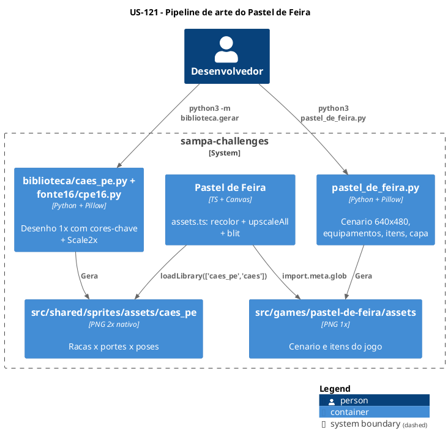

### Diagrama — Sequência da US

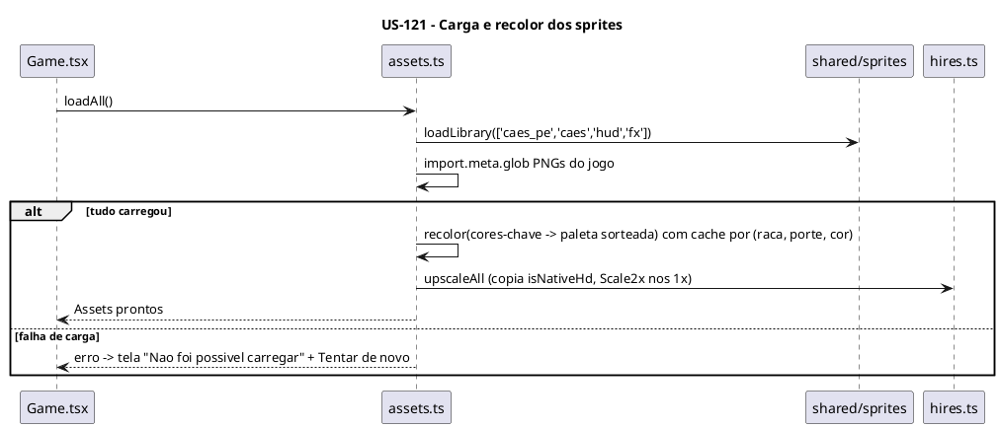

### Sequenciamento de Tarefas

| # | Tarefa | Escopo | Depende de |
|---|---|---|---|
| TF-121-01 | Gerador da biblioteca `caes_pe` (cachorros de pé) | Pixel art compartilhada | US-110 |
| TF-121-02 | Carga, recolor e mapeamento de sprites no jogo | Apresentação (assets) | TF-121-01 |
| TF-121-03 | Gerador do cenário, equipamentos, itens e capa | Pixel art do jogo | US-110 |
| TF-121-04 | Render final com a arte (troca dos placeholders) | Apresentação (render) | TF-121-02, TF-121-03, US-119 |

### Tarefas

#### TF-121-01: Gerador da biblioteca `caes_pe` (cachorros de pé)

**User Story:** US-121 Arte: cachorros de pé e cenário da feira
**Épico:** [INSERIR_ID_EPICO] Pastel de Feira
**Sistema:** sampa-challenges
**Prioridade:** P1

##### 1. Descrição e Objetivo

> **Eu como** biblioteca de sprites,
> **Eu quero** cachorros de pé em 7 raças × 3 portes com poses e cores-chave,
> **Para que** clientes, pasteleiro e equipe tenham a arte no padrão 16 bits HD (`plan.md` 4.4).

##### 2. Especificação Técnica

**2.1 Pontos de interceptação**
- `tools/pixelart/biblioteca/fonte16/cpe16.py` — desenho 1× com cores-chave magenta (`#ff00ff`, `#b000b0`, `#ff9cff`) e poses `parado`, `andando_0/1`, `sentado`, `comendo_0/1`, `bravo`, `feliz`; pasteleiro e funcionários (`fritador`/`geral`) com avental e chapéu.
- `tools/pixelart/biblioteca/caes_pe.py` — Scale2x e gravação em `caes_pe/<raça>_<porte>_<pose>`.
- `tools/pixelart/biblioteca/gerar.py` — registrar o módulo.
- `src/shared/sprites/README.md` — linha nova na tabela de conteúdo.
- `src/shared/sprites/assets/caes_pe/*.png` — gerados.

**2.2 Dados:** PNGs 48×64 (p), 56×72 (m), 64×80 (g) **(P)**.

**2.3 Contrato:** chaves `lib/caes_pe/<raça>_<porte>_<pose>`, `lib/caes_pe/pasteleiro_<pose>`, `lib/caes_pe/func_<fritador|geral>_<pose>`.

**2.4 Resiliência e Zero Trust**

| Cenário | Estratégia | Impacto |
|---|---|---|
| Regerar a biblioteca altera sprites de outros jogos | Rodar o gerador inteiro e conferir com `git diff --stat` que só `caes_pe/` mudou | Sem regressão |

##### 3. Modelagem Visual

C4 N2 da US-121.

##### 4. Orientação de Execução

**4.1 Contexto de entrada:** `src/shared/sprites/README.md`; `tools/pixelart/biblioteca/caes_costas.py`; `tools/pixelart/biblioteca/fonte16/csp16.py`; `tools/pixelart/biblioteca/prim.py`, `paleta.py`.

**4.2 Passos**
1. Desenho 1× por raça e porte.
2. Poses.
3. Pasteleiro e funcionários.
4. Módulo de geração.
5. Gerar.
6. README.

**4.3 Validação:** `cd tools/pixelart && python3 -m biblioteca.gerar ../../src/shared/sprites/assets`, depois `git diff --stat src/shared/sprites/assets` (só `caes_pe/`), depois inspeção visual dos PNGs.

**4.4 Restrições negativas**
- NÃO editar PNG à mão.
- NÃO acrescentar degradês nem detalhes de "alta resolução" (README da biblioteca).

**4.5 Skills:** `verification-before-completion`.

**4.6 Critérios de saída**
- [ ] 21 combinações × 8 poses + pasteleiro + 2 tipos de funcionário gerados.
- [ ] Outras pastas da biblioteca inalteradas.

**4.7 Decomposição Iterativa (mimic-loop)**

**Modo:** `mimic-loop` · **Máx. iterações:** 25 · **Saga:** `exec:sampa-challenges:TF-121-01`

| # | RT | Critério de conclusão | Depende de |
|---|---|---|---|
| RT-01 | Base 1× de 1 raça em 3 portes | PNGs `parado` revisados | — |
| RT-02 | Demais 6 raças | 21 combinações `parado` | RT-01 |
| RT-03 | Poses | 8 poses por combinação | RT-02 |
| RT-04 | Pasteleiro e funcionários + README | Chaves documentadas | RT-03 |

##### 5. Testes de Aceitação (DoD)

- [ ] As cores-chave estão presentes (recoloráveis).
- [ ] Os tamanhos batem com a tabela.
- [ ] O README da biblioteca está atualizado.

---

#### TF-121-02: Carga, recolor e mapeamento de sprites no jogo

**User Story:** US-121 Arte: cachorros de pé e cenário da feira
**Épico:** [INSERIR_ID_EPICO] Pastel de Feira
**Sistema:** sampa-challenges
**Prioridade:** P1

##### 1. Descrição e Objetivo

> **Eu como** jogo,
> **Eu quero** carregar os sprites da biblioteca e do jogo, recolorir os cachorros e preparar as imagens em alta,
> **Para que** cada cliente tenha raça, porte e cor sorteados (RN-165).

##### 2. Especificação Técnica

**2.1 Pontos de interceptação**
- `src/games/pastel-de-feira/game/assets.ts` — `loadAll()`: biblioteca (`caes_pe`, `caes`, `hud`, `fx`) + PNGs do jogo, `isNativeHd`, recolor por canvas fora da tela com cache por (raça, porte, cor), paleta de cores de pelagem.
- `src/games/pastel-de-feira/game/sim/customers.ts` — sorteio de aparência (raça, porte, cor) com `rng.fork('aparencia')` (só visual, sem efeito em regra).
- `src/games/pastel-de-feira/Game.tsx` — tela de erro de carga com "Tentar de novo".

**2.2 Dados:** cache de imagens recoloridas em memória (limitado ao que aparece).

**2.3 Contrato:** `Assets.cliente(raca, porte, cor, pose)` devolve a imagem pronta para `blit`.

**2.4 Resiliência e Zero Trust**

| Cenário | Estratégia | Impacto |
|---|---|---|
| PNG não carrega | Erro → tela de recarga | `plan.md` 5.1 |
| Cache crescendo | Limitado às combinações vistas (máx. 7 × 3 × N cores) | Memória estável |

##### 3. Modelagem Visual

Sequência da US-121.

##### 4. Orientação de Execução

**4.1 Contexto de entrada:** `src/games/corredor-sp/CLAUDE.md` (troca de cores-chave); `src/games/cachorro-loko/game/assets.ts` (`isNativeHd`).

**4.2 Passos**
1. `loadAll`.
2. Recolor.
3. Aparência no sorteio.
4. Tela de erro.

**4.3 Validação:** `npm run typecheck`, comando padrão com `--scenario clientes` (determinismo mantido), depois navegador.

**4.4 Restrições negativas**
- NÃO deixar a aparência consumir o `rng` das regras (usar `fork` separado para não mudar o equilíbrio).

**4.5 Skills:** `verification-before-completion`, `expert-lsp`.

**4.6 Critérios de saída**
- [ ] Clientes variados na tela.
- [ ] Os cenários de clientes continuam passando sem alteração.

##### 5. Testes de Aceitação (DoD)

- [ ] Recolor sem bordas magenta visíveis.
- [ ] Erro de carga mostra "Tentar de novo".

---

#### TF-121-03: Gerador do cenário, equipamentos, itens e capa

**User Story:** US-121 Arte: cachorros de pé e cenário da feira
**Épico:** [INSERIR_ID_EPICO] Pastel de Feira
**Sistema:** sampa-challenges
**Prioridade:** P1

##### 1. Descrição e Objetivo

> **Eu como** jogo,
> **Eu quero** cenário da feira 640×480, sprites de equipamentos e itens e a capa,
> **Para que** a barraca e o card do hub tenham a arte final.

##### 2. Especificação Técnica

**2.1 Pontos de interceptação**
- `tools/pixelart/pastel_de_feira.py` — fundo da feira (toldo, rua, barracas vizinhas), zonas por slot do `layout.ts` (balcão, bancada, tachos pequeno/grande, estufa, moenda manual/motorizada/automática, mesas, área de delivery, escritório, caixas térmicas, área de descanso), pastéis por categoria e estado (cru/ponto/passado/queimado), Especial grande, doces, copo de caldo, moedas, placa XEPA, indicadores de perfil, ícones de eventos, capa 320×200.
- `src/games/pastel-de-feira/assets/*.png` — só os arquivos usados.

**2.2 Dados:** PNGs 1× (passam por Scale2x no jogo).

**2.3 Contrato:** nomes de arquivo estáveis, referenciados em `assets.ts`.

**2.4 Resiliência e Zero Trust**

| Cenário | Estratégia | Impacto |
|---|---|---|
| Sprite muda de tamanho | Conferir as hitboxes do `layout.ts` (regra "Sprites" do `CLAUDE.md` raiz) | Toque preciso |

##### 3. Modelagem Visual

C4 N2 da US-121.

##### 4. Orientação de Execução

**4.1 Contexto de entrada:** `tools/pixelart/fuga_rocam.py`; `tools/pixelart/sinuca_de_bar.py`; `game/layout.ts`.

**4.2 Passos**
1. Paleta da feira.
2. Fundo.
3. Zonas.
4. Itens.
5. Capa.
6. Copiar os PNGs usados.

**4.3 Validação:** `cd tools/pixelart && python3 pastel_de_feira.py <saida>`, inspeção visual, depois `npm run build`.

**4.4 Restrições negativas**
- NÃO usar a pasta `public/` nem caminhos soltos.

**4.5 Skills:** `verification-before-completion`.

**4.6 Critérios de saída**
- [ ] Todos os slots do layout têm sprite.
- [ ] Capa 320×200.

**4.7 Decomposição Iterativa (mimic-loop)**

**Modo:** `mimic-loop` · **Máx. iterações:** 25 · **Saga:** `exec:sampa-challenges:TF-121-03`

| # | RT | Critério de conclusão | Depende de |
|---|---|---|---|
| RT-01 | Paleta + fundo 640×480 | PNG do fundo revisado | — |
| RT-02 | Equipamentos e zonas | Um PNG por slot | RT-01 |
| RT-03 | Itens e indicadores | Pastéis por estado, caldo, ícones | RT-01 |
| RT-04 | Capa | 320×200 revisada | RT-02 |

##### 5. Testes de Aceitação (DoD)

- [ ] Assets dentro do orçamento de 1,2 MB somados à `caes_pe` (`plan.md` 7).

---

#### TF-121-04: Render final com a arte (troca dos placeholders)

**User Story:** US-121 Arte: cachorros de pé e cenário da feira
**Épico:** [INSERIR_ID_EPICO] Pastel de Feira
**Sistema:** sampa-challenges
**Prioridade:** P1

##### 1. Descrição e Objetivo

> **Eu como** jogador,
> **Eu quero** ver toda a barraca, as pessoas e os itens com a arte final, mantendo o desempenho,
> **Para que** o jogo esteja visualmente pronto.

##### 2. Especificação Técnica

**2.1 Pontos de interceptação**
- `src/games/pastel-de-feira/game/render/scene.ts` — camada estática com fundo + zonas compradas. Entidades com sprites (clientes por aparência e pose, equipe, motoboys, itens por estado).
- `src/games/pastel-de-feira/game/render/panel.ts` — painéis com sprites.
- `src/games/pastel-de-feira/game/render/fx.ts` — partículas e indicadores (vapor, fumaça do queimado, moedas, `lib/fx`).
- `src/games/pastel-de-feira/manifest.ts` — capa final.

**2.2 Dados:** nenhum.

**2.3 Contrato:** `render(ctx, snapshot, ui)` inalterado.

**2.4 Resiliência e Zero Trust**

| Cenário | Estratégia | Impacto |
|---|---|---|
| Celular lento | Camada estática em cache, sem alocação por quadro | ≥ 30 quadros/s |

##### 3. Modelagem Visual

Sequência da US-121.

##### 4. Orientação de Execução

**4.1 Contexto de entrada:** `src/games/_modelo/CLAUDE.md` (`blit`, meio pixel); TF-121-02/03.

**4.2 Passos**
1. Cenário.
2. Entidades.
3. Painéis.
4. Efeitos.
5. Capa.
6. Medir FPS no pior caso.

**4.3 Validação:** `npm run typecheck && npm run build`, depois navegador com o overlay de depuração (FPS) na barraca cheia, em desktop e celular.

**4.4 Restrições negativas**
- NÃO usar `drawImage` sem tamanho em sprite em alta.
- NÃO usar coordenadas não inteiras fora do meio pixel permitido.

**4.5 Skills:** `verification-before-completion`.

**4.6 Critérios de saída**
- [ ] Sem placeholders.
- [ ] Pior caso ≥ 30 quadros/s no celular de referência.

##### 5. Testes de Aceitação (DoD)

- [ ] 60 quadros/s no desktop com a barraca cheia.
- [ ] Capa no card do hub.
- [ ] Pixel art nítido (`imageSmoothingEnabled = false`).

---

## US-122: Experiência: tutorial, som, acelerar e atalhos

**Épico:** [INSERIR_ID_EPICO] Pastel de Feira
**Sistema:** sampa-challenges
**Estimativa:** 5 Story Points
**Prioridade:** P1

### Narrativa de Valor

> **Eu como** jogador novo ou experiente,
> **Eu quero** um tutorial no dia 1, balões ao desbloquear sistemas, som e música com mudo, acelerar 2× e atalhos de teclado,
> **Para que** o jogo seja fácil de aprender e confortável de jogar.

### Contexto de Negócio

Implementa a seção 3.20 da spec (RN-170–174, JA-11). O acelerar usa os passos fixos do `DaySim`
(2 passos por quadro), sem mudar regras.

### Critérios de Aceitação (Nível de Negócio)

- [ ] O dia 1 com tutorial conduz o primeiro pedido com o relógio pausado em cada passo.
- [ ] Cada sistema novo mostra um balão na primeira vez.
- [ ] Efeitos e música com mudos separados, salvos entre sessões.
- [ ] Acelerar 2× por botão e tecla F, indisponível durante o tutorial.
- [ ] Atalhos de teclado conforme RN-174.

### Regras de Negócio Aplicáveis

| # | Regra | Tipo |
|---|---|---|
| RN-170–174 | Tutorial, desbloqueio, som, acelerar, atalhos | Obrigatória/Condicional |

### Diagrama — Sequência da US (container único)

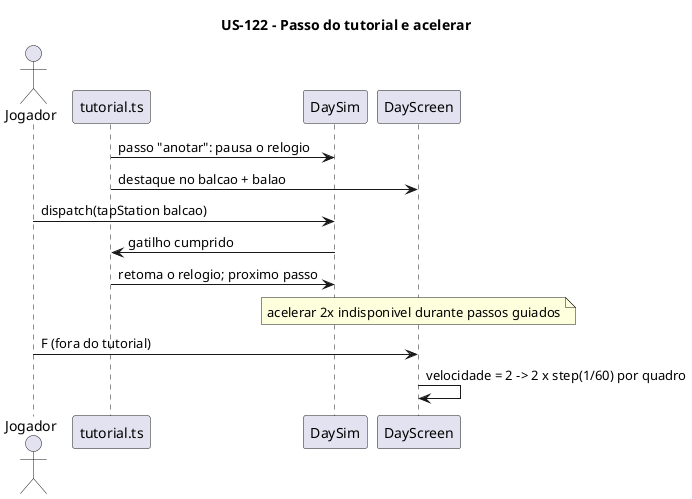

### Sequenciamento de Tarefas

| # | Tarefa | Escopo | Depende de |
|---|---|---|---|
| TF-122-01 | Tutorial do dia 1 e balões de desbloqueio | Experiência | US-120 |
| TF-122-02 | Som e música sintetizados com mudo separado | Áudio | US-110 |
| TF-122-03 | Acelerar 2× e atalhos de teclado | Controles | US-110 |

### Tarefas

#### TF-122-01: Tutorial do dia 1 e balões de desbloqueio

**User Story:** US-122 Experiência: tutorial, som, acelerar e atalhos
**Épico:** [INSERIR_ID_EPICO] Pastel de Feira
**Sistema:** sampa-challenges
**Prioridade:** P1

##### 1. Descrição e Objetivo

> **Eu como** jogador novo,
> **Eu quero** ser guiado no primeiro pedido e ver uma explicação curta de cada sistema novo,
> **Para que** eu aprenda o jogo sem ler manual (RN-170, RN-171, JA-11).

##### 2. Especificação Técnica

**2.1 Pontos de interceptação**
- `src/games/pastel-de-feira/game/tutorial.ts` — roteiro de passos (anotar → montar → colocar → tirar → caldo → entregar → cobrar) com gatilho por evento do snapshot e pausa do relógio.
- `src/games/pastel-de-feira/game/sim/day.ts` — pausa do relógio por tutorial (sem pausar a interação).
- `src/games/pastel-de-feira/game/render/alerts.ts` — destaque da estação e balão do passo.
- `src/games/pastel-de-feira/components/prep/PrepScreen.tsx` — balões de desbloqueio (`pastel-de-feira:visto`).
- `src/games/pastel-de-feira/sim/scenarios/tutorial.ts`.

**2.2 Dados:** `pastel-de-feira:visto` (lista de ids, `try/catch`).

**2.3 Contrato:** o tutorial só observa o snapshot e controla a pausa. Não injeta comandos.

**2.4 Resiliência e Zero Trust**

| Cenário | Estratégia | Impacto |
|---|---|---|
| Tutorial pulado | Sem roteiro; os balões valem | Spec, seção 4 |
| `visto` corrompido | Trata como vazio | Balões reaparecem |

##### 3. Modelagem Visual

Sequência da US-122.

##### 4. Orientação de Execução

**4.1 Contexto de entrada:** `spec.md` RN-170, RN-171; TF-110-10.

**4.2 Passos**
1. Roteiro.
2. Pausa do relógio.
3. Destaques.
4. Balões.
5. Cenário (tutorial completo por comandos).

**4.3 Validação:** comando padrão com `--scenario tutorial`, depois navegador numa campanha nova.

**4.4 Restrições negativas**
- NÃO bloquear o "Sair" durante o tutorial.

**4.5 Skills:** `test-driven-agentic-development`, `verification-before-completion`.

**4.6 Critérios de saída**
- [ ] O cenário do tutorial chega ao fim.
- [ ] Dia 1 jogável do começo ao fim com tutorial.

##### 5. Testes de Aceitação (DoD)

- [ ] O relógio fica parado durante o passo guiado.
- [ ] O balão do delivery aparece uma única vez no dia 5.

---

#### TF-122-02: Som e música sintetizados com mudo separado

**User Story:** US-122 Experiência: tutorial, som, acelerar e atalhos
**Épico:** [INSERIR_ID_EPICO] Pastel de Feira
**Sistema:** sampa-challenges
**Prioridade:** P1

##### 1. Descrição e Objetivo

> **Eu como** jogador,
> **Eu quero** efeitos e música de feira com mudos separados,
> **Para que** o jogo tenha som sem arquivos pesados (RN-172).

##### 2. Especificação Técnica

**2.1 Pontos de interceptação**
- `src/games/pastel-de-feira/game/sound.ts` — WebAudio no padrão do `fuga-rocam/game/sound.ts`: `unlock()` no primeiro gesto, efeitos por `snapshot.events` (fritura, ponto, queima, moedas, oferta, alarme, eventos), música em loop sintetizada, chaves `pastel-de-feira:som` e `pastel-de-feira:musica`.
- `src/games/pastel-de-feira/components/DayScreen.tsx` — botões de mudo e consumo dos eventos.
- `src/games/pastel-de-feira/components/PauseMenu.tsx` — controles de som e música.

**2.2 Dados:** 2 chaves `on`/`off`.

**2.3 Contrato:** `sfx.play(eventos)`, `sfx.setMuted(canal, bool)`.

**2.4 Resiliência e Zero Trust**

| Cenário | Estratégia | Impacto |
|---|---|---|
| `AudioContext` ausente | No-op | Sem som |
| Contexto suspenso | `resume()` no gesto | Som volta |

##### 3. Modelagem Visual

Não se aplica.

##### 4. Orientação de Execução

**4.1 Contexto de entrada:** `src/games/fuga-rocam/game/sound.ts`.

**4.2 Passos**
1. Motor de áudio.
2. Efeitos.
3. Música.
4. Mudos.
5. UI.

**4.3 Validação:** `npm run typecheck`, depois navegador (desktop e celular).

**4.4 Restrições negativas**
- NÃO adicionar arquivos de áudio.
- NÃO criar o `AudioContext` antes de um gesto.

**4.5 Skills:** `verification-before-completion`.

**4.6 Critérios de saída**
- [ ] Mudos persistem depois de recarregar.

##### 5. Testes de Aceitação (DoD)

- [ ] Música desligada com efeitos ligados funciona.
- [ ] Modo privado não quebra.

---

#### TF-122-03: Acelerar 2× e atalhos de teclado

**User Story:** US-122 Experiência: tutorial, som, acelerar e atalhos
**Épico:** [INSERIR_ID_EPICO] Pastel de Feira
**Sistema:** sampa-challenges
**Prioridade:** P1

##### 1. Descrição e Objetivo

> **Eu como** jogador de desktop,
> **Eu quero** acelerar o dia e jogar pelo teclado,
> **Para que** o ritmo e o controle sejam confortáveis (RN-173, RN-174).

##### 2. Especificação Técnica

**2.1 Pontos de interceptação**
- `src/games/pastel-de-feira/components/DayScreen.tsx` — velocidade 1×/2× no acumulador (2 passos por quadro), botão, indisponível no tutorial.
- `src/games/pastel-de-feira/game/input.ts` — teclado: números (estações na ordem da visão geral), Espaço/Enter (ação principal), Esc (recolher o painel), P (pausa), M (mudo), F (acelerar). Listeners no `useEffect` com cleanup.
- `src/games/pastel-de-feira/sim/scenarios/velocidade.ts` — 2× produz o mesmo `DayResult` que 1× com os mesmos comandos por passo.

**2.2 Dados:** nenhum.

**2.3 Contrato:** `setSpeed(1|2)` é comando de sessão (não afeta o determinismo por passo).

**2.4 Resiliência e Zero Trust**

| Cenário | Estratégia | Impacto |
|---|---|---|
| Tecla repetida (auto-repeat) | Ignorar `e.repeat` em ações de toque único | Sem ação dupla |
| Foco num input do Preparo | Atalhos só ativos no Dia de Feira | Sem conflito |

##### 3. Modelagem Visual

Sequência da US-122.

##### 4. Orientação de Execução

**4.1 Contexto de entrada:** `src/games/fuga-rocam/components/GameScreen.tsx` (teclado); `CLAUDE.md` raiz regra 4.

**4.2 Passos**
1. Velocidade.
2. Mapa de teclas.
3. Cleanup.
4. Cenário de equivalência.

**4.3 Validação:** comando padrão com `--scenario velocidade`, depois navegador.

**4.4 Restrições negativas**
- NÃO mudar o `STEP` para acelerar.

**4.5 Skills:** `test-driven-agentic-development`, `verification-before-completion`.

**4.6 Critérios de saída**
- [ ] O cenário de equivalência 1×/2× passa.
- [ ] Um dia jogável só pelo teclado.

##### 5. Testes de Aceitação (DoD)

- [ ] F alterna entre 1× e 2×.
- [ ] Esc recolhe o painel.
- [ ] Nenhum listener sobra depois de sair do jogo.

---

## US-123: Calibração, verificação e liberação no hub

**Épico:** [INSERIR_ID_EPICO] Pastel de Feira
**Sistema:** sampa-challenges
**Estimativa:** 5 Story Points
**Prioridade:** P0

### Narrativa de Valor

> **Eu como** mantenedor do hub,
> **Eu quero** os valores (P) calibrados por simulação, os critérios da spec comprovados, a documentação completa e o card fora de "Em obras",
> **Para que** o Pastel de Feira seja publicado equilibrado e sustentável.

### Contexto de Negócio

Fecha a entrega: determinismo comprovado (replay), robôs de calibração (`plan.md` 5.4), ajuste dos
valores, documentação (README e `CLAUDE.md` do jogo, regra 7 do `CLAUDE.md` raiz, PA-15) e checklist do hub.

### Critérios de Aceitação (Nível de Negócio)

- [ ] Todos os grupos de cenários passam (`--scenario all`).
- [ ] O replay com a mesma semente e os mesmos comandos dá hash idêntico.
- [ ] Os 4 robôs cumprem os critérios da spec em ≥ 80% das sementes.
- [ ] README e `CLAUDE.md` do jogo com a tabela de parâmetros final. `CLAUDE.md` raiz com a exceção de resolução.
- [ ] Checklist do hub verde. O card sai de "Em obras".

### Regras de Negócio Aplicáveis

| # | Regra | Tipo |
|---|---|---|
| Spec seção 5 | Critérios funcionais, desempenho e qualidade | Obrigatória |
| Todas as RN (P) | Valores calibrados | Obrigatória |

### Diagrama — C4 N2 da US (múltiplos containers)

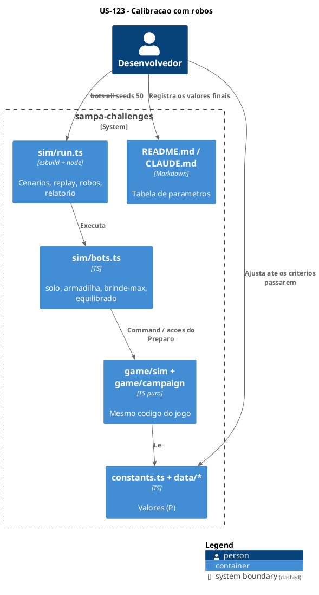

### Diagrama — Sequência da US

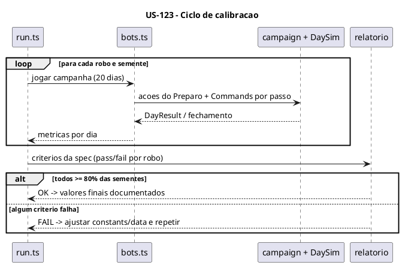

### Sequenciamento de Tarefas

| # | Tarefa | Escopo | Depende de |
|---|---|---|---|
| TF-123-01 | Replay de determinismo e cenário completo | Verificação | US-122 |
| TF-123-02 | Robôs de calibração, relatório e ajuste dos valores (P) | Equilíbrio | TF-123-01 |
| TF-123-03 | Documentação e liberação no hub | Documentação | TF-123-02, US-121 |

### Tarefas

#### TF-123-01: Replay de determinismo e cenário completo

**User Story:** US-123 Calibração, verificação e liberação no hub
**Épico:** [INSERIR_ID_EPICO] Pastel de Feira
**Sistema:** sampa-challenges
**Prioridade:** P0

##### 1. Descrição e Objetivo

> **Eu como** desenvolvedor,
> **Eu quero** gravar e reproduzir dias (`--replay`) e rodar todos os grupos de cenário,
> **Para que** o determinismo e todas as RN estejam comprovados (spec, seção 5).

##### 2. Especificação Técnica

**2.1 Pontos de interceptação**
- `src/games/pastel-de-feira/sim/run.ts` — `--replay <arquivo>` (config + semente + comandos por passo), hash do `DayResult`, `--scenario all`.
- `src/games/pastel-de-feira/game/sim/day.ts` — exportar o registro de comandos (`log`) em modo de depuração.
- `src/games/pastel-de-feira/sim/scenarios/replay.ts`.

**2.2 Dados:** arquivos de replay em JSON na pasta temporária (não versionados).

**2.3 Contrato (replay)**

```json
{ "config": "DayConfig serializado", "seed": 123, "comandos": [{ "passo": 10, "cmd": { "type": "tapStation", "station": "balcao" } }], "hash": "sha-1 do DayResult" }
```

**2.4 Resiliência e Zero Trust**

| Cenário | Estratégia | Impacto |
|---|---|---|
| Replay de versão antiga | Recusar com mensagem (versão no arquivo) | Sem falso positivo |

##### 3. Modelagem Visual

Sequência da US-123.

##### 4. Orientação de Execução

**4.1 Contexto de entrada:** `plan.md` 5.3; TF-110-03/04.

**4.2 Passos**
1. Log de comandos.
2. Replay.
3. Hash.
4. Grupo `all`.

**4.3 Validação:** comando padrão com `--scenario all`, depois `node "${TMPDIR:-/tmp}/pf-sim.mjs" --replay <arquivo>` duas vezes.

**4.4 Restrições negativas**
- NÃO versionar arquivos de replay.

**4.5 Skills:** `test-driven-agentic-development`, `verification-before-completion`.

**4.6 Critérios de saída**
- [ ] `--scenario all` com código 0.
- [ ] Hash idêntico em 2 execuções.

##### 5. Testes de Aceitação (DoD)

- [ ] O replay de um dia gravado no navegador reproduz o mesmo resultado no node.

---

#### TF-123-02: Robôs de calibração, relatório e ajuste dos valores (P)

**User Story:** US-123 Calibração, verificação e liberação no hub
**Épico:** [INSERIR_ID_EPICO] Pastel de Feira
**Sistema:** sampa-challenges
**Prioridade:** P0

##### 1. Descrição e Objetivo

> **Eu como** desenvolvedor,
> **Eu quero** robôs que joguem campanhas inteiras e um relatório contra os critérios da spec,
> **Para que** os valores (P) sejam ajustados com evidência (spec, seção 5; L9).

##### 2. Especificação Técnica

**2.1 Pontos de interceptação**
- `src/games/pastel-de-feira/sim/bots.ts` — `solo`, `armadilha`, `brinde-max`, `equilibrado` (`plan.md` 5.4), usando ações do Preparo e `Command`.
- `src/games/pastel-de-feira/sim/report.ts` — tabela por dia + JSON: lucro, meta, reputação, falhas por tipo, desperdício, ocupação de posições. Pass/fail por critério.
- `src/games/pastel-de-feira/game/constants.ts`, `src/games/pastel-de-feira/game/data/*.ts` — ajustes (meta, chegada, preços, tempos).

**2.2 Dados:** relatório em arquivo temporário. Os valores finais ficam no código e na documentação (TF-123-03).

**2.3 Contrato:** `run.ts --bots <nome|all> --seeds N --days 20`.

**2.4 Resiliência e Zero Trust**

| Cenário | Estratégia | Impacto |
|---|---|---|
| Critério que não converge | Registrar o trade-off e escalar ao utilizador antes de mudar regra | Decisão de negócio fica com o utilizador |

##### 3. Modelagem Visual

C4 N2 e sequência da US-123.

##### 4. Orientação de Execução

**4.1 Contexto de entrada:** `spec.md` seção 5; `plan.md` 5.4, 8.

**4.2 Passos**
1. Robôs.
2. Relatório.
3. Rodada inicial (50 sementes).
4. Ajustes nesta ordem: meta → chegada → preços → tempos.
5. Repetir até passar.

**4.3 Validação:** comando padrão trocando `--scenario <grupo>` por `--bots all --seeds 50`.

**4.4 Restrições negativas**
- NÃO alterar regras (RN) para passar no critério. Só valores (P).
- Mudança de regra = decisão do utilizador.

**4.5 Skills:** `verification-before-completion`, `systematic-debugging` (critério inesperado).

**4.6 Critérios de saída**
- [ ] Os 4 critérios passam em ≥ 80% das sementes.
- [ ] O relatório final é anexado ao PR.

**4.7 Decomposição Iterativa (mimic-loop)**

**Modo:** `mimic-loop` · **Máx. iterações:** 30 · **Saga:** `exec:sampa-challenges:TF-123-02`

| # | RT | Critério de conclusão | Depende de |
|---|---|---|---|
| RT-01 | Robôs + relatório | Relatório gerado para os 4 robôs | — |
| RT-02 | Piso (`solo`) | Dias 1–3 cumpridos em ≥ 80% | RT-01 |
| RT-03 | Armadilha | Reputação cai no dia 5 em ≥ 80% | RT-01 |
| RT-04 | Brinde-max | Reputação sobe e lucro < meta em ≥ 80% | RT-01 |
| RT-05 | Equilibrado | Campanha vencível e dia 20 não trivial | RT-02, RT-03, RT-04 |

##### 5. Testes de Aceitação (DoD)

- [ ] O relatório mostra pass nos 4 critérios.
- [ ] `--scenario all` continua passando depois dos ajustes.

---

#### TF-123-03: Documentação e liberação no hub

**User Story:** US-123 Calibração, verificação e liberação no hub
**Épico:** [INSERIR_ID_EPICO] Pastel de Feira
**Sistema:** sampa-challenges
**Prioridade:** P0

##### 1. Descrição e Objetivo

> **Eu como** mantenedor,
> **Eu quero** README e `CLAUDE.md` do jogo completos, a exceção registrada no `CLAUDE.md` raiz e o checklist do hub verde,
> **Para que** o jogo seja publicado e mantível (PA-15, checklist do `CLAUDE.md` raiz).

##### 2. Especificação Técnica

**2.1 Pontos de interceptação**
- `src/games/pastel-de-feira/README.md` — regras resumidas, controles, tabela de parâmetros final.
- `src/games/pastel-de-feira/CLAUDE.md` — mapa de arquivos, arquitetura (sim/campaign/render), "Visual em alta" 640×480, como verificar (comandos de cenário, replay e robôs), armadilhas.
- `CLAUDE.md` (raiz) — regra 7 com o Pastel de Feira (lógica e canvas 640×480 → 1280×960). Seção "IA e workers"/simulação, se aplicável.
- `src/games/pastel-de-feira/manifest.ts` — tirar "Em obras", descrição final, tags `['1 jogador', 'Gestão']`.

**2.2 Dados:** nenhum.

**2.3 Contrato:** `GameManifest` sem mudança de forma.

**2.4 Resiliência e Zero Trust**

| Cenário | Estratégia | Impacto |
|---|---|---|
| Documentação divergente do código | Tabela gerada a partir de `constants.ts`/`data` (conferência manual item a item) | Doc fiel |

##### 3. Modelagem Visual

Os diagramas do `plan.md` são referenciados no `CLAUDE.md` do jogo, em PlantUML (`regra-plantuml-diagrams`).

##### 4. Orientação de Execução

**4.1 Contexto de entrada:** `CLAUDE.md` raiz (checklist); `src/games/fuga-rocam/README.md` e `CLAUDE.md` (formato).

**4.2 Passos**
1. README.
2. `CLAUDE.md` do jogo.
3. `CLAUDE.md` raiz.
4. Manifest.
5. Checklist completo.

**4.3 Validação:** `npm run typecheck && npm run build` + comando padrão com `--scenario all`, depois checklist manual do hub (home, card, jogo, voltar, outros jogos, 390 px).

**4.4 Restrições negativas**
- NÃO alterar regras de outros jogos no `CLAUDE.md` raiz além da regra 7.

**4.5 Skills:** `verification-before-completion`, `finishing-a-development-branch`, `regra-plantuml-diagrams`.

**4.6 Critérios de saída**
- [ ] Todos os itens do checklist do `CLAUDE.md` raiz marcados com evidência.

##### 5. Testes de Aceitação (DoD)

- [ ] O card mostra "Pastel de Feira" sem "Em obras", com capa e recorde.
- [ ] Nenhum estilo vazou.
- [ ] Testado a ≈ 390 px.
- [ ] README/CLAUDE.md com os parâmetros finais.
